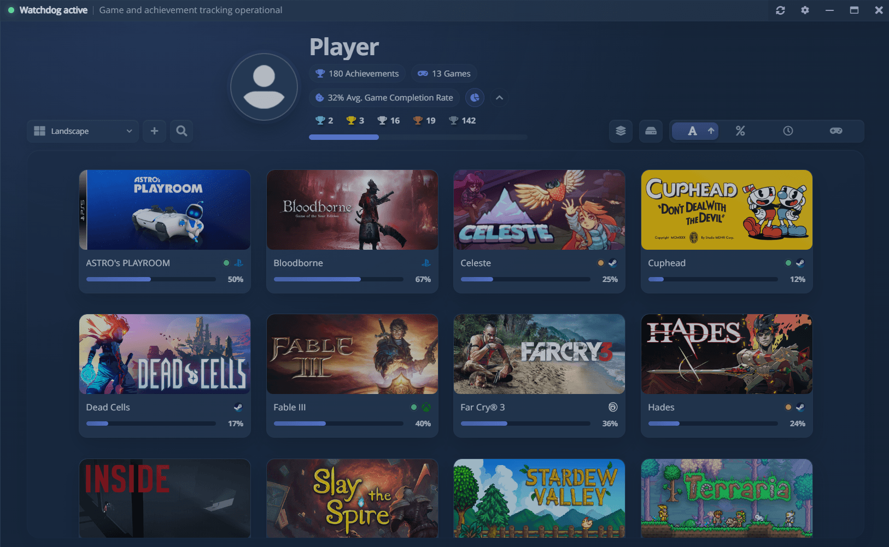
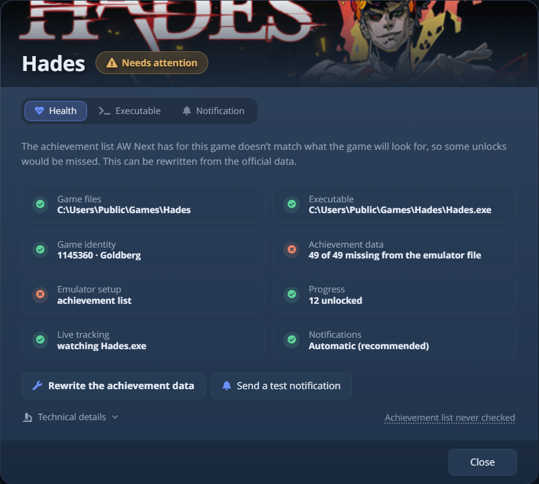

<picture>
  <source media="(prefers-color-scheme: dark)" srcset="docs/assets/img/readme-logo-dark.png">
  
</picture>

# Achievement Watcher Next

**An achievement tracker for Windows and Linux.**

AW Next reads achievements, rarity and playtime from Steam, GOG, Epic, Ubisoft, EA, Xbox, local
saves and console emulators, shows them in one library, and pops up each unlock while you play.

### [Download](https://github.com/Shirowwww/Achievement-Watcher-Next/releases/latest) &nbsp;·&nbsp; [Website](https://shirowwww.github.io/Achievement-Watcher-Next/) &nbsp;·&nbsp; [Docs](https://shirowwww.github.io/Achievement-Watcher-Next/README.html) &nbsp;·&nbsp; [Discord](https://discord.gg/DjTMrDsXTh)

[The same tour with sound](https://shirowwww.github.io/Achievement-Watcher-Next/#tour) · [Presets](https://shirowwww.github.io/Achievement-Watcher-Next/gallery/) · [Themes](https://shirowwww.github.io/Achievement-Watcher-Next/gallery/themes/) · [cs.rin thread](https://cs.rin.ru/forum/viewtopic.php?f=20&t=161187)

## What it does

<table>
<tr>
<td width="50%" valign="top">

**📚 One library** 
Every source in the same list, with rarity, progress achievements, covers and your own
collections. Trophy mode grades each achievement gold, silver or bronze, and a game that also
came out on PlayStation takes its real trophies and platinum.

</td>
<td width="50%" valign="top">

**🔔 Unlock popups** 
In Automatic mode, an unlock shows in game when it can be seen there, and as a desktop
notification otherwise. OBS can draw the same popup on your stream.

</td>
</tr>
<tr>
<td valign="top">

**🎨 Presets and themes** 
Ten popup presets and a designer that previews the real popup. Thirteen interface themes. Both
can be shared as one file, and Steam Achievement Notifier `.san` themes convert.

</td>
<td valign="top">

**🎮 In-game overlay** 
`Ctrl+Shift+K` opens the running game's achievement list, with search and filters. It works with
a gamepad too.

</td>
</tr>
<tr>
<td valign="top">

**📸 Screenshots and clips** 
A screenshot of each unlock (HDR works), and if you want, a short MP4 recorded by the graphics
card around the unlock.

</td>
<td valign="top">

**🩺 Game Health** 
Tells you whether a game is tracked and why not, and offers the repairs that apply to it. Every
repair backs up first.

</td>
</tr>
<tr>
<td valign="top">

**🐧 Linux** beta 
A native build that does not run through Wine. It follows games from Steam and Proton, Wine,
Lutris, Heroic and Bottles, and runs on the Steam Deck.

</td>
<td valign="top">

**🔒 Local first** 
No account to create and no Steam Web API key. The library works offline, and the sign-in
tokens it keeps are encrypted by Windows or your desktop keyring.

</td>
</tr>
</table>

<table>
<tr>
<td align="center"> Library</td>
<td align="center"> Game Health</td>
</tr>
<tr>
<td align="center" colspan="2">  Unlock popups, common and rare</td>
</tr>
</table>

28 interface languages · Simple and Advanced modes · full controller navigation · one-file profile backup ·
[how it compares to AW 2.x and Achievements](https://shirowwww.github.io/Achievement-Watcher-Next/comparison.html)

## Install

| | Windows 10 and 11 | Linux (x64, beta) |
|---|---|---|
| **Get** | `Achievement.Watcher.Setup.<version>.exe` or `Achievement.Watcher.Portable.<version>.zip` from the [latest release](https://github.com/Shirowwww/Achievement-Watcher-Next/releases/latest) | `Achievement.Watcher.<version>.AppImage`, same release |
| **Run** | Run the installer, or extract the ZIP | `chmod +x`, then run. Needs FUSE 2 (`libfuse2t64` on Ubuntu 24.04) |
| **Data** | `%APPDATA%\Achievement Watcher Next` | `~/.config/Achievement Watcher Next` |
| **Guide** | [Getting started](https://shirowwww.github.io/Achievement-Watcher-Next/getting-started.html) | [Linux and Steam Deck](https://shirowwww.github.io/Achievement-Watcher-Next/linux.html) |

Then follow the first-run guide, run **Settings → Folders → Smart Find**, and leave AW Next in the
tray. Updates are built in and download only what changed. Upgrading keeps your data, and an older
Achievement Watcher folder is imported without being modified.

## Supported sources

Steam, Steam-compatible saves, GOG Galaxy, Epic Games, Ubisoft Connect, EA Desktop, Xbox PC, console
emulators, RetroAchievements and a few more.

<b>What is read from each source</b>

 

| Source | What is read |
|---|---|
| **Steam** | Local state (private profiles too), achievement sets and DLC tags; optionally your other PCs and Steam Family games |
| **Steam-compatible saves** | Goldberg, GBE Fork, GreenLuma, LumaPlay, SmartSteamEmu, CreamAPI, Nemirtingas and similar |
| **GOG Galaxy** | Galaxy databases, legacy saves and UniverseLAN, with a one-click fix |
| **Epic Games** | Local installs, and owned games with their official state after an optional sign-in |
| **Ubisoft Connect** | Native data, legacy Uplay formats, Uplay R1 and R2 |
| **EA Desktop** | Achievement events from the local EA Desktop log |
| **Xbox PC** | Game Pass and Store installs, plus owned games and their Xbox Network state |
| **Console emulators** | RPCS3, ShadPS4, KytyPS5, Xenia, and Xbox 360 recompilations such as ReXGlue |
| **RetroAchievements** | Your emulator games, unlocks and rarity, announced live whatever the emulator |
| **More** | Games for Windows LIVE (XLiveLessNess), Dead Space 2 MarkerPatch, Alice: Madness Returns MadnessPatch |

Each source can be switched off on its own. More in [Compatible sources](https://shirowwww.github.io/Achievement-Watcher-Next/sources.html) ·
[Goldberg / GBE setup](https://shirowwww.github.io/Achievement-Watcher-Next/emulator-setup.html) ·
[Uplay R2 setup](https://shirowwww.github.io/Achievement-Watcher-Next/uplay-r2.html)

> [!WARNING]
> Reading achievements never changes anything. The emulator repair tools do modify game files,
> always after a confirmation and with a backup. Use them only with games you own.

## Documentation

<table align="center">
<tr><th>Start</th><th>Use</th><th>Fix a problem</th><th>Contribute</th></tr>
<tr valign="top">
<td><a href="https://shirowwww.github.io/Achievement-Watcher-Next/getting-started.html">Getting started</a> <a href="https://shirowwww.github.io/Achievement-Watcher-Next/sources.html">Sources</a> <a href="https://shirowwww.github.io/Achievement-Watcher-Next/notifications.html">Notifications</a> <a href="https://shirowwww.github.io/Achievement-Watcher-Next/presets.html">Presets</a></td>
<td><a href="https://shirowwww.github.io/Achievement-Watcher-Next/overlay.html">Overlay</a> <a href="https://shirowwww.github.io/Achievement-Watcher-Next/controller.html">Controller</a> <a href="https://shirowwww.github.io/Achievement-Watcher-Next/game-health.html">Game Health</a> <a href="https://shirowwww.github.io/Achievement-Watcher-Next/advanced.html">Advanced tools</a></td>
<td><a href="https://shirowwww.github.io/Achievement-Watcher-Next/troubleshooting.html">Troubleshooting</a> <a href="https://shirowwww.github.io/Achievement-Watcher-Next/faq.html">FAQ</a> <a href="https://shirowwww.github.io/Achievement-Watcher-Next/linux.html">Linux and Steam Deck</a> <a href="https://github.com/Shirowwww/Achievement-Watcher-Next/issues">Issues</a></td>
<td><a href="CONTRIBUTING.md">Contributing</a> <a href="BUILD.md">Build guide</a> <a href="https://shirowwww.github.io/Achievement-Watcher-Next/architecture.html">Architecture</a> <a href="https://shirowwww.github.io/Achievement-Watcher-Next/RELEASE_WORKFLOW.html">Release workflow</a></td>
</tr>
</table>

**Build from source:** Windows and Node.js `22.22.2+` or `24.15+`. `npm run build` in `app` writes the
installer, portable ZIP and updater files to `app\dist`; the AppImage is built on Linux with
`npm run build:linux`. Details in [BUILD.md](BUILD.md).

## Security and support

Ideas and bugs go to the [issue tracker](https://github.com/Shirowwww/Achievement-Watcher-Next/issues)
or the [cs.rin thread](https://cs.rin.ru/forum/viewtopic.php?f=20&t=161187), where releases are
announced. For questions, help and sharing presets, join the [Discord server](https://discord.gg/DjTMrDsXTh).
Report a vulnerability privately through the [security policy](SECURITY.md).

Download only from the [official releases](https://github.com/Shirowwww/Achievement-Watcher-Next/releases).
Each release can be checked on VirusTotal by its SHA-256
([3.12.2](https://www.virustotal.com/gui/file/960fcd46c228e46a908b7f870ffbf1fd1e703f58892388c4c1c35447e5dce03b)),
and the updater installs only an update signed by the project's pinned `CN=Shirow` certificate.
The project contains no game files and does not bypass online ownership checks.

<b>My antivirus flags the emulator files</b>

 

It is a false positive. The Steam emulator (GBE Fork) and the Ubisoft loaders stand in for a game's
Steam or Ubisoft library, and that is the behaviour detection engines look for. Both are
third-party and open source, and the bundled ones are checked against known SHA-256 digests before
any repair may use them. SmartScreen may also warn, because the self-signed certificate is not
issued by a public authority; you do not need to install or trust it.

None is written unless you ask: a repair you run, the Emulators tab, or automatic repair, which is
off by default and warns you first. Allow the file your antivirus named, or exclude
`%APPDATA%\Achievement Watcher Next\cache`; never switch protection off. Details in
[Troubleshooting](https://shirowwww.github.io/Achievement-Watcher-Next/troubleshooting.html#antivirus-or-smartscreen-warning)

<b>What to include in a bug report</b>

 

The app version, your Windows version (or Linux distribution and desktop), the affected source, and
the relevant files from `%APPDATA%\Achievement Watcher Next\logs` (`~/.config/Achievement Watcher Next/logs`
on Linux). The issue tracker cannot provide games, credentials or piracy support.

## Support the project

AW Next is free and stays free. If you would like to help, you can buy me a coffee:

## Credits and license

Created by [Xan105](https://github.com/xan105/Achievement-Watcher), continued by
[darktakayanagi](https://github.com/darktakayanagi/Achievement-Watcher), and maintained here by
Shirowwww and project contributors. Parts are derived from
[Achievements](https://github.com/PSerban93/Achievements) by JokerVerse (PSerban93), MIT License,
copyright (c) 2025 JokerVerse. Redistributions must keep the attribution in [NOTICE](NOTICE).

Licensed under [LGPL-3.0](LICENSE). Not affiliated with Valve, Sony, Microsoft, GOG, Epic Games,
Electronic Arts or Ubisoft.
