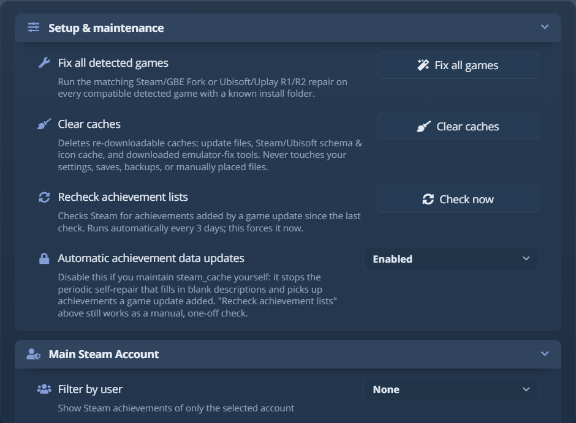
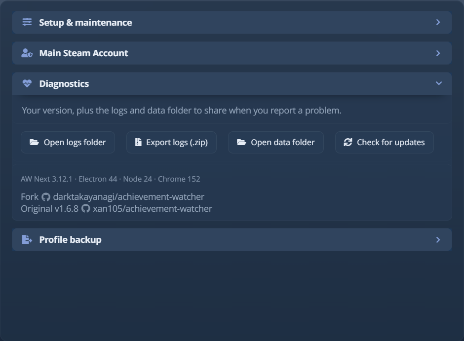
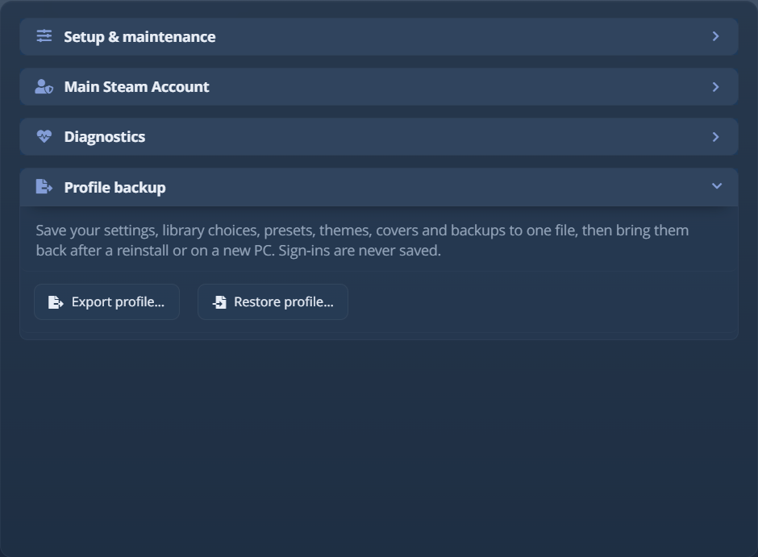
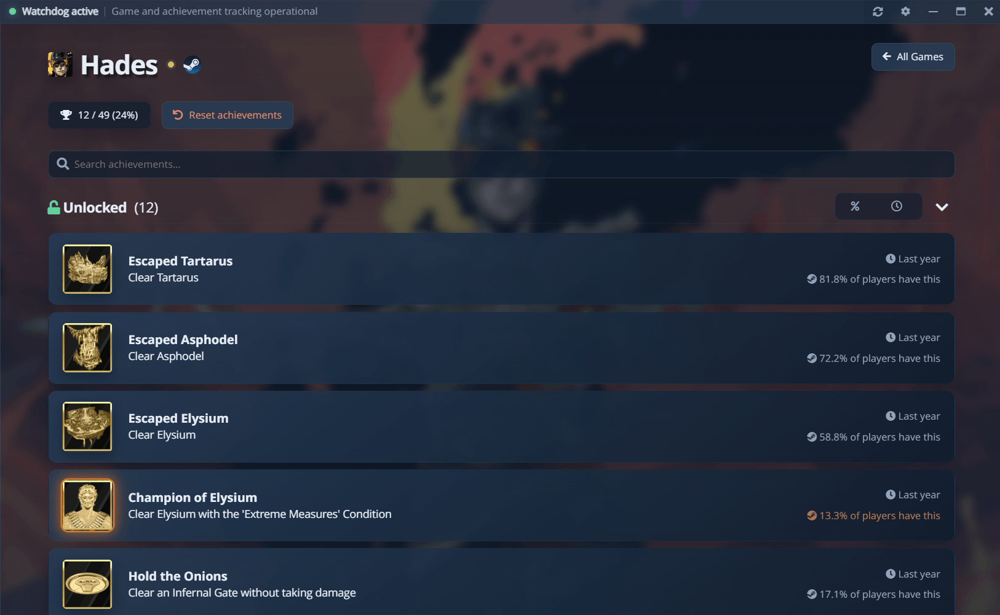

# Advanced tools

These tools are under **Settings → Advanced** or in a game's right-click menu. The Advanced tab
exists only while the interface is in **Advanced** mode: switch the **Interface** control at the top
of Settings if you do not see it. Nothing is lost by switching back.

<picture><source srcset="assets/shot/advanced-panel-800.webp 800w, assets/shot/advanced-panel.webp 940w" sizes="(max-width: 700px) 100vw, 720px"></picture> 
Setup &amp; maintenance; the other sections fold away below it

## Setup and maintenance

| Tool | What it does |
|---|---|
| **Fix all detected games** | Runs the matching repair (Steam/GBE Fork or Ubisoft/Uplay R2) over every compatible detected game with a known install folder. This rebuilds games that already have a setup. |
| **Disable hardware acceleration** | Turns off GPU acceleration when the window or overlay misbehaves. Needs a restart. |
| **Clear caches** | Deletes only re-downloadable caches: update files, the Steam/Ubisoft schema and icon cache, and downloaded emulator-fix tools. Settings, saves, backups and manually placed files are never touched. |
| **Recheck achievement lists** | Checks Steam for achievements added by a game update. This runs every 3 days; the button forces it now. |
| **Automatic achievement data updates** | On by default. Off stops that recheck and the blank-description repair, for anyone who maintains `steam_cache` by hand. **Recheck achievement lists** still works while it is off. |

Source-specific repair settings are under **Settings → Emulators**. **Ubisoft / Uplay R2** holds its
package health, DLL import/restore controls and targeted batch repair; loader and INI details stay
automatic.

**Clear caches** is the first thing to try when an update keeps failing on the same downloaded file.

## Diagnostics

<picture><source srcset="assets/shot/diagnostics-panel-800.webp 800w, assets/shot/diagnostics-panel.webp 940w" sizes="(max-width: 700px) 100vw, 720px"></picture> 
Versions, and one click to the logs and data folders

The Diagnostics card prints the app, Electron, Node and Chrome versions, and opens the logs folder,
the data folder or an update check. **Export logs (.zip)** bundles every log file into one archive
while the app runs; copying them by hand is unreliable because the processes writing them never stop.
Your user name and any key, token or password are masked in the archive, not in the logs on disk. See
[Troubleshooting](troubleshooting.md#open-logs-and-local-data) for what a bug report needs.

## Profile backup

<picture><source srcset="assets/shot/profile-backup-panel-800.webp 800w, assets/shot/profile-backup-panel.webp 940w" sizes="(max-width: 700px) 100vw, 720px"></picture> 
Export profile and Restore profile, under Settings → Advanced

**Export profile…** saves your settings, library choices, presets, themes, covers, custom backgrounds,
GBE restore points and playtime to one `.awbackup` file, for a reinstall or a new PC. Sign-ins,
caches and logs are never saved, so you sign in again to Epic, Steam, Xbox, PlayStation and
RetroAchievements afterwards. **Restore profile…** checks the whole file first and applies it at the
next start. The files it replaces are kept, and a failed restore puts everything back.

## AppID blacklist

A game removed from the library with **Blacklist** is listed here with the ID it was blacklisted
under, and can be restored one by one. Use the blacklist for a stray folder that the scan keeps
finding but that is not a game.

## Reset a game's achievements

**Reset achievements**, on the game's page beside the playtime or in its right-click menu, sends
every achievement back to locked so you can play the game through again. AW Next announces them as
new when they unlock.

<picture><source srcset="assets/shot/achievements-800.webp 800w, assets/shot/achievements.webp 1280w" sizes="(max-width: 700px) 100vw, 800px"></picture> 
Reset sits beside the completion count on the game's own page

Every file involved is backed up first to
`%APPDATA%\Achievement Watcher Next\backups\achievements\<appid>\<date>\`, and the confirmation lists
the exact files before anything is touched. A file whose backup fails is skipped, not cleared.

| Source | What a reset does |
|---|---|
| Steam emulators (Goldberg / GBE and compatible layouts, including Goldberg SocialClub and Uplay R2) | Removes the achievement save. The emulator writes a fresh one at the next unlock. |
| RPCS3 | Removes `TROPUSR.DAT`. The trophy list (`TROPCONF.SFM`) is left alone. |
| ShadPS4 | Relocks the trophies inside `TROP*.XML`, which also holds the trophy list, so the file is edited, not removed. |
| KytyPS5 | Removes the game's `trophies_*.json` unlock files. The trophy list stays in the game's own package. |
| Xenia | Clears the earned flag inside the `.gpd`, which also holds the achievement list, so the file is edited. |
| Steam, GOG Galaxy, Ubisoft Connect, EA, Epic, Xbox | **Not possible.** These keep unlocks on your account and re-synchronise them; only the account can clear them. AW Next says so. |

Progress counters stored beside the achievements (`stats.ini`, `stats.bin`, …) are reset and backed up
too: for a "travel 1000 km" achievement the counter is the progress, and leaving it full would make
the achievement fire at once or never again.

**Restore an achievement backup**, in the same right-click menu, puts a whole reset back. Refresh the
library afterwards to read the restored unlocks.

> [!NOTE]
> A reset also clears AW Next's own record of what was already unlocked, including in the running
> background tracker. Otherwise a re-earned achievement would never be announced again.

## Forget a game

**Forget this game...**, in the right-click menu, clears everything AW Next keeps about a game: its
achievement saves (backed up first, as a reset does), play time, cached achievement list and icons,
per-game settings, and the emulator configuration AW Next wrote into its folder. The confirmation
lists each part first. The next scan finds the game again as a new one. **Remove from list** only
hides a game.

## Renaming a game

**Game settings → Rename…**, in the right-click menu, sets the name a game is shown under: on its
tile and screen, in search and sorting, in notifications, and in the folders screenshots and clips
are saved to. Search still finds the game by its original name. Leave the field empty, or pick
**Restore the original name**, to go back. The name is kept per game in `cfg/gameTitles.json`, so it
survives rescans and is part of a profile backup. Cover lookups and game matching use the original
name.

**Settings → General → Game titles in my language**, on by default, shows Steam games under the
title Steam gives them in your achievement language (the game's own language when it has one).
Covers follow the same language. Steam's local catalogue answers for games your Steam client knows;
the rest are asked once, in batches, and checked again after a month. A name you set yourself always
wins.

## Editing a game's playtime

**Achievements & playtime → Edit playtime…**, in the right-click menu, replaces a game's total
playtime, for example one carried over from another tracker or one that missed sessions. Type hours
(`12.5`) or hours and minutes (`12h30` or `12:30`). The date of the last session is kept, and AW Next
adds later sessions to the new total. A game you own on Steam never goes below the playtime Steam
reports: the next scan raises a lower total back to Steam's.

## A different achievement language for one game

**Game settings → Achievement language**, in the right-click menu, shows one game's achievements and
notifications in another language than the rest of the library. **Same as the app** goes back to the
global choice.

## Add a game manually

The `+` beside the library search adds a game from a title and an executable, with an optional
platform and Steam AppID. Use it for a game no source detects: a standalone build, a portable
install, or an emulator you launch yourself.

A manually added game:

- is launchable and tracks playtime like any other entry;
- shows **No achievements** if it has none, and is left out of completion statistics instead of
  counting as 0%;
- can adopt a Steam achievement schema later by adding the AppID, without being recreated;
- keeps guarded per-game diagnostics, while destructive actions stay hidden.

Manually added folders carry a compact icon in the Folders list, to tell them from the locations
Smart Find discovered.

## Set a game's AppID by hand

Right-click a game whose folder name matches several Steam releases, so the automatic match picked
the wrong one, and choose **Set AppID manually...**. The choice is remembered per install folder and
written to `steam_appid.txt`; **Clear the manual AppID override** undoes it. Game Health's **Correct
the game ID file** also asks for the AppID, starting from AW Next's own suggestion.

## Mark an achievement as unlocked

An achievement a source cannot see (earned before you set tracking up, or never recorded by an
emulator) can be marked from its right-click menu with **Mark as manually unlocked**. **Clear manual
unlock** undoes it. Manual unlocks persist across scans and are cleared by a reset.

## Emulator and repair tools

Diagnosis and repair for Goldberg / GBE Fork setups, the GBE runtime installer, Steamless and the
opt-in API-check bypass are in **Settings → Emulators** and in each game's **Emulator & tools**
submenu. Their guides:

- [Goldberg / GBE setup](emulator-setup.md) - diagnose and repair an emulated Steam game
- [Uplay setup, R1 and R2](uplay-r2.md) - the Ubisoft equivalent
- [Goldberg / GBE reference](goldberg-gbe.md) - file formats and detection rules

**Remove AW Next's emulator configuration**, in the same menu, undoes only the DLC section, switches
and identity keys AW Next wrote to a game's `configs.user.ini`, never a value you or the repack set,
and deletes the file only when nothing else is left in it. It shows exactly what it will remove
first, which is the only way to recover if you never backed up that file.

**Apply the GOG achievement fix (UniverseLAN)...** appears on a GOG game that ships a Galaxy dll. It
installs the UniverseLAN build matching that game's Galaxy SDK, keeps the original dll as a backup and
never overwrites existing UniverseLAN saves. The unlocks it writes under `%LOCALAPPDATA%\UniverseLAN`
are read and notified like any other.

If a repair swapped in the supported emulator, **Undo the emulator switch** in
[Game Health](game-health.md#the-repairs) puts the crack's own files back.

> [!WARNING]
> Repairs create backups, but they still modify game files. Use them only with games you own.

---

**Next:** [FAQ](faq.md) - short answers to the questions that come up most.

[← Documentation](README.md) · [Troubleshooting](troubleshooting.md) · [Project home](https://github.com/Shirowwww/Achievement-Watcher-Next)

