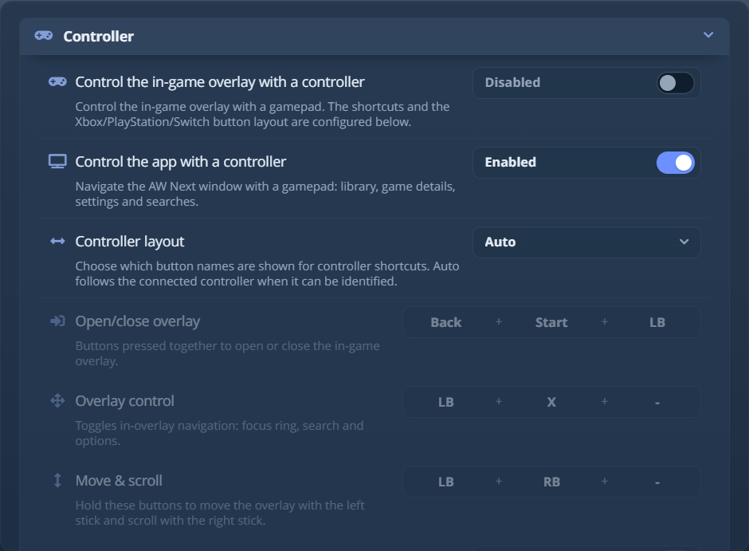
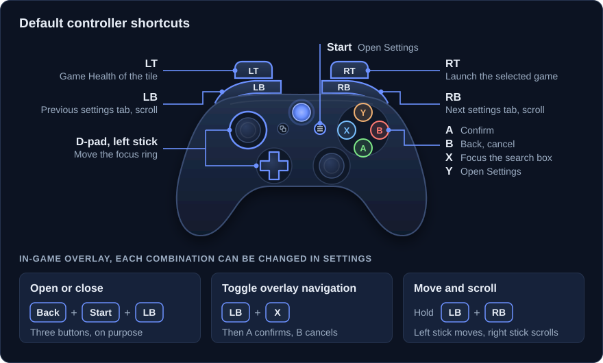

# Controller (gamepad) guide

A gamepad can drive two separate places: the main window and the in-game overlay. Both are set up in
**Settings → Controller**.

<picture><source srcset="assets/shot/controller-panel-800.webp 800w, assets/shot/controller-panel.webp 940w" sizes="(max-width: 700px) 100vw, 720px"></picture> 
Overlay and app navigation, layout, and per-shortcut button bindings

## The two switches

| Setting | Default | What it covers |
|---|---|---|
| **Control the app with a controller** | On | The main AW Next window: library, game details, settings and searches. |
| **Control the in-game overlay with a controller** | Off | The in-game overlay, driven by the background tracker while you play. |

App navigation is plain window input and costs nothing, so it is on by default. Overlay control loads
the native controller stack in the background tracker, so it is opt-in.

## Shortcuts at a glance

Button names use the Xbox vocabulary; the app shows them in the layout you select.

| Shortcut | Default | Where |
|---|---|---|
| Open / close the overlay | **Back + Start + LB** | In game |
| Toggle overlay navigation | **LB + X** | Overlay open |
| Move & scroll the overlay | **LB + RB** (held) | Overlay open |
| Confirm | **A** | App + overlay |
| Back / cancel | **B** | App + overlay |
| Focus the search box | **X** | App + overlay |
| Open Settings / overlay options | **Y** | App + overlay |
| Open Settings | **Start** | App |
| Launch the selected game | **RT** | App, library |
| Open Game Health for the selected game | **LT** | App, library |
| Previous / next settings tab | **LB** / **RB** | App, Settings open |
| Scroll the page | **LB** / **RB** | App, Settings closed |

The overlay toggle uses three buttons so it cannot fire by accident mid-game. Every overlay shortcut
is configurable and takes one to three buttons.

In the library, the stick moves between tiles and **A** opens the game, like a click. The two
controls painted on a tile sit on the triggers: **RT** launches the selected game and **LT** opens
its Game Health panel. Both do nothing unless a library tile is selected.

## Options

- **Controller layout**: the vocabulary for hints and button names. **Auto** follows the connected pad
  when it can be identified; the others are **Xbox**, **PlayStation** and **Switch**.
- **Controller backend**: **Auto** picks the best available input backend, **XInput** is the most
  compatible, and **GameInput** suits newer Windows builds.
- **Bindings**: one to three buttons per shortcut. Shortcuts may share a button (the defaults do:
  **LB + X** and **LB + RB** both use LB), and the input layer makes sure holding one combo does not
  fire the other. A button repeated inside one binding counts once. The overlay toggle also accepts
  the **Guide** button; the two overlay modes do not, because the browser gamepad API that reads
  them does not report it reliably.
- **Focus overlay when it opens**: gives the overlay keyboard focus, which pauses many games that
  lose focus. Off by default.
- **Send Escape to the game when opening with controller**: sends an Escape key press to the focused
  game just before the overlay opens, so many games pause or open their menu. It runs only for
  controller-triggered opens while a game is running, never for the keyboard hotkey. Off by default.

## App window

With app navigation on, pressing any gamepad button in the main window raises a focus ring. The
D-pad or left stick moves between controls, and the shortcuts above apply. Two details:

- **B** first leaves a focused text field, then goes back or cancels, so you can leave the search
  box without the mouse.
- **LB** / **RB** switch settings tabs while Settings is open and scroll the page when it is closed.

Moving the mouse or pressing a keyboard key returns control to the mouse and keyboard.

## In-game overlay

**Back + Start + LB** opens or closes the overlay over the running game. **LB + X** then toggles
navigation mode: the D-pad or left stick moves the focus ring, **A** confirms, **B** cancels, **X**
focuses the search and **Y** opens the options panel. Holding **LB + RB** moves the overlay with the
left stick and scrolls the list with the right stick.

A small **UI** badge shows in the header while navigation is active, and the hint bar shows your own
bindings and layout. The rest of the overlay is in the [overlay guide](overlay.md).

> [!IMPORTANT]
> Windows does not let a third-party app capture a controller exclusively, so the game may still
> receive button input while the overlay is open. To make the game pause, enable **Focus overlay
> when it opens** (most games pause when they lose focus) or **Send Escape to the game when opening
> with controller**.

## Supported pads

Xbox controllers, PlayStation DualShock 4 / DualSense and Switch Pro controllers are supported. Xbox
pads go through XInput; PlayStation and Switch pads are read over raw HID, so they need no vendor
driver.

## When a controller is not detected

1. Confirm the right switch is on: app navigation and overlay control are separate.
2. Try the **XInput** backend explicitly; **Auto** can pick GameInput on a build where a given pad is
   not enumerated.
3. Check the pad in the Windows game-controller panel (`joy.cpl`). If Windows does not see it, AW Next
   cannot either.
4. For a bug report, add `debugLogging = true` to the `[controller]` section of
   `%APPDATA%\Achievement Watcher Next\cfg\options.ini` and restart. The background tracker then logs
   button-level diagnostics. There is no UI switch because the output is verbose; turn it off
   afterwards.

---

**Next:** [Game Health](game-health.md) - the per-game panel that says why a game is or is not being
tracked.

[← Documentation](README.md) · [Overlay guide](overlay.md) · [Project home](https://github.com/Shirowwww/Achievement-Watcher-Next)

## On Linux

On Linux AW Next reads gamepads from the kernel's input devices, and the shortcuts above work the same
way. While Steam Input runs, it reads only Steam's virtual pads, so one press is not counted twice. The
Steam Deck and the Decky plugin are covered in [Linux and the Steam Deck](linux.md#steam-deck).