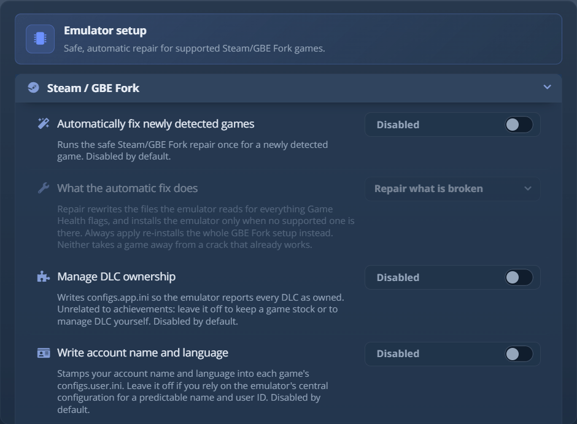
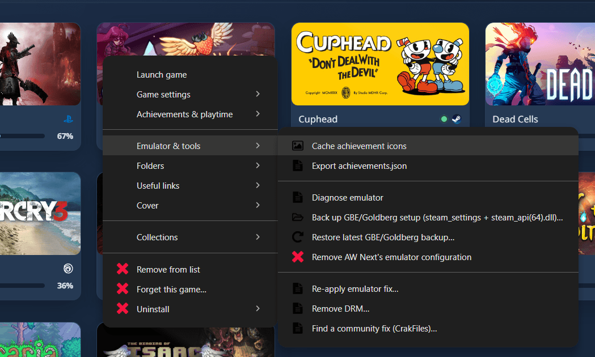

# Goldberg and GBE Fork setup

AW Next reads the achievement saves that Goldberg, GBE Fork and compatible Steam-emulator layouts
produce. It can also diagnose and repair a game's local emulator configuration when the schema, the
AppID or the runtime files are incomplete.

> [!WARNING]
> The repair tools are optional. They modify files inside the selected game folder, so use them only
> with games you own, and keep any extra backup you care about.

## Schema and save files are different

Two unrelated files are commonly named `achievements.json`:

| | Schema file | Runtime save file |
|---|---|---|
| Typical location | `<game>\steam_settings\achievements.json` | `%APPDATA%\GSE Saves\<appid>\achievements.json` or `%APPDATA%\Goldberg SteamEmu Saves\<appid>\achievements.json` |
| Written by | The game or emulator setup | The emulator while the game runs |
| Purpose | Names, descriptions and icons of the achievements | Which achievements have unlocked |
| When missing | In-game achievement handling may be incomplete; AW Next can use another schema source | The game shows 0% until the first unlock is written |

A schema file does not prove anything has unlocked, and a runtime save with no earned entry is a valid
0%. Both save folders can exist for one game: AW Next reads whichever holds the unlocks. If a GBE or
Goldberg config redirects saves elsewhere (`local_save_path`), AW Next watches the folder where they
land.

## Recommended workflow

1. Add the game library or save root under **Settings → Folders**.
2. Run **Smart Find** or **Generate configs**.
3. If the game shows missing data, right-click it and choose **Diagnose emulator**.
4. Read the report before applying a repair.
5. Use **Apply emulator fix** to install the runtime DLL and repair `steam_settings` together.
6. Launch the game, unlock an achievement, and refresh AW Next if needed.

Automatic setup for newly discovered games is opt-in under **Settings → Emulators → Steam / GBE
Fork**. With it off, a library scan writes nothing into a game folder (no DLL, no configuration file,
not even a missing `achievements.json`) until you ask for a repair.

<picture><source srcset="assets/shot/steam-gbe-panel-800.webp 800w, assets/shot/steam-gbe-panel.webp 940w" sizes="(max-width: 700px) 100vw, 720px"></picture> 
Automatic repair, the DLC and identity switches, and the opt-in SteamStub unpacker

## Context-menu actions

<picture><source srcset="assets/shot/emulator-tools-800.webp 800w, assets/shot/emulator-tools.webp 1049w" sizes="(max-width: 700px) 100vw, 560px"></picture> 
Right-click a game → Emulator &amp; tools

### Diagnose emulator

Reports the detected emulator type, AppID, `steam_settings` location, schema and save counts, missing
entries or icons, custom save paths and AppID mismatches, and whether the installed runtime is the one
AW Next put there. Diagnosis is read-only.

### Apply emulator fix

Repairs the runtime DLL and the schema in one step:

- downloads and caches a matching GBE Fork release and installs the DLL architecture the game needs
  (`steam_api.dll` or `steam_api64.dll`), keeping any existing file as a backup;
- builds `steam_settings\achievements.json` (and its `images` folder) to match the Steam achievement
  list, and downloads the icons;
- writes `steam_appid.txt` when it is missing;
- writes the GBE configuration files (`configs.app.ini`, `configs.main.ini`, `configs.user.ini`).

Every file it replaces is backed up first, and schema repairs also keep timestamped copies under
`steam_settings\.aw-backups`. The runtime is installed as a normal DLL replacement; AW Next does not
configure a separate ColdClient launcher.

Packaged Unreal Engine builds are repaired the same way. Their Steam files live under
`Engine\Binaries\ThirdParty\Steamworks` rather than beside the executable, and AW Next finds, installs
and checks them there.

### DLC ownership and account identity

Two switches in **Settings → Emulators → Steam / GBE Fork**, both off by default and independent of
automatic repair:

| Setting | What it writes |
|---|---|
| **Manage DLC ownership** | `configs.app.ini`, so the emulator reports every DLC as owned |
| **Write account name and language** | Your account name and language, in `configs.user.ini` |

Neither affects achievements. Leave them off to keep a game stock, or if you manage DLC or identity by
hand.

The **Emulator identity** card below them shows what gets written:

| Field | What it does |
|---|---|
| **Account name** | Written while **Write account name and language** is on. Empty uses your AW Next profile name. |
| **Steam ID** | Written while that switch is on; empty keeps each game's own. The dice button makes a random valid one, and a typo is flagged as you type and never written. |
| **Save folder** | Applies as soon as you choose one: every game fixed or repaired from then on saves there (`local_save_path`), and AW Next watches it for live notifications. Empty keeps `%APPDATA%\GSE Saves`. |

To undo what either switch wrote, right-click a game and choose **Remove AW Next's emulator
configuration**. It shows exactly what it will remove before doing anything. It removes only the DLC
section, switches and identity keys AW Next added, keeps every value you or the repack set, and deletes
a file only when nothing else is left in it.

### Using your own emulator DLL

**Settings → Emulators → Emulator DLL** imports your own `steam_api.dll` or `steam_api64.dll` and
installs it instead of the downloaded GBE Fork build, on every fix and every automatic fix. The
architecture you do not import still comes from the official build, as do the interface tools.

An imported file is re-validated on every use: it must be a real PE of the architecture its name
claims, and it must be a Steam emulator DLL. A file that fails is reported and ignored, never
installed. **Use the official build** removes the import and returns to the downloaded release.

### Remove Steam DRM (Steamless)

Tries to unpack SteamStub from the selected executable when a DLL replacement cannot load. The original
executable is kept as `*.steamstub.bak`. It does nothing for games without SteamStub and does not
bypass server-side ownership checks.

### Back up and restore

Right-click **Back up GBE/Goldberg setup** to snapshot the current DLL and `steam_settings` files, or
**Restore latest GBE/Goldberg backup** to bring one back. A backup notes when the folder already held
configuration AW Next had written, so it is never mistaken for the untouched original.

## Set AppID manually

When a game's folder name matches several Steam releases and the automatic match picked the wrong one,
right-click it and choose **Set AppID manually**. The AppID is written to `steam_appid.txt` and
remembered for that install folder, so later repairs use it instead of guessing again. **Clear the
manual AppID override**, in the same menu, removes it.

## Common problems

### The game is missing

- Start the emulator once so it creates a runtime save, or add the real game library so discovery can
  find `steam_settings`, `steam_appid.txt` or the Steam API DLL.
- Check that the folder added in Settings is high enough to contain the game folder, but not a whole
  drive of unrelated data.
- Run **Generate configs** and review the result count.

### Every achievement remains locked

Check these causes in order:

1. **Nothing has unlocked yet.** An absent or empty runtime save is expected.
2. **Schema names do not match the save keys.** Run **Diagnose emulator**, then repair the schema.
3. **The save path is customized.** Point AW Next at the actual save root or remove the placeholder
   override.
4. **The AppID is wrong.** Use **Set AppID manually** before running another repair.

### Descriptions or icons are missing

Run a full repair with icon download enabled. When online metadata is unavailable, AW Next can reuse a
valid local schema, but it cannot invent descriptions that no source has.

### In-game notifications are missing but the library updates

AW Next reads the runtime save, but the game's own emulator schema or overlay may be incomplete. Check
that `steam_settings\achievements.json` has the same API names as the runtime save and valid icon
paths.

## Limitations

Some games do not report achievements through Steamworks at all, even when sold on Steam, and cannot
be tracked through a Goldberg or GBE save path. AW Next also cannot repair a game whose real identity
or achievement schema it cannot resolve safely.

The [technical Goldberg/GBE reference](goldberg-gbe.md) covers file formats, detection rules and
implementation details.

---

**Next:** [Uplay setup, R1 and R2](uplay-r2.md), the Ubisoft equivalent for games that do not load
`steam_api.dll`.

[← Documentation](README.md) · [Technical reference](goldberg-gbe.md) · [Project home](https://github.com/Shirowwww/Achievement-Watcher-Next)

