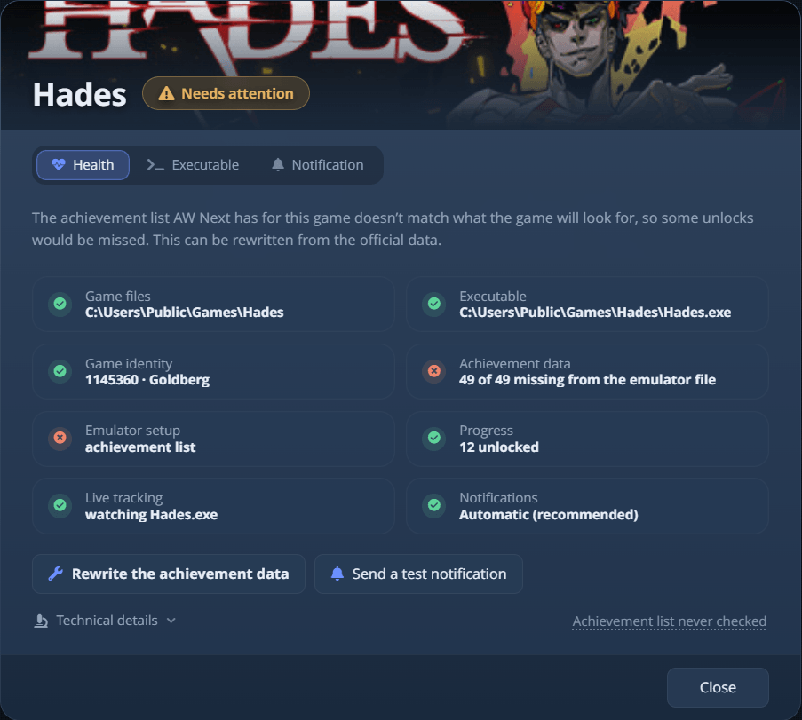

# Game Health

Cuando un juego falla, abre primero su panel **Game Health**. Dice si AW Next puede ver el
juego, leer sus logros y anunciar sus desbloqueos, y ofrece solo las reparaciones que se aplican.

Ábrelo con el botón de **herramientas** de la esquina superior derecha de un recuadro de juego, o desde el menú de clic derecho
del juego. El panel tiene tres pestañas: **Estado**, **Ejecutable**, que fija el programa que se vigila mientras
juegas, y **Notificación**, donde el juego puede tener su propio preset de popup, posición,
sonido y escala (consulta [Comportamiento por juego](notifications.md#per-game-behavior)).

<picture><source srcset="../assets/shot/game-health-800.webp 800w, ../assets/shot/game-health.webp 903w" sizes="(max-width: 700px) 100vw, 620px"></picture> 
Un estado, su motivo, las comprobaciones que lo respaldan y las reparaciones que se aplican

## Los estados {#the-states}

| Estado | Qué significa |
|---|---|
| **Listo** | El juego está detectado, sus datos de logros están disponibles y AW Next lo vigila para detectar desbloqueos. |
| **Requiere atención** | El juego funciona, pero parte de su configuración está incompleta. Las comprobaciones muestran cuál. |
| **Sin seguimiento** | Falta algo esencial, así que no se puede registrar ningún desbloqueo: el juego no se puede localizar, no tiene datos de logros o le falta el emulador que escribe sus desbloqueos. |
| **Solo tiempo de juego** | Un juego añadido a mano: AW Next conoce su lista de logros y cuenta su tiempo de juego, pero nada en este PC registra todavía sus desbloqueos (ni emulador, ni partida guardada, ni cuenta de tienda). Gris, porque nada está roto, y también lo está el punto de la tarjeta del juego; configura una fuente y el estado cambia. |

La frase bajo el estado da la causa, las comprobaciones muestran qué parte falla y un botón de reparación actúa
exactamente sobre eso.

- El modo **Simple** expresa los resultados con palabras sencillas (*Datos de logros encontrados*, *Se detecta al arrancar el juego*).
  **Avanzado** añade recuentos exactos, el proceso vigilado y el canal de notificación.
- Los **Detalles técnicos**, al final en ambos modos, contienen cada valor en bruto. Pulsa **Copiar** para un informe
  de error. Un valor largo se desplaza al pasar el ratón.

A los juegos de emuladores de consola no se les pide un ejecutable de Windows ni archivos del juego.

Algunos juegos no registran nada sin conexión, sea cual sea la configuración. En Halo: Campaign Evolved y The Crew
Motorfest los logros los concede el servidor del editor, así que un crack no guarda ninguno. Su
panel lo dice desde el primer inicio.

## Las comprobaciones {#the-checks}

| Comprobación | A qué responde | Arreglo habitual |
|---|---|---|
| **Archivos del juego** | ¿Sigue ahí la carpeta de instalación? | **Localizar el juego** |
| **Ejecutable** | ¿Qué programa hay que vigilar mientras juegas? | **Localizar el juego** |
| **Identidad del juego** | ¿Con qué AppID y plataforma se emparejó este juego? El modo Simple la omite. | **Corregir el archivo de identificación del juego** o **Definir el AppID manualmente** |
| **Datos de logros** | ¿Hay una lista de logros, está completa y están al día sus definiciones de progreso y de estadísticas? | **Reescribir los datos de logros** |
| **Configuración del emulador** | ¿Tiene un juego que necesita un emulador de Steam alguno, y cuál lo atiende? Los ajustes de los que el emulador puede prescindir aparecen aquí como notas, no como problemas. En un juego de Ubisoft esto abarca también el cargador de Uplay y si alguna vez pidió un logro. | **Instalar el archivo del emulador**, **Cambiar al emulador compatible**, **Completar los ajustes del emulador** o **Reparar los logros de Ubisoft** |
| **Progreso** | ¿Se ha encontrado ya algún desbloqueo o partida guardada? | Inicia el juego y desbloquea algo |
| **Contadores de progreso** | En los juegos al estilo CODEX/RUNE que rastrean una estadística en lugar de un desbloqueo simple, ¿ha obtenido AW Next la estadística que hay tras cada logro? Se muestra solo para los juegos que usan una. | **Obtener contadores de progreso** |
| **Detección del inicio del juego** | ¿Nota el rastreador en segundo plano cuándo arranca este juego y vigila el ejecutable definido para él? Por sí solo no registra ningún desbloqueo: eso es trabajo del emulador. | **Vigilar este juego** |
| **Notificaciones** | ¿Qué canal entregó la última notificación de este juego y por qué? | **Enviar una notificación de prueba** |

## Las reparaciones {#the-repairs}

El panel muestra solo las reparaciones que pueden arreglar este juego. Cada una dice qué va a cambiar y dónde se
guardan los archivos anteriores. No se reescribe nada sin copia de seguridad o confirmación, y una reparación que falla a medias restituye cada archivo que había cambiado; el error indica qué se restauró.

| Reparación | Qué hace |
|---|---|
| **Localizar el juego** | Abre un selector para elegir el ejecutable que se vigilará. |
| **Abrir la carpeta del juego** | Abre la carpeta de instalación en el Explorador. |
| **Reescribir los datos de logros** | Cambia solo `achievements.json`, `stats.json` y los iconos que faltan, nada más. Una lista completa se deja como está; las entradas que añade siguen el formato, los idiomas y la carpeta de iconos del propio archivo. Las definiciones de progreso y de estadísticas salen de generate_emu_config cuando **Datos de steam_settings** está en Avanzado con un inicio de sesión de Steam guardado, y si no de la lista pública games-infos-datas; la confirmación dice cuál. Cada archivo cambiado se copia antes a `.aw-backups` dentro de `steam_settings`. |
| **Completar los ajustes del emulador** | Añade solo los archivos de ajustes que le faltan a un juego (`steam_appid.txt`, `configs.main.ini`, `configs.user.ini` y `configs.app.ini` cuando [Gestionar la propiedad de los DLC](../goldberg-gbe.md) está activado). Lo que ya dan los ajustes globales del emulador se deja en sus manos, y la lista de logros no se toca. La cuenta propia de un juego en `configs.user.ini` solo se reemplaza cuando **Escribir nombre de cuenta e idioma** está activado y aceptas cuando se te pregunta. |
| **Instalar el archivo del emulador** | Descarga la versión compatible del emulador en la carpeta del juego y conserva el archivo que sustituye como `.bak`. |
| **Cambiar al emulador compatible** | Para un juego atendido por otro crack que no registró nada: instala encima el emulador compatible, renombra a `.bak` la configuración de ese crack y escribe en el mismo paso los `steam_settings` del emulador (ID del juego y lista de logros), de modo que el juego se pueda lanzar justo después. Necesita el AppID de Steam del juego; si alguna parte falla, se devuelven todos los archivos. Los iconos que falten se pueden añadir después con **Reescribir los datos de logros**. |
| **Deshacer el cambio de emulador** | Aparece allí donde se ejecutó una de las dos anteriores. Devuelve los archivos propios del juego desde sus copias `.bak` y quita el emulador compatible. |
| **Deshacer la última reparación** | Aparece tras cualquier cambio que AW Next haya hecho en la carpeta del juego: una reparación de este panel, un arreglo de emulador, CrakFiles, Quitar DRM de Steam (Steamless), Restaurar la última copia de seguridad de GBE/Goldberg, Definir el AppID manualmente, una reparación de Uplay o uno de los botones de deshacer anteriores. Primero lista cada archivo que va a devolver. Si un archivo está en uso (a menudo porque el juego se está ejecutando), no se cambia nada y la entrada queda para otro intento. |
| **Corregir el archivo de identificación del juego** | Reescribe `steam_appid.txt` cuando el emulador anuncia un juego y AW Next emparejó otro. Pide el AppID correcto, sugiriendo la coincidencia de AW Next, y conserva el archivo anterior. |
| **Obtener contadores de progreso** | Pregunta a Steam qué estadística impulsa cada logro, para juegos al estilo CODEX/RUNE. No escribe nada en la carpeta del juego. |
| **Reparar los logros de Ubisoft** | En un juego de Ubisoft compatible, reescribe la configuración del cargador, el esquema y la redirección de partidas en una sola transacción, con copia de seguridad de cada archivo tocado. Consulta [Configuración de Uplay](uplay-r2.md). |
| **Activar los logros sin conexión** | Para un juego de Ubisoft cuyo registro del cargador demuestra que nunca pidió un logro porque cree que no ha iniciado sesión. Añade una clave de sesión de relleno al INI junto al juego; púlsalo de nuevo para quitarla. Consulta [Configuración de Uplay](uplay-r2.md#a-game-that-never-asks-for-an-achievement). |
| **Vigilar este juego** | Añade el juego al rastreador en segundo plano para que se registren el tiempo de juego y los desbloqueos en directo, siguiendo el ejecutable definido en la pestaña **Ejecutable**. |
| **Reactivar notificaciones de progreso** | Vuelve a activar las notificaciones de progreso de un juego que habías silenciado. |
| **Enviar una notificación de prueba** | Lanza una notificación con el nombre y el arte de este juego, por el canal que usaría de verdad. |

> [!IMPORTANT]
> Una discrepancia no siempre es culpa del emulador: si se configuró a propósito para el ID que hay en el disco,
> déjalo como está. **Definir el AppID manualmente** (clic derecho) arregla para siempre una discrepancia en el nombre de la carpeta en lugar
> de corregir el archivo cada vez. Consulta [Configuración de Goldberg / GBE](emulator-setup.md#set-appid-manually).

## Estados habituales y qué hacer {#common-states-and-what-to-do}

| El panel dice | Qué suele significar |
|---|---|
| *No se encontró ninguna lista de logros* | El juego no tiene logros, o su fuente está desactivada. Revisa **Ajustes → Fuentes**. |
| *Este juego necesita un emulador de Steam y no hay ninguno configurado* | Usa **Aplicar arreglo de emulador** en el menú de clic derecho. Consulta [Configuración de Goldberg / GBE](emulator-setup.md). |
| *Falta el archivo del emulador que la lee* | **Instalar el archivo del emulador** pone el entorno de ejecución correspondiente. |
| *ColdClient sirve este juego, pero…* | `ColdClientLoader.ini`, junto al loader, arranca un archivo que falta u otro programa, nombra otro juego o no tiene loader para los 32 o 64 bits del juego. Corrige ese archivo; AW Next solo lo lee. Cuando esté bien, **Iniciar mediante el loader ColdClient** hace que Jugar arranque el loader. |
| *El emulador de Epic aún tiene el AppID de ejemplo* | `NemirtingasEpicEmu.json` contiene el AppID formado por ceros, o el propio archivo EOSSDK de Epic sigue en su sitio, así que el emulador nunca se carga. Pon el id de Epic del juego en el archivo. |
| *La lista de logros no coincide con lo que buscará el juego* | **Reescribir los datos de logros**. Es el resultado habitual de una actualización de un repack. |
| *Aún no se ha encontrado progreso de logros* | Normal en un juego al que no has jugado desde que lo configuraste. Inícialo y desbloquea algo. |
| *AW Next no vigila este juego mientras se ejecuta* | **Vigilar este juego** lo añade al rastreador. |
| *No se pudo enviar la última notificación* | Envía una notificación de prueba y consulta después [Notificaciones](notifications.md#if-a-test-or-unlock-does-not-appear). |
| *Windows ocultó la última notificación durante el juego* | Fue directamente al Centro de notificaciones porque el juego estaba a pantalla completa o No molestar estaba activado. Activa las [Notificaciones prioritarias](notifications.md#priority-windows-notifications), o usa Automático u Overlay en el juego. |
| *Funcionando - respaldo de Windows activo* | No es un fallo. La entrega Automática eligió una notificación de Windows para este juego; consulta [cómo decide Automático](notifications.md#how-automatic-decides). |
| *El juego nunca ha pedido un logro* | Lee su sesión vacía de Ubisoft como sin iniciar sesión. **Activar los logros sin conexión** lo desbloquea; no se envía nada a ninguna parte. Inicia el juego una vez después. |
| *Logros sin conexión activados, abre el juego una vez* | El ajuste está escrito y todavía no se ha juzgado nada. El botón de al lado dice ahora **Desactivar los logros sin conexión**. |
| *Gestionado por ALI213, OnlineFix, GBE Fork…* | El emulador que realmente lee ese juego, nombrado a partir de sus propios archivos. A un juego de Ubisoft atendido así no se le ofrece una reparación de Uplay: su capa de Uplay está sin usar, no rota. Esto abarca las versiones que conservan el `steam_api64.dll` de Valve: una compilación de RUNE que se ejecuta desde `Steam\steamclient64.dll`, o una versión de VOICES38 que carga su propio GBE Fork renombrado (`steam_api64.v38`); no instales nunca el emulador sobre esta última. Se reconocen las compilaciones de Ubisoft de online-fix, y allí una corrección de logros avisa de que el juego en línea puede dejar de funcionar. |
| *Solo faltan algunos iconos* | **Reescribir los datos de logros** descarga los iconos que faltan. |
| *Faltan definiciones de progreso o de estadísticas, o están desactualizadas* | Los logros con contador no avanzarían o mostrarían un objetivo equivocado. **Reescribir los datos de logros** las actualiza. |
| *Ajustes opcionales sin escribir* | Una nota, no un fallo: el emulador funciona sin ellos (un ticket de aplicación, un token de GC, el interruptor de estadísticas desconocidas, un nombre de cuenta). **Completar los ajustes del emulador** los añade si quieres. |
| *El nombre de cuenta o el idioma vienen de … `GSE Saves\settings`* | Una línea informativa, no una advertencia. GBE lee `GSE Saves\settings\configs.user.ini` (o los ajustes de la carpeta de guardado a la que apunta `local_save_path`) cuando el juego no tiene los suyos. Nada que arreglar. |
| *Vigilando X, no Y* | El ejecutable definido para este juego no es el que sigue el rastreador, así que pueden perderse inicios y tiempo de juego. **Vigilar este juego** sigue el elegido. *Vigilando X, iniciado por Y* está bien: Y es un lanzador, como un arrancador de antitrampas, que inicia el juego. |
| *Ninguna fuente de logros configurada* | Se muestra con **Solo tiempo de juego**. Aplica un arreglo de emulador o añade la carpeta donde el juego guarda sus logros. |
| *Más de una hora de juego y ni un solo logro registrado* | Lo más probable es que el crack que atiende el juego nunca informe de logros. Usa **Cambiar al emulador compatible** cuando se ofrezca; si no, comprueba que el juego arranca desde su propia carpeta. |
| *Archivo de identificación del juego*, con un acceso directo de Steam a este juego | Steam inicia un acceso directo que no es de Steam sin `steam_appid.txt` al lado, así que el emulador guarda con otro ID. **Completar los ajustes del emulador** escribe allí el archivo. |

---

**Siguiente:** [Solución de problemas](troubleshooting.md) - para los problemas que Game Health no resuelve por sí solo.

[← Documentación](README.md) · [Página del proyecto](https://github.com/Shirowwww/Achievement-Watcher-Next)

