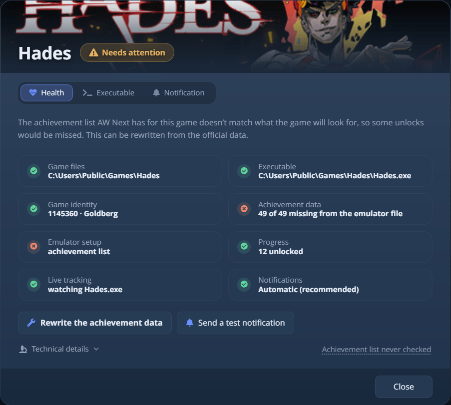

# Game Health

Quand un jeu se comporte mal, ouvrez d'abord son panneau **Game Health**. Il dit si AW Next peut voir le
jeu, lire ses succès et annoncer ses déblocages, et ne propose que les réparations qui s'appliquent.

Ouvrez-le avec le bouton **outils** dans le coin supérieur droit d'une tuile de jeu, ou depuis le menu du clic droit du jeu.
Le panneau a trois onglets : **État**, **Exécutable**, qui définit le programme à surveiller pendant que vous
jouez, et **Notification**, où le jeu peut avoir son propre preset de popup, sa position, son
son et son échelle (voir [Comportement par jeu](notifications.md#per-game-behavior)).

<picture><source srcset="../assets/shot/game-health-800.webp 800w, ../assets/shot/game-health.webp 903w" sizes="(max-width: 700px) 100vw, 620px"></picture> 
Un état, sa cause, les contrôles qui le justifient et les réparations qui s'appliquent

## Les trois états {#the-three-states}

| État | Ce que cela signifie |
|---|---|
| **Prêt** | Le jeu est détecté, ses données de succès sont disponibles et AW Next surveille ses déblocages. |
| **À vérifier** | Le jeu fonctionne, mais une partie de sa configuration est incomplète. Les contrôles montrent laquelle. |
| **Non suivi** | Il manque quelque chose d'essentiel, donc aucun déblocage ne peut être enregistré : le jeu est introuvable, il n'a aucune donnée de succès, ou il lui manque l'émulateur qui écrit ses déblocages. |

La phrase sous l'état donne la cause, les contrôles montrent quelle partie est en cause, et un bouton de réparation agit
exactement dessus.

- Le mode **Simple** énonce les résultats en mots simples (*Données de succès trouvées*, *Détecté au démarrage du jeu*).
  Le mode **Avancé** ajoute les totaux exacts, le processus surveillé et le canal de notification.
- Les **Détails techniques**, en bas dans les deux modes, contiennent chaque valeur brute. Appuyez sur **Copier** pour un rapport
  de bug. Une longue valeur défile au survol.

On ne demande pas d'exécutable Windows ni de fichiers de jeu aux jeux d'émulateurs de console.

Certains jeux n'enregistrent rien hors ligne, quelle que soit la configuration. Les succès de Halo: Campaign Evolved et de The Crew
Motorfest sont attribués par les serveurs de l'éditeur, donc un crack n'en enregistre aucun. Leur
panneau le dit dès le premier lancement.

## Les contrôles {#the-checks}

| Contrôle | Question à laquelle il répond | Correction habituelle |
|---|---|---|
| **Fichiers du jeu** | Le dossier d'installation est-il toujours là ? | **Localiser le jeu** |
| **Exécutable** | Quel programme faut-il surveiller pendant que vous jouez ? | **Localiser le jeu** |
| **Identité du jeu** | À quel AppID et à quelle plateforme ce jeu a-t-il été associé ? Le mode Simple l'omet. | **Corriger le fichier d'identification** ou **Définir l'AppID manuellement** |
| **Données de succès** | Y a-t-il une liste de succès, et est-elle complète ? | **Réécrire les données de succès** |
| **Configuration émulateur** | Un jeu qui a besoin d'un émulateur Steam en a-t-il un, et lequel le sert ? Pour un jeu Ubisoft, cela couvre aussi le chargeur Uplay et s'il a déjà demandé un succès. | **Installer le fichier d'émulateur**, **Passer à l'émulateur pris en charge**, ou **Réparer la prise en charge des succès Ubisoft** |
| **Progression** | A-t-on déjà trouvé un déblocage ou une sauvegarde ? | Lancez le jeu et débloquez quelque chose |
| **Compteurs de progression** | Pour les jeux de type CODEX/RUNE qui suivent une statistique plutôt qu'un déblocage simple, AW Next a-t-il récupéré la statistique derrière chaque succès ? Affiché seulement pour les jeux qui en utilisent une. | **Récupérer les compteurs de progression** |
| **Détection du lancement** | Le suiveur en arrière-plan remarque-t-il le démarrage de ce jeu ? En soi, il n'enregistre aucun déblocage : c'est le travail de l'émulateur. | **Surveiller ce jeu** |
| **Notifications** | Quel canal a diffusé la dernière notification de ce jeu, et pourquoi ? | **Envoyer une notification de test** |

## Les réparations {#the-repairs}

Le panneau ne montre que les réparations qui peuvent corriger ce jeu. Chacune dit ce qu'elle va modifier et où les
fichiers précédents sont conservés. Rien n'est réécrit sans sauvegarde ni confirmation.

| Réparation | Ce qu'elle fait |
|---|---|
| **Localiser le jeu** | Ouvre un sélecteur pour choisir l'exécutable à surveiller. |
| **Ouvrir le dossier du jeu** | Ouvre le dossier d'installation dans l'Explorateur. |
| **Réécrire les données de succès** | Écrit la liste des succès, les icônes et les réglages de l'émulateur, en copiant d'abord les fichiers existants dans une sauvegarde. |
| **Installer le fichier d'émulateur** | Télécharge la version de l'émulateur prise en charge dans le dossier du jeu, en gardant le fichier remplacé sous le nom `.bak`. |
| **Passer à l'émulateur pris en charge** | Pour un jeu servi par un autre crack qui n'a rien enregistré : installe par-dessus l'émulateur pris en charge et renomme en `.bak` la configuration de ce crack. |
| **Annuler le changement d'émulateur** | Apparaît partout où l'une des deux réparations ci-dessus a été exécutée. Remet les fichiers propres du jeu à partir de leurs copies `.bak` et retire l'émulateur pris en charge. |
| **Corriger le fichier d'identification** | Réécrit `steam_appid.txt` quand l'émulateur annonce un jeu et qu'AW Next en a reconnu un autre. Elle demande le bon AppID, en suggérant la correspondance d'AW Next, et conserve le fichier précédent. |
| **Récupérer les compteurs de progression** | Demande à Steam quelle statistique pilote chaque succès, pour les jeux de type CODEX/RUNE. N'écrit rien dans le dossier du jeu. |
| **Réparer la prise en charge des succès Ubisoft** | Pour un jeu Ubisoft compatible, réécrit la configuration du chargeur, le schéma et la redirection des sauvegardes en une seule transaction, chaque fichier touché étant sauvegardé. Voir [Configuration d'Uplay](uplay-r2.md). |
| **Activer les succès hors connexion** | Pour un jeu Ubisoft dont le journal du chargeur prouve qu'il n'a jamais demandé de succès parce qu'il se croit déconnecté. Ajoute une clé de session factice à l'INI à côté du jeu ; appuyez de nouveau pour la retirer. Voir [Configuration d'Uplay](uplay-r2.md#a-game-that-never-asks-for-an-achievement). |
| **Surveiller ce jeu** | Ajoute le jeu au suiveur en arrière-plan pour que le temps de jeu et les déblocages en direct soient enregistrés. |
| **Réactiver les notifications de progression** | Réactive les notifications de progression d'un jeu que vous aviez coupé. |
| **Envoyer une notification de test** | Envoie une notification avec le nom et l'illustration de ce jeu, par le canal qu'elle emprunterait réellement. |

> [!IMPORTANT]
> Une différence n'est pas toujours la faute de l'émulateur : s'il a été configuré exprès pour l'ID présent sur le disque,
> laissez-le tel quel. **Définir l'AppID manuellement** (clic droit) corrige définitivement une différence de nom de dossier au lieu
> de corriger le fichier à chaque fois. Voir [Configuration Goldberg / GBE](emulator-setup.md#set-appid-manually).

## États courants et quoi faire {#common-states-and-what-to-do}

| Le panneau indique | Ce que cela signifie en général |
|---|---|
| *Aucune liste de succès n'a été trouvée* | Le jeu n'a pas de succès, ou sa source est désactivée. Vérifiez **Paramètres → Sources**. |
| *Ce jeu a besoin d'un émulateur Steam et aucun n'est installé* | Utilisez **Appliquer le fix émulateur** dans le menu du clic droit. Voir [Configuration Goldberg / GBE](emulator-setup.md). |
| *Le fichier d'émulateur qui la lit est absent* | **Installer le fichier d'émulateur** remet en place l'environnement d'exécution correspondant. |
| *La liste de succès ne correspond pas à ce que le jeu va chercher* | **Réécrire les données de succès**. C'est le résultat habituel d'une mise à jour de repack. |
| *Aucune progression de succès n'a encore été trouvée* | Normal pour un jeu auquel vous n'avez pas joué depuis sa configuration. Lancez-le et débloquez quelque chose. |
| *AW Next ne surveille pas ce jeu pendant qu'il tourne* | **Surveiller ce jeu** l'ajoute au suiveur. |
| *La dernière notification n'a pas pu être envoyée* | Envoyez une notification de test, puis voir [Notifications](notifications.md#if-a-test-or-unlock-does-not-appear). |
| *Windows a masqué la dernière notification pendant le jeu* | Elle est allée directement au Centre de notifications parce que le jeu était en plein écran ou que Ne pas déranger était activé. Activez les [Notifications prioritaires](notifications.md#priority-windows-notifications), ou utilisez Automatique ou Overlay en jeu. |
| *Fonctionnel - repli Windows actif* | Ce n'est pas une panne. La diffusion Automatique a choisi une notification Windows pour ce jeu ; voir [comment Automatique décide](notifications.md#how-automatic-decides). |
| *Le jeu n'a jamais demandé de succès* | Il lit sa session Ubisoft vide comme une déconnexion. **Activer les succès hors connexion** le débloque ; rien n'est envoyé nulle part. Lancez ensuite le jeu une fois. |
| *Succès hors connexion activés, lancez le jeu une fois* | Le réglage est écrit et rien n'a encore été jugé. Le bouton à côté indique maintenant **Désactiver les succès hors connexion**. |
| *Pris en charge par ALI213, OnlineFix, GBE Fork…* | L'émulateur qui lit réellement ce jeu, nommé d'après ses propres fichiers. Un jeu Ubisoft servi ainsi ne se voit pas proposer de réparation Uplay : sa couche Uplay est inutilisée, pas cassée. Cela couvre les versions qui gardent le `steam_api64.dll` de Valve : une version RUNE lancée depuis `Steam\steamclient64.dll`, ou une version VOICES38 qui charge son propre GBE Fork renommé (`steam_api64.v38`) ; n'installez jamais l'émulateur par-dessus ce dernier. Les versions Ubisoft d'online-fix sont reconnues, et une correction des succès avertit alors que le jeu en ligne peut s'arrêter. |
| *Il ne manque que quelques icônes* | **Réécrire les données de succès** télécharge les icônes manquantes. |
| *Plus d'une heure de jeu et pas un seul succès enregistré* | Le crack qui sert le jeu ne rapporte très probablement jamais de succès. Utilisez **Passer à l'émulateur pris en charge** s'il est proposé ; sinon vérifiez que le jeu démarre depuis son propre dossier. |
| *Fichier d'identification*, avec un raccourci Steam vers ce jeu | Steam lance un raccourci hors Steam sans `steam_appid.txt` à côté, donc l'émulateur enregistre sous un autre ID. **Réécrire les données de succès** y écrit le fichier. |

---

**Suite :** [Dépannage](troubleshooting.md) - pour les problèmes que Game Health ne résout pas tout seul.

[← Documentation](README.md) · [Accueil du projet](https://github.com/Shirowwww/Achievement-Watcher-Next)

