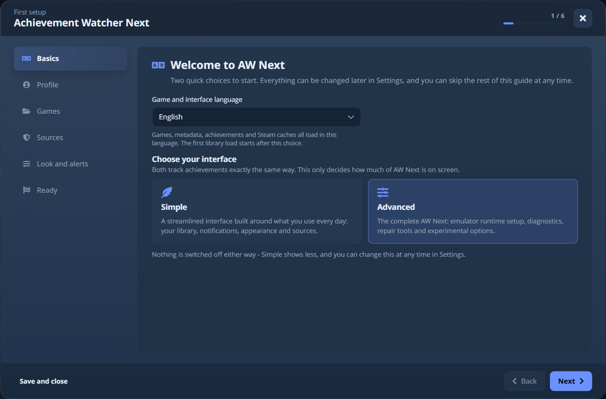
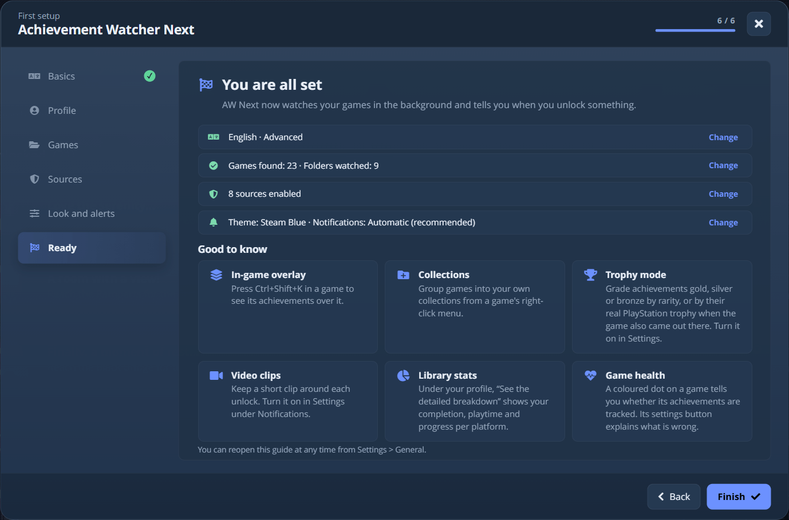
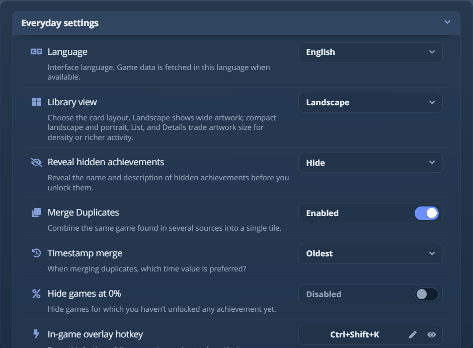
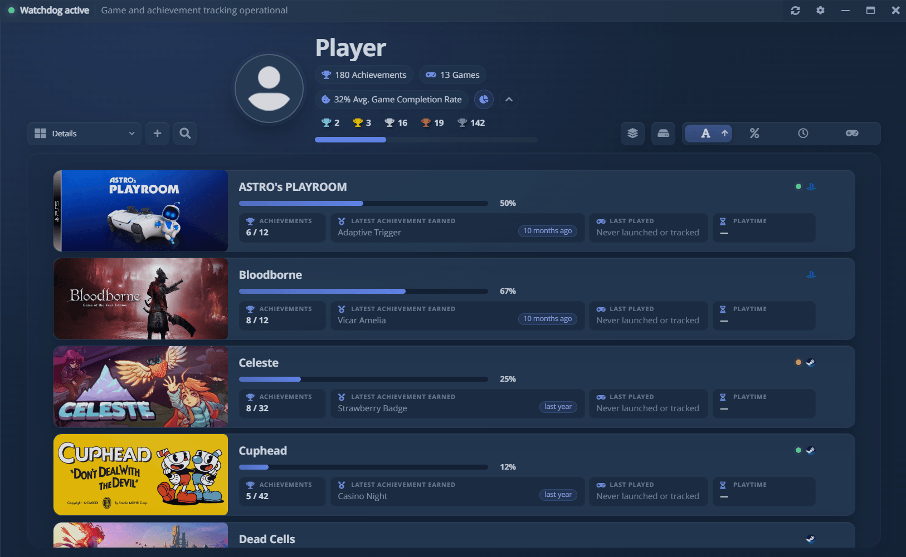
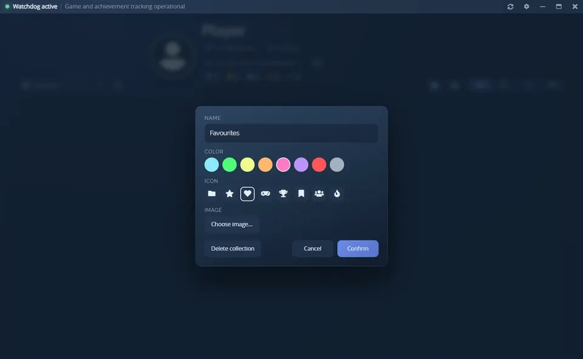
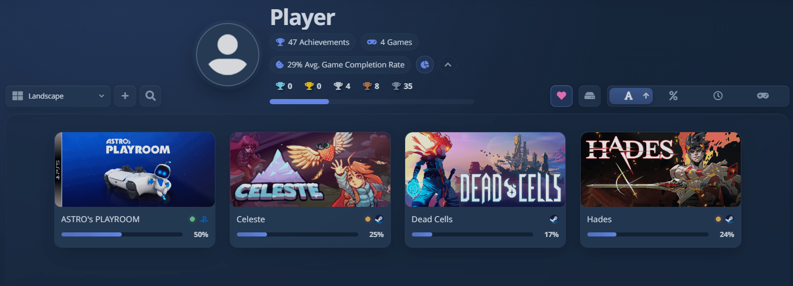
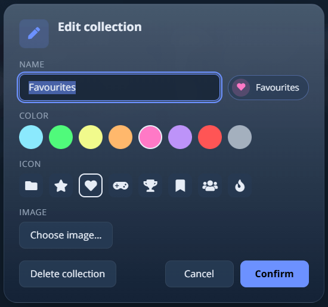
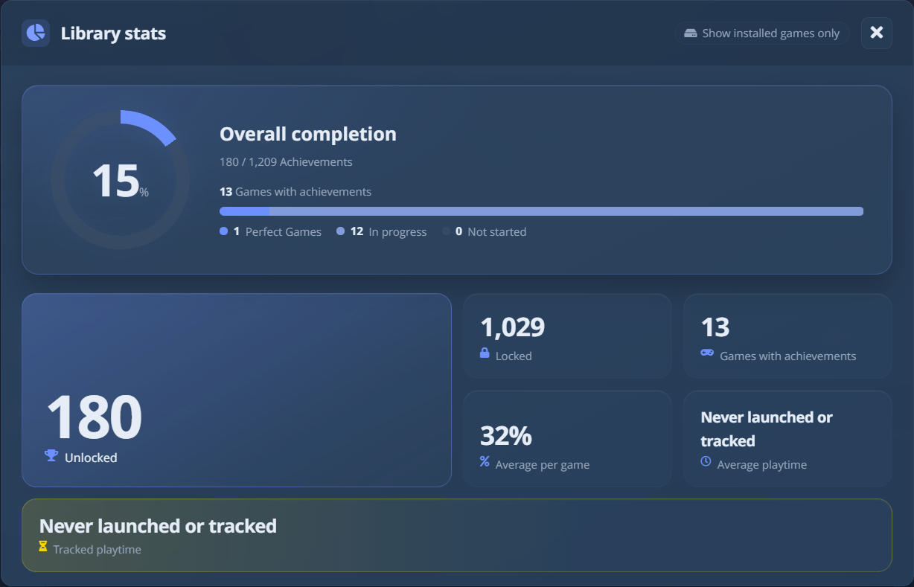
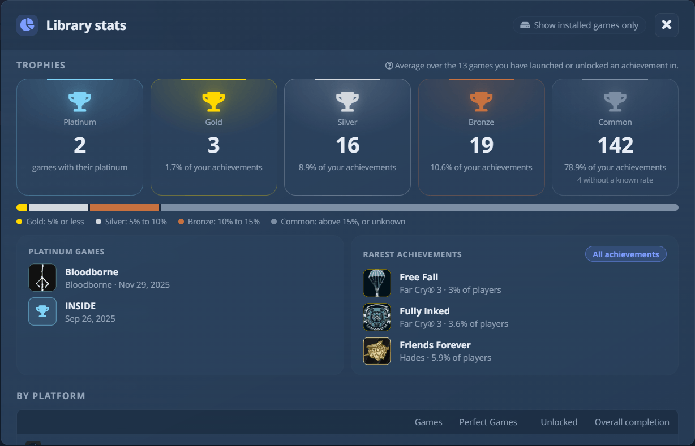

# Getting started

AW Next is a desktop app for Windows and Linux. Releases include their own runtime, so Node.js is
needed only to build from source. On Linux, install the AppImage as [Linux and the Steam Deck](linux.md)
describes, then come back: everything below applies, with `~/.config/Achievement Watcher Next` in place
of `%APPDATA%\Achievement Watcher Next`.

## Install

| | Windows 10 and 11 | Linux (x64, beta) |
|---|---|---|
| **Get it** | From the [latest release](https://github.com/Shirowwww/Achievement-Watcher-Next/releases/latest): `Achievement.Watcher.Setup.<version>.exe`, or `Achievement.Watcher.Portable.<version>.zip` to keep its data beside the app | From the same release: `Achievement.Watcher.<version>.AppImage` |
| **Start it** | Run the installer, choose a folder, then open AW Next from the Start menu | `chmod +x`, then run it. It needs FUSE 2: `libfuse2t64` on Ubuntu 24.04 |
| **Data** | `%APPDATA%\Achievement Watcher Next` (the portable build keeps a `data` folder beside the executable) | `~/.config/Achievement Watcher Next` |

> [!WARNING]
> The installer is signed with the project's own self-signed certificate (`CN=Shirow`), so Windows
> SmartScreen may still ask for confirmation. See
> [Antivirus or SmartScreen warning](troubleshooting.md#antivirus-or-smartscreen-warning). In-app
> updates install only a release signed by that certificate, pinned by thumbprint.

## First launch

<picture><source srcset="assets/shot/onboarding-dialog-800.webp 800w, assets/shot/onboarding-dialog.webp 1280w" sizes="(max-width: 700px) 100vw, 720px"></picture> 
Six steps: basics, profile, games, sources, look and alerts, and a final recap

The first-run guide asks for the choices that fill the library:

- **Basics**: the language (interface, and game metadata when a source offers it) and the interface,
  Simple or Advanced (see below). Neither is preselected.
- **Profile**: the name shown in the header, an optional local avatar and your main Steam account.
- **Games**: what was found on this PC, with counts. Add a folder only if something is missing.
- **Sources**: optional sign-ins (Steam, Epic, Xbox, PlayStation, RetroAchievements) that read your real
  library and unlocks made on another PC. You can skip them and connect later in **Settings →
  Sources**. Every source switch is under **Fine-tune sources**, folded away because the defaults read
  whatever is installed.
- **Look and alerts**: the theme and how unlocks are announced, with a **Test notification** button.
  The default, **Automatic**, needs no decision.
- **Ready**: a recap with a **Change** button for each choice, and pointers to collections, trophy
  mode, video clips and the overlay.

<picture><source srcset="assets/shot/onboarding-ready-dialog-800.webp 800w, assets/shot/onboarding-ready-dialog.webp 1280w" sizes="(max-width: 700px) 100vw, 720px"></picture> 
The last step: each choice with its Change button, then one card per feature worth knowing about

**Skip setup** keeps your answers, leaves the rest as it was and starts the first scan. **Settings →
General** reopens the guide.

## Simple and Advanced

Pick one in the first-run guide, and change it any time with the **Interface** control at the top of
**Settings**.

<picture><source srcset="assets/shot/settings-panel-800.webp 800w, assets/shot/settings-panel.webp 940w" sizes="(max-width: 700px) 100vw, 720px"></picture> 
The Interface control sits beside the panel title; the search field filters every tab at once

- **Simple** shows the everyday tabs: General, Appearance, Controller, Notification, Notification
  presets, Sources, Folders and Help.
- **Advanced** adds the **Steam / GBE Fork**, **Ubisoft / Uplay R1/R2** and **Advanced** tabs, and the
  deeper options inside the other tabs.

**Simple hides controls and never turns anything off.** Tracking, scanning and notifications behave the
same, and every value you set is still there when you switch back. Game Health follows the same idea:
Simple says *Achievement data found* or *Tracking active*, Advanced gives exact counts, files and
process names. An existing installation upgrades to **Advanced**, so nothing you used disappears.

The search field at the top of **Settings** filters every tab at once and counts the matches per tab.
It searches labels, descriptions, option values and internal names, so `hideZero` finds the same row in
any language. `Ctrl+F` jumps to it and `Esc` clears it.

## The library

In **Settings → Sources**, the shield marks the official desktop libraries. Enable a row and refresh;
only libraries detected on this PC appear. See [Compatible sources](sources.md).

The selector between the library search and the `+` button switches between six views: large cards,
portrait covers, their two compact variants, a list, and a details table with playtime and last
session. The choice is saved, and every view has the same cards, filters and context menu.

<picture><source srcset="assets/shot/library-views-800.webp 800w, assets/shot/library-views.webp 1280w" sizes="(max-width: 700px) 100vw, 800px"></picture> 
The Details view: latest achievement, last session and playtime for every game at a glance

**Settings → Appearance → Library tiles** sets the tile size and the gap between tiles (down to 0), and
shows or hides the game name, progress bar, platform icon, health dot and the two buttons, for every view
at once. A game Steam lists with no achievements shows its artwork instead of a bar; **Bar of games
without achievements** brings the bar back.

Right-click a game to rename it, edit its playtime or add it to a collection. A name you set survives
rescans and restores, while covers and matching keep the original title. Steam games can take their
title in your achievement language (**Settings → General**).

### Collections

Collections are your own groups of games. Right-click a game, choose **Collections**, and tick one or
make a new one. The collections button next to the installed-only toggle filters the library to one
collection, and the profile numbers follow.

 
Create a collection, add games from their right-click menu, then filter the library by it

<picture><source srcset="assets/shot/collections-panel-800.webp 800w, assets/shot/collections-panel.webp 1280w" sizes="(max-width: 700px) 100vw, 800px"></picture> 
Viewing one collection: the button takes its icon and colour, and the totals count only its games

A collection has a name, a colour and an icon or a picture of your own. **Edit collection…** in the
button's menu opens the editor, where you also delete it; its games stay in the library.

<picture><source srcset="assets/shot/collection-editor.webp 550w" sizes="(max-width: 700px) 100vw, 360px"></picture> 
The collection editor

### Library stats

The round button beside the completion rate in the profile header opens **Library stats**: overall
completion, unlocked and locked counts, the average per game, average and tracked playtime, trophy
counts, and one row per platform. **Show installed games only** limits the totals to this PC. The arrow
beside the button folds the profile header into one row, which gives the library more room (**Settings
→ Appearance → Profile** has the same choice).

<picture><source srcset="assets/shot/stats-overview-800.webp 800w, assets/shot/stats-overview.webp 1228w" sizes="(max-width: 700px) 100vw, 800px"></picture> 
The overview: completion, counts, average per game and playtime

**Trophies** counts a platinum for each finished game (a PlayStation game once its platinum trophy is
earned) and grades every other unlocked achievement by rarity, with the thresholds under the bar (they
follow the rarity setting in [Notifications](notifications.md#trophy-mode)). **Platinum games** lists
what you finished and when, **Rarest achievements** the hardest ones you hold, and **All achievements**
opens the full list.

<picture><source srcset="assets/shot/stats-trophies-800.webp 800w, assets/shot/stats-trophies.webp 1228w" sizes="(max-width: 700px) 100vw, 800px"></picture> 
Trophies, platinum games, rarest unlocks and the totals per platform

## Themes

**Settings → Appearance** paints the whole app and the in-game overlay. Thirteen palettes are built in,
and every one can be edited: pick a theme and the editor opens on its colours, one row per layer (window
background, top bar, library panel, cards and rows, settings window, text, muted text, borders, accent).
Each layer takes a colour with an opacity and optionally a gradient, and the five surface layers can
also take a background image with a fit and either a coloured veil or a blur.

Editing previews live and writes nothing. **Save theme** makes it a theme of your own: keep the name to
replace that theme, or type another to get a second one. **Custom…** is the scratch slot, always
editable and never overwritten by a save made from it. **Reset all** restores the theme you are
editing: a built-in returns its own palette, a saved or imported theme returns what is on disk, and
Custom returns to the default palette.

**Theme files** turn a theme into one portable file. **Export theme…** writes an `.awtheme` with the
palette, gradients, effects and images you used, and nothing about your machine (an image travels as
bytes, never as a path). Exporting a built-in is refused until you save it under your own name, since
the file would otherwise install as "Nord" elsewhere and shadow the Nord already there. **Import
theme…** first shows the app drawn with that theme, with its name, author, version and image count, and
installs only when you confirm. **Delete theme** removes an imported theme with its images.

An `.awtheme` holds only colours, numbers and pictures, so it cannot run anything or reach the network
(see [the format reference](awtheme-format.md)). Themes other people made are in the
[theme gallery](gallery/themes/), and sending yours takes [one file](community-galleries.md). A plain
`*.css` file dropped into `%APPDATA%\Achievement Watcher Next\themes` still appears in the picker, but
cannot be exported.

## Help and tips

**Settings → Help** is a live reference, grouped by how a question arrives: **Get started**,
**Something is wrong**, **Emulated games** and **Make it yours**. It shows your real hotkey, controller
layout and bindings, theme and notification mode, and refreshes as you change settings. Its search
ignores case and accents, and every topic is available in both interface modes.

## Find games and saves

Open **Settings → Folders** and pick a path:

- **Smart Find** offers everything it finds for approval before adding anything. It recognises library
  folders by name ("Games", "Jeux", "Repacks" and their equivalents in twenty-odd languages, plus
  "Emulators" and "Emulation") on every drive, and it reads what the launchers recorded: Epic
  manifests, GOG Galaxy and Ubisoft Connect registry entries, and the pointer Windows writes for the
  drive you chose for Xbox games. That finds a library named after a storefront (`D:\Epic Games`,
  `D:\XboxGames`) without scanning. Games a launcher owns keep their own source. Smart Find adds
  everything else in the same folder, usually where a repack or a Goldberg build ends up.
- **Add a Folder** watches a location you select.
- **Generate configs** runs a fuller scan and can apply enabled emulator setup options.

If a folder is rejected, select the directory that directly contains the save folders, AppID folders,
`steam_settings` or the emulator configuration. [Troubleshooting](troubleshooting.md#a-game-is-missing)
lists the first checks. When a folder name matches several Steam releases and the match is wrong,
right-click the game and choose **Set AppID manually...** (see
[Set a game's AppID by hand](advanced.md#set-a-games-appid-by-hand)).

Achievement lists need no Steam Web API key: they come from public endpoints and are cached per
language, so the library works offline afterwards ([how](sources.md#steam-metadata-without-an-api-key)).

## Notifications

**Settings → Notification** sets the delivery mode: **Automatic** (the default: the in-game overlay when
it can be shown, a Windows or desktop notification when it cannot, and never the same unlock twice),
**In-game overlay**, **Windows notification**, or **Both**. If Windows Do Not Disturb hides
notifications while you play, enable **Priority notifications** and approve the one-time request. Test
buttons let you try everything before launching a game. See [Notifications](notifications.md) and
[what Automatic looks at](notifications.md#how-automatic-decides).

## Check on a game

A game tile's **tools** button opens its **Game Health** panel: whether AW Next can see the game, read
its achievements and announce its unlocks, and the repairs that apply. It is the first thing to open
before reporting a problem (see [Game Health](game-health.md)). To play a game again from zero, use
[Reset achievements](advanced.md#reset-a-games-achievements), which backs everything up first.

## Tray and startup

Closing the main window keeps AW Next in the system tray, where the background tracker keeps watching
files and processes for playtime and unlocks. With no window open it hands its memory back to Windows,
and the periodic library scan waits while a game runs. **Settings → Advanced → Automatic achievement
data updates** turns that scan off for anyone who maintains `steam_cache` by hand. Whether AW Next
starts with Windows and closes to the tray is under **Settings → General**. To exit fully, use the
tray menu.

## Updates and existing data

Installed releases check the project's GitHub release feed, never during a game. A new version is
announced by a desktop notification and a title-bar chip (the tray icon also shows a blue dot), and
nothing takes the focus from a game or another app. The notice stays until you close it and returns
after a game.

Click the notification or the chip to open the update window. It shows the release notes of every
version you skipped and the download size, with **Update now**, **Later** and **Skip this version**.
Nothing downloads before you choose. After **Update now**, the same window follows the download, which
you can cancel or send to the background. The title-bar chip shows the state and brings the window back.
When the download finishes, the installer shows its own progress card and AW Next restarts. If a game is
running, the install waits for it to close, or you can install anyway from the window. **Settings →
Check for updates** opens the window at once. Updates download only what changed and fall back to the
full installer by themselves if that fails. The Linux AppImage updates from the same releases (see
[Linux updates](linux.md#updates)).

A newer build installed over an older one keeps your data in `%APPDATA%\Achievement Watcher Next`:
settings, watched folders, caches, playtime, logs, notification assets and local account data. On the
first launch after upgrading, AW Next imports an earlier install:

| You are coming from | Imported from | What happens |
|---|---|---|
| Achievement Watcher 3.x | `%APPDATA%\Achievement Watcher 3.0` | Settings, presets, themes, covers, caches, backups and logs are carried over |
| Achievement Watcher 1.6.8 | `%APPDATA%\Achievement Watcher` | Same, for anyone who skipped 3.x |
| A fresh machine | nothing | AW Next starts with defaults |

The import runs once, copies small files, hard-links the large write-once ones and **never deletes or
modifies the folder it read from**. Playtime counters stored in the registry come across too, and
screenshots move to `Pictures\Achievement Watcher Next` unless you chose your own folder.

Uninstalling offers one option, off by default: **Also delete settings, cache and saved data** (or
`--delete-app-data` on a silent uninstall), which removes the data folder and its registry playtime.
If an update keeps failing on the same downloaded file, **Settings → Advanced → Clear caches** deletes
only re-downloadable caches (update files, Steam and Ubisoft schemas and icons, emulator-fix tools).
Settings, saves and backups stay.

---

**Next:** [Compatible sources](sources.md): what AW Next can read, and what each source needs.

*Jump ahead if you know what you need: [Notifications](notifications.md) ·
[Game Health](game-health.md) · [Goldberg / GBE setup](emulator-setup.md) ·
[Troubleshooting](troubleshooting.md)*

[← Documentation](README.md) · [Project home](https://github.com/Shirowwww/Achievement-Watcher-Next)

