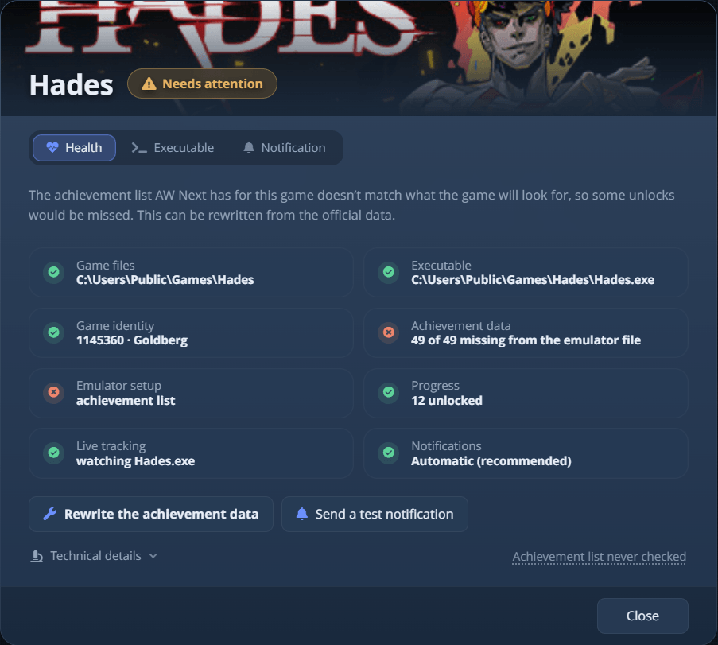

# Stato dei giochi

Quando un gioco dà problemi, apri prima il suo pannello **Stato dei giochi**. Dice se AW Next riesce a vedere il
gioco, leggerne gli obiettivi e annunciarne gli sblocchi, e propone solo le riparazioni che si applicano.

Aprilo dal pulsante **strumenti** nell'angolo in alto a destra di un riquadro di gioco, oppure dal menu
del tasto destro del gioco. Il pannello ha tre schede: **Stato**, **Eseguibile**, che imposta il programma da
osservare mentre giochi, e **Notifica**, dove il gioco può avere un proprio preset del popup, una propria posizione,
un proprio suono e una propria scala (vedi [Comportamento per singolo gioco](notifications.md#per-game-behavior)).

<picture><source srcset="../assets/shot/game-health-800.webp 800w, ../assets/shot/game-health.webp 903w" sizes="(max-width: 700px) 100vw, 620px"></picture> 
Uno stato, il motivo, i controlli che lo sostengono e le riparazioni applicabili

## Gli stati {#the-states}

| Stato | Che cosa significa |
|---|---|
| **Pronto** | Il gioco è rilevato, i suoi dati degli obiettivi sono disponibili e AW Next lo osserva per gli sblocchi. |
| **Richiede attenzione** | Il gioco funziona, ma una parte della sua configurazione è incompleta. I controlli mostrano quale. |
| **Non monitorato** | Manca qualcosa di essenziale, quindi nessuno sblocco può essere registrato: il gioco non si trova, non ha dati degli obiettivi o gli manca l'emulatore che scrive i suoi sblocchi. |
| **Solo tempo di gioco** | Un gioco aggiunto a mano: AW Next conosce il suo elenco degli obiettivi e ne conta il tempo di gioco, ma nulla su questo PC registra ancora i suoi sblocchi (nessun emulatore, salvataggio o account di uno store). Grigio, perché nulla è rotto, e così anche il punto sul riquadro del gioco; configura una fonte e lo stato cambia. |

La frase sotto lo stato indica la causa, i controlli mostrano quale parte è difettosa e un pulsante di
riparazione agisce esattamente su quella.

- La modalità **Semplice** descrive gli esiti con parole semplici (*Dati degli obiettivi trovati*, *Rilevato all'avvio del gioco*).
  **Avanzata** aggiunge i conteggi esatti, il processo osservato e il canale di notifica.
- **Dettagli tecnici**, in fondo in entrambe le modalità, contiene ogni valore grezzo. Premi **Copia** per una segnalazione di
  bug. Un valore lungo scorre al passaggio del mouse.

Ai giochi per emulatori di console non vengono richiesti un eseguibile Windows né i file del gioco.

Alcuni giochi non registrano nulla offline, qualunque sia la configurazione. Halo: Campaign Evolved e The Crew
Motorfest hanno gli obiettivi assegnati dai server dell'editore, quindi un crack non ne salva nessuno. Il loro
pannello lo dice fin dal primo avvio.

## I controlli {#the-checks}

| Controllo | A cosa risponde | Rimedio tipico |
|---|---|---|
| **File del gioco** | La cartella di installazione c'è ancora? | **Individua il gioco** |
| **Eseguibile** | Quale programma dovrebbe essere osservato mentre giochi? | **Individua il gioco** |
| **Identità del gioco** | A quale AppID e piattaforma è stato abbinato questo gioco? La modalità Semplice lo omette. | **Correggi il file identificativo del gioco** oppure **Imposta AppID manualmente** |
| **Dati obiettivi** | Esiste un elenco degli obiettivi, è completo e le sue definizioni di progresso e statistiche sono aggiornate? | **Riscrivi i dati degli obiettivi** |
| **Configurazione emulatore** | Un gioco che richiede un emulatore Steam ne ha uno, e quale lo serve? Le impostazioni di cui l'emulatore può fare a meno compaiono qui come note, non come problemi. Per un gioco Ubisoft comprende anche il loader Uplay e se ha mai chiesto un obiettivo. | **Installa il file dell'emulatore**, **Passa all'emulatore supportato**, **Completa le impostazioni dell'emulatore** oppure **Ripara il supporto agli obiettivi Ubisoft** |
| **Avanzamento** | È già stato trovato qualche sblocco o salvataggio? | Avvia il gioco e sblocca qualcosa |
| **Contatori di progresso** | Per i giochi in stile CODEX/RUNE che tracciano una statistica invece di uno sblocco semplice, AW Next ha recuperato la statistica dietro ogni obiettivo? Mostrato solo per i giochi che ne usano una. | **Recupera i contatori di progresso** |
| **Rilevamento dell'avvio del gioco** | Il tracker in background si accorge di quando questo gioco si avvia e sta osservando l'eseguibile impostato per il gioco? Da solo non registra alcuno sblocco: è compito dell'emulatore. | **Monitora questo gioco** |
| **Notifiche** | Quale canale ha consegnato l'ultima notifica per questo gioco e perché? | **Invia una notifica di prova** |

## Le riparazioni {#the-repairs}

Il pannello mostra solo le riparazioni che possono sistemare questo gioco. Ognuna dice che cosa cambierà e dove vengono conservati
i file precedenti. Nulla viene riscritto senza un backup o una conferma, e una riparazione che fallisce a metà rimette a posto ogni file che aveva modificato; l'errore dice che cosa è stato ripristinato.

| Riparazione | Che cosa fa |
|---|---|
| **Individua il gioco** | Apre un selettore per scegliere l'eseguibile da osservare. |
| **Apri la cartella del gioco** | Apre la cartella di installazione in Esplora file. |
| **Riscrivi i dati degli obiettivi** | Modifica solo `achievements.json`, `stats.json` e le icone mancanti, nient'altro. Un elenco completo viene lasciato com'è; le voci che aggiunge seguono il formato, le lingue e la cartella delle icone del file stesso. Le definizioni di progresso e statistiche vengono da generate_emu_config quando **Dati steam_settings** è su Avanzata con un accesso Steam salvato, altrimenti dall'elenco pubblico games-infos-datas, e la conferma dice quale. Ogni file modificato viene prima copiato in `.aw-backups` dentro `steam_settings`. |
| **Completa le impostazioni dell'emulatore** | Aggiunge solo i file di impostazioni che mancano a un gioco (`steam_appid.txt`, `configs.main.ini`, `configs.user.ini` e `configs.app.ini` quando [Gestisci la proprietà dei DLC](../goldberg-gbe.md) è attivo). Ciò che le impostazioni globali dell'emulatore già forniscono viene lasciato a loro, e l'elenco degli obiettivi non viene toccato. L'account proprio di un gioco in `configs.user.ini` viene sostituito solo quando **Scrivi nome account e lingua** è attivo e rispondi di sì quando ti viene chiesto. |
| **Installa il file dell'emulatore** | Scarica nella cartella del gioco la build supportata dell'emulatore, conservando il file che sostituisce come `.bak`. |
| **Passa all'emulatore supportato** | Per un gioco servito da un altro crack che non ha registrato nulla: installa sopra di esso l'emulatore supportato, rinomina la configurazione di quel crack in `.bak` e scrive nello stesso passaggio i `steam_settings` dell'emulatore (ID del gioco ed elenco degli obiettivi), così il gioco si può avviare subito dopo. Serve l'AppID Steam del gioco; se una parte fallisce, ogni file viene rimesso a posto. Le icone mancanti si possono aggiungere dopo con **Riscrivi i dati degli obiettivi**. |
| **Annulla il cambio di emulatore** | Compare ovunque sia stata eseguita una delle due precedenti. Rimette i file del gioco dalle loro copie `.bak` e toglie l'emulatore supportato. |
| **Annulla l'ultima riparazione** | Compare dopo qualsiasi modifica fatta da AW Next nella cartella del gioco: una riparazione di questo pannello, un fix emulatore, CrakFiles, Rimuovi DRM Steam (Steamless), Ripristina l'ultimo backup di GBE/Goldberg, Imposta AppID manualmente, una riparazione Uplay o uno dei pulsanti di annullamento qui sopra. Prima elenca ogni file che rimetterà a posto. Se un file è in uso (spesso perché il gioco è in esecuzione), non cambia nulla e la voce resta per un altro tentativo. |
| **Correggi il file identificativo del gioco** | Riscrive `steam_appid.txt` quando l'emulatore annuncia un gioco e AW Next ne ha abbinato un altro. Chiede l'AppID giusto, suggerendo l'abbinamento di AW Next, e conserva il file precedente. |
| **Recupera i contatori di progresso** | Chiede a Steam quale statistica guida ogni obiettivo, per i giochi in stile CODEX/RUNE. Non scrive nulla nella cartella del gioco. |
| **Ripara il supporto agli obiettivi Ubisoft** | Per un gioco Ubisoft compatibile, riscrive la configurazione del loader, lo schema e il reindirizzamento dei salvataggi in un'unica transazione, con ogni file toccato salvato in backup. Vedi [Configurazione di Uplay](uplay-r2.md). |
| **Attiva gli obiettivi offline** | Per un gioco Ubisoft il cui log del loader dimostra che non ha mai chiesto un obiettivo perché si crede disconnesso. Aggiunge una chiave di sessione segnaposto all'INI accanto al gioco; premilo di nuovo per rimuoverla. Vedi [Configurazione di Uplay](uplay-r2.md#a-game-that-never-asks-for-an-achievement). |
| **Monitora questo gioco** | Aggiunge il gioco al tracker in background così che il tempo di gioco e gli sblocchi in tempo reale vengano registrati, seguendo l'eseguibile impostato nella scheda **Eseguibile**. |
| **Riattiva le notifiche di progresso** | Riattiva le notifiche di progresso per un gioco che avevi silenziato. |
| **Invia una notifica di prova** | Genera una notifica con il nome e la grafica di questo gioco, attraverso il canale che userebbe davvero. |

> [!IMPORTANT]
> Una discrepanza non è sempre colpa dell'emulatore: se è stato configurato di proposito per l'ID presente su disco,
> lascialo stare. **Imposta AppID manualmente** (tasto destro) risolve una discrepanza dovuta al nome della cartella una volta per tutte, invece
> di correggere il file ogni volta. Vedi [Configurazione Goldberg / GBE](emulator-setup.md#set-appid-manually).

## Stati comuni e cosa fare {#common-states-and-what-to-do}

| Il pannello dice | Che cosa significa di solito |
|---|---|
| *Impossibile trovare un elenco degli obiettivi* | Il gioco non ha obiettivi, oppure la sua sorgente è disattivata. Controlla **Impostazioni → Sorgente**. |
| *Questo gioco richiede un emulatore Steam e non ne è configurato nessuno* | Usa **Applica correzione emulatore** dal menu del tasto destro. Vedi [Configurazione Goldberg / GBE](emulator-setup.md). |
| *Manca il file dell'emulatore che lo legge* | **Installa il file dell'emulatore** inserisce il runtime corrispondente. |
| *ColdClient gestisce questo gioco, ma…* | `ColdClientLoader.ini` accanto al loader avvia un file mancante o un altro programma, nomina un altro gioco o non ha un loader per i 32 o 64 bit del gioco. Correggi quel file; AW Next si limita a leggerlo. Una volta corretto, **Avvia tramite il loader ColdClient** fa sì che Gioca avvii il loader. |
| *L'emulatore Epic ha ancora l'AppID di esempio* | `NemirtingasEpicEmu.json` contiene l'AppID fatto di zeri, oppure il file EOSSDK di Epic è ancora al suo posto, quindi l'emulatore non si carica mai. Inserisci nel file l'id Epic del gioco. |
| *L'elenco degli obiettivi non corrisponde a ciò che il gioco cercherà* | **Riscrivi i dati degli obiettivi**. È il risultato abituale di un aggiornamento di un repack. |
| *Non è ancora stato trovato alcun avanzamento degli obiettivi* | Normale per un gioco a cui non hai giocato dopo averlo configurato. Avvialo e sblocca qualcosa. |
| *AW Next non sta osservando questo gioco mentre è in esecuzione* | **Monitora questo gioco** lo aggiunge al tracker. |
| *Non è stato possibile inviare l'ultima notifica* | Invia una notifica di prova, poi vedi [Notifiche](notifications.md#if-a-test-or-unlock-does-not-appear). |
| *Windows ha nascosto l'ultima notifica durante la partita* | È andata direttamente nel Centro notifiche perché il gioco era a schermo intero o Non disturbare era attivo. Attiva le [Notifiche prioritarie](notifications.md#priority-windows-notifications), oppure usa Automatico o Overlay di gioco. |
| *Funziona - ripiego su Windows attivo* | Non è un difetto. La consegna Automatica ha scelto una notifica di Windows per questo gioco; vedi [come decide Automatico](notifications.md#how-automatic-decides). |
| *Il gioco non ha mai chiesto un obiettivo* | Legge la sua sessione Ubisoft vuota come disconnessa. **Attiva gli obiettivi offline** lo sblocca; non viene inviato nulla da nessuna parte. Avvia il gioco una volta dopo. |
| *Obiettivi offline attivi, avvia il gioco una volta* | L'impostazione è scritta e non è ancora stato giudicato nulla. Il pulsante accanto ora dice **Disattiva gli obiettivi offline**. |
| *Servito da ALI213, OnlineFix, GBE Fork…* | L'emulatore che sta davvero leggendo quel gioco, nominato dai suoi stessi file. A un gioco Ubisoft servito in questo modo non viene proposta una riparazione Uplay: il suo livello Uplay non è usato, non è rotto. Ciò comprende le release che mantengono il `steam_api64.dll` di Valve: una build RUNE che gira da `Steam\steamclient64.dll`, o una release VOICES38 che carica il proprio GBE Fork rinominato (`steam_api64.v38`); non installare mai l'emulatore sopra quest'ultima. Le build Ubisoft di online-fix vengono riconosciute, e una correzione degli obiettivi lì avverte che il gioco online potrebbe smettere di funzionare. |
| *Mancano solo alcune icone* | **Riscrivi i dati degli obiettivi** scarica le icone mancanti. |
| *Definizioni di progresso o statistiche mancanti o obsolete* | Gli obiettivi a contatore non avanzerebbero o mostrerebbero un traguardo sbagliato. **Riscrivi i dati degli obiettivi** li aggiorna. |
| *Impostazioni facoltative non scritte* | Una nota, non un difetto: l'emulatore funziona anche senza (un ticket dell'app, un token GC, l'interruttore delle statistiche sconosciute, un nome account). **Completa le impostazioni dell'emulatore** le aggiunge se vuoi. |
| *Il nome account o la lingua vengono da … `GSE Saves\settings`* | Una riga informativa, non un avviso. GBE legge `GSE Saves\settings\configs.user.ini` (o le impostazioni della cartella dei salvataggi a cui punta `local_save_path`) quando il gioco non ne ha di proprie. Non c'è nulla da correggere. |
| *Monitora X, non Y* | L'eseguibile impostato per questo gioco non è quello che il tracker segue, quindi avvii e tempo di gioco possono sfuggire. **Monitora questo gioco** segue quello scelto. *Monitora X, avviato da Y* va bene: Y è un launcher, come un bootstrapper anti-cheat, che avvia il gioco. |
| *Nessuna fonte di obiettivi configurata* | Mostrato con **Solo tempo di gioco**. Applica un fix dell'emulatore, oppure aggiungi la cartella in cui il gioco salva i suoi obiettivi. |
| *Eseguito per oltre un'ora e nemmeno un obiettivo registrato* | Molto probabilmente il crack che serve il gioco non riporta mai gli obiettivi. Usa **Passa all'emulatore supportato** quando è offerto; altrimenti controlla che il gioco si avvii dalla propria cartella. |
| *File identificativo del gioco*, con un collegamento Steam a questo gioco | Steam avvia un collegamento non-Steam senza alcun `steam_appid.txt` accanto, quindi l'emulatore salva con un altro ID. **Completa le impostazioni dell'emulatore** scrive lì il file. |

---

**Avanti:** [Risoluzione dei problemi](troubleshooting.md) - per i problemi che Stato dei giochi non risolve da solo.

[← Documentazione](README.md) · [Home del progetto](https://github.com/Shirowwww/Achievement-Watcher-Next)

