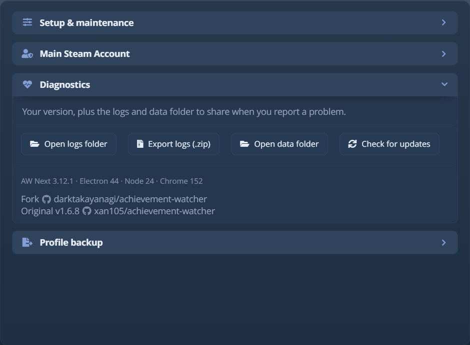

# Risoluzione dei problemi

## Da dove iniziare {#start-here}

Se il problema riguarda **un solo gioco**, apri prima il pannello **[Stato dei giochi](game-health.md)** di quel gioco.
Dice se AW Next riesce a vedere il gioco, leggerne gli obiettivi e annunciarne gli sblocchi, e
propone solo le riparazioni che si applicano. La maggior parte dei problemi di un singolo gioco finisce lì.

Usa il resto di questa pagina per i problemi che riguardano l'intera app. **Impostazioni → Aiuto** ne ha una
versione breve dei primi controlli sotto *Qualcosa non funziona* (Stato dei giochi e Risoluzione dei problemi), e la sua riga
*La tua configurazione attuale* mostra il tema, la modalità di notifica, il controller, la scorciatoia dell'overlay e quante
sorgenti sono attive. Per una domanda prima di essere sicuro che sia un bug, chiedi nel
[server Discord](https://discord.gg/DjTMrDsXTh). In una segnalazione di bug, indica la versione dell'app, la versione di
Windows, la sorgente coinvolta, i passaggi esatti e i log rilevanti.

## Su Linux {#on-linux}

L'app per Linux ha problemi che questa pagina non copre. L'AppImage non si avvia senza FUSE 2
(`libfuse2t64` su Ubuntu 24.04). Il portachiavi chiede la password solo con l'accesso automatico. La
scorciatoia dell'overlay sotto Wayland è una che associ tu nelle impostazioni della tastiera del desktop. Ognuno ha il suo rimedio
in [Linux e Steam Deck](linux.md#install). Il resto di questa pagina descrive Windows; su Linux
i log si trovano in `~/.config/Achievement Watcher Next/logs`.

## Aprire i log e i dati locali {#open-logs-and-local-data}

<div align="center">
<picture><source srcset="../assets/shot/diagnostics-panel-800.webp 800w, ../assets/shot/diagnostics-panel.webp 940w" sizes="(max-width: 700px) 100vw, 720px"></picture><br>
<sub>Versioni dell'app e del runtime e accesso rapido a log, dati e controlli degli aggiornamenti</sub>
</div>

La scheda **Avanzate** esiste solo in modalità Avanzata. Se non la vedi, porta il controllo **Interfaccia**
in cima a **Impostazioni** da Semplice ad Avanzata; non si perde nulla tornando indietro (vedi
[getting-started.md](getting-started.md#simple-and-advanced)).

**Impostazioni → Avanzate → Diagnostica** apre la cartella dei log o dei dati. Il percorso predefinito dei log è:

```text
%APPDATA%\Achievement Watcher Next\logs
```

I file più utili sono di solito `Achievement Watcher.log`, `renderer.log`, `parser.log` e i log
del Watchdog della sorgente interessata. Un errore che attraversa scansione, interfaccia e notifiche ne richiede
diversi, quindi usa **Esporta i registri (.zip)** nella stessa scheda invece di copiare i file a mano:
i processi che scrivono i log non si fermano mai, quindi una copia manuale può catturare una riga scritta a metà. L'
esportazione funziona con l'app in esecuzione e aggiunge un `about.txt` con le versioni di app, Electron, Node e Chrome.

L'archivio è pensato per una issue pubblica, quindi le sue copie sono oscurate: il tuo nome utente di Windows in ogni
percorso diventa `[username]`, e chiavi, token e password diventano `[redacted]`, `[token]` o
`[apikey]`. I log sul tuo disco restano invariati, e un file che non può essere oscurato viene escluso.
L'oscuramento funziona su forme note, quindi leggi i file prima di pubblicarli; una cartella di gioco con il tuo nome,
per esempio, resta com'è.

I log vengono accodati, mai troncati, così un arresto anomalo sopravvive al riavvio successivo. Ogni esecuzione inizia con un
marcatore, seguito da un blocco `[diag]` con ciò che serve a una segnalazione di bug: versioni, percorsi di installazione e dati,
come è stata avviata l'app, la lingua e il tema, e la geometria di ogni display:

```text
===== session 2026-08-11T00:53:31.890Z pid=19276 =====
[diag] app: Achievement Watcher 3.10.0 (packaged)
[diag] runtime: electron 43.4.0 · chrome 150.0.7871.224 · node 24.18.1 · v8 15.0
[diag] display: 3056414223 1080x1920 @1x work=1080x1872 rotation=270
[diag] display: 3933707034 (primary) 2048x1152 @1.25x work=2048x1104 rotation=0
```

Incolla quel blocco in una issue. I problemi di dimensione e posizione della finestra sono quasi sempre dovuti alla scala del display
o a più monitor, e le righe `[MainWindow]` che seguono registrano i limiti della finestra e il display
ogni volta che viene mostrata, spostata, ridimensionata o chiusa.

Ogni file di log ruota in `<name>.log.1` oltre i 2 MB, quindi viene conservata una generazione precedente.

## Manca un gioco {#a-game-is-missing}

1. Apri **Impostazioni → Sorgente** e verifica che l'integrazione interessata sia attiva.
2. Apri **Impostazioni → Cartelle**, esegui **Ricerca smart**, poi usa **Genera configurazioni** per una scansione completa.
3. Aggiungi a mano la libreria dei giochi o la radice dei salvataggi se usa una posizione personalizzata.
4. Disattiva **Mostra solo i giochi installati** per vedere se il gioco è noto ma non più considerato
   installato.
5. Per i salvataggi degli emulatori, avvia il gioco una volta così che crei una cartella di runtime.

Se restano solo residui di vecchi salvataggi e i file del gioco non ci sono più, il filtro dei soli installati nasconde
la voce.

Un gioco i cui metadati non è stato possibile recuperare resta nell'elenco: ciò che c'è su disco decide che un gioco
esiste, e la ricerca online serve solo a decorarlo. La voce mostra il nome noto in locale e
si completa a una scansione successiva.

## Gli obiettivi restano bloccati o mostrano 0% {#achievements-stay-locked-or-show-0}

Nessun file di sblocchi di runtime significa 0%, anche con un elenco di obiettivi completo.

Apri il pannello **[Stato dei giochi](game-health.md)** del gioco: indica la parte mancante e propone la
riparazione, che si tratti di riscrivere i dati degli obiettivi, ripristinare il file dell'emulatore o correggere uno
`steam_appid.txt` che indica un altro gioco. Per controllare a mano:

- verifica che l'AppID rilevato o l'ID della piattaforma appartenga al gioco giusto;
- controlla se c'è un percorso di salvataggio personalizzato;
- ripara uno schema `steam_settings` non corrispondente solo dopo aver esaminato il rapporto;
- se hai giocato su un altro PC, collega quell'account Steam: un gioco senza nulla da leggere in locale viene
  poi letto dal tuo profilo Steam, i cui dettagli del gioco devono essere pubblici. La risposta resta in cache per sei
  ore (vedi [Account collegati](sources.md#connected-accounts)).

I salvataggi degli emulatori Steam possono essere divisi tra `%APPDATA%\GSE Saves` e
`%APPDATA%\Goldberg SteamEmu Saves` per lo stesso gioco. AW Next legge quello che contiene gli sblocchi, quindi
non devi sistemarlo a mano.

Un gioco senza un set di obiettivi non ha una barra di avanzamento invece di mostrare 0% (oppure **Nessun obiettivo**, se
hai riattivato quella barra in **Impostazioni → Aspetto → Riquadri della libreria**) ed è escluso dalle statistiche
di completamento.

**Funziona dal pulsante Gioca di AW Next ma non da un collegamento di Steam.** Un gioco crackato aggiunto a Steam
come gioco non-Steam viene avviato con un ID di gioco proprio, e GBE Fork legge quell'ID prima del suo
`steam_appid.txt`, quindi gli sblocchi vengono salvati sotto il numero del collegamento e non raggiungono mai la scheda del gioco.
Steam passa l'ID vero quando un `steam_appid.txt` si trova nella cartella di avvio del collegamento (Inizia
in); uno accanto al solo eseguibile non viene letto. Stato dei giochi segnala un collegamento la cui cartella di avvio
ne è priva, e la sua riparazione scrive lì il file.

**Un crack scene viene servito e non viene mai registrato nulla.** Alcuni crack non riportano mai gli obiettivi.
Dopo un'ora di gioco senza nulla di registrato, Stato dei giochi lo dice e, quando quel crack è il file della libreria Steam
del gioco, propone di installare sopra di esso l'emulatore supportato e di annullare poi l'operazione.

**Halo: Campaign Evolved e The Crew Motorfest non registrano nulla offline.** I server dell'editore
assegnano i loro obiettivi, quindi nessun crack o emulatore può registrarli. Il loro pannello Stato dei giochi lo dice.

Vedi [Configurazione di Goldberg e GBE Fork](emulator-setup.md#common-problems) o [Configurazione di Goldberg Uplay R2](uplay-r2.md#achievements-remain-at-0) per i passaggi specifici di ogni sorgente.

## È stato abbinato il gioco sbagliato {#the-wrong-game-was-matched}

Quando il nome della cartella di un gioco corrisponde a più release di Steam e l'abbinamento automatico ha scelto quella
sbagliata, fai clic con il pulsante destro e scegli **Imposta AppID manualmente...**. L'AppID che inserisci viene scritto in
`steam_appid.txt` e ricordato per quella cartella di installazione, così le riparazioni successive lo usano; **Cancella l'AppID manuale**, nello stesso menu, la annulla. La riparazione **Correggi il file identificativo del gioco** di Stato dei giochi chiede
anche l'AppID. Dettagli: [Impostare a mano l'AppID di un gioco](advanced.md#set-a-games-appid-by-hand).

Una discrepanza non è sempre colpa dell'emulatore. Se è stato configurato di proposito per l'ID presente su disco, lascialo
stare.

## Mancano nomi, descrizioni o grafica {#names-descriptions-or-artwork-are-missing}

- Aggiorna mentre sei online così che l'app possa riprovare le sue sorgenti di metadati.
- Verifica l'identità della piattaforma del gioco; un AppID Steam sbagliato può restituire metadati convincenti
  ma estranei.
- Per Goldberg/GBE, uno schema locale valido può riempire un po' del testo mancante offline.
- Usa le azioni sulla copertina del gioco per riprovare o scegliere una grafica locale quando le sorgenti automatiche falliscono.

Una scheda intitolata con il solo AppID Steam significa che la ricerca del nome è tornata vuota mentre la grafica,
che proviene dal solo AppID, è stata risolta. La scansione successiva sostituisce il numero quando la ricerca
riesce.

Gli obiettivi di DLC e aggiornamenti mostrano il gruppo di appartenenza sotto il titolo (per esempio un'etichetta "Hearts of
Stone"), dai set di obiettivi di Steam stesso oppure, per un gioco che non li ha, da SteamHunters.

Le descrizioni degli obiettivi nascosti restano nascoste quando ogni sorgente disponibile le omette.

## Un aggiornamento del gioco ha aggiunto obiettivi che non compaiono {#a-game-update-added-achievements-that-arent-showing-up}

Uno schema in cache si ricontrolla da solo su Steam ogni 3 giorni, perché Steam non annuncia mai i nuovi
obiettivi. Per rilevarli subito, usa **Impostazioni → Avanzate → Riverifica elenchi obiettivi**, che
funziona anche con **Aggiornamenti automatici dei dati sugli obiettivi** disattivati. Quell'interruttore, anch'esso in Impostazioni →
Avanzate, ferma solo il controllo periodico e la riparazione delle descrizioni vuote. Nessuno dei due controlli rimuove
obiettivi o sblocchi esistenti. Disattivalo solo se gestisci `steam_cache` a mano.

## Un aggiornamento si blocca sullo stesso file {#an-update-is-stuck-on-the-same-file}

I file di aggiornamento scaricati vengono conservati tra un'esecuzione e l'altra. Se un download continua a fallire sullo stesso file, usa
**Impostazioni → Avanzate → Svuota cache** e controlla di nuovo gli aggiornamenti. Vengono eliminate solo le cache riscaricabili;
impostazioni, dati dei giochi e log restano.

Gli aggiornamenti normalmente scaricano solo la parte dell'installer che è cambiata, e ripiegano da soli sull'
installer completo se questo non riesce.

AW Next annuncia una nuova versione con una notifica di Windows e un'etichetta nella barra del titolo, e facendo clic su
una delle due si apre la finestra di aggiornamento, che elenca le note di rilascio di ogni versione saltata. L'
avviso resta finché non lo chiudi e ricompare dopo una partita, mai durante. Nel frattempo l'icona nell'area di notifica porta un
puntino blu. **Impostazioni → Controlla aggiornamenti** apre subito la finestra.

**Aggiornamento rifiutato.** Ogni aggiornamento viene verificato rispetto al certificato di firma fissato del progetto prima
dell'installazione, non una firma qualsiasi e non lo SHA-512 pubblicato insieme ad esso, perché entrambi provengono dalla
stessa release. Un rifiuto quasi sempre significa che il file scaricato è stato manomesso o è danneggiato:
svuota le cache come sopra e scarica di nuovo dalla
[pagina ufficiale delle Release](https://github.com/Shirowwww/Achievement-Watcher-Next/releases).

## Le notifiche non compaiono {#notifications-do-not-appear}

1. Verifica che il tracker in background sia in esecuzione.
2. Apri il gioco e leggi la riga Notifiche del suo pannello **Stato dei giochi**: indica il canale
   che ha consegnato l'ultima notifica per quel gioco, e perché.
3. Usa le prove normale, rara e overlay in **Impostazioni → Notifiche**.
4. Verifica la modalità di consegna e il preset selezionato. Con **Automatico**, un popup dell'overlay mancante è spesso
   il ripiego previsto: vedi [Notifiche](notifications.md#how-automatic-decides).
5. Controlla le autorizzazioni di notifica di Windows per AW Next.
6. Se il problema si verifica solo mentre giochi o a schermo intero, attiva **Notifiche prioritarie** in
   **Impostazioni → Notifiche** e accetta la richiesta di autorizzazione di Windows.
7. Prova l'overlay fuori dallo schermo intero esclusivo.
8. Controlla i log subito dopo una prova o uno sblocco falliti.

Se la libreria si aggiorna ma non compare alcuna notifica, il problema è il canale di notifica. Se
anche la libreria resta invariata, diagnostica prima la sorgente o il percorso dei salvataggi.

## La sorgente browser OBS resta vuota {#the-obs-browser-source-stays-empty}

1. Premi **Anteprima** in **Impostazioni → Notifiche → Sorgente browser OBS**, oppure apri
   `http://127.0.0.1:8082/obs/?test=1`. Una scheda di esempio ogni dieci secondi significa che la pagina e il feed
   funzionano, e il problema sono le impostazioni della sorgente in OBS.
2. Proprio nulla, nemmeno una pagina vuota: un'altra copia di AW Next, o un altro programma, occupa la porta
   8082. Solo la copia partita per prima serve l'indirizzo.
3. Una pagina vuota è normale tra uno sblocco e l'altro. Usa `?test=1` per vederla disegnare.
4. Verifica che **Websocket @localhost:8082** sia attivo in **Impostazioni → Notifiche → Trasporto**: la
   sorgente legge quel feed.
5. La scheda riempie qualunque dimensione abbia la sorgente. Se appare sfocata, dai alla sorgente più pixel e
   posizionala più piccola nella scena.

Vedi [Mostra gli sblocchi in streaming (OBS)](notifications.md#show-unlocks-on-stream-obs) per la configurazione completa.

## Un gioco non si avvia dal pulsante Gioca {#a-game-will-not-start-from-the-play-button}

Alcuni giochi richiedono i diritti di amministratore, perché il loro manifest o launcher li chiede. Windows
rifiuta di avviarli nel modo in cui AW Next normalmente avvia un gioco e segnala `EACCES`.

AW Next riprova allora tramite la shell di Windows, che mostra la normale richiesta UAC, così il gioco
si avvia dopo la tua conferma. Se viene rifiutato anche questo, AW Next propone di riprovare come amministratore. Solo il
gioco viene elevato, perché un AW Next elevato creerebbe file che il tuo account normale non può riscrivere.
Ignorare la richiesta UAC viene trattato come una decisione, non come un errore.

## Il tempo di gioco non viene tracciato {#playtime-is-not-tracked}

AW Next segue l'eseguibile del gioco configurato e la durata del suo processo. Se invece si avvia un launcher, un helper o un
binario con un nome diverso:

- fai clic con il pulsante destro sul gioco e apri la sua configurazione;
- seleziona l'eseguibile che resta attivo mentre giochi;
- evita i processi del launcher e del gestore degli arresti anomali;
- riavvia il gioco dopo aver salvato.

Un gioco Java che si avvia tramite `javaw.exe` e fa uscire il proprio launcher viene tracciato automaticamente attraverso quel processo
Java.

Per correggere un totale già sbagliato, usa **Obiettivi e tempo di gioco → Modifica tempo di gioco…** (vedi
[Modificare il tempo di gioco di un gioco](advanced.md#editing-a-games-playtime)).

## I trofei PlayStation non si importano {#playstation-trophies-do-not-import}

- *La sessione PlayStation è scaduta*: collega di nuovo l'account in **Impostazioni → Sorgente**.
- *PlayStation chiede di rallentare* o *Messo in pausa da PlayStation*: Sony limita la frequenza delle richieste. Importa
  di nuovo tra qualche minuto e riprende da dove si era fermato.
- *Ancora nessun elenco di trofei su questo account*: l'account non ha un elenco di trofei da importare.

## Un gioco Nemirtingas Epic non registra nulla {#a-nemirtingas-epic-game-records-nothing}

Quando la cartella di un gioco contiene l'emulatore (la sua libreria `EOSSDK` con un
`nepice_settings\NemirtingasEpicEmu.json` accanto), la scheda **Stato dei giochi** del gioco mostra una riga
**Emulatore Epic**:

- **SavePath deve essere `"appdata"`.** L'emulatore scrive gli obiettivi in
  `%APPDATA%\NemirtingasEpicEmu`, dove li legge AW Next, solo con quel valore; qualsiasi altro li tiene
  nella cartella del gioco. La riga avvisa quando è impostato su altro.
- **Alcuni giochi richiedono gli argomenti di avvio di Epic.** Alcuni giochi EOS accedono all'emulatore, e quindi salvano
  un obiettivo, solo quando un launcher passa `-epicapp=...` e gli altri. Finché l'emulatore non ha
  salvato nulla, la riga propone **Aggiungi gli argomenti di avvio di Epic**, che li scrive nelle impostazioni di
  avvio del gioco a partire dall'`AppId` della configurazione. Funziona anche un `.bat` che li passa.
- Se il gioco va in crash all'avvio con l'emulatore presente, disattiva il suo plugin dell'overlay
  (`"Plugins": { "Overlay": { "Enabled": false } }`); la riga te lo ricorda finché è attivo.

## Ubisoft o Uplay R2 usa l'azione sbagliata {#ubisoft-or-uplay-r2-uses-the-wrong-action}

I giochi Ubisoft dovrebbero ricevere i metadati Ubisoft e la riparazione Uplay R2, non l'azione GBE di Steam. Esegui una
nuova scansione delle cartelle e controlla l'icona della sorgente. Se il gioco continua a essere identificato male, allega `parser.log`,
la sorgente e gli ID mostrati e il nome della directory del gioco a una segnalazione.

## Avviso dell'antivirus o di SmartScreen {#antivirus-or-smartscreen-warning}

Le release pacchettizzate sono firmate con il certificato proprio del progetto, fissato dalla sua impronta digitale esatta, non
emesso da un'autorità pubblicamente affidabile, quindi Windows SmartScreen può comunque avvisare. Non devi mai
installare il certificato. Prima di installare un aggiornamento, AW Next verifica che sia firmato, che il
firmatario sia `CN=Shirow`, che l'impronta digitale corrisponda a una delle due fissate dall'app e che il
file non sia stato modificato dopo la firma. Lo SHA-512 pubblicato con una release non può sostituire quel controllo,
perché verrebbero sostituiti entrambi insieme. Anche le DLL facoltative degli emulatori possono scatenare rilevamenti euristici.
Scarica solo dalla
[pagina ufficiale delle Release](https://github.com/Shirowwww/Achievement-Watcher-Next/releases) e confronta
l'installer con lo SHA-512 nel `latest.yml` corrispondente per un secondo controllo.

Non disattivare la protezione a livello di sistema. Segnala un file in quarantena proveniente dalla release ufficiale al
fornitore dell'antivirus come falso positivo.

### Controllare una release da solo {#checking-a-release-yourself}

Ogni installer pubblicato può essere cercato su VirusTotal tramite il suo SHA-256:

```powershell
Get-FileHash "Achievement.Watcher.Setup.3.12.7.exe" -Algorithm SHA256
```

Apri `https://www.virustotal.com/gui/file/<the hash it prints>`. Se il file è quello pubblicato,
il rapporto è già lì. Per la release attuale è
[l'installer 3.12.7](https://www.virustotal.com/gui/file/183be0f0780edcf4377607a357313125d53b9091f50c7114e3bee3998b5a4d96)
(`183be0f0780edcf4377607a357313125d53b9091f50c7114e3bee3998b5a4d96`).

Il risultato elenca ciò che pensa ciascun motore. Una manciata di rilevamenti euristici su una build che include
file di emulatori è il falso positivo descritto sotto. Ciò che conta è che l'hash corrisponda al file
pubblicato dalla pagina delle release.

### I file degli emulatori vengono segnalati {#the-emulator-files-are-flagged}

È il rilevamento in cui ci si imbatte davvero, ed è un falso positivo. Registrare gli obiettivi di un
gioco senza un client di store in esecuzione significa mettere accanto ad esso una libreria sostitutiva: l'emulatore Steam (GBE
Fork) o un loader Ubisoft. I motori di rilevamento sorvegliano esattamente questo, quindi segnalano ciò che il file
*fa*, non ciò che contiene. Windows Defender mette in quarantena tutte le copie che riesce a vedere in una volta: nella cartella
del gioco, installata con AW Next e nella sua cache.

**Quando scatta.** Nel momento in cui un file viene scritto, e solo allora:

| Che cosa hai fatto | Che cosa viene scritto |
|---|---|
| Hai eseguito una riparazione, dal menu di un gioco o dalle Impostazioni | l'emulatore o il loader, nella cartella di quel gioco |
| Hai aperto **Impostazioni → Emulatori → Ubisoft / Uplay R1/R2** | i loader inclusi, nella cache di AW Next |
| Hai attivato **Correggi automaticamente i nuovi giochi rilevati** | lo stesso, durante una scansione, per ogni gioco che ne ha bisogno |

Avviare AW Next non ne scrive nessuno. La riparazione automatica è disattivata a meno che tu non la attivi, e ti avvisa
prima, con la possibilità di aggiungere prima un'esclusione di Defender. Se era già attiva, lo stesso
avviso compare una volta, prima della prima scrittura, con l'esclusione e l'interruttore di disattivazione nella finestra.
Nulla viene scritto mentre la finestra è nascosta nell'area di notifica.

**Che cosa fa AW Next.** Una quarantena viene segnalata come un problema dell'antivirus, con un pulsante per
consentire la cartella in Windows Defender e un altro per rimettere a posto i file rimossi. **Impostazioni →
Emulatori → Ubisoft / Uplay R1/R2 → Ripristina DLL integrate** le ripristina in qualsiasi momento.

**Che cosa fare.** Consenti il file che il tuo antivirus ha nominato, oppure escludi
`%APPDATA%\Achievement Watcher Next\cache`. Questo protegge le copie di AW Next; la copia in una cartella
di gioco può comunque essere segnalata, quindi escludi anche quella cartella se continua a succedere. Segnalare il falso
positivo al tuo fornitore lo risolve per tutti.

Windows Defender chiama l'archivio di GBE Fork `Trojan:Win32/Suschil!rfn` mentre AW Next lo scarica nella
sua cache. È lo stesso falso positivo: consentilo, oppure escludi la cartella della cache, ed esegui di nuovo
la correzione.

**Da controllare prima.** Entrambi sono di terze parti e open source: l'emulatore Steam proviene dalle
[release ufficiali di GSE Fork](https://github.com/Detanup01/gbe_fork), e i loader Ubisoft sono distribuiti in
`app/resources/uplayR1/` e `app/resources/uplayR2/` nel repository. AW Next verifica quelli inclusi
rispetto a digest SHA-256 noti, alla loro architettura PE e alla loro capacità di gestire gli obiettivi prima che qualsiasi
riparazione li usi, e rifiuta un file che non supera il controllo.

### Un antivirus reagisce mentre AW Next è in esecuzione {#an-antivirus-reacts-while-aw-next-runs}

I motori comportamentali (System Watcher di Kaspersky, Advanced Threat Defense di Bitdefender) giudicano ciò che un
programma fa, non ciò che contiene. AW Next non avvia PowerShell per le notifiche di Windows, i suoni dei toast
o il controllo della firma dell'aggiornamento, e non compila codice in `%TEMP%`: gli screenshot usano l'
helper nativo incluso nell'app, e il controllo delle notifiche chiama Windows direttamente.

Se il tuo antivirus reagisce comunque, annota il nome esatto del rilevamento e segnala il file che nomina come falso
positivo. Per Kaspersky è [opentip.kaspersky.com](https://opentip.kaspersky.com): cerca il file
tramite il suo hash, poi **Submit to reanalyze**.

## La finestra non si apre {#the-window-does-not-open}

- Usa l'icona nell'area di notifica nel caso l'app si sia avviata nascosta.
- Termina un processo AW Next bloccato, poi riavvialo.
- Rimuovi `ELECTRON_RUN_AS_NODE` dall'ambiente se era stata impostata per lo sviluppo; fa avviare
  Electron come semplice Node.
- Controlla `renderer.log` e il log principale dell'app per il primo errore.
- Prova **Impostazioni → Generale → Disattiva l'accelerazione hardware** se l'interfaccia resta visibile abbastanza a lungo per
  cambiarla.

## Ricominciare con un profilo nuovo {#start-with-a-fresh-profile}

Usalo solo dopo aver fatto un backup dei dati che vuoi conservare:

1. Esci completamente da AW Next dall'area di notifica.
2. Rinomina `%APPDATA%\Achievement Watcher Next` in `Achievement Watcher Next.backup`.
3. Avvia l'app e riproduci il problema con il profilo nuovo.

Se il problema scompare, ripristina solo i dati che ti servono oppure allega i file di configurazione rilevanti
alla segnalazione. Rinominare lascia una via di ritorno; eliminare no.

## Segnala il problema {#report-the-problem}

Cerca prima tra le [issue esistenti](https://github.com/Shirowwww/Achievement-Watcher-Next/issues). Se
nessuna corrisponde, apri un bug usando il modello del repository e allega i log dopo aver rimosso tutto ciò che
non vuoi condividere pubblicamente.

---

**Vedi anche:** [FAQ](faq.md) per risposte brevi · [Strumenti avanzati](advanced.md) per manutenzione,
svuotamento delle cache e reimpostazioni · [Stato dei giochi](game-health.md) per i problemi di un singolo gioco.

Il percorso dell'utente finisce qui. La documentazione poi diventa tecnica:
[Riferimento Goldberg/GBE](../goldberg-gbe.md) per formati di file e regole di rilevamento, e
[Architettura](../architecture.md) per i confini tra app / renderer / Watchdog.

<div align="center">

[← Documentazione](README.md) · [Per iniziare](getting-started.md) · [Home del progetto](https://github.com/Shirowwww/Achievement-Watcher-Next)

</div>
