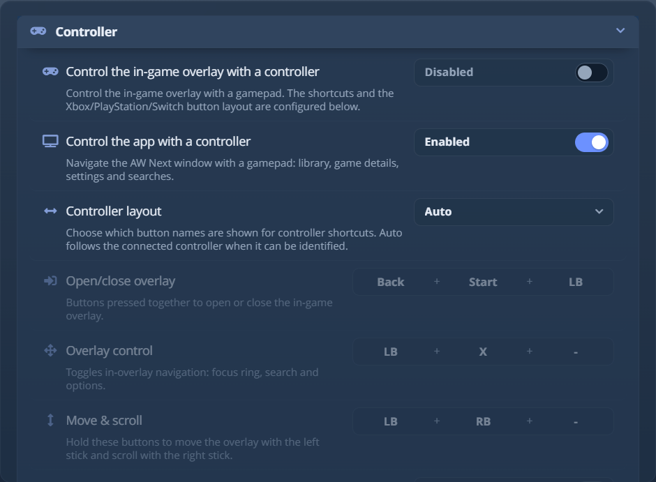
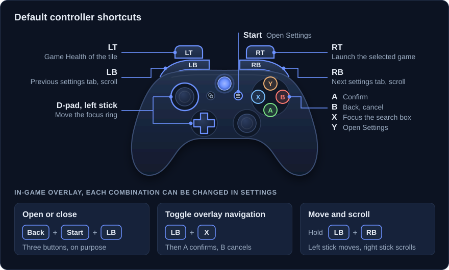

# コントローラー(ゲームパッド)のガイド

ゲームパッドは、メインウィンドウとゲーム内オーバーレイという 2 つの別々の場所を操作できます。どちらも
**設定 → コントローラー** で設定します。

<picture><source srcset="../assets/shot/controller-panel-800.webp 800w, ../assets/shot/controller-panel.webp 940w" sizes="(max-width: 700px) 100vw, 720px"></picture> 
オーバーレイとアプリのナビゲーション、レイアウト、ショートカットごとのボタンの割り当て

## 2 つのスイッチ {#the-two-switches}

| 設定 | 既定 | 対象 |
|---|---|---|
| **アプリをコントローラーで操作** | オン | AW Next のメインウィンドウ：ライブラリ、ゲームの詳細、設定、検索。 |
| **コントローラーでゲーム内オーバーレイを操作** | オフ | プレイ中にバックグラウンドのトラッカーが制御する、ゲーム内オーバーレイ。 |

アプリのナビゲーションは通常のウィンドウ入力で負荷がないため、既定でオンです。オーバーレイの制御は、バックグラウンドの
トラッカーでネイティブのコントローラースタックを読み込むため、有効にするかどうかは任意です。

## ショートカット一覧 {#shortcuts-at-a-glance}

ボタンの名前は Xbox の用語を使い、アプリは選択したレイアウトで表示します。

| ショートカット | 既定 | 場所 |
|---|---|---|
| オーバーレイを開く / 閉じる | **Back + Start + LB** | ゲーム中 |
| オーバーレイのナビゲーションを切り替える | **LB + X** | オーバーレイ表示中 |
| オーバーレイの移動とスクロール | **LB + RB**(押したまま) | オーバーレイ表示中 |
| 決定 | **A** | アプリ + オーバーレイ |
| 戻る / キャンセル | **B** | アプリ + オーバーレイ |
| 検索ボックスにフォーカス | **X** | アプリ + オーバーレイ |
| 設定 / オーバーレイのオプションを開く | **Y** | アプリ + オーバーレイ |
| 設定を開く | **Start** | アプリ |
| 選択したゲームを起動 | **RT** | アプリ、ライブラリ |
| 選択したゲームのゲームの状態を開く | **LT** | アプリ、ライブラリ |
| 前 / 次の設定タブ | **LB** / **RB** | アプリ、設定を開いているとき |
| ページをスクロール | **LB** / **RB** | アプリ、設定を閉じているとき |

オーバーレイの切り替えには、ゲーム中に誤って作動しないよう 3 つのボタンを使います。オーバーレイのショートカットはすべて
設定可能で、1 つから 3 つのボタンを指定できます。

ライブラリでは、スティックでタイルの間を移動し、**A** でゲームを開きます。クリックと同じです。タイルに描かれた
2 つのコントロールはトリガーに対応しています：**RT** で選択したゲームを起動し、**LT** でその
ゲームの状態パネルを開きます。どちらも、ライブラリのタイルが選択されていないと何もしません。

## オプション {#options}

- **コントローラーレイアウト**：ヒントやボタン名に使う用語。**自動** は、識別できる場合は接続されたパッドに従います。
  ほかには **Xbox**、**PlayStation**、**Switch** があります。
- **コントローラーのバックエンド**：**自動** は利用可能な最適な入力バックエンドを選び、**XInput** は最も
  互換性が高く、**GameInput** は新しい Windows のビルドに向いています。
- **割り当て**：ショートカットごとに 1 つから 3 つのボタン。ショートカットはボタンを共有できます(既定ではそうなっています：
  **LB + X** と **LB + RB** はどちらも LB を使います)。入力レイヤーが、片方の組み合わせを押し続けても
  もう片方が作動しないようにします。1 つの割り当ての中で繰り返されたボタンは 1 回として数えられます。オーバーレイの切り替えは
  **Guide** ボタンも受け付けますが、2 つのオーバーレイモードは受け付けません。それらを読み取るブラウザーのゲームパッド API が、
  Guide ボタンを確実には報告しないためです。
- **開いたときにオーバーレイにフォーカス**：オーバーレイにキーボードフォーカスを与えます。フォーカスを失うと一時停止する
  多くのゲームが一時停止します。既定ではオフです。
- **コントローラーで開くときにゲームへ Esc を送信**：オーバーレイを開く直前に、フォーカスのあるゲームに Escape キーの押下を送り、
  多くのゲームが一時停止するかメニューを開くようにします。ゲームの実行中にコントローラーで開いたときだけ作動し、
  キーボードのホットキーでは決して作動しません。既定ではオフです。

## アプリのウィンドウ {#app-window}

アプリのナビゲーションがオンのとき、メインウィンドウでゲームパッドのボタンを押すとフォーカスリングが表示されます。
十字キーまたは左スティックでコントロール間を移動でき、上記のショートカットが使えます。2 つの細かい点：

- **B** は、まずフォーカスされているテキスト欄から抜け、その後で戻るかキャンセルします。そのため、マウスなしで
  検索ボックスから出られます。
- **LB** / **RB** は、設定を開いているときは設定のタブを切り替え、閉じているときはページをスクロールします。

マウスを動かすかキーボードのキーを押すと、操作はマウスとキーボードに戻ります。

## ゲーム内オーバーレイ {#in-game-overlay}

**Back + Start + LB** で、実行中のゲームの上のオーバーレイを開閉します。続けて **LB + X** でナビゲーション
モードを切り替えます：十字キーまたは左スティックでフォーカスリングを動かし、**A** で決定、**B** でキャンセル、**X** で
検索にフォーカス、**Y** でオプションパネルを開きます。**LB + RB** を押したままにすると、左スティックで
オーバーレイを動かし、右スティックでリストをスクロールします。

ナビゲーションが有効な間は、ヘッダーに小さな **UI** バッジが表示され、ヒントバーには自分の割り当てと
レイアウトが表示されます。オーバーレイのほかの部分は[オーバーレイのガイド](overlay.md)にあります。

> [!IMPORTANT]
> Windows ではサードパーティのアプリがコントローラーを排他的にキャプチャすることはできないため、オーバーレイを開いている間も
> ゲームがボタン入力を受け取る場合があります。ゲームを一時停止させるには、**開いたときにオーバーレイに
> フォーカス**(ほとんどのゲームはフォーカスを失うと一時停止します)か、**コントローラーで開くときにゲームへ Esc を
> 送信** を有効にしてください。

## 対応するパッド {#supported-pads}

Xbox コントローラー、PlayStation の DualShock 4 / DualSense、Switch Pro コントローラーに対応しています。Xbox の
パッドは XInput を通り、PlayStation と Switch のパッドは生の HID で読み取られるため、メーカーのドライバーは
不要です。

## コントローラーが検出されないとき {#when-a-controller-is-not-detected}

1. 正しいスイッチがオンになっていることを確認します：アプリのナビゲーションとオーバーレイの制御は別のものです。
2. **XInput** バックエンドを明示的に試します。**自動** では、特定のパッドが列挙されないビルドで GameInput が選ばれることがあります。
3. Windows のゲームコントローラーパネル(`joy.cpl`)でパッドを確認します。Windows に認識されていなければ、AW Next にも
   認識できません。
4. バグを報告するには、`%APPDATA%\Achievement Watcher Next\cfg\options.ini` の `[controller]` セクションに
   `debugLogging = true` を追加して再起動します。すると、バックグラウンドのトラッカーがボタン単位の診断情報を
   ログに記録します。出力が膨大なため、UI にスイッチはありません。終わったらオフにしてください。

---

**次へ：** [ゲームの状態](game-health.md) - ゲームが追跡されている、またはされていない理由を示す、ゲームごとのパネル。

[← ドキュメント](README.md) · [オーバーレイのガイド](overlay.md) · [プロジェクトのホーム](https://github.com/Shirowwww/Achievement-Watcher-Next)

## Linux では {#on-linux}

Linux では、AW Next はカーネルの入力デバイスからゲームパッドを読み取り、上記のショートカットも同じように動作します。
Steam Input の実行中は Steam の仮想パッドだけを読み取るため、1 回の押下が二重に数えられることはありません。
Steam Deck と Decky プラグインについては、[Linux と Steam Deck](linux.md#steam-deck)を参照してください。
