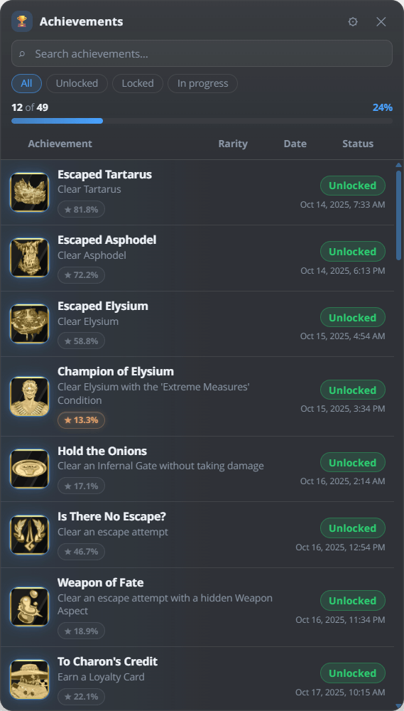
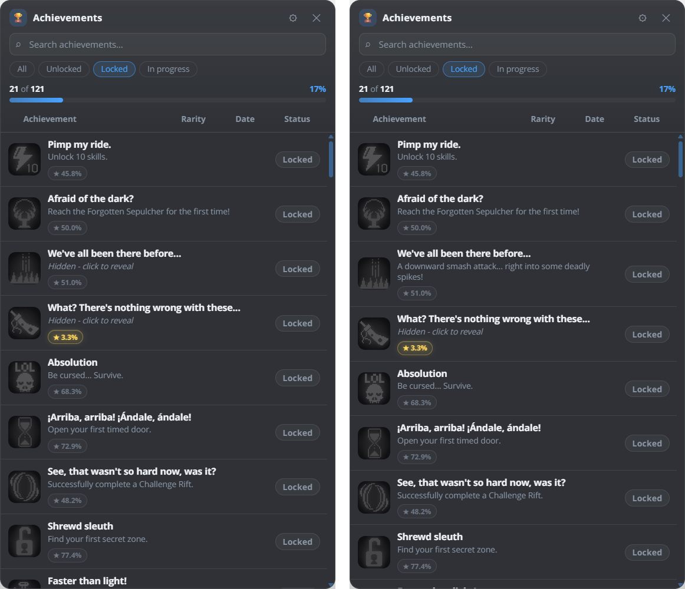

# ゲーム内の実績リスト(オーバーレイ)

ゲーム内オーバーレイ(対応ゲームの実行中は既定で `Ctrl+Shift+K`)は、ゲームを離れることなく、実行中のゲームの実績リストを
表示します：名前、説明、ロック状態、解除日、進捗です。ヘッダーをドラッグして動かせ、ゲームの上に表示されたままになります。
Linux では、Wayland でネイティブに動作しているゲームはホットキーを渡さないため、代わりに
`~/.local/bin/achievement-watcher --toggle-overlay` をキーに割り当ててください。
[オーバーレイのショートカット](linux.md#overlay-shortcut)を参照してください。

<picture><source srcset="../assets/shot/overlay.webp 569w" sizes="(max-width: 700px) 100vw, 360px"></picture> 
ステータス、レア度、日付の列と、検索およびフィルター

## ゲーム中に実績リストを開くには? {#how-do-i-open-the-achievement-list-in-a-game}

対応ゲームの実行中に `Ctrl+Shift+K` を押します。これが既定のホットキーです。オーバーレイには、そのゲームのすべての
実績が、ステータス、解除日、レア度、進捗とともに表示され、検索もできます。
もう一度ホットキーを押すと閉じます。コントローラーでは、既定は **Back + Start + LB** です。

Wayland 上の Linux では、ネイティブな Wayland ウィンドウとして動作するゲームは、キーを AW Next に渡しません。
代わりに、デスクトップのキーボード設定で `~/.local/bin/achievement-watcher --toggle-overlay` をキーに割り当ててください。
[オーバーレイのショートカット](linux.md#overlay-shortcut)を参照してください。

## オーバーレイは解除ポップアップと同じものですか? {#is-the-overlay-the-same-as-the-unlock-popup}

いいえ。ポップアップは、何かが解除されたときに表示される一度きりの通知で、プリセットで装飾されます
([通知](notifications.md)を参照)。オーバーレイは 1 つのゲームの完全なリストで、自分で開き、
閉じるまで表示され続けます。

## 表示される内容 {#what-it-shows}

- `unlocked / total` と達成率を表示する統計バー。
- 実績ごとに 1 行。色付きのステータスのピル(`解除済み` / `ロック中`)、獲得した実績の解除日、進捗型の実績には
  `current / max` のラベル付きの進捗バーが付きます。
- 解除率が分かっているすべての実績に、レア度のバッジ(`★ 12.3%`)。通常の実績は暗いグレーのバッジで、
  レアなものは既定で 5%、10%、15% の基準に応じて、やわらかい光輪のついたゴールド、シルバー、ブロンズです。
  **設定 → 一般 → レア度の表示** でティアを変更したり、トロフィーのグレードに切り替えたりできます。
- 固定した実績が、並べ替えに関係なく先頭に表示されます。ロック中の行にある小さなピンで固定と解除ができ、メインウィンドウの **一番上に固定** と同じです。実績が解除されるとピンは外れます。
- **解除済み** の下に、その解除時に撮影されたスクリーンショットとクリップのボタンが、ある場合に表示されます。コントローラーでは左右で切り替え、**A** でクリップを再生、**B** で閉じます。

## 隠し実績 {#hidden-achievements}

オーバーレイは、解除していない隠し実績のネタバレをしません。メインウィンドウと同様に、その説明は
*隠し - クリックで表示* と表示されます。クリックするか、コントローラーで **A** を押すと、その 1 つの説明が
表示されます。検索は、まだ隠されている説明を無視します。

<picture><source srcset="../assets/shot/overlay-hidden-800.webp 800w, ../assets/shot/overlay-hidden.webp 1162w" sizes="(max-width: 700px) 100vw, 560px"></picture> 
「We've all been there before...」をクリックする前と後：その説明だけが表示されます

## 検索とフィルター {#search-and-filters}

- 検索ボックスは、入力に合わせて実績の名前と説明で行を絞り込みます。
- リストの上のピルで、**すべて**、**解除済み**、**未解除**、**進行中** を切り替えます。
- **レア度**、**日付**、**ステータス** の列見出しをクリックすると、昇順、降順、元の順序の順に切り替わります。
  同時に並べ替えられる列は 1 つだけです。
- `/` で検索ボックスにフォーカスします。`Esc` で検索ボックスを消去するか、開いている場合はオプションパネルを閉じます。

## コントローラー(ゲームパッド) {#controller-gamepad}

**設定 → コントローラー** で **コントローラーでゲーム内オーバーレイを操作** を有効にすると、ゲームパッドで
オーバーレイを操作できます。既定の割り当てでは：

- **Back + Start + LB** でオーバーレイを開閉します。
- **LB + X** でナビゲーションモードを切り替えます：フォーカスリングが現在位置を示し、オーバーレイのヘッダーに小さな **UI** バッジが
  表示されます。
- ナビゲーションモードでは、十字キーまたは左スティックでフォーカスを動かし、**A** で決定、**B** でキャンセル、**X** で
  検索にフォーカス、**Y** でオプションパネルを開きます。
- **LB + RB** を押したままにすると、左スティックでオーバーレイを動かし、右スティックでリストを
  スクロールします。

すべてのショートカットは設定でき、ボタンの名前は選んだレイアウトに従い、オーバーレイのヒントバーには
自分の割り当てが表示されます。[コントローラーのガイド](controller.md)で、設定、対応するパッド、
そしてゲームにもボタン入力が届き続ける Windows の注意点を説明しています。

## カスタマイズ {#customization}

オーバーレイのヘッダーの **⚙** ボタンでオプションが開きます。

- **アクセント**：5 つのカラープリセット、自分の色、またはメインウィンドウのテーマに従う **アプリのテーマを使用**
  (進捗、有効なフィルター、フォーカスリング、解除済みの行の光彩に使われます)。プリセットの後ろのチップにはあなたの色とそのコードが表示され、
  オーバーレイ内で、色合いのパッド、色相スライダー、コードの入力欄、直近の 3 色を備えたピッカーが開きます。
- **密度**：行間隔のコンパクト、快適、ゆったり。
- **アイコンサイズ**：小、中、大。
- **ズーム**：パネルサイズの 80% から 125%。
- **不透明度**：パネルの背景の 20% から 100% までのスライダーで、動かすとすぐに反映されます。
- 統計バー、進捗バー、レア度バッジ、説明の**表示/非表示の切り替え**。

変更はすぐに反映され、ローカルに保存されます。**初期設定に戻す** で元の見た目に戻ります。オプションは
キーボードでも操作できます：ズームのメニューと不透明度のスライダーにはフォーカスリングが表示され、スイッチは
Tab とスペースで切り替わり、アニメーションはシステムの視覚効果を減らす設定に従います。

## キーボードショートカット(オーバーレイを開いているとき) {#keyboard-shortcuts-overlay-open}

- `Ctrl+Alt+Shift+矢印キー` - オーバーレイのウィンドウを少し動かします。
- `Ctrl+Alt+Shift+1` … `5` - 定義済みの位置にスナップします。
- `Ctrl+Alt+Shift+C` - クリックスルーを切り替えます。

## 注意点 {#notes}

- オーバーレイはアプリで選択したインターフェース言語に従います。
- 最初に開いたあと、オーバーレイのウィンドウは非表示のまま 5 分間再利用されるため、再度切り替えても
  ほぼ瞬時です。非表示の間はコントローラーのポーリングを停止し、5 分間操作がないとウィンドウは
  解放されてメモリが空きます。
- 行の内容は描画の前にエスケープされます。実績のデータは表示されるだけで、実行されることはありません。
- オーバーレイのリストは、ポップアップの見た目を設定する、一度きりのオーバーレイ*通知*プリセット(設定 →
  通知)とは別のものです。

---

**次へ：** [コントローラーのガイド](controller.md) - ゲームパッドでオーバーレイとアプリを操作します。

[← ドキュメント](README.md) · [通知のガイド](notifications.md) · [プロジェクトのホーム](https://github.com/Shirowwww/Achievement-Watcher-Next)

