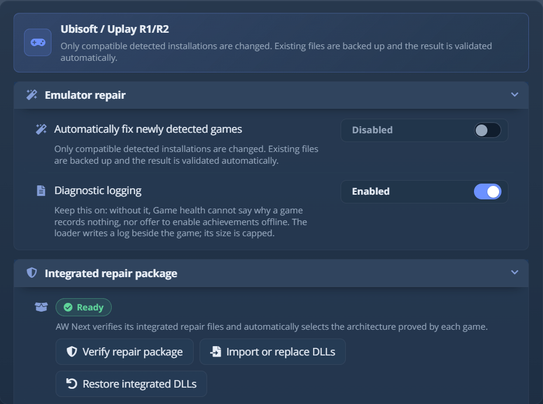

# Goldberg Uplay のセットアップ(R1 と R2)

AW Next には、Goldberg Uplay エミュレーターで動作する Ubisoft のゲーム向けに、別の修復があります。公式の
Ubisoft Connect のインストールには決して触れません。ゲームが選ばれるのは、AW Next が、そのゲームが使うローダーと世代を
正確に確認できたときだけです。

Ubisoft のゲームは、実行ファイルがリンクされた世代のローダーだけを読み込みます。おおよそ 2019 年
以降は **R2**、それ以前はすべて **R1** です。AW Next は該当する方を検出して修復します。
誤った世代では、ゲームが決して開かない DLL を置いてしまうためです。2 つの製品 ID を持つ Ubisoft のゲーム(基本ゲームと
その Complete Edition)はどちらでも動作します：どちらの ID のセーブも読み取られ、その中のむき出しの
目標 ID は Steam の実績リストと照合されます。

> [!WARNING]
> この修復はゲームのファイルを変更します。自分が所有するゲームにだけ使ってください。

## ゲームを修復する {#repair-a-game}

**ゲームの状態** から：

1. **設定 → フォルダー** にゲームのライブラリを追加して、スキャンします。
2. ゲームの **ゲームの状態** パネルを開いて、**Uplay R1/R2 のセットアップを診断** を確認します。
3. **Ubisoft の実績修正を適用…** を実行して、ゲームを一度起動します。

**設定 → エミュレーター → Ubisoft / Uplay R1/R2** から：

<picture><source srcset="../assets/shot/uplay-r2-panel-800.webp 800w, ../assets/shot/uplay-r2-panel.webp 928w" sizes="(max-width: 700px) 100vw, 720px"></picture> 
統合された修復パッケージは、どのゲームにも触れる前に検証されます

- **新しく検出されたゲームを自動修正**：Steam / GBE Fork の下にも表示される同じスイッチで、
  Ubisoft のゲームにも適用されます。既定ではオフです。
- **検出された Uplay R1/R2 ゲームを修復**：検出されたすべてのインストールを、確認を取った 1 つのバッチで修復します。
- **DLL をインポートまたは置換** / **内蔵 DLL を復元**：自分のローダーのビルドを使うか、AW Next が同梱する
  ものに戻します。手動で選択した DLL に既知の SHA-256 フィンガープリントは不要ですが、名前とアーキテクチャが整合した、
  実績に対応する有効な Uplay ローダーでなければなりません。

統合された DLL は `app/resources/uplayR2/`(R2)と `app/resources/uplayR1/`(R1)にあります。AW Next は、
修復がそれらを使う前に、ハッシュ、PE アーキテクチャ、実績への対応を確認し、
その隣にリカバリー用のアーカイブを保持します。

同じ修復トランザクションが、コンテキストメニュー、ゲームの状態、自動修復、すべてを修正、そして
バッチボタンから実行されます。変更されるすべての DLL、スキーマ、INI のスナップショットを `<game>\.aw-backups\<timestamp>\` に取り、
そのあとの検証に失敗した場合は自動的に復元します。同じ修復を繰り返しても何も起こりません。

## 未対応のゲームを Steam のリリースに関連付ける {#linking-an-unmapped-game-to-its-steam-release}

AW Next は、ほとんどの Ubisoft のゲームを自動で Steam のリリースに照合し、Steam の実績名を
ローダーが期待する Ubisoft の目標 ID に変換します。それができない場合は、ゲームの右クリックメニューの
**ゲームを特定（Steam アプリ ID）** で、リリースを自分で選びます。確認できない組み合わせは拒否されます。
誤った組み合わせでは、別のゲームの実績リストがこのゲームの
フォルダーに書き込まれてしまうためです。

Ubisoft Connect でゲームの実績ページを一度開いておくと、Brawlhalla や The Crew 2 のように
それが必要なタイトルを AW Next が認識しやすくなります。確定した選択は、その正確な
インストールフォルダーについて記憶されます。自動の照合(内蔵のマップ、ライブの Ubisoft カタログ、
タイトル照合のルール)は、[Uplay R1/R2 リファレンス](../uplay-reference.md)で説明しています。

## 実績を一度も要求しないゲーム {#a-game-that-never-asks-for-an-achievement}

Ubisoft のタイトルの中には、最初にローダーに Ubisoft のセッションを要求し、ローダーが空の
キーで答えるものがあります。そうしたゲームは空のキーをサインアウト状態と解釈し、実績の API を一度も呼びません。
セットアップは正しく見えるのに、何も記録されません。Avatar: Frontiers of Pandora がこのように動作します。

ゲームの状態の診断ログがそのことを証明すると、エミュレーター設定の確認で **オフラインで実績を有効にする** が提案されます。
ゲームの隣にプレースホルダーのセッションキーを 1 つ追加します。本物の Ubisoft のセッションではなく、
アカウントは関係せず、何もどこにも送信されず、その 1 つの確認を通すのに十分なだけのものです。正当でないトークンは
一部のゲームを壊す可能性があるため、自動で追加されることはありません。

**オンにしたあと、ゲームを一度起動してください。** それまで、行には *オフラインの実績がオンです。ゲームを一度起動してください* と
表示されます。その後、隣のボタンは **オフラインの実績を無効にする** になり、キーを
取り除きます。

これは R2 のローダーにのみ当てはまります。R1 の INI には無関係なキーがあります。この修復に相当する Steam 向けのものは、
[Goldberg / GBE のガイド](emulator-setup.md)で説明しています。

## 実績が 0% のまま {#achievements-remain-at-0}

- ゲームのアップデート後は、**Uplay R1/R2 のセットアップを診断** をもう一度実行してください。アップデートでスキーマが削除されたり、
  解除数がリセットされたりすることがよくあります。
- ローダーの DLL の隣にある `upc_r2.log`(または `upc_r1.log`)を読んでください。ゲームが要求したすべての
  目標番号が記録されています。**設定 → エミュレーター → Ubisoft / Uplay R1/R2** の **診断ログ** はオンのままにしてください。
  ゲームの状態は、一度も要求しなかったゲームと、スキーマにない目標を要求しているゲームを区別するために
  これを必要とします。既定でオンで、AW Next はログが 25 MB を超えると切り詰めます。
- `%APPDATA%\Achievement Watcher Next\logs\parser.log` を確認してください。

## ウイルス対策ソフトについての注意 {#antivirus-note}

ウイルス対策ソフトが単体のローダー DLL を削除したり、途中でリカバリー用のアーカイブを隔離したりした場合、ゲームの
状態がウイルス対策の問題を報告し、フォルダーを許可してファイルを元に戻すことを提案します。自分で代わりを
探す必要はありません。

ID、目標 ID、ローダーのログについては、[Uplay R1/R2 リファレンス](../uplay-reference.md)で説明しています。

[← ドキュメント](README.md) · [トラブルシューティング](troubleshooting.md) · [プロジェクトのホーム](https://github.com/Shirowwww/Achievement-Watcher-Next)

