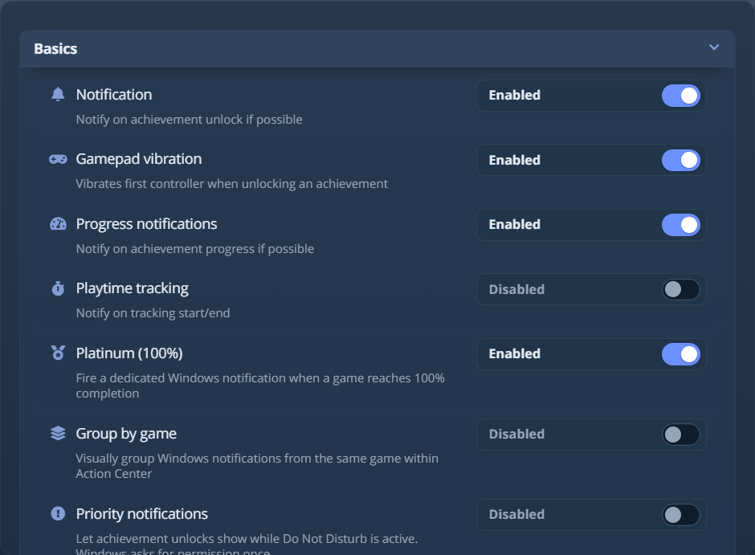
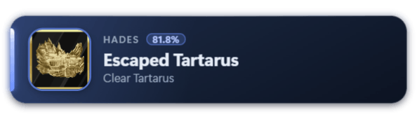
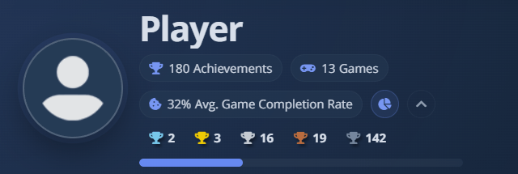
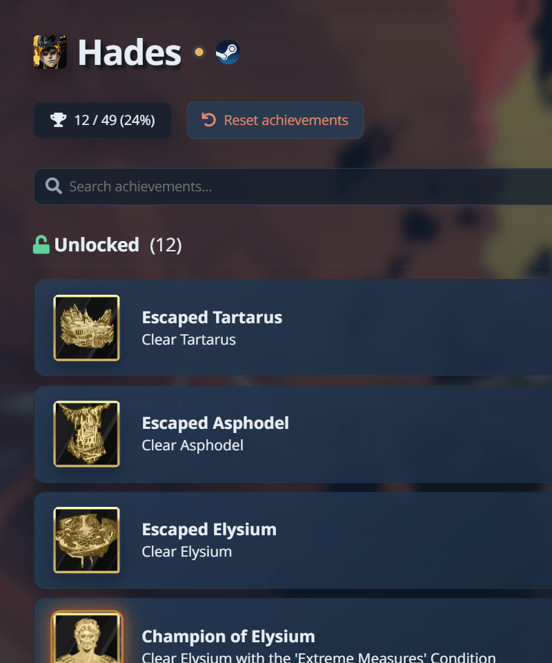
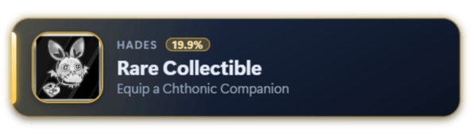
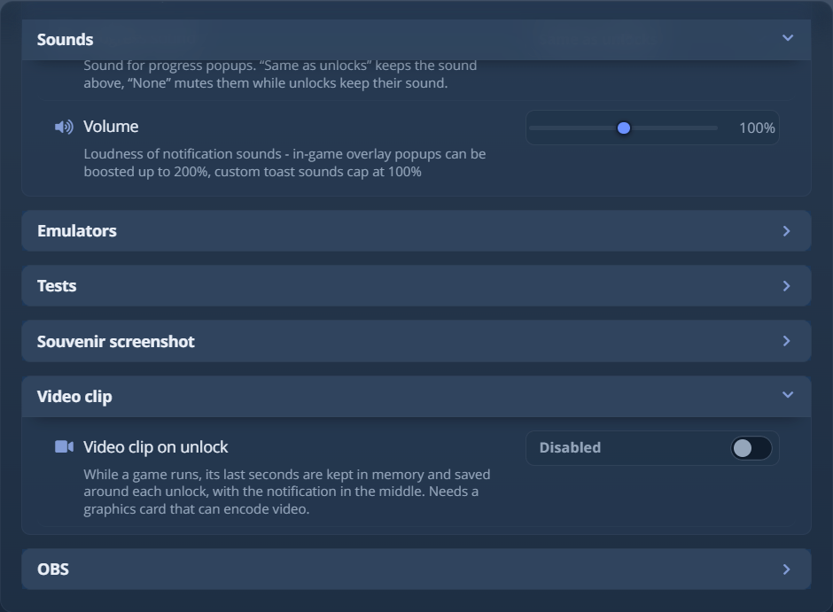

# Notifications

AW Next announces an unlock with a native Windows notification (toast), an in-game overlay popup, or
both. Choose how under **Settings → Notification**.

On Linux the notification is the desktop's own (GNOME or KDE) and the overlay works the same way.
Do Not Disturb and the Priority notifications switch are covered in [Supported desktops](linux.md#supported-desktops).

<picture><source srcset="assets/shot/notifications-panel-800.webp 800w, assets/shot/notifications-panel.webp 940w" sizes="(max-width: 700px) 100vw, 720px"></picture> 
One delivery mode, one preset - Automatic handles the rest

## Choose a delivery mode

| Mode | Behavior |
|---|---|
| **Automatic** (default) | The in-game overlay when it can be shown, a Windows notification when it cannot. |
| **In-game overlay** | Always the styled popup above the running game, even in exclusive fullscreen, where it may not be visible. If the overlay cannot display at all, that notification arrives as a Windows notification. |
| **Windows notification** | Always the Windows system notification. Achievement and progress notifications use the achievement icon; playtime notifications can include game artwork and a progress bar. |
| **Both** | The same event on both transports. |

AW Next posts Windows notifications itself and starts no other program, PowerShell included, so they
appear at once. A custom app id set in `options.ini` (`[notification_advanced] appID`) still goes
through the former PowerShell route.

The library window can stay closed in every mode: the background tracker handles delivery.

<picture><source srcset="assets/shot/notification-popup.webp 594w" sizes="(max-width: 700px) 100vw, 440px"></picture> 
The overlay popup, drawn by the selected preset with the game's own artwork

Whatever the mode, **Websocket @localhost:8082** broadcasts every notification event as JSON on a
local websocket, for stream overlays and other tools. It is on by default, listens on `127.0.0.1`
only and shows nothing itself. Turn it off if you do not use it. The same address serves a ready-made
stream overlay: see [Show unlocks on stream (OBS)](#show-unlocks-on-stream-obs).

> [!TIP]
> Use the test buttons after changing the mode. A successful test confirms the display path; a real
> unlock still depends on the game source being watched correctly.

### How Automatic decides

Each notification is routed once, from what AW Next can observe at that moment:

| Situation | What happens |
|---|---|
| Nothing covering the screen | In-game overlay. |
| The game is in **fullscreen** (Direct3D with Windows' fullscreen optimizations, which most games get) | Windows notification, shown over the game without taking its focus: a priority notification when those are on, otherwise a reminder that AW Next closes after the usual notification time. Borderless and windowed games keep the overlay. |
| The game holds the screen in **legacy exclusive mode** (older games, many OpenGL games, or fullscreen optimizations off) | Nothing from another app is drawn on that screen. The notification goes to Notification Center; its sound and the controller rumble still play. Borderless mode in the game brings it back on screen. |
| The app cannot display the popup (no usable preset, renderer unavailable) | A Windows notification. |
| The overlay fails to display | Windows notifications for ten minutes, then the overlay is tried again. |
| The overlay was asked but never reported back | No second notification, to avoid a duplicate. The next unlock uses a Windows notification. |

AW Next remembers which transport last delivered for each game and uses it only as a tie-breaker when
Windows cannot say whether a game is in exclusive fullscreen. A fallback happens only after a definite
failure, so the same unlock is never announced twice. AW Next does not inject into games or force
display-mode changes.

### Where the current state is shown

A game's **Game Health** panel has a Notifications row naming the transport that delivered the last
notification and why, for example *Working - Windows fallback active* (Simple mode). With no
notification yet it shows the configured mode. If Windows kept a notification in Notification Center
because the game was full screen or Do Not Disturb was on, the row says so. See
[Game Health](game-health.md).

## Priority Windows notifications

Full-screen games and other automatic Windows rules can turn on **Do Not Disturb**, which sends
ordinary toasts to Notification Center without showing them. **Settings → Notification → Priority
notifications** marks achievement unlocks as important. Windows asks once whether AW Next may send
them; change the answer in Windows notification settings.

It is off by default and covers achievement and completion unlocks only, never progress or playtime.
The toast uses the `urgent` scenario, which needs Windows 11 (build 22546) or later; on Windows 10
the setting does nothing. See [Microsoft's app-notification documentation](https://learn.microsoft.com/en-us/windows/apps/develop/notifications/app-notifications/app-notifications-content).

## Games Steam runs

Steam shows its own pop-up for the games it runs, so AW Next stays quiet for them by default. Enable
**Settings → Notification → Steam client games** to get AW Next's notification too, with its sound,
overlay, rarity and screenshot souvenir. It covers owned games and games added through SteamTools,
LuaTools or GreenLuma: AW Next follows the stats file Steam rewrites in `appcache\stats`. To keep
only AW Next's notification, turn off **Steam → Settings → Notifications → I unlock an achievement**.

## How the popup looks

The look of the in-game popup is a **preset**: ten ship with the app, you can design your own, and a
preset can be shared as one `.awpreset` file. See [Presets and the Preset Designer](presets.md).
**Opacity** (30% to 100%) in the same settings sets how see-through the popup is.

## Sounds, volume and duration

- Import `.wav`, `.mp3`, `.ogg`, `.flac`, `.m4a` or `.aac` files from the Notification settings.
- **Random** in the sound list plays a different file from yours for every notification, and for
  every preview or test.
- **Rare achievement sound** and **100% completion sound** (Advanced mode) give those popups their own
  sound, for the overlay and Windows notifications. Both start on "Same as unlocks"; "None" makes
  that kind of popup silent. A sound chosen for one game in its own panel still wins.
- **Progress sound** (Advanced mode) does the same for progress popups. It wins over a game's own
  sound, except for a game set to no sound. To silence one game's progress popups, right-click it and
  mute its progress.
- **Emulators** (Advanced mode) gives each console its own preset and sound: Xenia, RPCS3, shadPS4 and
  Kyty are listed. Recompiled Xbox 360 games follow Xenia's choice, PS4 ports follow shadPS4's, and
  **Same as main** keeps the main settings.
- Overlay volume goes from 0% to 200%; above 100% the overlay boosts the sound. Windows notification
  playback is limited by the system audio path.
- Duration follows the preset or uses a fixed cap.
- Playtime notifications are silent.

A shared preset can carry its own sound, which replaces the one selected here. See
[Share a preset](presets.md#share-a-preset).

## Position and scale

Choose a corner, edge or centered position in the Notification settings. Positions are measured
against the whole screen, so a bottom anchor sits on the bottom edge, not above the taskbar, and the
card touches the chosen edges whatever room for shadow or glow its preset leaves around it. AW
measures each preset once per position, in the background after its first popup, so that first popup
shows at the old place. A preset whose card follows the length of its text (PS5 Steam, Slim)
is measured with each popup, which holds it back about half a second.

**Reposition** moves the custom position, used exactly as you left it; one saved on a monitor that is
gone is brought back into view. With several screens, the popup appears on the screen of the game
you are playing, not the one under the mouse, and a custom position keeps its place relative to that
screen. Windows notifications always show on the main screen.

The scale setting resizes the whole popup without changing its layout, and **Reposition** previews
it at that scale.

### Progress popups

Counter achievements (kill 50 enemies, travel 100 km) can raise a progress popup at every step. In
Advanced mode, **Progress position** and **Progress scale** give those popups their own place and
size. **Same as unlocks**, the default, follows a game's own position when it has one; any other
choice applies to the progress popups of every game. The crosshair beside **Progress position** places
a custom anchor for progress only. These settings move only the in-game popup.

**Progress milestones**, in the common notification settings, shows a progress notification only when
a counter crosses another 10, 25 or 50% of its goal. It applies to the popup and the Windows
notification. The unlock itself is always shown.

The overlay list has its own keyboard shortcuts (see the
[Overlay guide](overlay.md#keyboard-shortcuts-overlay-open)) and optional gamepad control (see the
[Controller guide](controller.md)).

## Per-game behavior

Open a game's tools panel and choose **Notification** to give that game its own popup preset,
position, sound or scale. Every field inherits the global setting, and only the values you change are
stored; sound also offers silence and random. The crosshair beside Position drags a preview to where
that game's popup should appear. The five test buttons preview that game and its artwork without
changing achievement progress. A removed preset or sound falls back to the global value, and renaming
a user preset keeps its game assignments.

Right-click a game to mute its progress notifications while keeping unlocks and completion
notifications.

An achievement with a global unlock rate at or below the rare limit prints its percentage and gets
the preset's rare styling: **gold** at 5% or less, **silver** up to 10%, **bronze** up to 15%. Move
these limits with **Settings → General → Rarity thresholds** set to Custom (Advanced mode).

### Trophy mode

**Settings → General → Rarity display** switches to **Trophy mode**: every achievement is graded by
its global unlock rate (gold under 20%, silver under 50%, bronze otherwise or when the rate is
unknown) in the game window, the overlay, the profile trophies and the notification. **Rarity
thresholds** moves the bounds. All three grades use the preset's rare styling (`state-rare` plus
`tier-gold`, `tier-silver` or `tier-bronze`); platinum stays the separate completion state. The app
gives a preset its tier in `rarityTier` (with `rarityMode` and the localized `rarityGrade`); a preset
without the field falls back to the percentage.

With a PlayStation account connected (**Settings → Sources**), a game that also came out on
PlayStation uses its real trophy list, wherever its achievements come from: each achievement takes the
grade and DLC group of the trophy with the same name or description. The real platinum shows in every
rarity mode (game page, stats, 100% popup) with its name, description and icon, and counts once that
trophy is earned, even with DLC trophies left. PlayStation emulators keep their own trophies. AW
finds the list by the game's original name, so renaming a game changes nothing.

Every source pops the 100% popup, the live ones included (Xenia, recompiled ports, GOG Galaxy,
Ubisoft Connect, Xbox PC). When the game has a platinum, the achievement tied to it pops as the
platinum.

<picture><source srcset="assets/shot/trophy-profile.webp 640w" sizes="(max-width: 700px) 100vw, 440px"></picture> 
The profile counts every unlock by grade, with platinum for finished games

<picture><source srcset="assets/shot/trophy-game-panel.webp 800w" sizes="(max-width: 700px) 100vw, 560px"></picture> 
On a game's page each achievement carries its grade and the share of players who have it

<picture><source srcset="assets/shot/notification-popup-trophy.webp 594w" sizes="(max-width: 700px) 100vw, 440px"></picture> 
A gold unlock in the AW Next preset

## Show unlocks on stream (OBS)

Capturing the popup as a window does not work: the popup window lives a few seconds, so OBS never
catches it. Use a **Browser** source, which OBS keeps loaded for the whole stream.

1. **Settings -> Notification -> OBS browser source.** **Preview** opens the page in your browser
   with a sample unlock every ten seconds, the quickest check that the chain works. **Copy link**
   copies the address.
2. In OBS: **+ -> Browser**, paste the address into **URL**.
3. Set any **Width** and **Height**. The card scales to fill the box.

The source shows the same preset, artwork and rarity styling as the in-game popup and follows the
preset you pick in Settings. The test buttons under **Settings -> Notification** fire into it too,
whatever the delivery mode.

> [!TIP]
> **A bigger source is a sharper card.** The card is laid out at the source's size, not stretched.
> Give the source roughly twice the preset's own box and place it at half size in your scene:
> `http://127.0.0.1:8082/obs/_config` reports both numbers. Only the achievement icon stays soft,
> since Steam publishes it at 64x64.

### Options

Append them to the address, `?first=x&then=y`:

| Option | Effect |
|---|---|
| `?test=1` | Repeats a sample unlock every ten seconds, for positioning the source. Remove it afterwards. |
| `?scale=2` | Pins the card at that zoom instead of fitting it to the source. `?scale=app` follows the scale set in Settings. |
| `?duration=8000` | Holds each card for that many milliseconds instead of the configured duration. |
| `?sound=1` | Plays the notification sound through the browser source, so it reaches the stream without capturing desktop audio. Off by default, since the app already plays it on your speakers. Tick **Control audio via OBS** on the source to put it in the mix. |
| `/obs/preset/Xbox/` | Uses one named preset for the stream, whatever the desktop is set to. Any installed preset name works, including your own. |

### Notes

- The page is blank between unlocks by design: nothing is drawn, so it costs no CPU until an
  achievement pops.
- It is local only. The page and the feed listen on `127.0.0.1`, so nothing else on your network can
  reach them.
- Achievement icons are served from this machine for sources that keep their artwork locally
  (Goldberg, emulators, your own library art), and only for pictures a notification announced.
- One copy of AW Next serves the address: the one that started first. A second instance, or anything
  else on port 8082, leaves the source with nothing to connect to. Close the extra copy and the source
  reconnects within a few seconds.
- If the source stays blank on a real unlock, check that the test buttons work, then that the
  **Websocket** row is on.

## Screenshot souvenirs

**Screenshot on unlock** saves a picture of the screen a moment after an achievement pops, once the
popup has finished appearing, so the notification is in the shot. Files land in
`<folder>\<game>\<achievement> - <date>.png`. **Open folder** in the same row opens it, creating it
first if needed. The folder defaults to `Pictures\Achievement Watcher Next` and can be changed.

Achievements unlocking in the same second each keep their own file, and a game whose title Windows
refuses as a folder name still gets its screenshots. On multi-monitor setups the souvenir captures
the monitor the game is on, like the video clips; with no visible game window, it takes the monitor
of the window in front, then the primary one.

### Playing with Windows HDR on

**HDR screenshots** defaults to **Automatic**. At capture time, AW Next checks whether HDR is active
on the display showing the game. If so, a one-shot helper captures an FP16 frame through Windows
Graphics Capture and tone-maps its highlights into an SDR/sRGB PNG, then exits. With HDR off,
**Automatic** and **Off** use the standard capture. Any helper failure (missing Windows support, a
blocked capture, a timeout) also falls back to the standard screenshot, so the souvenir and the
notification are not lost.

## Video clips

**Video clip on unlock** works like a console's trophy video. While a game AW Next tracks is running,
the last seconds of play are kept in memory, already compressed by the graphics card's video encoder.
When an achievement pops, the stretch around it is saved as an MP4 in
`<folder>\<game>\<achievement> - <date>.mp4`, with the popup in the middle of it. The folder is
`Videos\Achievement Watcher Next` unless you pick another. Achievements unlocking close together
share one clip.

| Setting | Choices | Default |
|---|---|---|
| Clip length | 10 to 30 seconds, half before the unlock and half after | 20 s |
| Format | H.264, HEVC or AV1, saved as MP4 | H.264 |
| Resolution | Screen, 2160p, 1440p, 1080p or 720p, never above the screen | 1080p |
| Frame rate | 30 FPS, 60 FPS or Unlocked, which follows your screen (120, 144, 240 Hz) | 30 FPS |
| Quality | Low, Medium or High | Medium |
| Sound | Game only, or the whole PC | Game only |

<picture><source srcset="assets/shot/video-clip-panel-800.webp 800w, assets/shot/video-clip-panel.webp 940w" sizes="(max-width: 700px) 100vw, 720px"></picture> 
The Video clip section sits at the bottom of the Notification tab and is off until you turn it on

The row under the table estimates the size of one clip for your screen. It is a ceiling: the encoder
runs at a constant bitrate and a quiet scene comes out smaller.

- **Cost.** Nothing runs while no game does. Capture, scaling and encoding stay on the GPU, on an
  encoder block separate from the one rendering the game. The recorder uses well under 1 % of the CPU
  and about 70 to 110 MB of memory plus one clip. Nothing is written to disk until an achievement
  unlocks.
- **Format.** H.264 plays everywhere, Discord and phones included. HEVC and AV1 make smaller files.
  AV1 needs a GeForce RTX 40, Radeon RX 7000, Intel Arc or newer; without the chosen format the clip
  is recorded in H.264. A card with no hardware H.264 encoder uses Windows' software encoder, on the
  processor, at 1080p and 30 FPS at most.
- **Frame rate.** **Unlocked** records at the refresh rate of the monitor showing the game and
  follows it when it changes. If the encoder refuses a rate, the recorder steps down to 60, then 30
  FPS, and logs it. The size estimate assumes twice the 30 FPS bitrate for Unlocked.
- **If the recorder stops answering.** AW Next restarts it after a wait that doubles each time, and
  gives up on a game after five failed restarts. A clip whose writing fails halfway is kept if what
  was written plays, otherwise removed. A clip left half written by a PC that went down is cleaned up
  the next time a game is recorded.
- **HDR.** With Windows HDR on, clips are tone-mapped like HDR screenshots; **HDR screenshots** set to
  **Off** applies to clips too.
- **Sound.** **Game only** leaves out voice chat and music. If the game's sound cannot be recorded
  alone, the whole PC is recorded.
- **What is captured.** The monitor showing the game, notifications included. A very old game in
  exclusive fullscreen may record black frames.

## If a test or unlock does not appear

1. Confirm notifications are enabled, and read the Notifications row of the game's
   **[Game Health](game-health.md)** panel.
2. Check that the background tracker is running.
3. For overlays, select a valid preset and test again outside an exclusive fullscreen game.
   **Automatic** already handles both cases.
4. If a full-screen game or Do Not Disturb hides Windows notifications, enable **Priority
   notifications** and approve Windows' one-time request.
5. Check Windows notification settings for AW Next.
6. Open **Settings → Advanced → Diagnostics** and inspect the logs.

If the problem remains, continue with [Troubleshooting](troubleshooting.md#notifications-do-not-appear).

---

**Next:** [Presets and the Preset Designer](presets.md) - the look of the popup, and how to make your
own.

[← Documentation](README.md) · [Project home](https://github.com/Shirowwww/Achievement-Watcher-Next)

