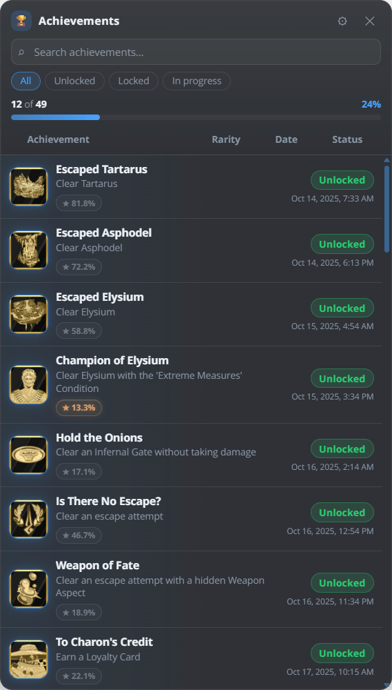
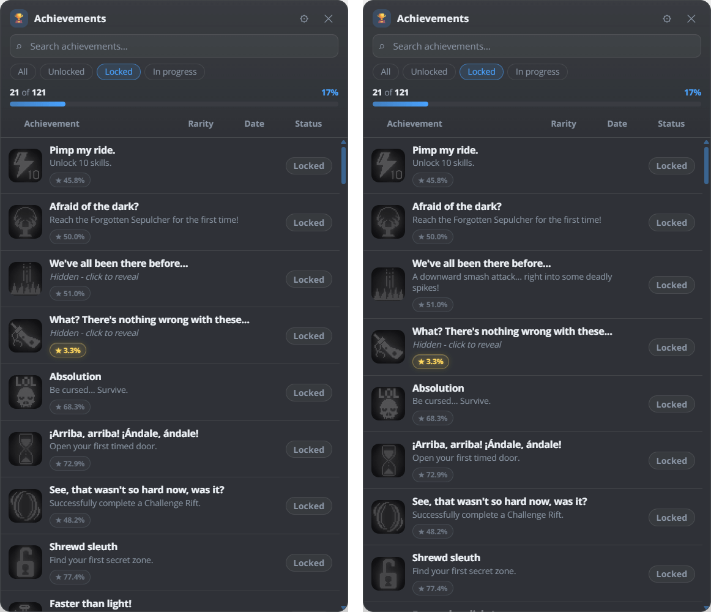

# In-game overlay list

The in-game overlay (`Ctrl+Shift+K` by default while a supported game runs) shows the achievement
list of the running game without leaving it: names, descriptions, lock state, unlock dates and
progress. Drag it by its header; it stays on top of the game. On Linux, a game running natively
under Wayland does not pass the hotkey on: bind `~/.local/bin/achievement-watcher --toggle-overlay`
to a key instead, as [Overlay shortcut](linux.md#overlay-shortcut) shows.

<picture><source srcset="assets/shot/overlay.webp 569w" sizes="(max-width: 700px) 100vw, 360px"></picture> 
Status, rarity and date columns, with search and filters

## What it shows

- A stats bar with `unlocked / total` and the completion percentage.
- One row per achievement with a colored status pill (`Unlocked` / `Locked`), the unlock date for
  earned achievements, and a progress bar with a `current / max` label for progress achievements.
- A rarity badge (`★ 12.3%`) for every achievement with a known unlock rate. Common achievements use
  a dark-gray badge; rare ones use gold, silver and bronze with a soft halo, at 5%, 10% and 15% by
  default. **Settings → General → Rarity display** changes the tiers or switches to trophy grades.

## Hidden achievements

The overlay does not spoil a hidden achievement you have not unlocked: as in the main window, its
description reads *Hidden - click to reveal*. Click it, or press **A** on a controller, to reveal
that one description. Search ignores descriptions that are still masked.

<picture><source srcset="assets/shot/overlay-hidden-800.webp 800w, assets/shot/overlay-hidden.webp 1162w" sizes="(max-width: 700px) 100vw, 560px"></picture> 
Before and after a click on "We've all been there before...": only that description is revealed

## Search and filters

- The search box filters rows by achievement name and description as you type.
- The pills above the list switch between **All**, **Unlocked**, **Locked** and **In progress**.
- Clicking the **Rarity**, **Date** or **Status** column header sorts ascending, then descending,
  then back to the natural order. One column sorts at a time.
- `/` focuses the search box. `Esc` clears it, or closes the options panel if it is open.

## Controller (gamepad)

Enable **Control the in-game overlay with a controller** in **Settings → Controller** to drive the
overlay from a gamepad. With the default bindings:

- **Back + Start + LB** opens or closes the overlay.
- **LB + X** toggles navigation mode: a focus ring shows where you are, and a small **UI** badge
  appears in the overlay header.
- In navigation mode, the D-pad or left stick moves the focus, **A** confirms, **B** cancels, **X**
  focuses the search and **Y** opens the options panel.
- Holding **LB + RB** moves the overlay with the left stick and scrolls the list with the right
  stick.

Every shortcut is configurable, button names follow the layout you pick, and the overlay's hint bar
shows your own bindings. The [controller guide](controller.md) covers the settings, the supported pads
and the Windows caveat about the game still seeing your button presses.

## Customization

The **⚙** button in the overlay header opens the options:

- **Accent**: five color presets, a custom color picker, or **Use app theme** to follow the main
  window's theme (used for progress, active filters, focus rings and unlocked-row glow).
- **Density**: Compact, Cozy or Spacious row spacing.
- **Icon size**: Small, Medium or Large.
- **Zoom**: 80% to 125% of the panel size.
- **Opacity**: 40% to 100% of the panel's background.
- **Show/hide toggles** for the stats bar, progress bars, rarity badges and descriptions.

Changes apply at once and are saved locally. **Reset defaults** restores the original look. The
options work from the keyboard: the zoom and opacity menus show a focus ring, switches toggle with
Tab and Space, and animations follow the system's reduced-motion setting.

## Keyboard shortcuts (overlay open)

- `Ctrl+Alt+Shift+Arrows` - nudge the overlay window.
- `Ctrl+Alt+Shift+1` … `5` - snap to a preset position.
- `Ctrl+Alt+Shift+C` - toggle click-through.

## Notes

- The overlay follows the interface language selected in the app.
- After the first open, the overlay window is kept hidden and reused for 5 minutes, so toggling it
  again is near-instant. While hidden it pauses controller polling, and after 5 minutes of
  inactivity the window is released to free memory.
- Row content is escaped before rendering; achievement data is only displayed, never executed.
- The overlay list is separate from the one-shot overlay *notification* presets (Settings →
  Notification), where the popup's appearance is configured.

---

**Next:** [Controller guide](controller.md) - drive the overlay and the app with a gamepad.

[← Documentation](README.md) · [Notification guide](notifications.md) · [Project home](https://github.com/Shirowwww/Achievement-Watcher-Next)

