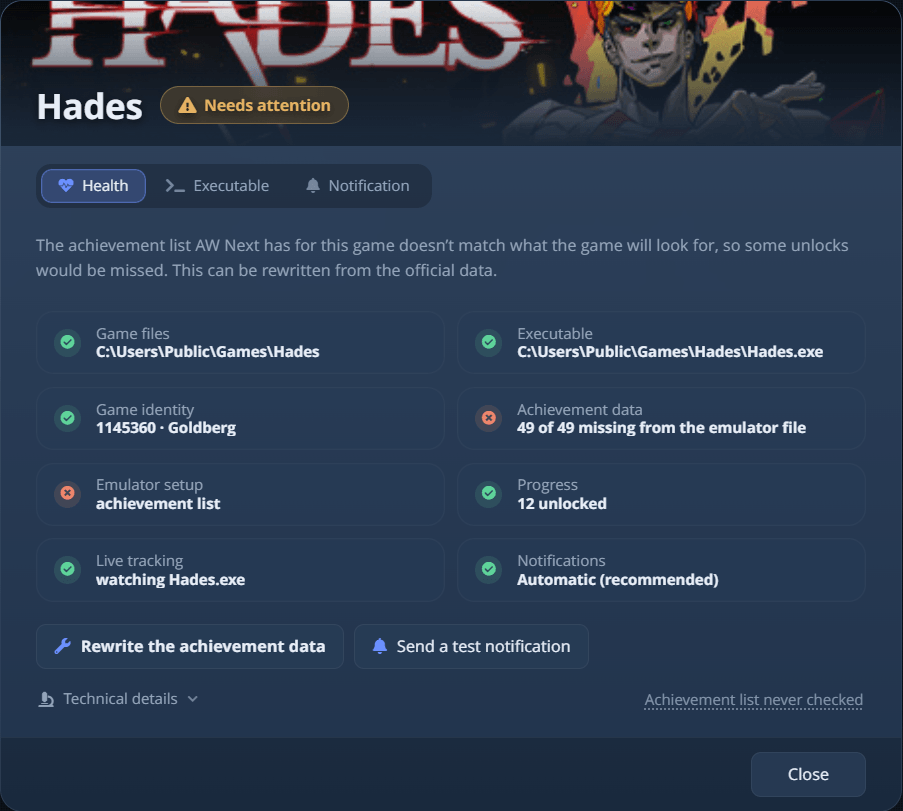

# Stan gry

Gdy gra sprawia kłopoty, najpierw otwórz jej panel **Stan gry**. Mówi on, czy AW Next widzi
grę, odczytuje jej osiągnięcia i ogłasza odblokowania, i oferuje tylko te naprawy, które mają zastosowanie.

Otwórz go przyciskiem **narzędzi** w prawym górnym rogu kafelka gry albo z menu
prawego przycisku gry. Panel ma trzy karty: **Stan**, **Plik gry**, która ustawia program do
obserwowania podczas gry, oraz **Powiadomienie**, w której gra może mieć własny preset okna, położenie,
dźwięk i skalę (zobacz [Zachowanie dla poszczególnych gier](notifications.md#per-game-behavior)).

<picture><source srcset="../assets/shot/game-health-800.webp 800w, ../assets/shot/game-health.webp 903w" sizes="(max-width: 700px) 100vw, 620px"></picture> 
Jeden stan, jego przyczyna, kontrole, które za nim stoją, i naprawy, które mają zastosowanie

## Stany {#the-states}

| Stan | Co oznacza |
|---|---|
| **Gotowe** | Gra jest wykryta, jej dane osiągnięć są dostępne, a AW Next obserwuje ją pod kątem odblokowań. |
| **Wymaga uwagi** | Gra działa, ale część jej konfiguracji jest niekompletna. Kontrole pokazują, która. |
| **Nieśledzone** | Brakuje czegoś istotnego, więc żadne odblokowanie nie może zostać zapisane: nie da się zlokalizować gry, nie ma ona danych osiągnięć albo brakuje emulatora, który zapisuje jej odblokowania. |
| **Tylko czas gry** | Gra dodana ręcznie: AW Next zna jej listę osiągnięć i liczy czas gry, ale nic na tym komputerze nie zapisuje jeszcze jej odblokowań (nie znaleziono emulatora, zapisu ani konta w sklepie). Kolor szary, bo nic nie jest zepsute, tak samo jak kropka na kafelku gry; skonfiguruj źródło, a stan się zmieni. |

Zdanie pod stanem podaje przyczynę, kontrole pokazują, która część zawodzi, a przycisk
naprawy działa dokładnie na nią.

- Tryb **Prosty** podaje wyniki prostymi słowami (*Znaleziono dane osiągnięć*, *Wykrywane po uruchomieniu gry*).
  **Zaawansowany** dodaje dokładne liczby, obserwowany proces i drogę dostarczania powiadomień.
- **Szczegóły techniczne**, na dole w obu trybach, zawierają wszystkie surowe wartości. Naciśnij **Kopiuj**, aby dołączyć je do zgłoszenia
  błędu. Długa wartość przewija się po najechaniu myszą.

Od gier na emulatorach konsol nie wymaga się pliku wykonywalnego Windows ani plików gry.

Niektóre gry nie zapisują niczego offline, niezależnie od konfiguracji. W Halo: Campaign Evolved i The Crew
Motorfest osiągnięcia przyznają serwery wydawcy, więc crack nie zapisuje żadnego. Ich
panel mówi o tym od pierwszego uruchomienia.

## Kontrole {#the-checks}

| Kontrola | Na co odpowiada | Typowa naprawa |
|---|---|---|
| **Pliki gry** | Czy folder instalacji nadal istnieje? | **Znajdź grę** |
| **Plik gry** | Który program należy obserwować podczas gry? | **Znajdź grę** |
| **Tożsamość gry** | Z jakim AppID i platformą dopasowano tę grę? Tryb Prosty to pomija. | **Popraw plik identyfikatora gry** lub **Ustaw AppID ręcznie** |
| **Dane osiągnięć** | Czy jest lista osiągnięć, czy jest kompletna i czy jej definicje postępu i statystyk są aktualne? | **Zapisz dane osiągnięć ponownie** |
| **Konfiguracja emulatora** | Czy gra wymagająca emulatora Steam ma go i który ją obsługuje? Ustawienia, bez których emulator da sobie radę, są tu pokazywane jako uwagi, a nie problemy. W przypadku gry Ubisoftu obejmuje to także loader Uplay i to, czy kiedykolwiek poprosił o osiągnięcie. | **Zainstaluj plik emulatora**, **Przełącz na obsługiwany emulator**, **Uzupełnij ustawienia emulatora** lub **Napraw obsługę osiągnięć Ubisoft** |
| **Postęp** | Czy znaleziono już jakieś odblokowanie lub zapis? | Uruchom grę i odblokuj coś |
| **Liczniki postępu** | Czy w grach w stylu CODEX/RUNE, które śledzą statystykę zamiast zwykłego odblokowania, AW Next pobrał statystykę stojącą za każdym osiągnięciem? Pokazywane tylko dla gier, które jej używają. | **Pobierz liczniki postępu** |
| **Wykrywanie uruchomienia gry** | Czy tracker w tle zauważa, kiedy ta gra się uruchamia, i czy obserwuje plik wykonywalny ustawiony dla gry? Sam nie zapisuje żadnego odblokowania: to zadanie emulatora. | **Obserwuj tę grę** |
| **Powiadomienia** | Którą drogą dostarczono ostatnie powiadomienie dla tej gry i dlaczego? | **Wyślij powiadomienie testowe** |

## Naprawy {#the-repairs}

Panel pokazuje tylko te naprawy, które mogą naprawić tę grę. Każda mówi, co zmieni, i gdzie przechowywane są
poprzednie pliki. Nic nie jest zapisywane od nowa bez kopii zapasowej lub potwierdzenia, a naprawa, która zawiedzie w połowie, przywraca każdy plik, który zdążyła zmienić; błąd mówi, co przywrócono.

| Naprawa | Co robi |
|---|---|
| **Znajdź grę** | Otwiera okno wyboru, aby wskazać plik wykonywalny do obserwowania. |
| **Otwórz folder gry** | Otwiera folder instalacji w Eksploratorze. |
| **Zapisz dane osiągnięć ponownie** | Zmienia tylko `achievements.json`, `stats.json` i brakujące ikony, nic więcej. Kompletna lista zostaje bez zmian; dodawane wpisy trzymają się formatu pliku, jego języków i folderu ikon. Definicje postępu i statystyk pochodzą z generate_emu_config, gdy **Dane steam_settings** jest ustawione na Zaawansowany i zapisano logowanie do Steam, a w przeciwnym razie z publicznej listy games-infos-datas; potwierdzenie mówi, skąd. Każdy zmieniany plik jest najpierw kopiowany do `.aw-backups` w `steam_settings`. |
| **Uzupełnij ustawienia emulatora** | Dodaje tylko pliki ustawień, których grze brakuje (`steam_appid.txt`, `configs.main.ini`, `configs.user.ini` oraz `configs.app.ini`, gdy włączone jest [Zarządzaj własnością DLC](../goldberg-gbe.md)). To, co dają już globalne ustawienia emulatora, zostaje po ich stronie, a lista osiągnięć nie jest ruszana. Własne konto gry w `configs.user.ini` jest zastępowane tylko wtedy, gdy włączone jest **Zapisuj nazwę konta i język** i odpowiesz twierdząco na pytanie. |
| **Zainstaluj plik emulatora** | Pobiera obsługiwaną kompilację emulatora do folderu gry, zachowując zastępowany plik jako `.bak`. |
| **Przełącz na obsługiwany emulator** | Dla gry obsługiwanej przez inny crack, który niczego nie zapisał: instaluje na nim obsługiwany emulator, zmienia nazwę konfiguracji tego cracka na `.bak` i w tym samym kroku zapisuje `steam_settings` emulatora (identyfikator gry i listę osiągnięć), więc grę można uruchomić od razu. Wymaga Steam AppID gry; jeśli którakolwiek część się nie powiedzie, każdy plik wraca na miejsce. Brakujące ikony można dodać później przez **Zapisz dane osiągnięć ponownie**. |
| **Cofnij zmianę emulatora** | Pojawia się wszędzie tam, gdzie wykonano jedną z dwóch powyższych. Przywraca własne pliki gry z ich kopii `.bak` i usuwa obsługiwany emulator. |
| **Cofnij ostatnią naprawę** | Pojawia się po każdej zmianie, jaką AW Next wprowadził w folderze gry: naprawie z tego panelu, poprawce emulatora, CrakFiles, Usuń DRM Steam (Steamless), Przywróć ostatnią kopię zapasową GBE/Goldberg, Ustaw AppID ręcznie, naprawie Uplay albo jednym z przycisków cofania powyżej. Najpierw wypisuje każdy plik, który przywróci. Jeśli plik jest używany (często dlatego, że gra jest uruchomiona), nic nie zostaje zmienione, a wpis czeka na kolejną próbę. |
| **Popraw plik identyfikatora gry** | Zapisuje na nowo `steam_appid.txt`, gdy emulator zapowiada jedną grę, a AW Next dopasował inną. Prosi o właściwy AppID, sugerując dopasowanie AW Next, i zachowuje poprzedni plik. |
| **Pobierz liczniki postępu** | Pyta Steam, która statystyka napędza każde osiągnięcie, dla gier w stylu CODEX/RUNE. Nie zapisuje niczego w folderze gry. |
| **Napraw obsługę osiągnięć Ubisoft** | Dla zgodnej gry Ubisoftu zapisuje na nowo konfigurację loadera, schemat i przekierowanie zapisów w jednej transakcji, z kopią zapasową każdego dotkniętego pliku. Zobacz [Konfiguracja Uplay](uplay-r2.md). |
| **Włącz osiągnięcia offline** | Dla gry Ubisoftu, której log loadera dowodzi, że nigdy nie poprosiła o osiągnięcie, bo uważa się za wylogowaną. Dodaje jeden zastępczy klucz sesji do pliku INI obok gry; naciśnij ponownie, aby go usunąć. Zobacz [Konfiguracja Uplay](uplay-r2.md#a-game-that-never-asks-for-an-achievement). |
| **Obserwuj tę grę** | Dodaje grę do trackera w tle, aby zapisywano czas gry i odblokowania na żywo, według pliku wykonywalnego ustawionego na karcie **Plik gry**. |
| **Włącz powiadomienia o postępie** | Ponownie włącza powiadomienia o postępie dla gry, którą wyciszyłeś. |
| **Wyślij powiadomienie testowe** | Wysyła powiadomienie z nazwą i grafiką tej gry, drogą, którą naprawdę by poszło. |

> [!IMPORTANT]
> Niezgodność nie zawsze jest winą emulatora: jeśli został celowo skonfigurowany pod ID zapisane na dysku,
> zostaw go w spokoju. **Ustaw AppID ręcznie** (prawy przycisk) naprawia niezgodność nazwy folderu raz na zawsze, zamiast
> poprawiać plik za każdym razem. Zobacz [Konfiguracja Goldberg / GBE](emulator-setup.md#set-appid-manually).

## Typowe stany i co robić {#common-states-and-what-to-do}

| Panel mówi | Co zwykle oznacza |
|---|---|
| *Nie udało się znaleźć listy osiągnięć* | Gra nie ma osiągnięć albo jej źródło jest wyłączone. Sprawdź **Ustawienia → Źródło**. |
| *Ta gra wymaga emulatora Steam, a żaden nie jest skonfigurowany* | Użyj **Zastosuj poprawkę emulatora** z menu prawego przycisku. Zobacz [Konfiguracja Goldberg / GBE](emulator-setup.md). |
| *Brakuje pliku emulatora, który ją odczytuje* | **Zainstaluj plik emulatora** wkłada pasujące środowisko uruchomieniowe. |
| *ColdClient obsługuje tę grę, ale…* | `ColdClientLoader.ini` obok loadera uruchamia brakujący plik lub inny program, wskazuje inną grę albo nie ma loadera dla 32 lub 64 bitów gry. Popraw ten plik; AW Next tylko go odczytuje. Gdy będzie poprawny, **Uruchom przez loader ColdClient** sprawia, że Graj uruchamia loader. |
| *Emulator Epic nadal ma przykładowy AppID* | `NemirtingasEpicEmu.json` zawiera AppID złożony z samych zer albo oryginalny plik EOSSDK od Epic nadal leży na miejscu, więc emulator nigdy się nie ładuje. Wpisz do pliku identyfikator Epic gry. |
| *Lista osiągnięć nie zgadza się z tym, czego będzie szukać gra* | **Zapisz dane osiągnięć ponownie**. To zwykły skutek aktualizacji repacka. |
| *Nie znaleziono jeszcze żadnego postępu osiągnięć* | Normalne dla gry, w którą nie grałeś od jej skonfigurowania. Uruchom ją i odblokuj coś. |
| *AW Next nie obserwuje tej gry, gdy działa* | **Obserwuj tę grę** dodaje ją do trackera. |
| *Nie udało się wysłać ostatniego powiadomienia* | Wyślij powiadomienie testowe, a potem zobacz [Powiadomienia](notifications.md#if-a-test-or-unlock-does-not-appear). |
| *Windows ukrył ostatnie powiadomienie podczas gry* | Trafiło prosto do Centrum powiadomień, bo gra była na pełnym ekranie lub włączone było Nie przeszkadzać. Włącz [Powiadomienia priorytetowe](notifications.md#priority-windows-notifications) albo użyj Automatycznie lub Nakładki w grze. |
| *Działa - aktywne rozwiązanie zastępcze Windows* | To nie usterka. Dostarczanie Automatyczne wybrało dla tej gry powiadomienie systemu Windows; zobacz [jak decyduje Automatycznie](notifications.md#how-automatic-decides). |
| *Gra nigdy nie poprosiła o osiągnięcie* | Czyta swoją pustą sesję Ubisoftu jako wylogowaną. **Włącz osiągnięcia offline** ją odblokowuje; nic nie jest nigdzie wysyłane. Po tym uruchom grę raz. |
| *Osiągnięcia offline włączone, uruchom grę raz* | Ustawienie jest zapisane i nic nie zostało jeszcze ocenione. Przycisk obok brzmi teraz **Wyłącz osiągnięcia offline**. |
| *Obsługiwane przez ALI213, OnlineFix, GBE Fork…* | Emulator, który faktycznie odczytuje tę grę, nazwany na podstawie jego własnych plików. Grze Ubisoftu obsługiwanej w ten sposób nie proponuje się naprawy Uplay: jej warstwa Uplay jest nieużywana, a nie zepsuta. Obejmuje to wydania, które zachowują `steam_api64.dll` Valve: kompilację RUNE działającą z `Steam\steamclient64.dll` albo wydanie VOICES38 ładujące własny zmieniony GBE Fork (`steam_api64.v38`); nigdy nie instaluj emulatora na tym drugim. Kompilacje Ubisoftu z online-fix są rozpoznawane, a poprawka osiągnięć w nich ostrzega, że gra online może przestać działać. |
| *Brakuje tylko niektórych ikon* | **Zapisz dane osiągnięć ponownie** pobiera brakujące ikony. |
| *Brakujące lub nieaktualne definicje postępu albo statystyk* | Osiągnięcia z licznikiem nie ruszałyby się albo pokazywałyby zły cel. **Zapisz dane osiągnięć ponownie** je aktualizuje. |
| *Opcjonalne ustawienia nie zostały zapisane* | Uwaga, nie usterka: emulator działa bez nich (bilet aplikacji, token GC, przełącznik nieznanych statystyk, nazwa konta). **Uzupełnij ustawienia emulatora** dodaje je, jeśli chcesz. |
| *Nazwa konta lub język pochodzą z … `GSE Saves\settings`* | Wiersz informacyjny, nie ostrzeżenie. GBE czyta `GSE Saves\settings\configs.user.ini` (albo ustawienia folderu zapisów, na który wskazuje `local_save_path`), gdy gra nie ma własnych. Nie ma nic do naprawiania. |
| *Obserwuje X, a nie Y* | Plik wykonywalny ustawiony dla tej gry nie jest tym, który śledzi tracker, więc uruchomienia i czas gry mogą umknąć. **Obserwuj tę grę** podąża za wybranym. *Obserwuje X, uruchomiony przez Y* jest w porządku: Y to launcher, na przykład program startowy anti-cheata, który uruchamia grę. |
| *Nie skonfigurowano źródła osiągnięć* | Pokazywane razem z **Tylko czas gry**. Zastosuj poprawkę emulatora albo dodaj folder, w którym gra zapisuje osiągnięcia. |
| *Uruchomiona ponad godzinę i ani jedno osiągnięcie nie zostało zapisane* | Crack obsługujący grę najpewniej nigdy nie zgłasza osiągnięć. Użyj **Przełącz na obsługiwany emulator**, gdy jest oferowany; w przeciwnym razie sprawdź, czy gra uruchamia się z własnego folderu. |
| *Plik identyfikatora gry*, ze skrótem Steam do tej gry | Steam uruchamia skrót spoza Steam bez `steam_appid.txt` obok, więc emulator zapisuje pod innym ID. **Uzupełnij ustawienia emulatora** zapisuje tam ten plik. |

---

**Dalej:** [Rozwiązywanie problemów](troubleshooting.md) - dla problemów, których Stan gry nie rozwiązuje sam.

[← Dokumentacja](README.md) · [Strona główna projektu](https://github.com/Shirowwww/Achievement-Watcher-Next)

