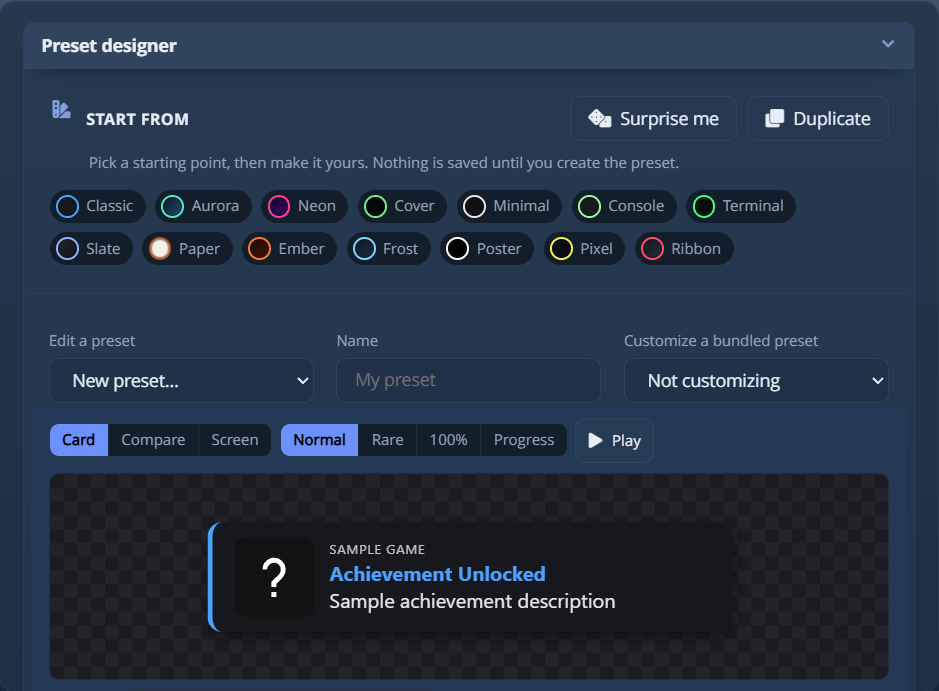
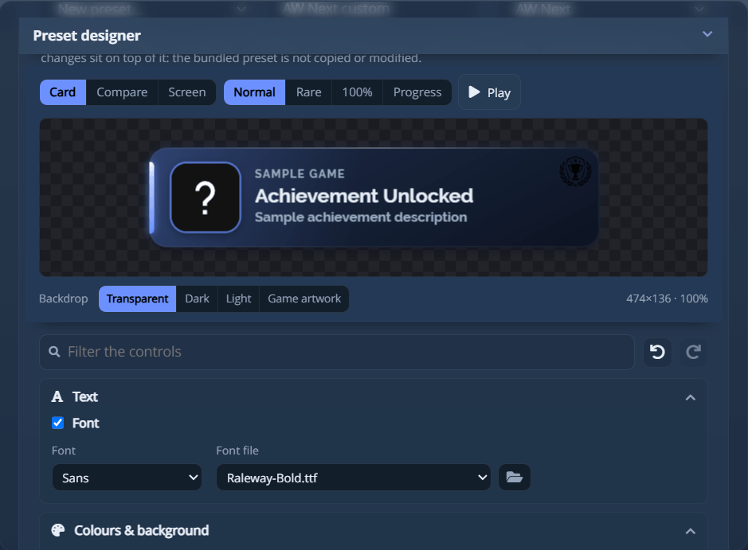

# Presets and the Preset Designer

A **preset** is the look of the in-game overlay popup: its layout, colours, motion and the way it
paints a rare unlock or a 100% completion. Pick one under **Settings → Notification → Preset**,
design your own in **Settings → Notification presets**, or import one somebody shared with you.

> [!NOTE]
> Presets style the in-game overlay. With **Notification type** set to *Windows notification*,
> nothing a preset describes is drawn, and the Notification presets tab is not shown.

## The bundled presets

AW Next ships ten, each with its own composition, type, motion and colour.

| Preset | What it is |
| --- | --- |
| **AW Next** | The default. The app's own palette, an accent rail down the left edge, a ringed icon and the game's name above the achievement. |
| **Steam Modern** | The dark navy plate with the Steam mark behind the text, square corners, sliding up out of the bottom edge. |
| **Steam Original** | A copy of the popup the Steam client draws today: slate gradient, a faint oversized Steam mark, a square icon, and only a gold rim for a rare unlock. |
| **Epic Games** | Flat, neutral and square-shouldered, with the widest gutters in the set and a single rule down the left edge. |
| **PlayStation** | The console's type and long grey-to-black panel, with the PlayStation mark pulsing inside a ring on the right. |
| **Xbox** | A dark pill with a green arc that sweeps once around the circular icon and settles into a steady ring. |
| **Cover** | The game's artwork as the background, drifting slowly, with a scrim under the text and the largest type in the set. |
| **Glass** | Translucent and quiet: no accent bar, and no colour until a rare or 100% unlock brings one. |
| **Arcade** | Phosphor green on black, monospaced and uppercase, with scanlines and a hard offset edge. A rare unlock switches to amber. |
| **Slim** | The low one, on true black: the same width as the rest at half the height, built to disappear on an OLED panel. |

Every preset has the same width, so switching preset never moves the popup sideways.

### The four states every preset draws

| State | What it looks like |
| --- | --- |
| **Normal** | The preset's own accent. |
| **Rare** | Gold at 5% or less, silver up to 10%, bronze up to 15% (the limits can be changed under **Settings → General → Rarity thresholds**), plus the unlock rate printed on the card, a stronger glow and an added edge. |
| **100% completion** | A cold, brighter treatment with a doubled rim. |
| **Progress** | A progress bar with a `current/max - %` label. |

The preset you pick paints rare and 100% itself, so there is one preset setting, not three. The
per-emulator overrides stay under **Settings → Notification → Emulators** (Advanced mode): Xenia,
RPCS3, shadPS4 and Kyty can each take their own preset and sound.

A preset uses the sound chosen in the Notification tab unless it sets its own, so changing the look
does not change what you hear. A shared preset can bring its own sound: see
[Share a preset](#share-a-preset). **Opacity** (30% to 100%) in the Notification tab sets how see-through
the popup is.

> [!NOTE]
> Presets shipped under earlier names still resolve: `Shirow`/`Default`/`Midnight`/`xqjan` to
> **AW Next**, `Steam` to **Steam Modern**, `PS4`/`PS5 enhanced` to **PlayStation**,
> `Xbox 360`/`Xbox One` to **Xbox**, `Game Cover`/`Sunset` to **Cover**, `Clean`/`Modern`/`Smooth Pop` to **Glass**,
> `Neon Future`/`LAZ0RBOX` to **Arcade**, and the community `ArmsofGod`, `Epic Preset`,
> and `mudoss` to **Pantheon**, **Onyx** and **Outline**. The community **Hexagon** and **Indiana**
> were removed, and they and `TigerDX Award` fall back to **AW Next**. A preset of your own with one
> of those names is used ahead of the replacement.

## Design your own

The designer has its own tab, **Settings → Notification presets**, also reachable from the tools
button beside the preset setting. Everything is set with ordinary controls: no CSS, JSON or file to
edit.

<div align="center">
<picture><source srcset="assets/shot/notification-preset-panel-800.webp 800w, assets/shot/notification-preset-panel.webp 939w" sizes="(max-width: 700px) 100vw, 720px"></picture><br>
<sub>Start from a complete design, then shape it under a live preview of the real popup, which stays on screen while the controls scroll</sub>
</div>

### Starting points

The first row holds fourteen complete designs: *Classic*, *Aurora*, *Neon*, *Cover*, *Minimal*,
*Console*, *Terminal*, *Slate*, *Paper* (the one light design), *Ember*, *Frost*, *Poster*, *Pixel*
and *Ribbon*. Each is an ordinary set of control values, so picking one is the same as moving every
control by hand: keep it, or use it as a base.

| Action | What it does |
| --- | --- |
| **Surprise me** | Builds a design you have not tried: it picks a kind of card (flat, gradient, neon, over artwork, glassy, terminal or light), then rolls every control inside what that kind allows. |
| **Duplicate** | Keeps the current design and frees the name, so the next **Create preset** adds a preset instead of replacing the one it came from. |

Nothing is saved until you press **Create preset**.

### The preview

The preview is the notification itself, drawn by the same page, styles and engine as in a game. It
stays pinned to the top of the panel while the controls scroll.

| Control | What it shows |
| --- | --- |
| **Card** | The popup at its own size. The pixel size and preview zoom are printed under it. |
| **Compare** | All four notifications at once, two by two. |
| **Screen** | The popup on a mock display at **720p**, **1080p**, **1440p** or **4K**, at its true relative size and in the corner notifications are set to appear. |
| **Normal / Rare / 100% / Progress** | The four notifications a preset has to look right in. In **Compare**, the one you pick is drawn at full strength. |
| **Play** | Plays entry, hold and exit once, at the preset's own timings. |
| **Backdrop** | What the popup is judged against: transparency, a dark scene, a bright one, or artwork from your library. |
| **Position / Scale** | Mirror the settings of the same name in the Notification tab, and change them. Shown in the **Screen** view only. A popup you placed by hand is drawn at the bottom centre and labelled. |

### Finding your way around

The designer has nine groups and sixty-odd controls, with a filter and an undo history.

| | What it does |
| --- | --- |
| **The filter** | Type in the box above the groups and only the matching controls stay. It searches labels, dropdown words and the property's own name, so both `corner` and `radius` find the same slider, and a name read out of an `.awpreset` finds its control. A match behind **Advanced** opens it. **Esc** clears the box. |
| **Undo / redo** | The two arrows beside the filter, or **Ctrl+Z** and **Ctrl+Y** (**Ctrl+Shift+Z** works too). One slider drag is one step. Loading a preset, picking a starting point or pressing Reset starts a fresh history. |

**Layout & size** and **Colours & background** start open; the other groups open on a click, and most
have an **Advanced** disclosure for fine-tuning.

### The controls

In **Simple** interface mode the Advanced halves are not shown.

| Group | What it covers |
| --- | --- |
| **Layout & size** | Icon on the left, right, above the text or not at all; text alignment; popup width, padding and spacing; and whether the **game's name** is printed above the achievement. |
| **Text** | Font (one of five families, or **a font file of your own**: TTF, OTF, WOFF or WOFF2, 4 MB at most, copied into the preset), title and description size, how many lines the description may wrap onto, and the title colour. Under Advanced: title weight, uppercase, letter spacing, a text shadow and an outline around every glyph. |
| **Colours & background** | A solid colour, a two-colour gradient with an angle, the **game's own artwork**, or **a picture of your own** (copied into the preset), dimmed, blurred and framed behind the text. Plus text colour, accent and opacity. Under Advanced, a **texture** (grid, dots, hatching or speckle) over the background and under the text. |
| **Icon** | Size, **shape** (rounded square, circle, squircle, hexagon or diamond) and, under Advanced, a border and a glow in the accent colour. Corner rounding applies to the rounded square only. A **logo** (PNG, JPEG, GIF, WebP or BMP, 2 MB at most) can sit behind the text in a corner or at the middle of a side, with a size and distance from the edge; it is copied into the preset like the font. |
| **Border & corners** | Corner radius, which edge carries the accent bar (or a full outline, or none) and its thickness; under Advanced, a border of your own colour. |
| **Shadow & glow** | Drop shadow depth, accent glow, and whether that glow **pulses** or **breathes** while the popup is on screen. |
| **Motion & timing** | Which edge the popup enters from and leaves to (or fade, or zoom) and how long it stays. Under Advanced: travel distance, entry and exit speed, the entry curve (smooth, linear, back, gentle, snap or elastic) and an **exit curve**. |
| **Rare & completion** | Colour and glow for a rare unlock and for 100%, a **state tint** that washes the whole card, whether the progress bar shows, and whether a **rarity badge** prints the unlock rate. Under Advanced: the progress bar thickness, the silver and bronze tiers, and a **padlock** before the title of a hidden achievement. |
| **Sound** | A sound this preset plays instead of the one in the Notification tab. Leave it on **App setting** for none. |

| Action | What it does |
| --- | --- |
| **Show on screen** | Renders the design as a real overlay popup, at full size, in the configured position and the state the preview shows, without saving it. |
| **Create preset** | Saves it and selects it as the active preset. |
| **Update preset** | The same button once the name matches a preset the designer made: it replaces that preset instead of adding another. |
| **Edit a preset** | Loads one of your generated presets back into the controls, with every value as saved. |
| **Reset** | Returns the controls to the default design. Nothing on disk changes. |
| **Rename** | Appears once a generated preset is loaded. Type the new name in the name field and press it: the preset is renamed on disk, and the notification settings that pointed at it follow. |
| **Delete** | Appears once a generated preset is loaded, and removes it after a confirmation. |
| **Export** / **Import** | Move a preset between machines: see [Share a preset](#share-a-preset). |

Only presets this designer generated can be re-opened or deleted: it stores its settings in an
`aw-preset.json` beside the generated files, and that file makes a preset editable. Bundled and
hand-written presets are never touched.

> [!NOTE]
> A preset you already made keeps its files as generated. Opening it in the designer and saving
> applies today's defaults to it, among them a rare unlock and a 100% completion repainting the whole
> popup.

> [!NOTE]
> Presets you create are stored in `%APPDATA%\Achievement Watcher Next\presets\Users Presets`, not in
> the installation folder, and survive app updates.

## Customize a bundled preset

**Customize a bundled preset**, at the top of the designer, starts from a preset that ships with the
app. Nothing of that preset is copied or edited: the layer you save is a few lines naming it, plus
the values you changed, laid over the bundled preset as it ships. If a later version improves the
bundled preset, your layer improves with it.

Tick the sections to change: **background** (a colour or a gradient), **text colour**, **accent**,
**border**, **glow**, **font** (one of the five families or a font file of your own) and **logo**.
The controls start from the bundled preset's own colours. The preview and **Show on screen** show the
bundled preset with your layer on top.

<div align="center">
<picture><source srcset="assets/shot/preset-customize-panel-800.webp 800w, assets/shot/preset-customize-panel.webp 939w" sizes="(max-width: 700px) 100vw, 720px"></picture><br>
<sub>AW Next with a font file of its own and a logo in the top-right corner: only ticked sections change</sub>
</div>

- It works on the presets in the **Default Presets** list, which all draw the same card. Community
  presets (Batman, Onyx, Outline and the others) draw their own layouts and are not offered.
- A layer cannot be exported as an `.awpreset`, since it exists only on top of the bundled preset of
  the install that made it. To share a design, build it with the designer.
- The **OBS browser source** ignores layers and shows the default preset instead.
- The popup keeps the bundled preset's window size, so a large glow or border can be clipped.

## Import a theme from Steam Achievement Notifier

Themes from **Steam Achievement Notifier** (SAN) come across whole. AW Next draws an imported theme
with SAN's own card layouts, so it looks and moves as it did in SAN: all eleven layouts, at SAN's
text size and with the theme's own scale setting. Two buttons in the **Notification presets** tab
import themes:

- **Import SAN theme** reads one `.san` file, or the `usertheme.json` inside a theme SAN has already
  unpacked, with the pictures and sounds beside it.
- **Import from SAN on this PC** reads SAN's own settings when SAN is installed here, and imports
  every theme saved on this PC in one go. The four themes in use (regular, semi-rare, rare and 100%)
  become one preset, `SAN - <theme name>`, that switches between them as SAN does, and every other
  saved theme becomes a preset of its own. Running it again refreshes those presets instead of adding
  copies and never touches one of your own presets that shares a name.

Installed SAN presets are rebuilt on their own.

### What comes across

Everything the theme holds: every setting, its pictures (background, mask, logos and decorations,
icon border, percentage badges, hidden-achievement icon), its font, and its sounds (one per state, or
a folder SAN picks from at random). The preset carries all of it, so SAN is not needed afterwards,
and it exports as an `.awpreset`.

Its controls are SAN's, not the designer's sliders, so pick it in the preset list rather than in
**Edit a preset**. To change one, change it in SAN and import it again.

The state a notification gets follows your rarity settings in AW Next. A 100% completion uses SAN's
100% card. In rare mode, gold and silver use its rare card and bronze its semi-rare one; in trophy
mode, gold, silver and bronze use rare, semi-rare and regular. A rare or 100% sound chosen in AW
Next wins over the theme's own, and the popup's position and size come from the **Notification** tab.

The report after an import lists what could not come along: a file the theme names but did not carry,
a picture or font refused, and settings from a newer SAN that this version does not draw yet. It is
also written to the app log.

### What is checked before anything is installed

The rules are those of an `.awpreset`, since a theme file comes from somebody else's machine. Nothing
inside one is run or evaluated; only its `usertheme.json` is read. Every path is checked against the
package it came in, and the absolute paths SAN writes are read as filenames only. Only pictures,
fonts and audio are taken out, by file type and under a size limit; an SVG that could run a script
and a file that is not a font are refused. Every setting is checked for type and range. An import
that fails leaves every preset you already have untouched.

## Share a preset

**Export** and **Import**, in the **Notification presets** tab, move a preset between machines as one
`.awpreset` file: the style, every image and font it uses, its designer settings and its metadata.

The [preset gallery](gallery/) collects these files: browse, download one and import it, or add
yours. What a submission must be, and what is checked before it is listed, is in
[The community galleries](community-galleries.md).

**Export** writes what the card is showing, under the name in the **Name** field: the design in the
controls, saved or not, so a preset in progress can be shared without creating it first. An imported
preset selected in **Edit a preset** is exported from disk as it is, since its look lives in files
the controls cannot describe. Only the preset travels: no path from your machine, no account name, no
setting of yours.

**Import** asks for the file, checks it, and installs it under `presets\Users Presets`. If the name
is taken, by one of your presets or a bundled one, you choose **Keep both** (the import lands under
`Name (2)`) or **Replace**. Nothing is written until you answer.

An imported preset appears in **Edit a preset**, is selected, and can be exported again or deleted
from there. A preset the designer made comes back complete for further editing. A hand-written preset
gets its look from files the controls cannot reproduce, so the controls stay as they are and the name
field stays empty.

### What is checked before anything is installed

A package is validated whole and refused entirely, never part-installed, when:

- it is not a preset package, or its manifest is missing or malformed;
- it needs a newer AW Next than the one running, or a newer package format;
- it carries a file the format does not describe: a program, a script, or anything outside
  `preset/` and `sounds/`;
- any path inside it points outside its own folder.

Nothing inside a package is run or evaluated while it is checked or installed. The preset's page
renders later, in the same sandboxed notification window as a bundled preset.

### What a package contains

```text
manifest.json     name, description, author, version, tags, format version,
                  minimum AW Next version, and the designer settings
preset/           index.html, style.css, images and fonts (relative paths only)
sounds/           optional audio, added to your sound list on import
```

The manifest is kept beside the installed preset as `aw-package.json`. It tells the app the preset
was imported and may be removed again, and carries the description and credit into the next export.

A sound you imported yourself travels with the preset; a bundled sound does not, since the manifest
names it and every install has it. Importing never changes the sound you have selected and never
overwrites one you have: a different file of the same name arrives as `name (2)`.

The optional `author` field is filled only from the preset's own file, so nothing is credited to you
unless you put it there.

---

**Next:** [Overlay](overlay.md) - the in-game achievement list, which is separate from these
popups.

<div align="center">

[← Documentation](README.md) · [Notifications](notifications.md) · [Project home](https://github.com/Shirowwww/Achievement-Watcher-Next)

</div>