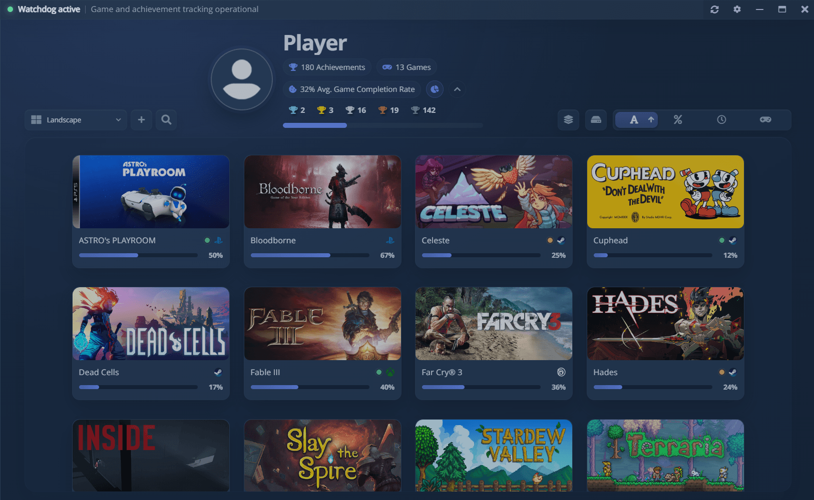

<!--
  jekyll-readme-index still drops a file literally named README.md, even with readme_index.enabled: false
  in _config.yml. Explicit front matter with a permalink makes Jekyll publish it at README.html.
-->

# Documentação do AW Next

Guias para configuração, uso diário e manutenção.

[Início](../index.html) · [Baixar](https://github.com/Shirowwww/Achievement-Watcher-Next/releases/latest) · [Galeria de presets](../gallery/) · [Galeria de temas](../gallery/themes/) · [Histórico de alterações](../changelog.md) · [Segurança](https://github.com/Shirowwww/Achievement-Watcher-Next/blob/main/SECURITY.md) · [Relatar um problema](https://github.com/Shirowwww/Achievement-Watcher-Next/issues) · [Discord](https://discord.gg/DjTMrDsXTh)

<picture><source srcset="../assets/shot/home-800.webp 800w, ../assets/shot/home.webp 1280w" sizes="(max-width: 700px) 100vw, 800px"></picture>

## Por onde começar {#start-here}

Leia na ordem ou vá direto ao que você precisa. Cada página termina com um link para a próxima.

| # | Guia | O que cobre |
|---|---|---|
| 1 | [Primeiros passos](getting-started.md) | Instalação, primeira execução, Simples e Avançado, como encontrar jogos, atualizações |
| 2 | [Fontes compatíveis](sources.md) | Todas as fontes que o AW Next lê e o que cada uma exige |
| 3 | [Notificações](notifications.md) | Modos de entrega, Automático, sons, posição, capturas de tela |
| 4 | [Presets e o Preset Designer](presets.md) | O visual do popup, como criar o seu, como compartilhar arquivos `.awpreset` |
| 5 | [Overlay](overlay.md) | A lista de conquistas dentro do jogo: busca, filtros, raridade |
| 6 | [Controle](controller.md) | Usar o app e o overlay com um gamepad |
| 7 | [Estado do jogo](game-health.md) | O relatório de cada jogo e seus reparos guiados |
| 8 | [Solução de problemas](troubleshooting.md) | Problemas de detecção, progresso, notificações e tempo de jogo |

## Quando você precisar {#when-you-need-it}

| Guia | O que cobre |
|---|---|
| [Perguntas frequentes](faq.md) | Respostas curtas para as dúvidas mais comuns |
| [Linux e Steam Deck](linux.md) | O AppImage e suas atualizações, ambientes de desktop, o atalho do overlay, Steam, Proton e launchers |
| [Ferramentas avançadas](advanced.md) | Manutenção, limpeza de caches, redefinições, jogos manuais, diagnóstico |
| [Configuração do Goldberg / GBE](emulator-setup.md) | Diagnosticar ou reparar um jogo Steam emulado |
| [Configuração do Uplay, R1 e R2](uplay-r2.md) | O equivalente para a Ubisoft |
| [Comparação](comparison.md) | Como o AW Next se diferencia do Achievement Watcher 2.x e do Achievements |
| [Galerias da comunidade](community-galleries.md) | Presets e temas de outras pessoas, e como enviar os seus |

**Configurações → Ajuda** é a referência mais rápida com o app aberto. Ela se adapta à sua configuração
(atalho do overlay, atribuições do controle, modo de notificação, tema, fontes ativadas) e filtra os
tópicos conforme você digita.

## Referência para desenvolvedores {#developer-reference}

Para quem contribui e para quem compila o AW Next a partir do código-fonte.

| Tema | Referência |
|---|---|
| Como contribuir, branches, testes, estilo dos commits | [CONTRIBUTING.md](https://github.com/Shirowwww/Achievement-Watcher-Next/blob/main/CONTRIBUTING.md) |
| Ambiente de desenvolvimento, execução, empacotamento | [BUILD.md](https://github.com/Shirowwww/Achievement-Watcher-Next/blob/main/BUILD.md) |
| Limites entre app, renderer e Watchdog; o contrato do parser | [Arquitetura](../architecture.md) |
| Formatos de arquivo do Goldberg / GBE, detecção, invariantes de reparo | [Referência do Goldberg / GBE](../goldberg-gbe.md) |
| Como os jogos Uplay R1/R2 são identificados, reparados e lidos | [Referência do Uplay R1/R2](../uplay-reference.md) |
| Versionamento, publicação, CI, validação da atualização automática | [Fluxo de lançamento](../RELEASE_WORKFLOW.md) |
| O instalador, o desinstalador e o atualizador | [Instalador, desinstalador e atualizações](../INSTALLER_AND_UPDATES.md) |
| Tradução, formatação Intl, roteamento de links, o linter de idiomas | [Localização](../localization.md) |
| Arquivos de idioma e paridade de chaves | [app/locale/README.md](https://github.com/Shirowwww/Achievement-Watcher-Next/blob/main/app/locale/README.md) |
| O arquivo de tema portátil e suas versões | [Formato .awtheme](../awtheme-format.md) |

## Onde ficam os seus dados {#where-your-data-lives}

Tudo o que o AW Next grava fica em **`%APPDATA%\Achievement Watcher Next`** (`~/.config/Achievement
Watcher Next` no Linux, com a mesma estrutura). Os caminhos abaixo são relativos a essa pasta. Uma
atualização mantém tudo, e na primeira execução ele importa uma pasta antiga do Achievement Watcher
sem modificá-la.

| O quê | Onde |
|---|---|
| Configurações, índices e bancos de dados | `cfg\` (`options.ini` é o arquivo de configurações) |
| Logs | `logs\` |
| Presets que você criou ou importou | `presets\Users Presets\` |
| Imagens que um preset usa como fundo | `presets\images\` |
| Sons que você adicionou | `sounds\` |
| Temas que você salvou ou importou | `theme-packs\` |
| Imagens usadas pelo tema Personalizado | `theme-images\` |
| Um tema em folha de estilo que você colocou aqui | `themes\` |
| Backups de conquistas e os feitos antes de um reparo do GBE | `backups\achievements\`, `backups\gbe\` |
| Capas e ícones dos jogos | `covers\`, `gameIcons\` |
| Capturas de tela | `Pictures\Achievement Watcher Next` (ou a pasta que você escolheu) |
| Contas conectadas | `steam_session.enc`, `epic_tokens.enc`, `cfg\xbox-auth.json`, `cfg\psn-auth.json` |
| **Baixáveis de novo:** esquemas, ícones e raridade vindos de uma plataforma | `steam_cache\`, `uplay_cache\` |
| **Baixáveis de novo:** ferramentas baixadas e resultados da busca em pastas | `cache\` (exceto `cache\uplayR2`, que guarda uma DLL fornecida por você) |
| Saves do GBE Fork (gravados pelo emulador) | `%APPDATA%\GSE Saves` |
| Saves do Goldberg clássico (idem) | `%APPDATA%\Goldberg SteamEmu Saves` |

**Configurações → Avançado → Limpar caches** esvazia as duas linhas que podem ser baixadas de novo e mais
nada. Nada em `cfg\`, `presets\`, `theme-packs\`, `theme-images\`, `themes\`, `sounds\`, `covers\`,
`gameIcons\` ou `backups\` é regenerado, então copie essas pastas antes de reinstalar.

Antes de relatar um problema, execute **Configurações → Avançado → Diagnóstico**, reproduza o problema uma vez
e depois remova os dados privados dos logs que você for anexar.

### O que sai deste PC {#what-leaves-this-pc}

O AW Next não tem análise de uso, telemetria nem conta própria. Ele envia apenas as consultas de que precisa
e guarda em cache cada resposta, para que a biblioteca continue funcionando offline.

| Ele pede | A | Levando |
|---|---|---|
| Listas de conquistas, ícones, raridade global | Os endpoints públicos da Steam, a página da SteamCommunity, o SteamHunters, o Exophase | O AppID de um jogo e o idioma da interface |
| Capas e logotipos | A CDN da Steam, o SteamDB, o SteamGridDB | O AppID ou o título de um jogo |
| Verificação e download de atualizações | O feed de releases do GitHub | Apenas a requisição |
| Ferramentas de reparo, quando você executa um reparo | Os projetos GBE Fork, Steamless, API-bypass e CrakFiles | Apenas a requisição |
| Sua biblioteca e seus desbloqueios, **somente se você conectar uma conta** | Steam, Epic, Xbox Network ou PlayStation Network | O token de sessão da conta; para os desbloqueios da Steam, o Steam ID público |
| Sua biblioteca do RetroAchievements e seus desbloqueios, **somente se você preencher o cartão da conta** | retroachievements.org | Seu nome de usuário e a chave Web API, guardados criptografados neste PC |
| Presets e temas da comunidade, **somente se você abrir a galeria ou publicar nela** | O serviço da galeria, `aw-gallery.shirow.dedyn.io` | A requisição da listagem; um arquivo somente quando você clica em Publicar |

Quando o executável de um jogo traz um ícone real de 256 px, o AW Next o lê do arquivo e o usa como
logotipo sem consultar a rede.

Este site não define cookies, não usa análise de uso e carrega suas fontes e scripts do próprio host.
As páginas das galerias buscam a listagem no serviço da galeria acima e, se ele estiver inacessível, usam a cópia
guardada ao lado delas.

Nada mais é enviado: nem sua biblioteca, nem o tempo de jogo, nem as pastas, nem as capturas de tela.
O broadcast opcional `Websocket @localhost:8082` escuta apenas em `127.0.0.1`, então somente programas
deste PC podem lê-lo. A única coisa que você envia de propósito é um preset ou tema que publica em uma galeria
(veja [As galerias da comunidade](community-galleries.md)).
