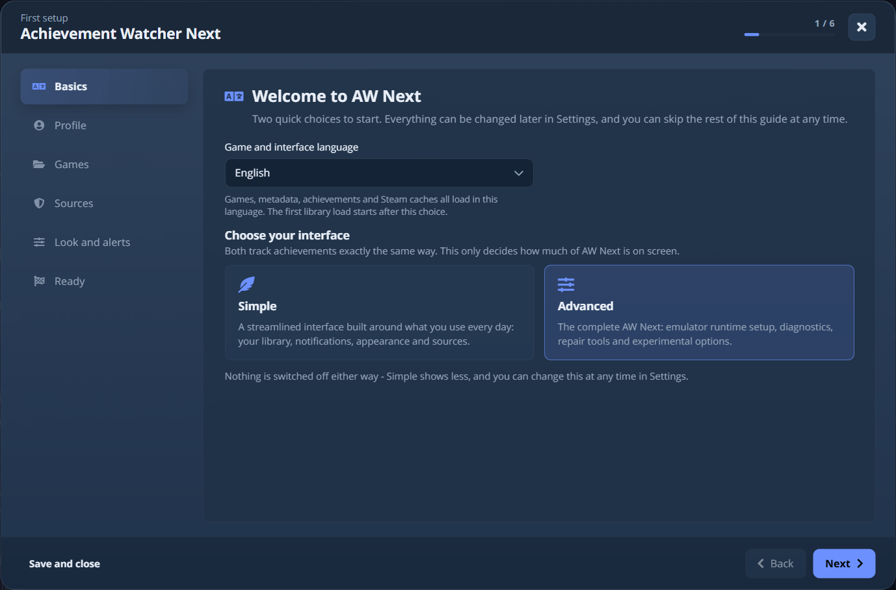
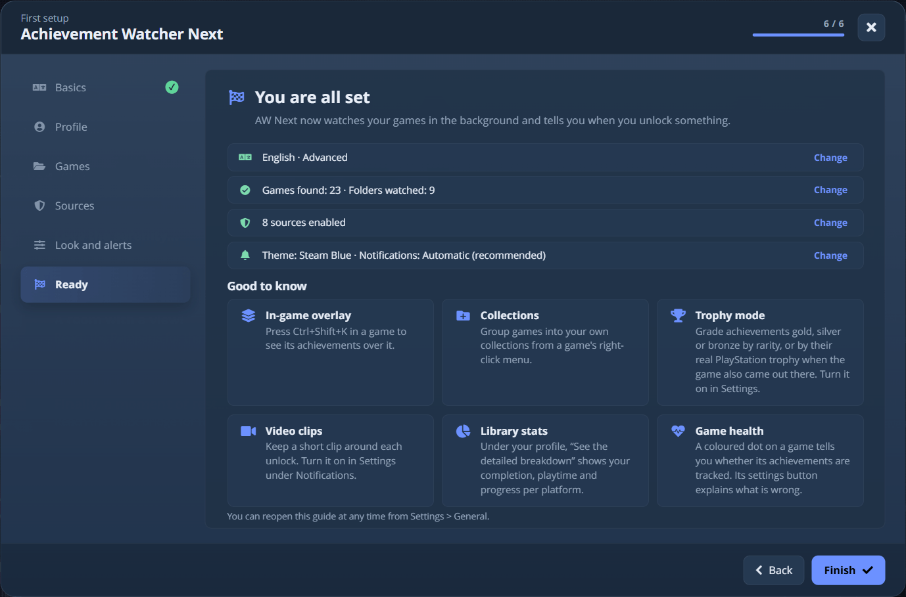
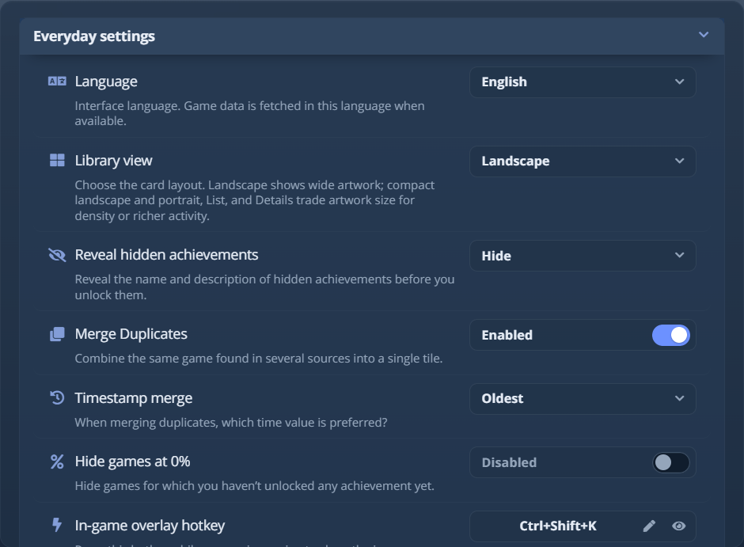
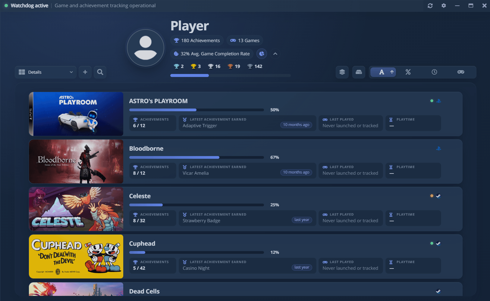
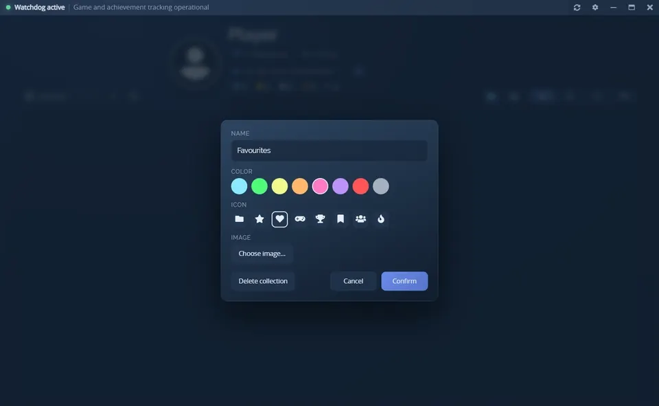
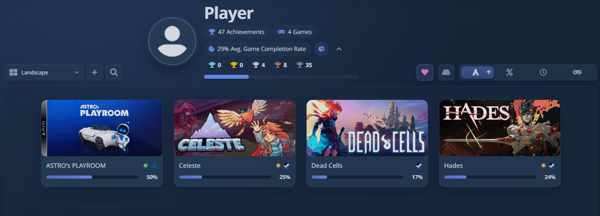
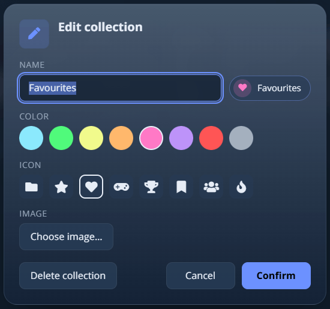
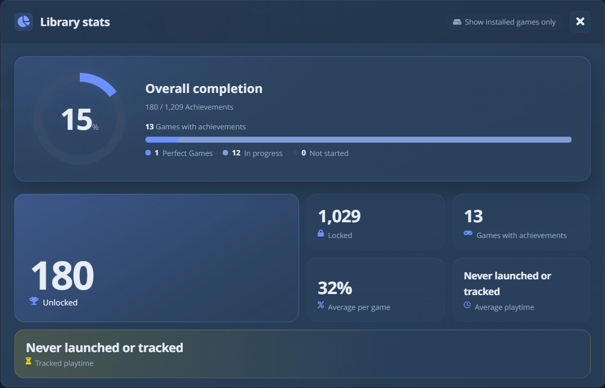
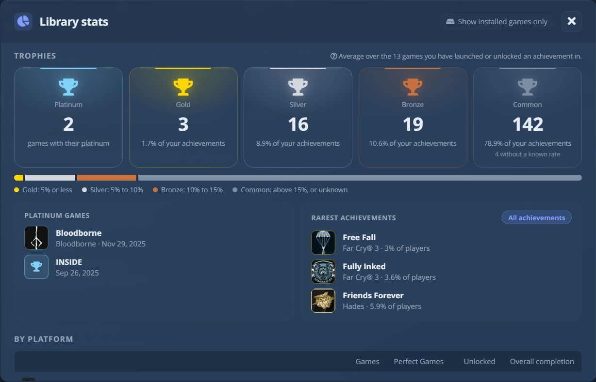

# Primeiros passos

O AW Next é um app de desktop para Windows e Linux. As versões já incluem o próprio runtime, então o Node.js
só é necessário para compilar a partir do código-fonte. No Linux, instale o AppImage como descreve [Linux e Steam Deck](linux.md)
e depois volte aqui: tudo o que vem a seguir vale também para o Linux, com `~/.config/Achievement Watcher Next` no lugar
de `%APPDATA%\Achievement Watcher Next`.

## Instalação {#install}

| Etapa | Windows 10 e 11 | Linux (x64, beta) |
|---|---|---|
| **Baixe** | Da [versão mais recente](https://github.com/Shirowwww/Achievement-Watcher-Next/releases/latest): `Achievement.Watcher.Setup.<version>.exe`, ou `Achievement.Watcher.Portable.<version>.zip` para manter os dados ao lado do app | Da mesma versão: `Achievement.Watcher.<version>.AppImage` |
| **Inicie** | Execute o instalador, escolha uma pasta e abra o AW Next pelo menu Iniciar | `chmod +x` e depois execute. Exige o FUSE 2: `libfuse2t64` no Ubuntu 24.04 |
| **Dados** | `%APPDATA%\Achievement Watcher Next` (a versão portátil mantém uma pasta `data` ao lado do executável) | `~/.config/Achievement Watcher Next` |

> [!WARNING]
> O instalador é assinado com o certificado autoassinado do próprio projeto (`CN=Shirow`), então o Windows
> SmartScreen ainda pode pedir confirmação. Veja
> [Aviso do antivírus ou do SmartScreen](troubleshooting.md#antivirus-or-smartscreen-warning). As
> atualizações dentro do app instalam apenas uma versão assinada por esse certificado, fixado pela impressão digital.

## Primeira execução {#first-launch}

<picture><source srcset="../assets/shot/onboarding-dialog-800.webp 800w, ../assets/shot/onboarding-dialog.webp 1280w" sizes="(max-width: 700px) 100vw, 720px"></picture> 
Seis etapas: o básico, o perfil, os jogos, as fontes, aparência e alertas, e um resumo final

O guia da primeira execução pergunta as escolhas que preenchem a biblioteca:

- **Básico**: o idioma (da interface e, quando uma fonte oferece, dos metadados dos jogos) e a interface,
  Simples ou Avançada (veja abaixo). Nenhuma das duas vem pré-selecionada.
- **Perfil**: o nome exibido no cabeçalho, um avatar local opcional e sua conta principal da Steam.
- **Jogos**: o que foi encontrado neste PC, com as contagens. Adicione uma pasta somente se algo estiver faltando.
- **Fontes**: logins opcionais (Steam, Epic, Xbox, PlayStation, RetroAchievements) que leem sua biblioteca real
  e os desbloqueios feitos em outro PC. Você pode pular e conectar depois em **Configurações →
  Fonte**. Todos os interruptores de fontes ficam em **Ajustar fontes**, recolhido porque os padrões leem
  tudo o que estiver instalado.
- **Aparência e alertas**: o tema e como os desbloqueios são anunciados, com um botão **Testar notificação**.
  O padrão, **Automático**, não exige nenhuma decisão.
- **Pronto**: um resumo com um botão **Alterar** para cada escolha, e indicações para coleções, modo troféus,
  videoclipes e o overlay.

<picture><source srcset="../assets/shot/onboarding-ready-dialog-800.webp 800w, ../assets/shot/onboarding-ready-dialog.webp 1280w" sizes="(max-width: 700px) 100vw, 720px"></picture> 
A última etapa: cada escolha com seu botão Alterar, depois um cartão para cada recurso que vale a pena conhecer

**Pular configuração** mantém as suas respostas, deixa o resto como estava e inicia a primeira varredura. **Configurações →
Geral** reabre o guia.

## Simples e Avançado {#simple-and-advanced}

Escolha um no guia da primeira execução e mude quando quiser com o controle **Interface** no topo de
**Configurações**.

<picture><source srcset="../assets/shot/settings-panel-800.webp 800w, ../assets/shot/settings-panel.webp 940w" sizes="(max-width: 700px) 100vw, 720px"></picture> 
O controle Interface fica ao lado do título do painel; o campo de busca filtra todas as abas de uma vez

- **Simples** mostra as abas do dia a dia: Geral, Aparência, Controle, Notificação, Presets de notificação,
  Fonte, Pastas e Ajuda.
- **Avançado** acrescenta as abas **Steam / GBE Fork**, **Ubisoft / Uplay R1/R2** e **Avançado**, e as opções
  mais detalhadas dentro das outras abas.

**O modo Simples oculta controles e nunca desativa nada.** O rastreamento, a varredura e as notificações se comportam
da mesma forma, e todo valor que você definiu continua lá quando você volta. O Estado do jogo segue a mesma ideia:
no modo Simples mostra *Dados de conquistas encontrados* ou *Detectado quando o jogo inicia*, no Avançado dá contagens, arquivos e
nomes de processo exatos. Uma instalação existente é atualizada para **Avançado**, então nada do que você usava desaparece.

O campo de busca no topo de **Configurações** filtra todas as abas de uma vez e conta as ocorrências por aba.
Ele pesquisa rótulos, descrições, valores de opções e nomes internos, então `hideZero` encontra a mesma linha
em qualquer idioma. `Ctrl+F` leva até ele e `Esc` o limpa.

## A biblioteca {#the-library}

Em **Configurações → Fonte**, o escudo marca as bibliotecas oficiais de desktop. Ative uma linha e atualize;
só aparecem as bibliotecas detectadas neste PC. Veja [Fontes compatíveis](sources.md).

O seletor entre a busca da biblioteca e o botão `+` alterna entre seis visualizações: cartões grandes,
capas em retrato, as duas variantes compactas delas, uma lista e uma tabela de detalhes com tempo de jogo e
última sessão. A escolha é salva, e todas as visualizações têm os mesmos cartões, filtros e menu de contexto.

<picture><source srcset="../assets/shot/library-views-800.webp 800w, ../assets/shot/library-views.webp 1280w" sizes="(max-width: 700px) 100vw, 800px"></picture> 
A visualização Detalhes: última conquista, última sessão e tempo de jogo de cada jogo num relance

**Configurações → Aparência → Cartões da biblioteca** define o tamanho dos cartões e o espaço entre eles
(até 0), e mostra ou oculta o nome do jogo, a barra de progresso, o ícone da plataforma, o indicador de estado e os
dois botões, em todas as visualizações de uma vez. Um jogo que a Steam lista sem conquistas mostra a arte em vez de
uma barra; **Barra de jogos sem conquistas** traz a barra de volta.

Clique com o botão direito num jogo para renomeá-lo, editar o tempo de jogo ou adicioná-lo a uma
coleção. Um nome que você definiu sobrevive a novas varreduras e restaurações, enquanto as capas e a
correspondência mantêm o título original. Os jogos da Steam podem usar o título no idioma das suas conquistas
(**Configurações → Geral**).

### Coleções {#collections}

Coleções são grupos de jogos feitos por você. Clique com o botão direito num jogo, escolha **Coleções**
e marque uma ou crie uma nova. O botão de coleções ao lado do interruptor de somente instalados
filtra a biblioteca por uma coleção, e os números do perfil acompanham.

 
Crie uma coleção, adicione jogos pelo menu de botão direito e depois filtre a biblioteca por ela

<picture><source srcset="../assets/shot/collections-panel-800.webp 800w, ../assets/shot/collections-panel.webp 1280w" sizes="(max-width: 700px) 100vw, 800px"></picture> 
Vendo uma única coleção: o botão assume o ícone e a cor dela, e os totais contam apenas os jogos dela

Uma coleção tem um nome, uma cor e um ícone ou uma imagem sua. **Editar coleção…** no menu do botão abre
o editor, onde você também a exclui; os jogos dela continuam na biblioteca.

<picture><source srcset="../assets/shot/collection-editor.webp 550w" sizes="(max-width: 700px) 100vw, 360px"></picture> 
O editor de coleções

### Estatísticas da biblioteca {#library-stats}

O botão redondo ao lado da taxa de conclusão no cabeçalho do perfil abre **Estatísticas da biblioteca**: conclusão
geral, números de conquistas desbloqueadas e bloqueadas, a média por jogo, o tempo de jogo médio e o rastreado,
as contagens de troféus e uma linha por plataforma. **Mostrar apenas os jogos instalados** limita os totais a este PC.
A seta ao lado do botão recolhe o cabeçalho do perfil em uma só linha, o que dá mais espaço à biblioteca
(**Configurações → Aparência → Perfil** tem a mesma opção).

<picture><source srcset="../assets/shot/stats-overview-800.webp 800w, ../assets/shot/stats-overview.webp 1228w" sizes="(max-width: 700px) 100vw, 800px"></picture> 
A visão geral: conclusão, contagens, média por jogo e tempo de jogo

**Troféus** conta uma platina para cada jogo concluído (um jogo da PlayStation quando o troféu de platina
é conquistado) e classifica cada outra conquista desbloqueada por raridade, com os limites abaixo da barra (eles
seguem a configuração de raridade em [Notificações](notifications.md#trophy-mode)). **Jogos platina** lista
o que você concluiu e quando, **Conquistas mais raras** as mais difíceis que você tem, e **Todas as conquistas**
abre a lista completa.

<picture><source srcset="../assets/shot/stats-trophies-800.webp 800w, ../assets/shot/stats-trophies.webp 1228w" sizes="(max-width: 700px) 100vw, 800px"></picture> 
Troféus, jogos platina, desbloqueios mais raros e os totais por plataforma

## Temas {#themes}

**Configurações → Aparência** pinta o app inteiro e o overlay do jogo. Treze paletas já vêm incluídas,
e todas podem ser editadas: escolha um tema e o editor abre nas cores dele, uma linha por camada (fundo da janela,
barra superior, painel da biblioteca, cartões e linhas, janela de configurações, texto, texto esmaecido, bordas,
destaque). Cada camada aceita uma cor com opacidade e, opcionalmente, um gradiente, e as cinco camadas de
superfície também podem receber uma imagem de fundo com um ajuste e um véu colorido ou um desfoque.

A edição mostra uma prévia ao vivo e não grava nada. **Salvar tema** o transforma num tema seu: mantenha o nome
para substituir esse tema ou digite outro para ter um segundo. **Personalizado…** é o espaço de rascunho, sempre
editável e nunca sobrescrito por um salvamento feito a partir dele. **Redefinir tudo** restaura o tema que você está
editando: um tema embutido volta à sua paleta, um tema salvo ou importado volta ao que está no disco, e o
Personalizado volta à paleta padrão.

**Arquivos de tema** transformam um tema em um único arquivo portátil. **Exportar tema…** grava um `.awtheme` com a
paleta, os gradientes, os efeitos e as imagens que você usou, e nada sobre a sua máquina (uma imagem viaja como
bytes, nunca como caminho). A exportação de um tema embutido é recusada até que você o salve com um nome seu, já que
o arquivo seria instalado em outro lugar como "Nord" e encobriria o Nord que já existe. **Importar
tema…** primeiro mostra o app desenhado com esse tema, com seu nome, autor, versão e número de imagens, e
só instala depois da sua confirmação. **Excluir tema** remove um tema importado junto com suas imagens.

Um `.awtheme` contém apenas cores, números e imagens, então não pode executar nada nem acessar a rede
(veja [a referência do formato](../awtheme-format.md)). Os temas que outras pessoas fizeram estão na
[galeria de temas](../gallery/themes/), e enviar o seu exige [um único arquivo](community-galleries.md). Um simples
arquivo `*.css` colocado em `%APPDATA%\Achievement Watcher Next\themes` ainda aparece no seletor, mas
não pode ser exportado.

## Ajuda e dicas {#help-and-tips}

**Configurações → Ajuda** é uma referência ao vivo, agrupada pela forma como uma dúvida surge: **Primeiros passos**,
**Algo não está funcionando**, **Jogos emulados** e **Personalização**. Ela mostra o seu atalho real, o layout e as
atribuições do controle, o tema e o modo de notificação, e se atualiza conforme você muda as configurações. A busca
ignora maiúsculas e acentos, e todos os tópicos estão disponíveis nos dois modos de interface.

## Encontrar jogos e saves {#find-games-and-saves}

Abra **Configurações → Pastas** e escolha um caminho:

- **Busca inteligente** oferece tudo o que encontra para sua aprovação antes de adicionar qualquer coisa. Ela reconhece
  pastas de bibliotecas pelo nome ("Games", "Jeux", "Repacks" e seus equivalentes em duas dezenas de idiomas, mais
  "Emulators" e "Emulation") em todas as unidades, e lê o que os launchers registraram: manifestos da
  Epic, entradas de registro do GOG Galaxy e do Ubisoft Connect e o ponteiro que o Windows grava para a
  unidade escolhida para os jogos do Xbox. Isso encontra uma biblioteca com nome de loja (`D:\Epic Games`,
  `D:\XboxGames`) sem fazer varredura. Os jogos de um launcher mantêm a própria fonte. A Busca inteligente adiciona
  todo o resto da mesma pasta, geralmente onde acaba um repack ou uma build do Goldberg.
- **Adicionar uma pasta** monitora um local que você selecionar.
- **Gerar configurações** executa uma varredura mais completa e pode aplicar as opções de configuração de
  emuladores que estiverem ativadas.

Se uma pasta for rejeitada, selecione o diretório que contém diretamente as pastas de saves, as pastas de AppID,
`steam_settings` ou a configuração do emulador. [Solução de problemas](troubleshooting.md#a-game-is-missing)
lista as primeiras verificações. Quando o nome de uma pasta corresponde a várias versões da Steam e a correspondência está
errada, clique com o botão direito no jogo e escolha **Definir o AppID manualmente…** (veja
[Definir o AppID de um jogo manualmente](advanced.md#set-a-games-appid-by-hand)).

As listas de conquistas não exigem nenhuma chave da Steam Web API: vêm de endpoints públicos e ficam em cache
por idioma, então a biblioteca funciona offline depois ([como](sources.md#steam-metadata-without-an-api-key)).

## Notificações {#notifications}

**Configurações → Notificação** define o modo de entrega: **Automático** (o padrão: o overlay do jogo quando
puder ser exibido, uma notificação do Windows ou do desktop quando não puder, e nunca o mesmo desbloqueio
duas vezes), **Overlay no jogo**, **Notificação do Windows** ou **Ambos**. Se o Não Perturbe do Windows ocultar
as notificações enquanto você joga, ative **Notificações prioritárias** e aprove o pedido único. Os
botões de teste permitem experimentar tudo antes de iniciar um jogo. Veja [Notificações](notifications.md) e
[o que o Automático observa](notifications.md#how-automatic-decides).

## Verificar um jogo {#check-on-a-game}

O botão de **ferramentas** de um cartão de jogo abre o painel **Estado do jogo**: se o AW Next consegue ver o jogo,
ler as conquistas dele e anunciar os desbloqueios, e os reparos que se aplicam. É a primeira coisa a abrir
antes de relatar um problema (veja [Estado do jogo](game-health.md)). Para jogar um jogo de novo do zero, use
[Redefinir as conquistas](advanced.md#reset-a-games-achievements), que faz backup de tudo antes.

## Bandeja e inicialização {#tray-and-startup}

Fechar a janela principal mantém o AW Next na bandeja do sistema, onde o rastreador em segundo plano continua observando
arquivos e processos para o tempo de jogo e os desbloqueios. Sem nenhuma janela aberta, ele devolve a memória ao
Windows, e a varredura periódica da biblioteca espera enquanto um jogo está em execução. **Configurações → Avançado →
Atualizações automáticas de dados de conquistas** desativa essa varredura para quem mantém o `steam_cache` manualmente.
Se o AW Next inicia com o Windows e fecha para a bandeja, isso fica em **Configurações → Geral**. Para sair de vez,
use o menu da bandeja.

## Atualizações e dados existentes {#updates-and-existing-data}

As versões instaladas consultam o feed de releases do GitHub do projeto, nunca durante um jogo. Uma nova versão
é anunciada por uma notificação do desktop e por um selo na barra de título (o ícone da bandeja também mostra um ponto azul),
e nada tira o foco de um jogo ou de outro app. O aviso fica até você fechá-lo e volta
depois de um jogo.

Clique na notificação ou no selo para abrir a janela de atualização. Ela mostra as notas de versão de todas as
versões que você pulou e o tamanho do download, com **Atualizar agora**, **Mais tarde** e **Pular esta versão**.
Nada é baixado antes de você escolher. Depois de **Atualizar agora**, a mesma janela acompanha o download, que
você pode cancelar ou mandar para segundo plano. O selo na barra de título mostra o estado e traz a janela de volta.
Quando o download termina, o instalador mostra o próprio cartão de progresso e o AW Next reinicia. Se um jogo estiver
em execução, a instalação espera ele fechar, ou você pode instalar mesmo assim pela janela. **Configurações →
Verificar atualizações** abre a janela na hora. As atualizações baixam só o que mudou e voltam sozinhas ao
instalador completo se isso falhar. O AppImage do Linux se atualiza a partir das mesmas versões (veja
[Atualizações no Linux](linux.md#updates)).

Uma versão mais nova instalada sobre uma mais antiga mantém seus dados em `%APPDATA%\Achievement Watcher Next`:
configurações, pastas monitoradas, caches, tempo de jogo, logs, recursos de notificação e dados de contas locais. Na
primeira execução depois da atualização, o AW Next importa uma instalação anterior:

| Você vem de | Importado de | O que acontece |
|---|---|---|
| Achievement Watcher 3.x | `%APPDATA%\Achievement Watcher 3.0` | Configurações, presets, temas, capas, caches, backups e logs são trazidos |
| Achievement Watcher 1.6.8 | `%APPDATA%\Achievement Watcher` | O mesmo, para quem pulou a 3.x |
| Uma máquina nova | nada | O AW Next começa com os padrões |

A importação roda uma só vez, copia os arquivos pequenos, cria links físicos para os grandes que só são gravados uma vez e
**nunca exclui nem modifica a pasta de onde lê**. Os contadores de tempo de jogo guardados no registro também são
trazidos, e as capturas de tela passam para `Pictures\Achievement Watcher Next`, a menos que você tenha escolhido
uma pasta própria.

A desinstalação oferece uma única opção, desativada por padrão: **Excluir também configurações, cache e dados salvos**
(ou `--delete-app-data` numa desinstalação silenciosa), que remove a pasta de dados e o tempo de jogo no registro.
Se uma atualização continua falhando no mesmo arquivo baixado, **Configurações → Avançado → Limpar caches** exclui
apenas os caches que podem ser baixados de novo (arquivos de atualização, esquemas e ícones da Steam e da Ubisoft,
ferramentas de correção de emuladores). Configurações, saves e backups permanecem.

---

**Próximo:** [Fontes compatíveis](sources.md): o que o AW Next pode ler e o que cada fonte exige.

*Pule adiante se você já sabe o que precisa: [Notificações](notifications.md) ·
[Estado do jogo](game-health.md) · [Configuração do Goldberg / GBE](emulator-setup.md) ·
[Solução de problemas](troubleshooting.md)*

[← Documentação](README.md) · [Página inicial do projeto](https://github.com/Shirowwww/Achievement-Watcher-Next)

