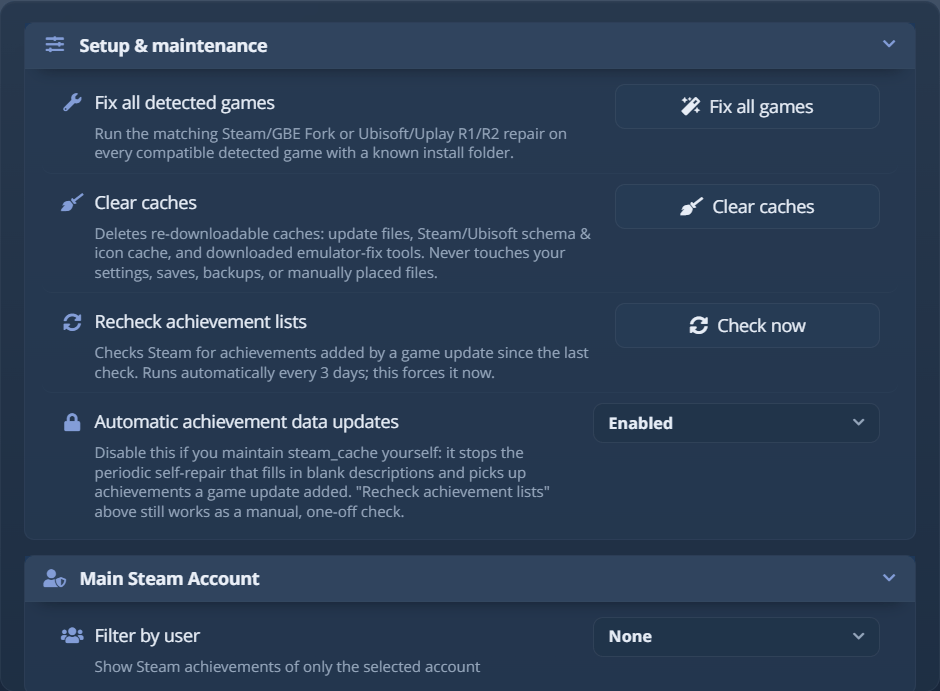
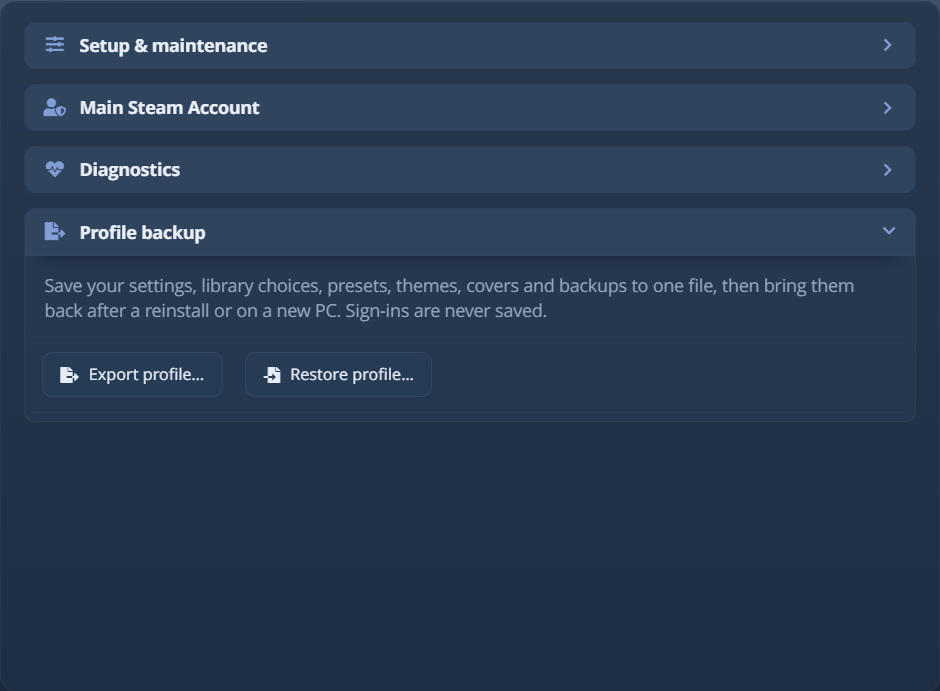
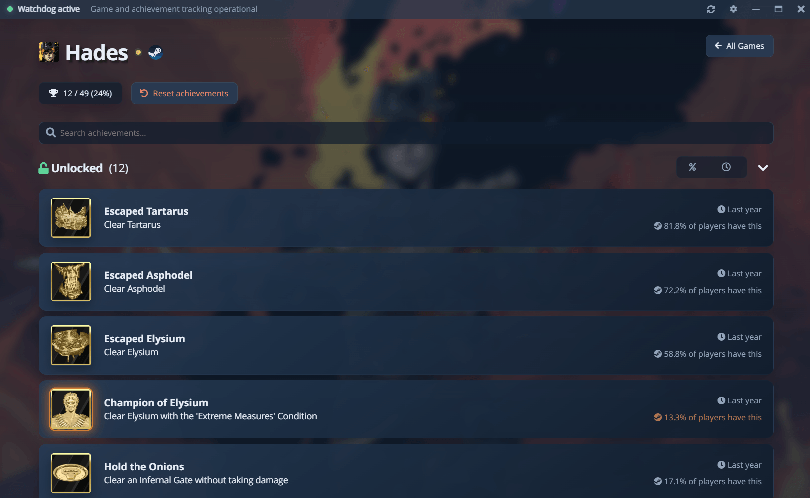

# Расширенные инструменты

Эти инструменты находятся в **Настройки → Дополнительно** или в контекстном меню игры. Вкладка «Дополнительно»
есть только когда интерфейс в режиме **Расширенный**: переключите элемент **Интерфейс** вверху
«Настроек», если вы её не видите. При обратном переключении ничего не теряется.

<picture><source srcset="../assets/shot/advanced-panel-800.webp 800w, ../assets/shot/advanced-panel.webp 940w" sizes="(max-width: 700px) 100vw, 720px"></picture> 
Настройка &amp; обслуживание; остальные разделы свёрнуты ниже

## Настройка и обслуживание {#setup-and-maintenance}

| Инструмент | Что он делает |
|---|---|
| **Исправить все обнаруженные игры** | Запускает подходящее исправление (Steam/GBE Fork или Ubisoft/Uplay R2) для каждой совместимой обнаруженной игры с известной папкой установки. Это перестраивает игры, у которых настройка уже есть. |
| **Отключить аппаратное ускорение** | Выключает ускорение на GPU, когда окно или оверлей работают неправильно. Требуется перезапуск. |
| **Очистить кэши** | Удаляет только кэши, которые можно скачать заново: файлы обновлений, кэш схем и значков Steam/Ubisoft и скачанные инструменты исправления эмуляторов. Настройки, сохранения, резервные копии и файлы, размещённые вручную, никогда не затрагиваются. |
| **Перепроверить списки достижений** | Проверяет в Steam достижения, добавленные обновлением игры. Это выполняется каждые 3 дня; кнопка запускает проверку сразу. |
| **Автоматическое обновление данных о достижениях** | Включено по умолчанию. Выключение останавливает эту перепроверку и исправление пустых описаний, для тех, кто ведёт `steam_cache` вручную. **Перепроверить списки достижений** продолжает работать, пока оно выключено. |

Параметры исправления для отдельных источников находятся в **Настройки → Эмуляторы**. **Ubisoft / Uplay R2** содержит
проверку состояния пакета, управление импортом и восстановлением DLL и целевое пакетное исправление; сведения о загрузчике и INI остаются
автоматическими.

**Очистить кэши** - первое, что стоит попробовать, когда обновление раз за разом не удаётся на одном и том же скачанном файле.

## Диагностика {#diagnostics}

<picture><source srcset="../assets/shot/diagnostics-panel-800.webp 800w, ../assets/shot/diagnostics-panel.webp 940w" sizes="(max-width: 700px) 100vw, 720px"></picture> 
Версии и один щелчок до папок журналов и данных

Карточка «Диагностика» выводит версии приложения, Electron, Node и Chrome и открывает папку журналов,
папку данных или проверку обновлений. **Экспорт журналов (.zip)** собирает все файлы журналов в один архив,
пока приложение работает; копировать их вручную ненадёжно, потому что записывающие их процессы никогда не останавливаются.
Ваше имя пользователя и любые ключи, токены и пароли маскируются в архиве, но не в журналах на диске. См.
[Устранение неполадок](troubleshooting.md#open-logs-and-local-data) о том, что нужно для отчёта об ошибке.

## Резервная копия профиля {#profile-backup}

<picture><source srcset="../assets/shot/profile-backup-panel-800.webp 800w, ../assets/shot/profile-backup-panel.webp 940w" sizes="(max-width: 700px) 100vw, 720px"></picture> 
Экспорт профиля и восстановление профиля в Настройки → Дополнительно

**Экспорт профиля…** сохраняет ваши настройки, выбор библиотеки, пресеты, темы, обложки, свои фоны,
точки восстановления GBE и время игры в один файл `.awbackup` - для переустановки или нового ПК. Данные входа,
кэши и журналы никогда не сохраняются, поэтому потом вы снова входите в Epic, Steam, Xbox, PlayStation и
RetroAchievements. **Восстановить профиль…** сначала проверяет весь файл и применяет его при
следующем запуске. Заменяемые файлы сохраняются, а неудачное восстановление возвращает всё на место.

## Удалённые игры {#removed-games}

Игра, убранная пунктом **Удалить из AW Next**, попадает в список **Настройки → Общие → Удалённые игры**
и может быть возвращена по одной или все сразу. Используйте это для постороннего каталога, который сканирование постоянно
находит, но который не является игрой; чтобы убрать настоящую игру с глаз, проще **Скрыть из отображения**
(см. [Скрыть, удалить или очистить игру](#hide-remove-or-clear-a-game)).

## Сброс достижений игры {#reset-a-games-achievements}

**Сбросить достижения** на странице игры рядом со временем игры или в её контекстном меню возвращает
каждое достижение в заблокированное состояние, чтобы вы могли пройти игру заново. AW Next объявляет их
как новые, когда они разблокируются.

<picture><source srcset="../assets/shot/achievements-800.webp 800w, ../assets/shot/achievements.webp 1280w" sizes="(max-width: 700px) 100vw, 800px"></picture> 
Сброс находится рядом со счётчиком завершения на странице самой игры

Каждый затрагиваемый файл сначала копируется в
`%APPDATA%\Achievement Watcher Next\backups\achievements\<appid>\<date>\`, а подтверждение перечисляет
точные файлы, прежде чем что-либо будет тронуто. Файл, резервная копия которого не удалась, пропускается, а не очищается.

| Источник | Что делает сброс |
|---|---|
| Эмуляторы Steam (Goldberg / GBE и совместимые структуры, включая Goldberg SocialClub и Uplay R2) | Удаляет сохранение достижений. Эмулятор записывает новое при следующей разблокировке. |
| RPCS3 | Удаляет `TROPUSR.DAT`. Список трофеев (`TROPCONF.SFM`) не затрагивается. |
| ShadPS4 | Снова блокирует трофеи внутри `TROP*.XML`, где также хранится список трофеев, поэтому файл редактируется, а не удаляется. |
| KytyPS5 | Удаляет файлы разблокировок игры `trophies_*.json`. Список трофеев остаётся в пакете самой игры. |
| Xenia | Очищает флаг получения внутри `.gpd`, где также хранится список достижений, поэтому файл редактируется. |
| Steam, GOG Galaxy, Ubisoft Connect, EA, Epic, Xbox | **Невозможно.** Они хранят разблокировки в вашей учётной записи и синхронизируют их заново; очистить их может только учётная запись. AW Next сообщает об этом. |

Счётчики прогресса, хранящиеся рядом с достижениями (`stats.ini`, `stats.bin`, …), тоже сбрасываются и сохраняются в
резервной копии: для достижения «проехать 1000 км» счётчик и есть прогресс, а если оставить его полным, достижение
сработает сразу или больше никогда.

**Восстановить резервную копию достижений** в том же контекстном меню возвращает весь сброс. После этого обновите
библиотеку, чтобы прочитать восстановленные разблокировки.

> [!NOTE]
> Сброс также очищает собственную запись AW Next о том, что уже было разблокировано, в том числе в работающем
> фоновом отслеживателе. Иначе повторно полученное достижение больше никогда не было бы объявлено.

## Заново закрыть одно достижение {#re-lock-a-single-achievement}

Щёлкните правой кнопкой разблокированное достижение на странице игры и выберите **Закрыть это достижение снова**, чтобы
пройти именно его ещё раз. В заблокированное состояние возвращается только это достижение: его флаг, время разблокировки и
прогресс в сохранении эмулятора, его счётчик, если сохранение связывает его с ним, и собственная запись
AW Next, поэтому оно объявляется как новое, когда вы его получите. Подтверждение перечисляет файлы, и каждый файл
сначала сохраняется в резервной копии, как при сбросе; **Восстановить резервную копию достижений** возвращает всё.

Сначала закройте игру. Эмулятор держит разблокировки в памяти и записывает их обратно при выходе из игры,
что отменило бы изменение, поэтому AW Next отказывается, пока игра запущена.

Это работает с текстовыми сохранениями эмуляторов Steam (Goldberg и GSE, CODEX, RUNE, OnlineFix, RLD!,
3DM, ALI213, TENOKE, Hoodlum, RAZOR1911, CreamAPI), UniverseLAN, Nemirtingas, Uplay R1 и R2,
GreenLuma и LumaPlay в Windows и с консольными сохранениями RPCS3, ShadPS4, Xenia, KytyPS5, портов Xbox
360 и XLLN. Сохранения SmartSteamEmu (`stats.bin`) и SKIDROW (`achieve.dat`) не редактируются по одному
достижению, поскольку их структура не документирована; для них используйте **Сбросить достижения**.

## Скрыть, удалить или очистить игру {#hide-remove-or-clear-a-game}

В контекстном меню игры есть три способа от неё избавиться, от самого мягкого до самого сильного:

| Пункт | Что происходит | Как отменить |
|---|---|---|
| **Скрыть из отображения** | Игра исчезает из «Все игры», из каждой коллекции и из статистики, но по-прежнему отслеживается и уведомляет. | В меню «Коллекции» пока игра скрыта, есть вид **Скрытые**; щёлкните её там правой кнопкой и выберите **Показать снова**. |
| **Удалить из AW Next** | Сканирование пропускает игру: она покидает библиотеку. Предназначено для инструментов и прочего, что не является играми. | **Настройки → Общие → Удалённые игры**. |
| **Очистить данные об игре...** | Стирается всё, что AW Next хранит об игре: её сохранения достижений (сначала в резервную копию, как при сбросе), время игры, кэшированный список достижений и значки, настройки игры и конфигурация эмулятора, записанная AW Next в её папку. Подтверждение сначала перечисляет каждую часть. | Отменять нечего: следующее сканирование найдёт игру заново как новую. |

## Переименование игры {#renaming-a-game}

**Настройки игры → Переименовать…** в контекстном меню задаёт название, под которым игра показывается: на её
плитке и экране, в поиске и сортировке, в уведомлениях и в папках, куда сохраняются скриншоты и клипы.
Поиск по-прежнему находит игру по её исходному названию. Оставьте поле пустым или выберите
**Восстановить исходное название**, чтобы вернуться. Название хранится для каждой игры в `cfg/gameTitles.json`, поэтому оно
переживает повторные сканирования и входит в резервную копию профиля. Поиск обложек и сопоставление игр используют исходное
название.

**Настройки → Общие → Названия игр на моём языке**, включено по умолчанию, показывает игры Steam под
названием, которое Steam даёт им на языке ваших достижений (на собственном языке игры, если он у неё есть).
Обложки следуют тому же языку. Локальный каталог Steam отвечает за игры, известные вашему клиенту Steam;
остальные запрашиваются один раз, пакетами, и проверяются заново через месяц. Заданное вами название всегда
главнее.

## Изменение времени игры {#editing-a-games-playtime}

**Достижения и время игры → Изменить время игры…** в контекстном меню заменяет общее время игры,
например перенесённое из другого трекера или такое, где пропущены сеансы. Введите часы
(`12.5`) или часы и минуты (`12h30` или `12:30`). Дата последнего сеанса сохраняется, а AW Next
добавляет последующие сеансы к новому итогу. Игра, которой вы владеете в Steam, никогда не опускается ниже времени игры, которое
сообщает Steam: следующее сканирование поднимает меньший итог до значения Steam.

## Другой язык достижений для одной игры {#a-different-achievement-language-for-one-game}

**Настройки игры → Язык достижений** в контекстном меню показывает достижения и уведомления одной игры на другом языке,
чем остальная библиотека. **Как в приложении** возвращает глобальный выбор.

## Добавление игры вручную {#add-a-game-manually}

Кнопка `+` рядом с поиском по библиотеке добавляет игру по названию и исполняемому файлу, с необязательной
платформой и AppID Steam. Используйте её для игры, которую не обнаруживает ни один источник: отдельной сборки, портативной
установки или эмулятора, который вы запускаете сами.

Добавленная вручную игра:

- запускается и отслеживает время игры, как любая другая запись;
- показывает **Нет достижений**, если их нет, и исключается из статистики завершения вместо того, чтобы
  считаться 0%;
- может позже принять схему достижений Steam, если добавить AppID, без пересоздания;
- сохраняет защищённую диагностику для каждой игры, а разрушительные действия остаются скрытыми.

Добавленные вручную папки в списке «Папки» несут небольшой значок, чтобы отличать их от мест,
найденных умным поиском.

## Указание AppID игры вручную {#set-a-games-appid-by-hand}

Щёлкните правой кнопкой игру, имя папки которой соответствует нескольким выпускам Steam, так что автоматическое сопоставление выбрало
неверный, и выберите **Указать AppID вручную...**. Выбор запоминается для каждой папки установки и
записывается в `steam_appid.txt`; **Сбросить ручной AppID** отменяет это. Исправление **Исправить
файл идентификатора игры** в «Состоянии игры» тоже запрашивает AppID, исходя из собственного предложения AW Next.

## Отметка достижения как разблокированного {#mark-an-achievement-as-unlocked}

Достижение, которое источник не видит (полученное до настройки отслеживания или никогда не записанное
эмулятором), можно отметить в его контекстном меню пунктом **Отметить как разблокированное вручную**. **Снять ручную
разблокировку** отменяет это. Ручные разблокировки сохраняются между сканированиями и очищаются сбросом.

## Шаги под достижением {#steps-under-an-achievement}

Длинное достижение можно разбить на шаги, которые вы пишете и отмечаете сами. Наведите курсор на него на странице игры
и откройте **Шаги** или щёлкните правой кнопкой и выберите **Добавить шаги**, затем введите шаг и нажмите Enter.
Щёлкните поле, чтобы отметить шаг, дважды щёлкните его текст, чтобы переименовать, и используйте крестик, чтобы удалить.
Игра никогда не сообщает о шагах, поэтому они лишь заполняют полосу достижения: разблокировка по-прежнему идёт от
игры, и когда она происходит, все шаги показываются выполненными. Внутриигровой оверлей показывает те же шаги и
отмечает их мышью или контроллером.

**Шаги** в заголовке игры экспортирует список в файл, которым можно поделиться, или импортирует его. Файл несёт
тексты, но не отметки, а его достижения сопоставляются по идентификатору, затем по названию; уже имеющиеся шаги
сохраняют свои отметки. Шаги хранятся в `cfg/achievement-steps.json` и входят в резервную копию профиля.

## Инструменты эмуляторов и исправления {#emulator-and-repair-tools}

Диагностика и исправление настроек Goldberg / GBE Fork, установщик среды выполнения GBE, Steamless и
необязательный обход проверки API находятся в **Настройки → Эмуляторы** и в подменю
**Эмулятор и инструменты** каждой игры. Их руководства:

- [Настройка Goldberg / GBE](emulator-setup.md) - диагностика и исправление игры Steam, работающей через эмулятор
- [Настройка Uplay, R1 и R2](uplay-r2.md) - то же самое для Ubisoft
- [Справочник Goldberg / GBE](../goldberg-gbe.md) - форматы файлов и правила обнаружения

**Удалить конфигурацию эмулятора, созданную AW Next** в том же меню отменяет только раздел DLC, переключатели
и ключи идентификации, которые AW Next записал в `configs.user.ini` игры, но никогда не значение, заданное вами или репаком,
и удаляет файл, только если в нём больше ничего не осталось. Сначала оно показывает, что именно будет удалено,
и это единственный способ восстановиться, если вы не делали резервную копию этого файла.

**Применить исправление достижений GOG (UniverseLAN)...** появляется у игры GOG, поставляющейся с dll Galaxy. Оно
устанавливает сборку UniverseLAN, подходящую к SDK Galaxy этой игры, сохраняет исходную dll как резервную копию и
никогда не перезаписывает существующие сохранения UniverseLAN. Записываемые им в `%LOCALAPPDATA%\UniverseLAN` разблокировки
читаются и сопровождаются уведомлениями, как любые другие.

Если исправление подменило эмулятор на поддерживаемый, **Отменить смену эмулятора** в разделе
[Состояние игры](game-health.md#the-repairs) возвращает собственные файлы взлома.

> [!WARNING]
> Исправления создают резервные копии, но всё же изменяют файлы игры. Используйте их только с играми, которыми вы владеете.

---

**Дальше:** [FAQ](faq.md) - короткие ответы на самые частые вопросы.

[← Документация](README.md) · [Устранение неполадок](troubleshooting.md) · [Главная страница проекта](https://github.com/Shirowwww/Achievement-Watcher-Next)

