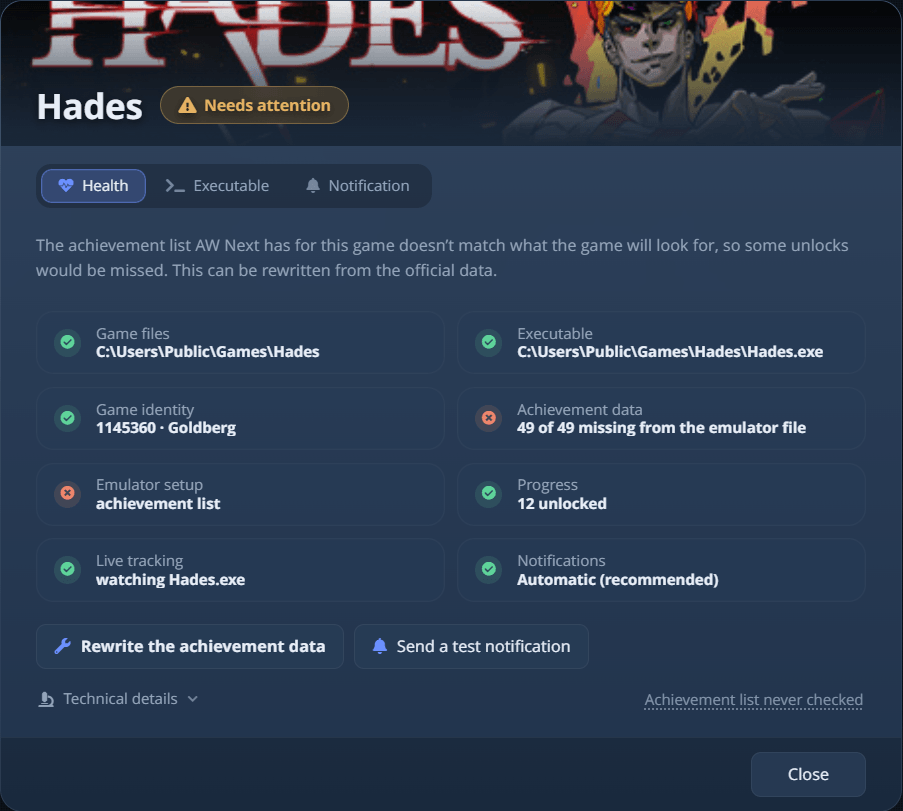

# Состояние игры

Когда игра ведёт себя неправильно, сначала откройте её панель **Состояние игры**. Она сообщает, видит ли AW Next
игру, читает ли её достижения и объявляет ли её разблокировки, и предлагает только те исправления, которые подходят.

Откройте её кнопкой **инструментов** в правом верхнем углу плитки игры или из контекстного меню
игры. В панели три вкладки: **Состояние**, **Файл запуска**, где задаётся программа, за которой
следят во время игры, и **Уведомление**, где игра может получить собственный пресет окна, положение,
звук и размер (см. [Поведение для отдельной игры](notifications.md#per-game-behavior)).

<picture><source srcset="../assets/shot/game-health-800.webp 800w, ../assets/shot/game-health.webp 903w" sizes="(max-width: 700px) 100vw, 620px"></picture> 
Одно состояние, его причина, стоящие за ним проверки и подходящие исправления

## Состояния {#the-states}

| Состояние | Что оно означает |
|---|---|
| **Готово** | Игра обнаружена, данные её достижений доступны, и AW Next следит за ней на предмет разблокировок. |
| **Требует внимания** | Игра работает, но часть её настройки не завершена. Проверки показывают, какая именно. |
| **Не отслеживается** | Не хватает чего-то существенного, поэтому ни одна разблокировка не может быть записана: игру не удаётся найти, у неё нет данных о достижениях или нет эмулятора, который записывает её разблокировки. |
| **Только время игры** | Игра, добавленная вручную: AW Next знает список её достижений и считает время игры, но пока ничто на этом ПК не записывает её разблокировки (нет эмулятора, сохранений или аккаунта магазина). Серый цвет, потому что ничего не сломано, как и точка на плитке игры; настройте источник, и состояние изменится. |

Фраза под состоянием называет причину, проверки показывают, какая часть неисправна, а кнопка исправления
действует именно на неё.

- Режим **Простой** описывает результаты простыми словами (*Данные о достижениях найдены*, *Определяется при запуске игры*).
  Режим **Расширенный** добавляет точные количества, отслеживаемый процесс и канал уведомлений.
- **Технические сведения** внизу в обоих режимах содержат все исходные значения. Нажмите **Копировать** для отчёта об
  ошибке. Длинное значение прокручивается при наведении.

Для игр на консольных эмуляторах исполняемый файл Windows и файлы игры не запрашиваются.

Некоторые игры ничего не записывают в автономном режиме, как бы ни была выполнена настройка. У Halo: Campaign Evolved и The Crew
Motorfest достижения выдают серверы издателя, поэтому взлом не сохраняет ни одного. Их
панель сообщает об этом с первого запуска.

## Проверки {#the-checks}

| Проверка | На какой вопрос отвечает | Типичное исправление |
|---|---|---|
| **Файлы игры** | Папка установки ещё на месте? | **Указать игру** |
| **Файл запуска** | За какой программой следить во время игры? | **Указать игру** |
| **Идентификация игры** | С каким AppID и платформой была сопоставлена эта игра? В режиме «Простой» не показывается. | **Исправить файл идентификатора игры** или **Указать AppID вручную** |
| **Данные достижений** | Есть ли список достижений, полон ли он и актуальны ли определения прогресса и статистики? | **Перезаписать данные достижений** |
| **Настройка эмулятора** | Есть ли у игры, которой нужен эмулятор Steam, такой эмулятор и какой именно её обслуживает? Настройки, без которых эмулятор обходится, показываются здесь как заметки, а не как проблемы. Для игры Ubisoft это также охватывает загрузчик Uplay и то, запрашивал ли он когда-либо достижение. | **Установить файл эмулятора**, **Переключиться на поддерживаемый эмулятор**, **Дополнить настройки эмулятора** или **Починить поддержку достижений Ubisoft** |
| **Прогресс** | Найдена ли уже какая-либо разблокировка или сохранение? | Запустите игру и что-нибудь разблокируйте |
| **Счётчики прогресса** | Для игр в стиле CODEX/RUNE, которые отслеживают статистику, а не простую разблокировку, получил ли AW Next статистику, стоящую за каждым достижением? Показывается только для игр, которые её используют. | **Получить счётчики прогресса** |
| **Обнаружение запуска игры** | Замечает ли фоновый отслеживатель, когда эта игра запускается, и следит ли он за файлом запуска, выбранным для игры? Сам по себе он не записывает разблокировок: это работа эмулятора. | **Отслеживать эту игру** |
| **Уведомления** | Какой канал доставил последнее уведомление для этой игры и почему? | **Отправить тестовое уведомление** |

## Исправления {#the-repairs}

Панель показывает только те исправления, которые могут помочь этой игре. Каждое сообщает, что именно оно изменит и где
хранятся прежние файлы. Ничего не перезаписывается без резервной копии или подтверждения, а исправление, которое не удалось на полпути, возвращает на место все файлы, которые успело изменить; в ошибке сказано, что было восстановлено.

| Исправление | Что оно делает |
|---|---|
| **Указать игру** | Открывает окно выбора исполняемого файла, за которым нужно следить. |
| **Открыть папку игры** | Открывает папку установки в Проводнике. |
| **Перезаписать данные достижений** | Изменяет только `achievements.json`, `stats.json` и недостающие значки, ничего больше. Полный список остаётся как есть; добавляемые записи следуют формату файла, его языкам и его папке значков. Определения прогресса и статистики берутся из generate_emu_config, когда **Данные steam_settings** установлены в «Расширенный» и сохранён вход в Steam, иначе из общедоступного списка games-infos-datas, и подтверждение сообщает, откуда именно. Каждый изменённый файл сначала копируется в `.aw-backups` внутри `steam_settings`. |
| **Дополнить настройки эмулятора** | Добавляет только те файлы настроек, которых игре не хватает (`steam_appid.txt`, `configs.main.ini`, `configs.user.ini` и `configs.app.ini`, когда включено [Управление владением DLC](../goldberg-gbe.md)). То, что уже дают глобальные настройки эмулятора, остаётся за ними, а список достижений не затрагивается. Собственный аккаунт игры в `configs.user.ini` заменяется, только когда включена **Запись имени аккаунта и языка** и вы отвечаете «Да» на вопрос. |
| **Установить файл эмулятора** | Скачивает поддерживаемую сборку эмулятора в папку игры, сохраняя заменяемый файл как `.bak`. |
| **Переключиться на поддерживаемый эмулятор** | Для игры, которую обслуживает другой взлом, ничего не записавший: устанавливает поверх него поддерживаемый эмулятор, переименовывает конфигурацию того взлома в `.bak` и в том же шаге записывает `steam_settings` эмулятора (идентификатор игры и список достижений), так что игру можно запускать сразу. Нужен Steam AppID игры; если какая-то часть не удалась, каждый файл возвращается на место. Недостающие значки можно добавить позже через **Перезаписать данные достижений**. |
| **Отменить смену эмулятора** | Появляется там, где выполнялось одно из двух предыдущих. Возвращает собственные файлы игры из их копий `.bak` и убирает поддерживаемый эмулятор. |
| **Отменить последнее исправление** | Появляется после любого изменения, которое AW Next внёс в папку игры: исправления из этой панели, исправления эмулятора, CrakFiles, «Удалить DRM Steam (Steamless)», «Восстановить последнюю резервную копию GBE/Goldberg», «Указать AppID вручную», починки Uplay или одной из кнопок отмены выше. Сначала перечисляет все файлы, которые вернёт. Если файл занят (часто потому, что игра запущена), ничего не меняется, а запись остаётся для новой попытки. |
| **Исправить файл идентификатора игры** | Переписывает `steam_appid.txt`, когда эмулятор сообщает об одной игре, а AW Next сопоставил другую. Запрашивает верный AppID, предлагая сопоставление AW Next, и сохраняет прежний файл. |
| **Получить счётчики прогресса** | Спрашивает Steam, какая статистика управляет каждым достижением, для игр в стиле CODEX/RUNE. Ничего не записывает в папку игры. |
| **Починить поддержку достижений Ubisoft** | Для совместимой игры Ubisoft переписывает конфигурацию загрузчика, схему и перенаправление сохранений одной транзакцией, с резервной копией каждого затронутого файла. См. [Настройка Uplay](uplay-r2.md). |
| **Включить достижения без подключения** | Для игры Ubisoft, у которой журнал загрузчика доказывает, что она никогда не запрашивала достижение, поскольку считает, что вы вышли из системы. Добавляет один ключ-заглушку сеанса в INI рядом с игрой; нажмите ещё раз, чтобы его убрать. См. [Настройка Uplay](uplay-r2.md#a-game-that-never-asks-for-an-achievement). |
| **Отслеживать эту игру** | Добавляет игру в фоновый отслеживатель, чтобы записывались время игры и разблокировки в реальном времени, следуя файлу запуска, выбранному на вкладке **Файл запуска**. |
| **Включить уведомления о прогрессе** | Снова включает уведомления о прогрессе для игры, которую вы отключили. |
| **Отправить тестовое уведомление** | Отправляет уведомление с названием и обложкой этой игры через тот канал, которым оно действительно пошло бы. |

> [!IMPORTANT]
> Несовпадение не всегда вина эмулятора: если он был настроен намеренно под идентификатор на диске,
> оставьте его в покое. **Указать AppID вручную** (щелчок правой кнопкой) устраняет несовпадение с именем папки раз и навсегда, вместо
> того чтобы каждый раз исправлять файл. См. [Настройка Goldberg / GBE](emulator-setup.md#set-appid-manually).

## Типичные состояния и что делать {#common-states-and-what-to-do}

| Панель сообщает | Что это обычно означает |
|---|---|
| *Список достижений не найден* | У игры нет достижений или её источник выключен. Проверьте **Настройки → Источники**. |
| *Для этой игры нужен эмулятор Steam, но он не настроен* | Используйте **Применить исправление эмулятора** в контекстном меню. См. [Настройка Goldberg / GBE](emulator-setup.md). |
| *Файл эмулятора, который её читает, отсутствует* | **Установить файл эмулятора** устанавливает подходящую среду выполнения. |
| *ColdClient обслуживает эту игру, но…* | `ColdClientLoader.ini` рядом с загрузчиком запускает отсутствующий файл или другую программу, называет другую игру или не имеет загрузчика для 32 или 64 бит игры. Исправьте этот файл; AW Next его только читает. Когда он исправлен, **Запустить через загрузчик ColdClient** заставляет кнопку Играть запускать загрузчик. |
| *У эмулятора Epic всё ещё образец AppID* | В `NemirtingasEpicEmu.json` записан AppID из одних нулей, или на месте остался собственный файл EOSSDK от Epic, поэтому эмулятор не загружается. Впишите в файл Epic ID игры. |
| *Список достижений не совпадает с тем, что будет искать игра* | **Перезаписать данные достижений**. Обычно это результат обновления репака. |
| *Прогресс достижений пока не найден* | Нормально для игры, в которую вы не играли после настройки. Запустите её и что-нибудь разблокируйте. |
| *AW Next не следит за этой игрой, пока она работает* | **Отслеживать эту игру** добавляет её в отслеживатель. |
| *Не удалось отправить последнее уведомление* | Отправьте тестовое уведомление, затем см. [Уведомления](notifications.md#if-a-test-or-unlock-does-not-appear). |
| *Windows скрыла последнее уведомление во время игры* | Оно сразу ушло в Центр уведомлений, потому что игра была на весь экран или был включён режим «Не беспокоить». Включите [Приоритетные уведомления](notifications.md#priority-windows-notifications) или используйте «Автоматически» либо «Внутриигровой оверлей». |
| *Работает - включён запасной вариант Windows* | Это не неисправность. Автоматическая доставка выбрала для этой игры уведомление Windows; см. [как решает «Автоматически»](notifications.md#how-automatic-decides). |
| *Игра никогда не запрашивала достижение* | Она воспринимает свой пустой сеанс Ubisoft как выход из системы. **Включить достижения без подключения** снимает блокировку; ничего никуда не отправляется. После этого один раз запустите игру. |
| *Достижения без подключения включены, запустите игру один раз* | Настройка записана, и пока ничего не оценивалось. Кнопка рядом теперь называется **Отключить достижения без подключения**. |
| *Обслуживается ALI213, OnlineFix, GBE Fork…* | Эмулятор, который на самом деле читает эту игру, определён по её собственным файлам. Игре Ubisoft, обслуживаемой таким образом, исправление Uplay не предлагается: её слой Uplay не используется, а не сломан. Это относится к релизам, сохраняющим `steam_api64.dll` от Valve: сборке RUNE, запускаемой из `Steam\steamclient64.dll`, или релизу VOICES38, загружающему собственный переименованный GBE Fork (`steam_api64.v38`); никогда не устанавливайте эмулятор поверх последнего. Сборки Ubisoft от online-fix распознаются, и при исправлении достижений для них выводится предупреждение, что сетевая игра может перестать работать. |
| *Не хватает только некоторых значков* | **Перезаписать данные достижений** скачивает недостающие значки. |
| *Определения прогресса или статистики отсутствуют или устарели* | Достижения со счётчиком не двигались бы или показывали неверную цель. **Перезаписать данные достижений** обновляет их. |
| *Необязательные настройки не записаны* | Заметка, а не неисправность: эмулятор работает и без них (билет приложения, токен GC, переключатель неизвестной статистики, имя аккаунта). **Дополнить настройки эмулятора** добавляет их, если нужно. |
| *Имя аккаунта или язык берутся из … `GSE Saves\settings`* | Информационная строка, а не предупреждение. GBE читает `GSE Saves\settings\configs.user.ini` (или настройки папки сохранений, на которую указывает `local_save_path`), когда у игры нет своих. Исправлять нечего. |
| *Отслеживает X, а не Y* | Файл запуска, выбранный для этой игры, не тот, за которым следит отслеживатель, поэтому запуски и время игры могут быть пропущены. **Отслеживать эту игру** переключает слежение на выбранный. *Отслеживает X, запущенный через Y* - это нормально: Y - лаунчер, например загрузчик античита, который запускает игру. |
| *Источник достижений не настроен* | Показывается вместе с состоянием **Только время игры**. Примените исправление эмулятора или добавьте папку, где игра сохраняет достижения. |
| *Играли больше часа, а ни одно достижение не записано* | Вероятно, взлом, обслуживающий игру, никогда не сообщает о достижениях. Используйте **Переключиться на поддерживаемый эмулятор**, когда он предлагается; иначе проверьте, что игра запускается из собственной папки. |
| *Файл идентификатора игры*, при наличии ярлыка Steam на эту игру | Steam запускает ярлык не из Steam без `steam_appid.txt` рядом с ним, поэтому эмулятор сохраняет под другим идентификатором. **Дополнить настройки эмулятора** записывает туда этот файл. |

---

**Дальше:** [Устранение неполадок](troubleshooting.md) - для проблем, которые «Состояние игры» не решает само.

[← Документация](README.md) · [Главная страница проекта](https://github.com/Shirowwww/Achievement-Watcher-Next)

