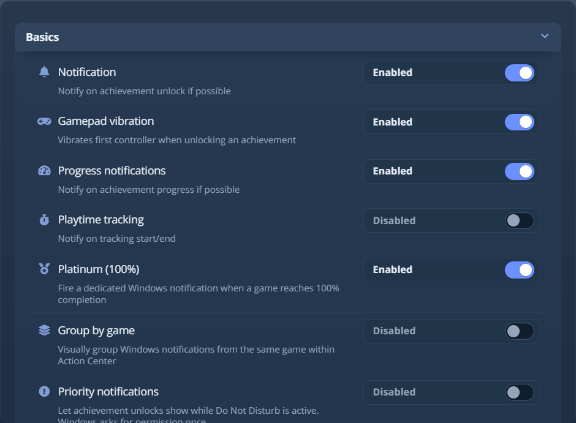
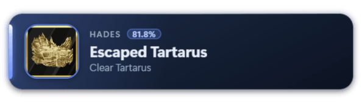
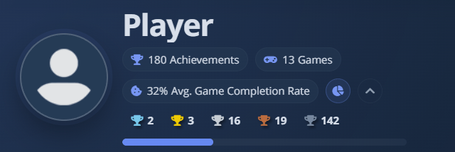
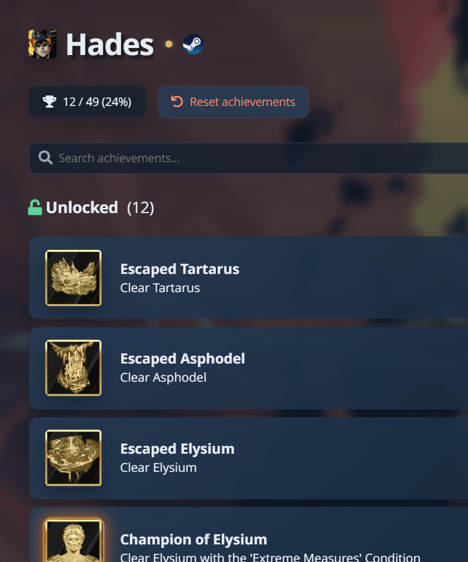
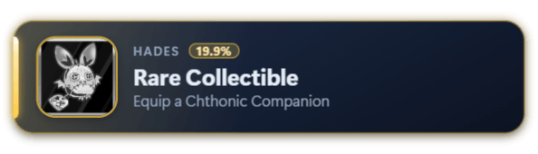
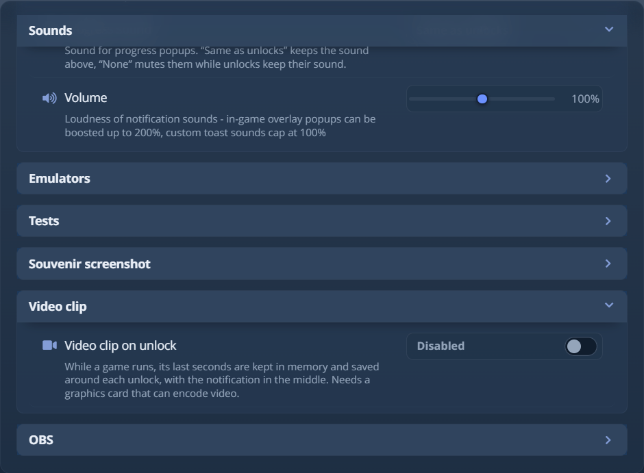

# Уведомления и всплывающие окна о достижениях

AW Next объявляет о разблокировке встроенным уведомлением Windows (toast), всплывающим окном внутриигрового оверлея
или обоими способами сразу. Выберите способ в **Настройки → Уведомления**.

В Linux уведомление - это штатное уведомление рабочего стола (GNOME или KDE), а оверлей работает так же.
«Не беспокоить» и переключатель «Приоритетные уведомления» описаны в разделе [Поддерживаемые рабочие столы](linux.md#supported-desktops).

<div align="center">
<picture><source srcset="../assets/shot/notifications-panel-800.webp 800w, ../assets/shot/notifications-panel.webp 940w" sizes="(max-width: 700px) 100vw, 720px"></picture><br>
<sub>Один режим доставки, один пресет - остальное берёт на себя «Автоматически»</sub>
</div>

## Выбор режима доставки {#choose-a-delivery-mode}

| Режим | Поведение |
|---|---|
| **Автоматически** (по умолчанию) | Внутриигровой оверлей, когда его можно показать, и уведомление Windows, когда нельзя. |
| **Внутриигровой оверлей** | Всегда оформленное всплывающее окно поверх запущенной игры, даже в эксклюзивном полноэкранном режиме, где оно может быть не видно. Если оверлей не может отобразиться вообще, это уведомление приходит как уведомление Windows. |
| **Уведомление Windows** | Всегда системное уведомление Windows. Уведомления о достижениях и прогрессе используют значок достижения; уведомления о времени игры могут включать обложку игры и полосу прогресса. |
| **Оба** | Одно и то же событие по обоим каналам. |

AW Next сам отправляет уведомления Windows и не запускает никаких других программ, включая PowerShell, поэтому они
появляются сразу. Пользовательский идентификатор приложения, заданный в `options.ini` (`[notification_advanced] appID`), по-прежнему
идёт прежним путём через PowerShell.

Окно библиотеки может оставаться закрытым в любом режиме: доставкой занимается фоновый отслеживатель.

<div align="center">
<picture><source srcset="../assets/shot/notification-popup.webp 594w" sizes="(max-width: 700px) 100vw, 440px"></picture><br>
<sub>Всплывающее окно оверлея, нарисованное выбранным пресетом с собственной обложкой игры</sub>
</div>

В любом режиме **Websocket @localhost:8082** рассылает каждое событие уведомления в виде JSON по
локальному websocket - для оверлеев стримов и других инструментов. Он включён по умолчанию, слушает только `127.0.0.1`
и сам ничего не показывает. Выключите его, если не пользуетесь. По тому же адресу работает готовый
оверлей для стрима: см. [Показ разблокировок на стриме (OBS)](#show-unlocks-on-stream-obs).

> [!TIP]
> Используйте кнопки проверки после смены режима. Успешная проверка подтверждает путь отображения; настоящая
> разблокировка по-прежнему зависит от того, правильно ли отслеживается источник игры.

### Как решает «Автоматически» {#how-automatic-decides}

Каждое уведомление направляется один раз, исходя из того, что AW Next может наблюдать в этот момент:

| Ситуация | Что происходит |
|---|---|
| Ничто не закрывает экран | Внутриигровой оверлей. |
| Игра в **полноэкранном** режиме (Direct3D с полноэкранными оптимизациями Windows, как у большинства игр) | Уведомление Windows, показанное поверх игры без перехвата фокуса: приоритетное, если они включены, иначе напоминание, которое AW Next закрывает через обычное время показа уведомления. В играх без рамки и в оконных остаётся оверлей. |
| Игра удерживает экран в **устаревшем эксклюзивном режиме** (старые игры, многие игры на OpenGL или выключенные полноэкранные оптимизации) | На этом экране ничего из других приложений не рисуется. Уведомление уходит в Центр уведомлений; его звук и вибрация контроллера по-прежнему работают. Режим без рамки в игре возвращает его на экран. |
| Приложение не может показать всплывающее окно (нет пригодного пресета, рендерер недоступен) | Уведомление Windows. |
| Оверлей не удаётся показать | Уведомления Windows в течение десяти минут, затем оверлей пробуют снова. |
| Оверлей был запрошен, но не отозвался | Второго уведомления нет, чтобы избежать дубликата. Следующая разблокировка использует уведомление Windows. |

AW Next запоминает, какой канал последним доставил уведомление для каждой игры, и использует это только как
решающий довод, когда Windows не может сказать, находится ли игра в эксклюзивном полноэкранном режиме. Запасной вариант срабатывает только после однозначного
сбоя, поэтому одна и та же разблокировка никогда не объявляется дважды. AW Next не внедряется в игры и не принуждает
к смене режима отображения.

### Где показано текущее состояние {#where-the-current-state-is-shown}

В панели **Состояние игры** есть строка «Уведомления», в которой назван канал, доставивший последнее
уведомление, и причина, например *Работает - включён запасной вариант Windows* (режим «Простой»). Если
уведомлений ещё не было, показан настроенный режим. Если Windows оставила уведомление в Центре уведомлений,
потому что игра была на весь экран или был включён режим «Не беспокоить», строка сообщает об этом. См.
[Состояние игры](game-health.md).

## Приоритетные уведомления Windows {#priority-windows-notifications}

Полноэкранные игры и другие автоматические правила Windows могут включить режим **Не беспокоить**, который отправляет
обычные уведомления в Центр уведомлений, не показывая их. **Настройки → Уведомления → Приоритетные
уведомления** помечает разблокировки достижений как важные. Windows один раз спрашивает, может ли AW Next отправлять
их; изменить ответ можно в настройках уведомлений Windows.

По умолчанию параметр выключен и охватывает только разблокировки достижений и завершения, но не прогресс и не время игры.
Уведомление использует сценарий `urgent`, для которого нужна Windows 11 (сборка 22546) или новее; в Windows 10
параметр ничего не делает. См. [документацию Microsoft об уведомлениях приложений](https://learn.microsoft.com/en-us/windows/apps/develop/notifications/app-notifications/app-notifications-content).

## Игры, запускаемые Steam {#games-steam-runs}

Steam показывает собственное всплывающее окно для игр, которые он запускает, поэтому AW Next по умолчанию молчит. Включите
**Настройки → Уведомления → Игры клиента Steam**, чтобы получать и уведомление AW Next - со звуком,
оверлеем, редкостью и скриншотом на память. Оно охватывает игры, которыми вы владеете, и игры, добавленные через SteamTools,
LuaTools или GreenLuma: AW Next следит за файлом статистики, который Steam перезаписывает в `appcache\stats`. Чтобы оставить
только уведомление AW Next, отключите **Steam → Настройки → Уведомления → Я разблокировал достижение**.

## Как выглядит всплывающее окно {#how-the-popup-looks}

Вид внутриигрового всплывающего окна задаётся **пресетом**: десять поставляются с приложением, можно создать свой, а
пресетом можно поделиться в виде одного файла `.awpreset`. См. [Пресеты и конструктор пресетов](presets.md).
**Непрозрачность** (от 30% до 100%) в тех же настройках определяет, насколько окно прозрачно.

## Звуки, громкость и длительность {#sounds-volume-and-duration}

- Импортируйте файлы `.wav`, `.mp3`, `.ogg`, `.flac`, `.m4a` или `.aac` в настройках уведомлений.
- **Случайный** в списке звуков проигрывает для каждого уведомления, а также для каждого предпросмотра или
  проверки другой файл из ваших.
- **Звук редкого достижения** и **Звук 100% прохождения** (режим «Расширенный») дают этим окнам собственный
  звук, для оверлея и для уведомлений Windows. Оба по умолчанию установлены в «Как разблокировки»; «Нет» делает
  окна такого вида беззвучными. Звук, выбранный для отдельной игры в её панели, по-прежнему главнее.
- **Звук прогресса** (режим «Расширенный») делает то же для окон прогресса. Он главнее звука отдельной игры,
  кроме игры, для которой звук отключён. Чтобы заглушить окна прогресса одной игры, щёлкните её правой кнопкой и
  отключите её прогресс.
- **Эмуляторы** (режим «Расширенный») дают каждой консоли свой пресет и звук: перечислены Xenia, RPCS3, shadPS4 и
  Kyty. Перекомпилированные игры Xbox 360 следуют выбору Xenia, порты PS4 - выбору shadPS4, а
  **Как основной** оставляет основные настройки.
- Громкость оверлея изменяется от 0% до 200%; выше 100% оверлей усиливает звук. Воспроизведение уведомлений Windows
  ограничено звуковым трактом системы.
- Длительность следует пресету или использует фиксированный предел.
- Уведомления о времени игры беззвучны.

Пресет, которым поделились, может нести собственный звук, который заменяет выбранный здесь. См.
[Как поделиться пресетом](presets.md#share-a-preset).

## Положение и размер {#position-and-scale}

Выберите угол, край или центр в настройках уведомлений. Положения отсчитываются от всего экрана, поэтому привязка
к низу находится на нижнем краю, а не над панелью задач, и карточка касается выбранных краёв независимо от того, сколько места для тени или свечения
пресет оставляет вокруг неё. AW
измеряет каждый пресет один раз для каждого положения, в фоне после первого окна, поэтому первое окно
показывается на старом месте. Пресет, у которого карточка следует длине текста (PS5 Steam, Slim),
измеряется при каждом окне, что задерживает его примерно на полсекунды.

**Переместить** меняет пользовательское положение, которое используется точно так, как вы его оставили; положение, сохранённое на уже
отсутствующем мониторе, возвращается в видимую область. При нескольких экранах окно появляется на экране игры,
в которую вы играете, а не там, где мышь, а пользовательское положение сохраняет место относительно этого
экрана. Уведомления Windows всегда показываются на главном экране.

Параметр размера изменяет всё окно целиком, не меняя его раскладку, а **Переместить** показывает его
в этом размере.

### Окна прогресса {#progress-popups}

Достижения-счётчики (убить 50 врагов, проехать 100 км) могут показывать окно прогресса на каждом шаге. В
режиме «Расширенный» **Положение прогресса** и **Размер прогресса** задают этим окнам собственное место и
размер. **Как разблокировки**, значение по умолчанию, следует положению самой игры, если оно у неё есть; любой другой
выбор применяется к окнам прогресса всех игр. Прицел рядом с **Положение прогресса** задаёт
пользовательскую привязку только для прогресса. Эти параметры перемещают только внутриигровое окно.

**Этапы прогресса** в общих настройках уведомлений показывают уведомление о прогрессе, только когда
счётчик пересекает очередные 10, 25 или 50% цели. Это относится к окну и к уведомлению Windows.
Сама разблокировка показывается всегда.

У списка оверлея есть собственные сочетания клавиш (см.
[руководство по оверлею](overlay.md#keyboard-shortcuts-overlay-open)) и необязательное управление геймпадом (см.
[руководство по контроллеру](controller.md)).

## Поведение для отдельной игры {#per-game-behavior}

Откройте панель инструментов игры и выберите **Уведомление**, чтобы задать этой игре собственный пресет окна,
положение, звук или размер. Каждое поле наследует глобальную настройку, а сохраняются только изменённые вами значения;
для звука также есть тишина и случайный выбор. Прицел рядом с «Положение» перетаскивает предпросмотр туда, где
должно появляться окно этой игры. Пять кнопок проверки показывают предпросмотр этой игры и её обложки, не
меняя прогресс достижений. Удалённый пресет или звук заменяется глобальным значением, а переименование
пользовательского пресета сохраняет его назначения играм.

Щёлкните игру правой кнопкой, чтобы отключить её уведомления о прогрессе, сохранив уведомления о разблокировках и
завершении.

Достижение с глобальной долей получивших не выше предела редкости выводит свой процент и получает
редкое оформление пресета: **золото** при 5% и меньше, **серебро** до 10%, **бронза** до 15%. Эти
пределы меняются в **Настройки → Общие → Пороги редкости** со значением «Пользовательские» (режим «Расширенный»).

### Режим трофеев {#trophy-mode}

**Настройки → Общие → Отображение редкости** переключается на **Режим трофеев**: каждое достижение получает степень
по глобальной доле получивших (золото - меньше 20%, серебро - меньше 50%, бронза - иначе или когда доля
неизвестна) в окне игры, в оверлее, в трофеях профиля и в уведомлении. **Пороги
редкости** сдвигают границы. Все три степени используют редкое оформление пресета (`state-rare` плюс
`tier-gold`, `tier-silver` или `tier-bronze`); платина остаётся отдельным состоянием завершения. Приложение
передаёт пресету его уровень в `rarityTier` (вместе с `rarityMode` и локализованным `rarityGrade`); пресет
без этого поля возвращается к проценту.

При подключённой учётной записи PlayStation (**Настройки → Источники**) игра, которая вышла и на
PlayStation, использует свой настоящий список трофеев, откуда бы ни приходили её достижения: каждое достижение получает
степень и группу DLC трофея с тем же названием или описанием. Настоящая платина показывается в каждом режиме
редкости (страница игры, статистика, окно 100%) с названием, описанием и значком и засчитывается, как только
этот трофей получен, даже если трофеи DLC остались. Эмуляторы PlayStation хранят свои трофеи. AW
находит список по исходному названию игры, поэтому переименование игры ничего не меняет.

Каждый источник показывает окно 100%, в том числе работающие в реальном времени (Xenia, перекомпилированные порты, GOG Galaxy,
Ubisoft Connect, Xbox PC). Если у игры есть платина, связанное с ней достижение показывается как
платина.

<div align="center">
<picture><source srcset="../assets/shot/trophy-profile.webp 640w" sizes="(max-width: 700px) 100vw, 440px"></picture><br>
<sub>Профиль считает каждую разблокировку по степени, а платину - за пройденные игры</sub>
</div>

<div align="center">
<picture><source srcset="../assets/shot/trophy-game-panel.webp 800w" sizes="(max-width: 700px) 100vw, 560px"></picture><br>
<sub>На странице игры у каждого достижения указана его степень и доля игроков, получивших его</sub>
</div>

<div align="center">
<picture><source srcset="../assets/shot/notification-popup-trophy.webp 594w" sizes="(max-width: 700px) 100vw, 440px"></picture><br>
<sub>Золотая разблокировка в пресете AW Next</sub>
</div>

## Показ разблокировок на стриме (OBS) {#show-unlocks-on-stream-obs}

Захват всплывающего окна как окна не работает: оно живёт несколько секунд, поэтому OBS никогда его
не ловит. Используйте источник **Браузер**, который OBS держит загруженным на протяжении всего стрима.

1. **Настройки -> Уведомления -> Источник браузера OBS.** **Предпросмотр** открывает страницу в вашем браузере
   с тестовой разблокировкой каждые десять секунд - это самая быстрая проверка того, что цепочка работает. **Копировать ссылку**
   копирует адрес.
2. В OBS: **+ -> Браузер**, вставьте адрес в поле **URL**.
3. Задайте любые **Ширина** и **Высота**. Карточка масштабируется, чтобы заполнить область.

Источник показывает тот же пресет, обложку и оформление редкости, что и внутриигровое окно, и следует
пресету, который вы выбрали в настройках. Кнопки проверки в **Настройки -> Уведомления** срабатывают и в нём,
независимо от режима доставки.

> [!TIP]
> **Чем больше источник, тем чётче карточка.** Карточка раскладывается в размере источника, а не растягивается.
> Задайте источнику примерно вдвое больше собственной области пресета и поставьте его в сцене вполовину меньше:
> `http://127.0.0.1:8082/obs/_config` сообщает оба числа. Мягким остаётся только значок достижения,
> поскольку Steam публикует его в 64x64.

### Параметры {#options}

Добавляйте их к адресу: `?first=x&then=y`:

| Параметр | Действие |
|---|---|
| `?test=1` | Повторяет тестовую разблокировку каждые десять секунд, для настройки положения источника. Потом уберите. |
| `?scale=2` | Фиксирует карточку на этом масштабе вместо подгонки под источник. `?scale=app` следует масштабу из настроек. |
| `?duration=8000` | Удерживает каждую карточку столько миллисекунд вместо настроенной длительности. |
| `?sound=1` | Воспроизводит звук уведомления через источник браузера, чтобы он попал в стрим без захвата звука рабочего стола. По умолчанию выключено, так как приложение уже воспроизводит его на ваших колонках. Отметьте **Управлять звуком через OBS** в источнике, чтобы включить его в микс. |
| `/obs/preset/Xbox/` | Использует один именованный пресет для стрима, что бы ни было задано на рабочем столе. Подходит имя любого установленного пресета, включая ваши. |

### Заметки {#notes}

- Между разблокировками страница пуста намеренно: ничего не рисуется, поэтому она не тратит процессор, пока не
  появится достижение.
- Это только локально. Страница и поток слушают `127.0.0.1`, поэтому больше никто в вашей сети не
  может до них добраться.
- Значки достижений отдаются с этого компьютера для источников, которые хранят свою графику локально
  (Goldberg, эмуляторы, обложки вашей библиотеки), и только для картинок, о которых объявило уведомление.
- Адрес обслуживает одна копия AW Next: та, что запущена первой. Вторая копия или что-либо
  ещё на порту 8082 оставляет источник без возможности подключиться. Закройте лишнюю копию, и источник
  переподключится в течение нескольких секунд.
- Если источник остаётся пустым при настоящей разблокировке, проверьте, работают ли кнопки проверки, а затем включена ли
  строка **Websocket**.

## Достижения на страницах библиотеки Steam {#achievements-on-steams-library-pages}

Steam не показывает достижений на странице ярлыка не из Steam. Плагин Steam (Millennium на
компьютере, Decky в игровом режиме) может запросить у AW Next достижения этого ярлыка по тому же локальному потоку,
`ws://127.0.0.1:8082`, и нарисовать их сам. AW Next отвечает по одной игре: плагин должен
назвать её, а ответ не содержит ни папки, ни учётной записи, ни названия источника.

Собственный плагин Millennium для AW Next, в папке `millennium/` репозитория, делает это для каждого
ярлыка, который распознаёт AW Next: на странице игры тогда появляются собственный раздел «Достижения» Steam, счётчик на
панели игры, полный список и вкладка «Ваши вещи» в Big Picture. Ярлык подбирается лучше всего, когда он
запускает тот же exe, что и **Исполняемый файл** игры в AW Next. Его README описывает установку, что
проверить, если страница остаётся пустой, и как он соседствует со Steam Cartridges, NativeGameLink и Game
Data Linker. Расширение Playnite в `playnite/` запрашивает так же, для любой игры из библиотеки Playnite,
а его README описывает установку и панели, которые может разместить тема. Запрос ниже
предназначен для тех, кто пишет другой плагин.

Плагин отправляет:

```json
{ "cmd": "bridge-game", "id": "r1", "exe": "D:\\Games\\Pinyon Shift\\pinyon_shift.exe", "launchOptions": "", "steamAppId": 0, "name": "Forza Horizon" }
```

Все поля, кроме `cmd`, необязательны, и каждое добавленное помогает. AW Next пробует их в таком порядке: exe,
который библиотека нашла для игры, папка игры или ROM, указанные в параметрах запуска (ярлык эмулятора), AppID
Steam, лаунчер в папке игры, имя файла exe, затем точное название.
Когда шаг подходит более чем одной игре, AW Next отвечает «не найдено».

Ответ:

```json
{ "cmd": "bridge-game", "id": "r1", "bridge": 1, "found": true,
  "game": { "id": "x360-4D5309C9", "name": "Forza Horizon", "total": 50, "unlocked": 12,
    "achievements": [{ "id": "1", "name": "...", "description": "...", "icon": "https://...", "iconLocked": "https://...",
      "hidden": false, "rarity": 12.5, "unlocked": true, "unlockedAt": 1790000000 }] } }
```

- `unlockedAt` указано в секундах Unix. `rarity` и `progress` (`{ "current": 6, "max": 50 }` у
  заблокированного частично выполненного достижения) есть только тогда, когда AW Next их знает.
- Значок, хранящийся на этом ПК, приходит в виде адреса `http://127.0.0.1:8082/bridge/icon/...`.
- Список - это библиотека в том виде, как её видело последнее сканирование, плюс разблокировки, объявленные с тех пор. Разблокировки
  по-прежнему приходят в потоке: когда одна из них несёт `id` игры в `appID`, запросите снова, чтобы обновить страницу.
- Плагин подключается со страниц самого Steam (`https://steamloopback.host`) или из нативного процесса;
  сайты отклоняются. Если задан пароль websocket, ему нужен тот же пароль.
- Ему не следует подключаться как `?client=decky`: это имя сообщает AW Next, что Steam показывает свои
  уведомления, и тогда AW Next не показывает собственное окно.

## Скриншоты на память {#screenshot-souvenirs}

**Скриншот при открытии** сохраняет снимок экрана через мгновение после появления достижения, когда
окно уже полностью появилось, так что уведомление попадает в кадр. Файлы сохраняются в
`<folder>\<game>\<achievement> - <date>.png`, дата - по местному времени ПК. **Открыть папку** в той же строке открывает её,
создавая при необходимости. По умолчанию папка - `Pictures\Achievement Watcher Next`, её можно изменить.

Достижения, разблокированные в ту же секунду, получают каждое свой файл, а игра, название которой Windows
не принимает как имя папки, всё равно получает свои скриншоты. При нескольких мониторах снимок на память захватывает
монитор, на котором игра, как и видеоклипы; если видимого окна игры нет, берётся монитор
окна на переднем плане, затем основной.

### Игра при включённом HDR в Windows {#playing-with-windows-hdr-on}

**HDR-снимки** по умолчанию установлены в **Автоматически**. В момент захвата AW Next проверяет, включён ли HDR
на дисплее, показывающем игру. Если да, одноразовая вспомогательная программа захватывает кадр FP16 через Windows
Graphics Capture и преобразует его яркие участки в PNG SDR/sRGB, после чего завершается. При выключенном HDR
**Автоматически** и **Выкл.** используют стандартный захват. Любой сбой вспомогательной программы (отсутствие поддержки Windows,
заблокированный захват, превышение времени) также возвращает к стандартному скриншоту, так что снимок на память и
уведомление не теряются.

## Видеоклипы {#video-clips}

**Видеоклип при получении** работает как видео трофея на консоли. Пока запущена игра, которую отслеживает AW Next,
последние секунды игры хранятся в памяти, уже сжатые видеокодером видеокарты.
Когда появляется достижение, отрезок вокруг него сохраняется как MP4 в
`<folder>\<game>\<achievement> - <date>.mp4`, с всплывающим окном посередине. Папка -
`Videos\Achievement Watcher Next`, если вы не выберете другую. Достижения, разблокированные рядом по времени,
делят один клип.

| Параметр | Варианты | По умолчанию |
|---|---|---|
| Длина клипа | от 10 до 60 секунд | 20 с |
| До получения | от 0 секунд до всего клипа. Увеличьте, если в тяжёлых играх уведомления приходят с опозданием | Половина клипа |
| Формат | H.264, HEVC или AV1, сохраняется как MP4 | H.264 |
| Разрешение | Экран, 2160p, 1440p, 1080p или 720p, но не выше экрана | 1080p |
| Частота кадров | 30 FPS, 60 FPS или без ограничения, что следует вашему экрану (120, 144, 240 Гц) | 30 FPS |
| Качество | Низкое, Среднее или Высокое | Среднее |
| Звук | Только игра или весь ПК | Только игра |

<div align="center">
<picture><source srcset="../assets/shot/video-clip-panel-800.webp 800w, ../assets/shot/video-clip-panel.webp 940w" sizes="(max-width: 700px) 100vw, 720px"></picture><br>
<sub>Раздел «Видеоклип» находится внизу вкладки «Уведомления» и выключен, пока вы его не включите</sub>
</div>

Строка под таблицей оценивает размер одного клипа для вашего экрана. Это верхняя граница: кодер
работает с постоянным битрейтом, а спокойная сцена получается меньше.

- **Затраты.** Пока нет игры, ничего не работает. Захват, масштабирование и кодирование остаются на видеокарте, на блоке
  кодера, отдельном от того, который рисует игру. Рекордер использует заметно меньше 1 % процессора
  и около 70-110 МБ памяти плюс один клип. На диск ничего не пишется, пока не
  разблокируется достижение.
- **Формат.** H.264 воспроизводится везде, включая Discord и телефоны. HEVC и AV1 дают файлы меньше.
  AV1 требует GeForce RTX 40, Radeon RX 7000, Intel Arc или новее; без выбранного формата клип
  записывается в H.264. Видеокарта без аппаратного кодера H.264 использует программный кодер Windows, на
  процессоре, не выше 1080p и 30 FPS.
- **Частота кадров.** **Без ограничения** записывает с частотой обновления монитора, показывающего игру, и
  следует за ней при изменении. Если кодер отказывается от частоты, рекордер понижает её до 60, затем до 30
  FPS и записывает это в журнал. Оценка размера предполагает для режима «без ограничения» вдвое больший битрейт, чем для 30 FPS.
- **Если рекордер перестаёт отвечать.** AW Next перезапускает его после ожидания, которое каждый раз удваивается, и
  отказывается от игры после пяти неудачных перезапусков. Клип, запись которого оборвалась на середине, сохраняется, если
  записанное воспроизводится, иначе удаляется. Клип, недописанный из-за аварийно выключившегося ПК, очищается
  при следующей записи игры.
- **HDR.** При включённом HDR в Windows клипы преобразуются так же, как HDR-снимки; **HDR-снимки**, установленные в
  **Выкл.**, относятся и к клипам.
- **Звук.** **Только игра** исключает голосовой чат и музыку. Если звук игры невозможно записать
  отдельно, записывается весь ПК.
- **Что захватывается.** Монитор, показывающий игру, вместе с уведомлениями. Очень старая игра в
  эксклюзивном полноэкранном режиме может записывать чёрные кадры.

## Если проверка или разблокировка не появляется {#if-a-test-or-unlock-does-not-appear}

1. Убедитесь, что уведомления включены, и прочитайте строку «Уведомления» в панели
   **[Состояние игры](game-health.md)**.
2. Проверьте, что фоновый отслеживатель запущен.
3. Для оверлея выберите допустимый пресет и проверьте снова вне игры в эксклюзивном полноэкранном режиме.
   **Автоматически** уже обрабатывает оба случая.
4. Если полноэкранная игра или режим «Не беспокоить» скрывает уведомления Windows, включите **Приоритетные
   уведомления** и подтвердите единовременный запрос Windows.
5. Проверьте настройки уведомлений Windows для AW Next.
6. Откройте **Настройки → Дополнительно → Диагностика** и изучите журналы.

Если проблема остаётся, продолжите с раздела [Устранение неполадок](troubleshooting.md#notifications-do-not-appear).

---

**Дальше:** [Пресеты и конструктор пресетов](presets.md) - внешний вид всплывающего окна и как создать
свой.

<div align="center">

[← Документация](README.md) · [Главная страница проекта](https://github.com/Shirowwww/Achievement-Watcher-Next)

</div>
