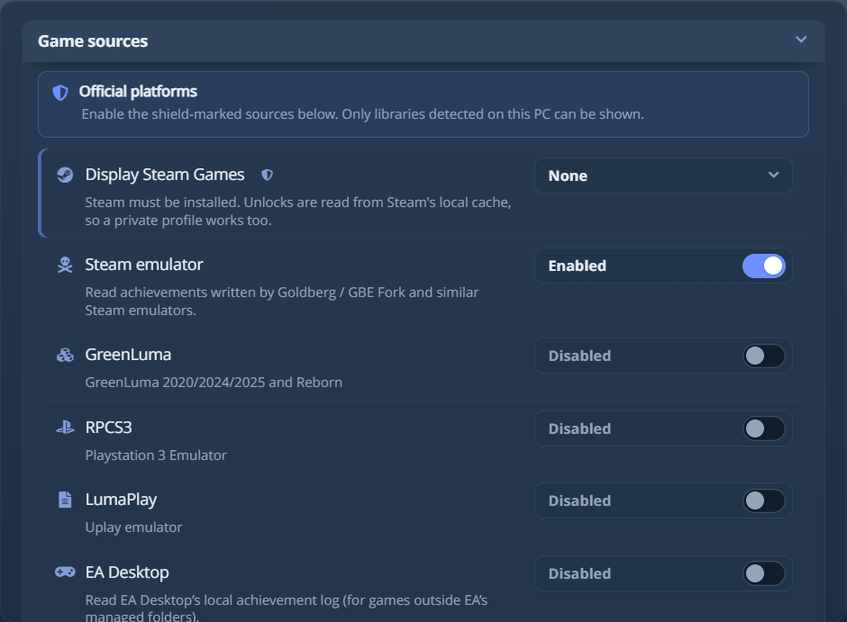
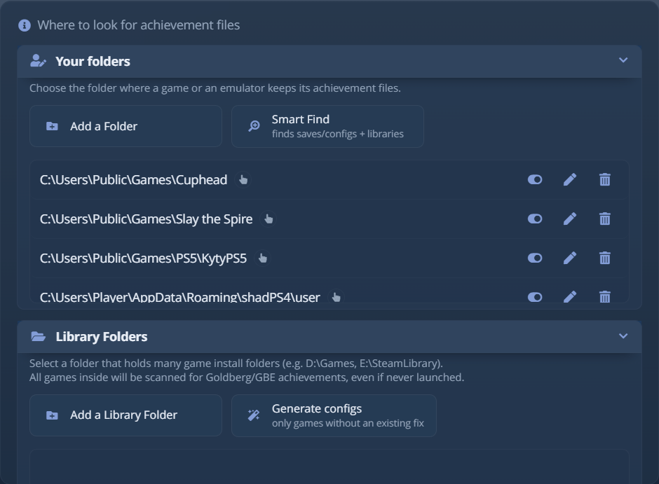
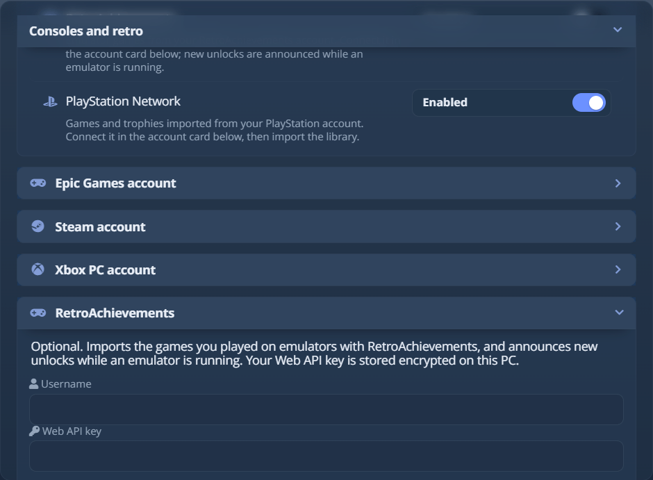

# Compatible sources

A **source** is one place AW Next reads achievements from: a launcher's local data, a Steam-compatible
save file, or a console emulator's trophy file. Each source has its own switch in **Settings →
Sources**.

<div align="center">
<picture><source srcset="assets/shot/sources-panel-800.webp 800w, assets/shot/sources-panel.webp 940w" sizes="(max-width: 700px) 100vw, 720px"></picture><br>
<sub>Each source is a separate switch; the shield marks the official desktop libraries</sub>
</div>

After enabling a source, refresh the library. Only libraries detected on this PC are shown.

## Official platform libraries

These read the launcher's own local data and carry a shield in Settings.

| Source | What AW Next reads | What it needs |
|---|---|---|
| **Steam** | Local appcache state, public-profile data, achievement schemas and product metadata | Steam installed; connecting an account is optional |
| **GOG Galaxy** | The Galaxy client's local databases, plus compatible legacy saves and UniverseLAN | GOG Galaxy installed, or a game running UniverseLAN |
| **Ubisoft Connect** | Native local data and legacy Uplay formats | Ubisoft Connect installed |
| **Epic Games** | Local installs, plus the games the account owns and their official achievement state once connected | The Epic Games launcher for local installs; an account connection for the rest |
| **Xbox PC** | Local Game Pass and Microsoft Store installs, plus the games the account owns and their Xbox Network state | The Xbox app for local installs; an account connection for the rest |

**Steam**, **Epic Games** and **Xbox PC** each have three settings: **None**, **Installed** (games on
this PC) or **Owned** (the whole library the account owns). **Owned** lists games that are not
installed here and needs the account connection below. **GOG Galaxy** offers **None**, **Installed**
or **Played**: Galaxy keeps the play data of a game after it is uninstalled, and **Played** still
lists those games.

**Steam libraries**, under the Steam account card, lists every Steam library folder on this PC. Switch
one off and its games leave the list, All games included, for example a drive you keep connected as
storage. They come back when you switch it on again.

> [!NOTE]
> Steam unlocks are read from the stats Steam keeps on this PC. A private profile, or private **Game
> details**, works for every game played here, including games added through SteamTools, LuaTools or
> GreenLuma, and a card updates the moment Steam records an unlock. A public profile only adds your
> name and avatar. Games played only on another PC need the account connection below. These unlocks
> raise an AW Next notification once **Steam client games** is enabled under Notification (see
> [Notifications](notifications.md#games-steam-runs)).

> [!NOTE]
> **EA Desktop** is different: it reads EA Desktop's local achievement log for games outside EA's
> managed folders, and does not import your regular EA library.

### Connected accounts

Steam, Epic, Xbox PC and PlayStation can each be connected from Settings to read what the local files
do not carry. Every token is encrypted before it is stored on this PC, and everything else works
without any account.

| Account | What connecting adds |
|---|---|
| **Steam** | Two switches, off by default and shown while the Steam source is **Owned**: **add the games you own** and **add the games shared with you through Steam Family**. They let a private profile, or one that never installed most of its library here, list the right games. Each makes the first scan noticeably longer, since every added game resolves its achievements and artwork once. A game with nothing to read locally is then read from your Steam profile, which needs its game details public; the answer is cached for six hours. **Hide games no longer in your Steam library** removes the leftovers, but never a game installed here or shared through Steam Family. You sign in on Valve's own page. |
| **Epic Games** | Your unlocked achievements and, with **Owned**, the whole library: each game with its full list, unlock state and rarity. A few owned games have achievements Epic's store data never lists (Shadow of the Tomb Raider, Civilization VI). They are still listed, from Nemirtingas' games-infos-datas, but without unlock state, which Epic does not share even when you are signed in. Names, descriptions and rarity of an installed game work without an account. |
| **Xbox PC** | Unlock state and rarity from Xbox Network for your library, cached locally. With **Owned** it also brings games the account has only played elsewhere. |
| **PlayStation** | Your PlayStation games and trophies, with Sony's own rate for each trophy, refreshed every three days in the background. A game you do not own can be added by name from Sony's catalog, and removed the same way. A game from any other source that also came out on PlayStation shows the real platinum of its list, and in trophy mode its real grades and DLC groups (see [Notifications](notifications.md#trophy-mode)). You sign in on Sony's own page. |

A tile carries a small badge for what the connection established: bought on that store, shared through
Steam Family, or no longer in your library.

## Steam-compatible saves

AW Next reads the achievement and stats files that Steam emulators write (`achievements.json`,
`achievements.ini`, `achievements.bin`, `stats.ini` and compatible layouts) from the places those
tools use. That covers **Goldberg** and **GBE Fork** (which AW Next can also install and repair),
**GreenLuma**, **LumaPlay**, **SmartSteamEmu**, **CreamAPI**, the **Nemirtingas** emulators and scene
releases with a compatible layout. For a game whose files are elsewhere, add the folder under
**Settings → Folders**.

<div align="center">
<picture><source srcset="assets/shot/folders-panel-800.webp 800w, assets/shot/folders-panel.webp 940w" sizes="(max-width: 700px) 100vw, 720px"></picture><br>
<sub>The folders AW Next checks on its own, and the ones you add - per-game saves or whole libraries</sub>
</div>

A portable CODEX, RUNE or CPY release normally writes to `%PUBLIC%\Documents\Steam\<SOURCE>\<appid>`,
but a portable copy keeps that tree inside the game folder, where nothing looks for it. Adding the
game's own folder under **Settings → Folders** is enough: its `steam_emu.ini` (or `cpy.ini`) names the
AppID, and the save tree is looked for beside it before the shared location. A game with no save yet
is still added, at 0%.

A release with no emulator config, or whose ini you deleted, works too: the save tree is read directly,
since `Steam\RUNE\<appid>` carries the AppID in its folder name. The same layouts are probed one level
below the folder you add, so you can point AW at a whole games library.

When a folder cannot be used, AW says why: it holds a game but no readable unlock file, it holds
nothing achievement related, or it is an **EA app** release. EA app releases keep achievements on the
EA account, not on disk, so they are read through the EA source and no folder you add can make them
appear. The message also says how many layouts were probed, which tells "nothing found" from "not
looked at".

Three cases have their own handling:

- **Goldberg SocialClub**: the Rockstar and Social Club variant, with its own switch.
- **RUNE Ubisoft Connect**: RUNE's Ubisoft emulator keeps `achievements.cfg` files under
  `Documents\RUNE\Ubisoft Connect\achievements`. They are found without adding a folder (adding a
  `RUNE\Ubisoft Connect` folder under **Settings → Folders** works too) and follow the Ubisoft
  Connect emulator switch. Names and icons come from Ubisoft Connect's list for the game; without it
  only achievement numbers show.
- **Uplay R2**: the Ubisoft equivalent of the Goldberg path, for compatible titles. It has no switch of
  its own: saves flow through the Steam emulator source, and its repair and loader tools are in
  **Settings → Emulators → Ubisoft / Uplay R1/R2**. See [Uplay R2 setup](uplay-r2.md).

If a game using one of these shows no achievements, its **Game Health** panel names the missing piece.
See [Game Health](game-health.md) and [Goldberg / GBE setup](emulator-setup.md).

## Console emulators

| Emulator | Console | Trophy / achievement file |
|---|---|---|
| **RPCS3** | PlayStation 3 | `TROPUSR.DAT` beside the trophy list |
| **ShadPS4** | PlayStation 4 | `TROP*.XML`, which holds the list and the earned state |
| **KytyPS5** | PlayStation 5 | `_Trophies\<title>\trophies_*.json` beside the emulator; the list comes from the game's `sce_sys\trophy2` package |
| **Xenia** | Xbox 360 | `.gpd`, which also holds both |

Each is watched live, so an unlock raises a notification like any other. RPCS3, ShadPS4 and Xenia can
move their data off the default path, and AW Next reads the settings the emulator reads:

- **RPCS3**: the trophy folder follows `vfs.yml` (including a `$(EmulatorDir)`-relative remap), a
  `portable` folder beside the executable, and `RPCS3_CONFIG_DIR`.
- **ShadPS4**: recognised whether you point at the emulator, its `user` folder, `game_data` itself, or
  (since 0.19) its `trophy` folder or `home\<user>\trophy`. Its config is read from either place
  shadPS4 has kept it.
- **Xenia**: follows `storage_root` and `content_root` in its config.
- **KytyPS5**: recognised whether you point at the emulator, its `_Trophies` folder or one game's
  folder. Games are looked up in the KytyPS5 launcher's game folders (`Kyty.ini`) and beside the
  emulator, unpacked or as a `.zar` archive. The trophy list lives in the game itself, so a game
  deleted after AW Next saw it stays listed as not installed, from the copy of its list and art kept
  then. A launcher game is listed before its first trophy. Only the active user counts: the one set
  for the game in the launcher, else the emulator's global user. With no user setting, every user's
  trophies are added.

So a relocated RPCS3 virtual disk or a ShadPS4 data folder can be added under **Settings → Folders**
directly, with no emulator executable nearby.

## RetroAchievements

Games played on any emulator that reports to RetroAchievements come from your account, not from a
file. Turn on the **RetroAchievements** source and fill in the account card under it: your username
and the **Web API key** from retroachievements.org/settings. The key is encrypted before it is stored
on this PC.

<div align="center">
<picture><source srcset="assets/shot/retroachievements-panel-800.webp 800w, assets/shot/retroachievements-panel.webp 940w" sizes="(max-width: 700px) 100vw, 720px"></picture><br>
<sub>The RetroAchievements switch, with the Epic and Steam account cards under it</sub>
</div>

**Import library** adds every game you played, with its achievements, unlock dates, points and rarity.
A second import fetches only the games whose progress moved, and a game played for the first time is
added on its own. New unlocks are announced within seconds while an emulator that reports to
RetroAchievements runs (RetroArch, DuckStation, PCSX2, PPSSPP, Dolphin, BizHawk, Project64 or any
other RA-integrated build, recognised by name or by the RetroAchievements dll beside it), and within a
few minutes otherwise.

AW Next reads unlocks from retroachievements.org, so RetroAchievements must stay on in the emulator:
turning it off there stops unlocks from being sent. To see only AW Next's notification, hide the
emulator's own pop-up. In RetroArch that is **Settings → Achievements → Visibility → Unlock
Notifications**. RetroBat rewrites `retroarch.cfg` at every launch, so close RetroBat and add this line
to `RetroBat\emulationstation\.emulationstation\es_settings.cfg`:

```xml
<string name="global.retroarch.cheevos_visibility_unlock" value="false" />
```

Use `cheevos_visibility_mastery` the same way for the mastery pop-up.

## Other sources

| Source | What it is |
|---|---|
| **Xbox 360 games recompiled for PC** | ReXGlue ports and similar keep their achievement list in an `achievements` folder (`.toml`, `.tsv`) or `SaveData\Achievements.json`, in the game folder or in `Documents\<game>`. The list comes from the game's own `default.xex`, in every language it ships, with secret achievements kept secret. [dbox.tools](https://dbox.tools) adds DLC achievements and Exophase the share of players per achievement. A list in `Documents` is found on its own; for one in the game folder, add that folder under **Settings → Folders** or use **Smart find**. Unlocks are notified live, playtime is tracked, and Reset achievements works. More than sixty known ports (Sonic Unleashed, Sonic the Hedgehog through Marathon Recompiled, Blue Dragon re:Blue, Lost Odyssey, Perfect Dark Zero, Fable II, Gears of War 2, Forza Motorsport 4, GoldenEye 007, Skate 2 and others) are listed from their executable before their first achievement. A port that keeps one list per profile is one game. The source follows the Xenia switch. |
| **PS4 games ported to PC** | Bloodborne, the Uncharted collection (one entry per game), God of War III Remastered, MediEvil and other ports built on the `run.py` runner. Also ports without it (Dragon's Crown Pro, inFAMOUS Second Son and First Light, The Last Guardian, Gravity Rush 2, Killzone Shadow Fall, Driveclub, Unicorn Overlord, Fist of the North Star: Lost Paradise, UFC 3, PROTOTYPE and PROTOTYPE 2 with one entry each, the PORTHEON UFC games), ports on BilalReloaded's runtime such as his Nathan Drake Collection port, and ports that write their own list, such as Crash Team Racing Nitro-Fueled. Add the port's folder under **Settings → Folders**. The trophy list, grades and icons come from the original game dump the port's launcher points to (`sce_sys\trophy`, even with an encrypted `npbind.dat`), or from the port's own `user\trophies\<title id>\trophies.tsv`. Unlocks come from whichever of `trophies.log`, `last_run.log`, `analysis\<name>-user\trophy\trophyNN.txt`, `progress_user<N>.txt`, `<title id>-user<N>.bin`, `trophies.dat` or `unlocked.txt` the port writes, with every profile merged, and are notified live. Rarity comes from Exophase's PS4 lists. Its switch is **PS4 Recomp**. |
| **Games for Windows LIVE** | XLiveLessNess installs. Each profile's unlock records are read, and the list, its texts and icons come from the game's own executable, so nothing is downloaded. DLC achievements come from each content pack's `spa.bin` under XLiveLessNess's `dlc\<title id>` folder. Watched live. |
| **Dead Space 2 MarkerPatch, Alice: Madness Returns MadnessPatch** | A Steam copy with the mod installed is found on its own. For any other copy, add the game folder under **Settings → Folders** (a folder inside it, such as `Binaries\Win32`, counts as the game folder) or let **Smart find** search your libraries. The list is built from the mod's own texts and images, and the unlocks it saves are notified live. Each has its own switch, and nothing is read while the mod's `AchievementSupport` is off. |
| **PC ports** | *The Legend of Zelda: Link's Awakening DX HD* (LADXHD Updated). Add the game folder under **Settings → Folders**. The 110 achievements, their texts in the game's languages and their pictures come from the install. Unlocks are read from `%LOCALAPPDATA%\Zelda_LA\achievements` (beside the game when it has a `portable.txt`). The file holds no dates, so an unlock is dated when it was seen. |
| **FINAL FANTASY VII (2013)** | This re-release predates Steamworks achievements and keeps its 36 unlocks in an 8-byte bitfield beside its saves, found in Documents without adding the folder. |
| **Remember seen unlocks** | Keeps a game listed after its save is gone, with the unlocks the background tracker saw. |
| **Manually added games** | A game added from a title and executable, with an optional platform and Steam AppID. See [Advanced tools](advanced.md#add-a-game-manually). |

## Steam metadata, without an API key

AW Next uses no Steam Web API key and no connected Steam account for this. Each game's list comes from
a keyless chain: the official `GetGameAchievements` endpoint first (hidden descriptions, icons, global
rarity and Steam's achievement sets), then the SteamCommunity achievements page (the same schema, in
your language), then SteamHunters, and a browser scrape only as a last resort.

As on Steam, an achievement the developer archived counts only if you earned it. Otherwise it is left
out of the list, the percentage and the platinum notification.

Results are cached per language in `%APPDATA%\Achievement Watcher Next\steam_cache\schema`, so local
sources and games seen before work offline.

Steam never announces that an update added achievements, so a cached list re-checks itself every 3
days and picks up new ones without removing any. To check at once, use **Settings → Advanced →
Recheck achievement lists**. **Automatic achievement data updates**, in the same place, turns the
periodic recheck off for anyone who maintains `steam_cache` by hand. The button still works.

DLC and update achievements carry the name of their group (for example *Hearts of Stone*) under the
title, taken from the same lookup.

## Sources you do not see

In **Simple** mode the Sources list folds away six niche rows: GreenLuma, LumaPlay, the two
Nemirtingas emulators (the GOG and Epic save readers), Goldberg SocialClub and the notification-cache
import. A row folds only while it is enabled and no game in your library came from it. Switch one off,
or own a game it detected, and the row returns, so the interface mode never hides the control that
would explain a missing game. **Advanced** always lists every source.

---

**Next:** [Notifications](notifications.md), to choose how unlocks are announced.

*Source-specific setup: [Goldberg / GBE](emulator-setup.md) · [Uplay R2](uplay-r2.md) ·
[Game Health](game-health.md)*

<div align="center">

[← Documentation](README.md) · [Project home](https://github.com/Shirowwww/Achievement-Watcher-Next)

</div>
