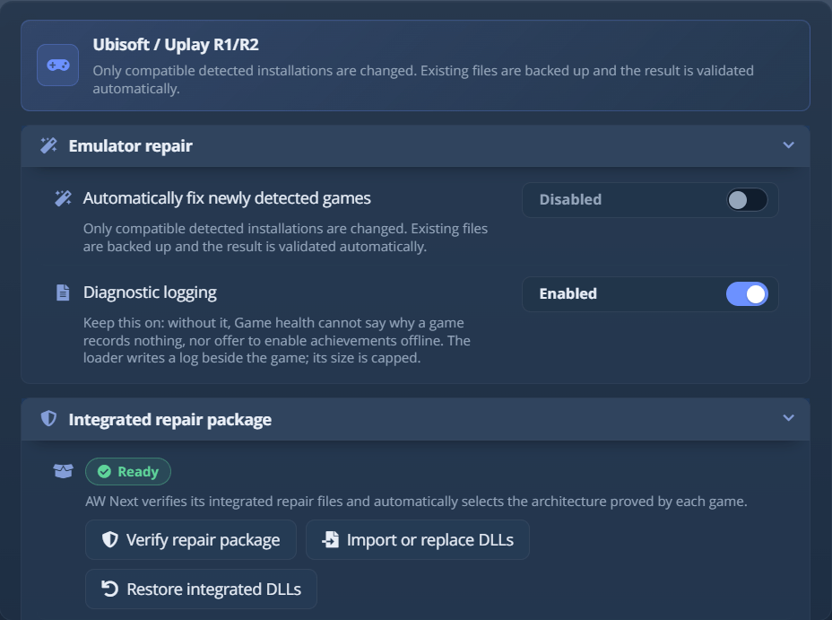

# Goldberg Uplay setup (R1 and R2)

AW Next has a separate repair for Ubisoft games running through the Goldberg Uplay emulator. It never
touches official Ubisoft Connect installs: a game is selected only once AW Next has proven the exact
loader and generation it uses.

A Ubisoft game loads only the loader generation its executable was linked against: roughly 2019
onward is **R2**, everything before is **R1**. AW Next detects and repairs whichever applies, since
the wrong generation would drop a DLL the game never opens. A Ubisoft game with two product ids (a
base game and its Complete Edition) works either way: a save under either id is read, and a bare
objective id inside it is matched against the Steam achievement list.

> [!WARNING]
> The repair changes game files. Use it only with games you own.

## Repair a game

From **Game Health**:

1. Add the game's library under **Settings → Folders** and scan it.
2. Open the game's **Game Health** panel and review **Diagnose Uplay R1/R2 setup**.
3. Run **Apply the Ubisoft achievement fix** and launch the game once.

From **Settings → Emulators → Ubisoft / Uplay R1/R2**:

<picture><source srcset="assets/shot/uplay-r2-panel-800.webp 800w, assets/shot/uplay-r2-panel.webp 928w" sizes="(max-width: 700px) 100vw, 720px"></picture> 
The integrated repair package is verified before any game is touched

- **Automatically fix newly detected games**: the switch also shown under Steam / GBE Fork, applied
  to Ubisoft games too. Off by default.
- **Repair detected Uplay R1/R2 games**: repairs every detected installation in one confirmed batch.
- **Import or replace DLLs** / **Restore integrated DLLs**: use your own loader build, or go back to
  the one AW Next ships. A manually selected DLL needs no known SHA-256 fingerprint, but it must be a
  valid achievement-capable Uplay loader with a coherent name and architecture.

The integrated DLLs are in `app/resources/uplayR2/` (R2) and `app/resources/uplayR1/` (R1). AW Next
checks their hashes, PE architecture and achievement capability before a repair may use them, and
keeps a recovery archive beside them.

The same repair transaction runs from the context menu, Game Health, automatic repair, Fix All and the
batch button. It snapshots every changed DLL, schema and INI under `<game>\.aw-backups\<timestamp>\`
and restores them automatically if validation fails afterward. Repeating an identical repair is a
no-op.

## Linking an unmapped game to its Steam release

AW Next matches most Ubisoft games to their Steam release on its own, to convert Steam achievement
names into the Ubisoft objective IDs the loader expects. When it cannot, choose the release yourself
with **Identify the game (Steam AppID)** in the game's right-click menu. A pairing that cannot be
confirmed is refused, because a wrong one would write another game's achievement list into this
game's folder.

Opening the game's achievements page in Ubisoft Connect once can help AW Next recognize a title that
needs it, such as Brawlhalla or The Crew 2. The choice you confirm is remembered for that exact
install folder. The automatic matching (the built-in map, the live Ubisoft catalogue and the
title-matching rule) is described in the [Uplay R1/R2 reference](uplay-reference.md).

## A game that never asks for an achievement

Some Ubisoft titles ask the loader for the Ubisoft session first, and the loader answers from an
empty key. Those games read the empty key as signed out and never call the achievement API. The setup
looks correct and nothing is recorded. Avatar: Frontiers of Pandora behaves this way.

When Game Health's diagnostic log proves that, it offers **Enable achievements offline** on the
Emulator setup check. It adds one placeholder session key beside the game: not a real Ubisoft
session, no account involved, nothing sent anywhere, just enough to pass that one check. It is never
added automatically, because a token that is not legitimate can break some games.

**Launch the game once after switching it on.** Until then the row reads *Offline achievements on,
launch the game once*. The button beside it then reads **Turn offline achievements off**, which takes
the key back out.

This applies to R2 loaders only; R1's INI carries an unrelated key. The [Goldberg / GBE guide](emulator-setup.md)
covers the Steam equivalent of this repair.

## Achievements remain at 0%

- Run **Diagnose Uplay R1/R2 setup** again after a game update, since updates often remove the schema
  or reset the unlock count.
- Read `upc_r2.log` (or `upc_r1.log`) beside the loader DLL: it records every objective number the
  game asks for. Keep **Diagnostic logging** on, in **Settings → Emulators → Ubisoft / Uplay R1/R2**.
  Game Health needs it to tell a game that never asked from one asking for an objective the schema
  does not carry. It is on by default, and AW Next trims the log once it passes 25 MB.
- Check `%APPDATA%\Achievement Watcher Next\logs\parser.log`.

## Antivirus note

If antivirus software removes a loose loader DLL, or quarantines the recovery archive mid-way, Game
Health reports an antivirus problem and offers to allow the folder and put the files back. You do not
need to find a replacement yourself.

Identity, objective IDs and the loader log are covered in the [Uplay R1/R2 reference](uplay-reference.md).

[← Documentation](README.md) · [Troubleshooting](troubleshooting.md) · [Project home](https://github.com/Shirowwww/Achievement-Watcher-Next)

