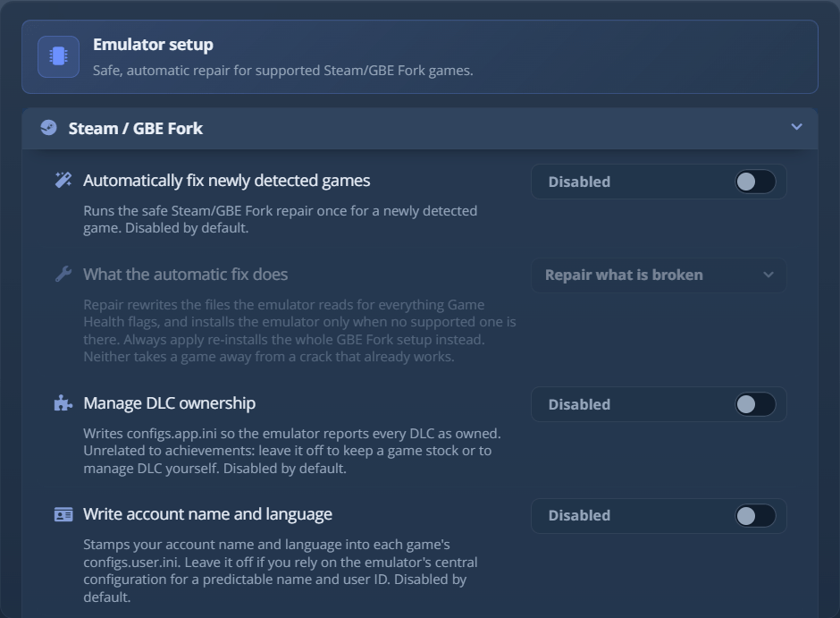
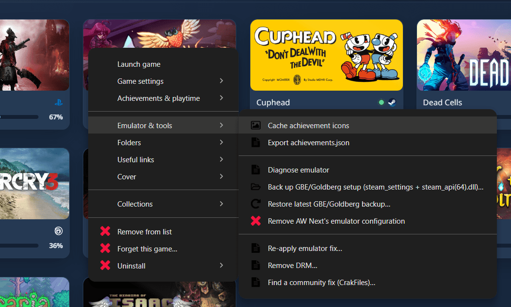

# Goldberg 和 GBE Fork 成就设置

AW Next 读取 Goldberg、GBE Fork 以及兼容的 Steam 模拟器布局生成的成就存档。
当架构、AppID 或运行时文件不完整时，它还可以诊断并修复游戏的本地模拟器配置。

## 如何通过 Goldberg 或 GBE Fork 获得成就通知？ {#how-do-i-get-achievement-notifications-with-goldberg-or-gbe-fork}

Goldberg 和 GBE Fork 是 Steam 模拟器：它们替代 Steam 库，并把解锁记录在
`%APPDATA%\GSE Saves\<appid>` 下的存档文件 `achievements.json` 中。游戏 `steam_settings` 文件夹中
同名的第二个文件只描述成就。AW Next 会读取两者，并在游戏上方显示
解锁弹窗。在 **设置 → 文件夹** 下添加游戏文件夹，运行 **智能查找**，
如果它停留在 0%，请右键单击游戏并选择 **诊断模拟器**。在你要求修复之前，
不会向游戏文件夹写入任何内容。

> [!WARNING]
> 修复工具是可选的。它们会修改所选游戏文件夹内的文件，所以请只对你拥有的游戏使用，
> 并为你在意的内容另做备份。

## 架构文件和存档文件是不同的 {#schema-and-save-files-are-different}

两个互不相关的文件通常都叫 `achievements.json`：

| | 架构文件 | 运行时存档文件 |
|---|---|---|
| 典型位置 | `<game>\steam_settings\achievements.json` | `%APPDATA%\GSE Saves\<appid>\achievements.json` 或 `%APPDATA%\Goldberg SteamEmu Saves\<appid>\achievements.json` |
| 由谁写入 | 游戏或模拟器设置 | 游戏运行时的模拟器 |
| 用途 | 成就的名称、说明和图标 | 哪些成就已解锁 |
| 缺失时 | 游戏内的成就处理可能不完整；AW Next 可以使用另一个架构来源 | 在写入第一个解锁之前，游戏显示 0% |

架构文件不能证明有任何内容已解锁，而没有已获得条目的运行时存档就是有效的
0%。同一款游戏可以同时存在两个存档文件夹：AW Next 会读取保存了解锁的那个。如果 GBE 或
Goldberg 配置把存档重定向到别处（`local_save_path`），AW Next 会监视存档
落入的文件夹。

## 推荐流程 {#recommended-workflow}

1. 在 **设置 → 文件夹** 下添加游戏库或存档根目录。
2. 运行 **智能查找** 或 **生成配置**。
3. 如果游戏显示数据缺失，请右键单击它并选择 **诊断模拟器**。
4. 在应用修复之前先阅读报告。
5. 使用 **应用模拟器修复…** 一并安装运行时 DLL 并修复 `steam_settings`。
6. 启动游戏，解锁一个成就，必要时刷新 AW Next。

对新发现游戏的自动设置需要在 **设置 → 模拟器 → Steam / GBE
Fork** 中主动开启。关闭时，游戏库扫描不会向游戏文件夹写入任何内容（没有 DLL，没有配置文件，
甚至没有缺失的 `achievements.json`），直到你要求修复。

<picture><source srcset="../assets/shot/steam-gbe-panel-800.webp 800w, ../assets/shot/steam-gbe-panel.webp 940w" sizes="(max-width: 700px) 100vw, 720px"></picture> 
自动修复、DLC 和身份开关，以及可选的 SteamStub 解包器

## 右键菜单操作 {#context-menu-actions}

<picture><source srcset="../assets/shot/emulator-tools-800.webp 800w, ../assets/shot/emulator-tools.webp 1049w" sizes="(max-width: 700px) 100vw, 560px"></picture> 
右键单击游戏 → 模拟器 &amp; 工具

### 诊断模拟器 {#diagnose-emulator}

报告检测到的模拟器类型、AppID、`steam_settings` 位置、架构和存档数量、缺失的
条目或图标、自定义存档路径和 AppID 不匹配，以及已安装的运行时是否是
AW Next 放在那里的。诊断是只读的。

### 应用模拟器修复… {#apply-emulator-fix}

一步修复运行时 DLL 和架构：

- 下载并缓存匹配的 GBE Fork 发布版，并安装游戏所需架构的 DLL
  （`steam_api.dll` 或 `steam_api64.dll`），任何现有文件都会保留为备份；
- 根据 Steam 成就列表构建 `steam_settings\achievements.json`（及其 `images` 文件夹），
  并下载图标；
- 缺少 `steam_appid.txt` 时写入它；
- 写入 GBE 配置文件（`configs.app.ini`、`configs.main.ini`、`configs.user.ini`）。

它替换的每个文件都会先备份，架构修复还会在
`steam_settings\.aw-backups` 下保留带时间戳的副本。运行时按普通 DLL 替换的方式安装；AW Next 不会
配置单独的 ColdClient 启动器。

打包的虚幻引擎游戏以同样的方式修复。它们的 Steam 文件位于
`Engine\Binaries\ThirdParty\Steamworks` 下，而不是可执行文件旁边，AW Next 会在那里查找、安装
并检查它们。

### DLC 所有权和账号身份 {#dlc-ownership-and-account-identity}

**设置 → 模拟器 → Steam / GBE Fork** 中的两个开关，默认都关闭，并且独立于
自动修复：

| 设置 | 写入的内容 |
|---|---|
| **管理 DLC 所有权** | `configs.app.ini`，使模拟器报告所有 DLC 均已拥有 |
| **写入账号名称和语言** | 你的账号名称和语言，写入 `configs.user.ini` |

两者都不影响成就。如果想让游戏保持原样，或者你手动管理 DLC 或身份，请让它们保持关闭。

它们下方的 **模拟器身份** 卡片显示将写入的内容：

| 字段 | 作用 |
|---|---|
| **账号名称** | 在 **写入账号名称和语言** 开启时写入。留空则使用你的 AW Next 个人资料名称。 |
| **Steam ID** | 在该开关开启时写入；留空则保留每款游戏自己的。骰子按钮会生成一个随机的有效 ID，输入错误会在你输入时被标出，且绝不会写入。 |
| **存档文件夹** | 选择后立即生效：此后修复或修复过的每款游戏都会保存到那里（`local_save_path`），AW Next 会监视它以发出实时通知。留空则保留 `%APPDATA%\GSE Saves`。 |

要撤销任一开关写入的内容，请右键单击游戏并选择 **移除 AW Next 的模拟器配置**。
它在执行任何操作之前会精确显示将要移除的内容。它只移除 AW Next 添加的 DLC
部分、开关和身份键，保留你或 repack 设置的每个值，并且
只有在文件中没有其他内容时才删除该文件。

### 使用你自己的模拟器 DLL {#using-your-own-emulator-dll}

**设置 → 模拟器 → 模拟器 DLL** 会导入你自己的 `steam_api.dll` 或 `steam_api64.dll`，
并在每次修复和每次自动修复时安装它，而不是下载的 GBE Fork 版本。你没有导入的
架构仍来自官方版本，界面工具也是如此。

导入的文件在每次使用时都会重新验证：它必须是名称所声明的架构的真实 PE，
并且必须是 Steam 模拟器 DLL。未通过的文件会被报告并忽略，绝不会
被安装。**使用官方版本** 会移除导入并回到下载的发布版。

### 移除 Steam DRM（Steamless） {#remove-steam-drm-steamless}

当 DLL 替换无法加载时，尝试从所选可执行文件中解包 SteamStub。原始
可执行文件会保留为 `*.steamstub.bak`。对没有 SteamStub 的游戏它什么也不做，也不会
绕过服务器端的所有权检查。

### 备份和恢复 {#back-up-and-restore}

右键单击 **备份 GBE/Goldberg 设置** 可为当前 DLL 和 `steam_settings` 文件创建快照，或用
**恢复最新的 GBE/Goldberg 备份…** 把其中一个恢复回来。如果文件夹中已经有 AW Next 写入的配置，
备份会注明，所以它绝不会被误认为未动过的原始状态。

## 手动设置 AppID {#set-appid-manually}

当游戏的文件夹名称匹配多个 Steam 发布版，而自动匹配选错了其中一个时，
右键单击它并选择 **手动设置 AppID**。AppID 会写入 `steam_appid.txt`，并
为该安装文件夹记住，所以以后的修复会使用它，而不是再次猜测。同一菜单中的 **清除
手动 AppID** 会移除它。

## 常见问题 {#common-problems}

### 游戏缺失 {#the-game-is-missing}

- 先启动一次模拟器，让它创建运行时存档，或添加真实的游戏库，以便发现过程能够
  找到 `steam_settings`、`steam_appid.txt` 或 Steam API DLL。
- 检查设置中添加的文件夹是否足够高，能够包含游戏文件夹，但又不是整个
  存放无关数据的驱动器。
- 运行 **生成配置** 并查看结果数量。

### 每个成就都保持锁定 {#every-achievement-remains-locked}

按顺序检查这些原因：

1. **尚未解锁任何内容。** 运行时存档不存在或为空是预期的。
2. **架构名称与存档键不匹配。** 运行 **诊断模拟器**，然后修复架构。
3. **存档路径被自定义。** 让 AW Next 指向实际的存档根目录，或移除占位的
   覆盖设置。
4. **AppID 有误。** 在运行另一次修复之前，先使用 **手动设置 AppID**。

### 说明或图标缺失 {#descriptions-or-icons-are-missing}

在启用图标下载的情况下运行完整修复。当在线元数据不可用时，AW Next 可以复用有效的
本地架构，但无法凭空创造任何来源都没有的说明。

### 游戏内通知缺失但游戏库会更新 {#in-game-notifications-are-missing-but-the-library-updates}

AW Next 读取的是运行时存档，但游戏自己的模拟器架构或叠加层可能不完整。请检查
`steam_settings\achievements.json` 与运行时存档的 API 名称是否相同，以及图标
路径是否有效。

## 限制 {#limitations}

有些游戏即使在 Steam 上销售，也根本不通过 Steamworks 报告成就，因而无法通过
Goldberg 或 GBE 的存档路径跟踪。AW Next 也无法修复其真实身份
或成就架构无法被安全解析的游戏。

[Goldberg/GBE 技术参考](../goldberg-gbe.md)介绍了文件格式、检测规则和
实现细节。

---

**下一页：** [Uplay 设置，R1 和 R2](uplay-r2.md)，适用于不加载
`steam_api.dll` 的游戏的 Ubisoft 对应方案。

[← 文档](README.md) · [技术参考](../goldberg-gbe.md) · [项目主页](https://github.com/Shirowwww/Achievement-Watcher-Next)

