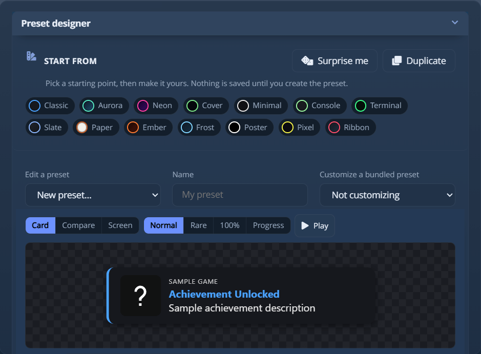
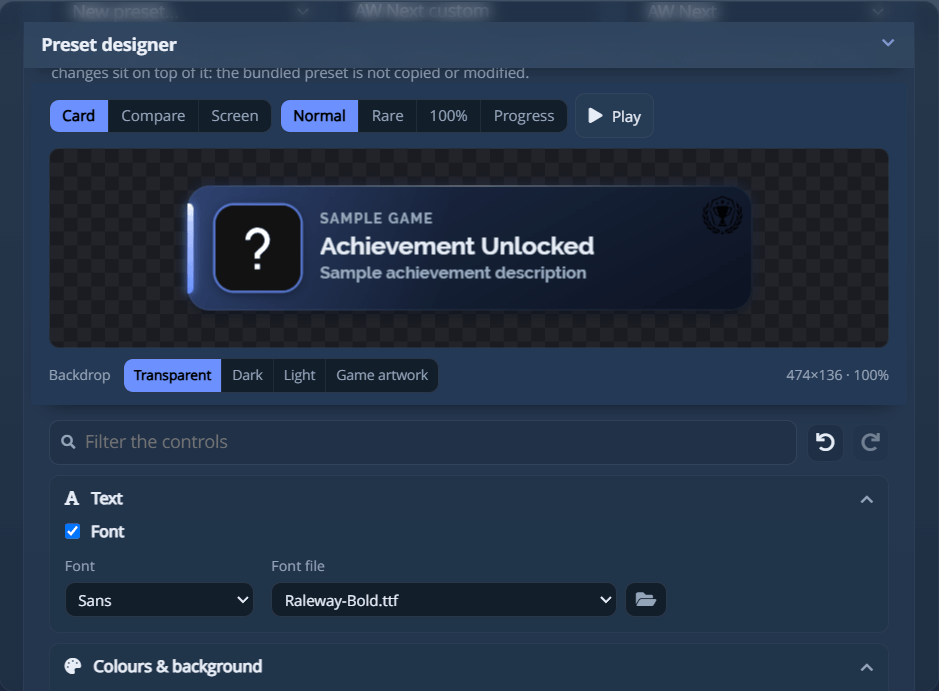

# 预设与预设设计器

**预设**是游戏内叠加层弹窗的外观：它的布局、颜色、动效，以及
它呈现稀有解锁或 100% 完成的方式。在 **设置 → 通知 → 预设** 中选择一个，
在 **设置 → 通知预设** 中设计你自己的，或导入别人分享给你的预设。
预设设置旁边的网格按钮会把每个预设显示为其卡片的图片：单击一个即可
使用它。

> [!NOTE]
> 预设为游戏内叠加层设定样式。当 **通知类型** 设为 *Windows 通知* 时，
> 预设所描述的任何内容都不会绘制，通知预设标签页也不会显示。

## 内置预设 {#the-bundled-presets}

AW Next 自带十个，每个都有自己的构图、字体、动效和颜色。

| 预设 | 说明 |
| --- | --- |
| **AW Next** | 默认。应用自己的配色，左边缘一条强调色条，带圆环的图标，成就上方显示游戏名称。 |
| **Steam Modern** | 深藏青色底板，文字后面有 Steam 标志，直角，从底边向上滑出。 |
| **Steam Original** | 复刻 Steam 客户端如今绘制的弹窗：石板色渐变、一个淡淡的超大 Steam 标志、方形图标，稀有解锁时只有一圈金色边框。 |
| **Epic Games** | 扁平、中性、方肩，是整套中边距最宽的，左边缘只有一条线。 |
| **PlayStation** | 主机的字体和从灰到黑的长面板，右侧圆环中有脉动的 PlayStation 标志。 |
| **Xbox** | 深色胶囊形，一道绿色弧线绕圆形图标扫过一圈，最后稳定成一个圆环。 |
| **Cover** | 以游戏美术图作背景，缓缓漂移，文字下方有遮罩，字号是整套中最大的。 |
| **Glass** | 半透明而安静：没有强调色条，在稀有或 100% 解锁带来颜色之前没有色彩。 |
| **Arcade** | 黑底荧光绿，等宽大写字体，带扫描线和硬边偏移。稀有解锁时切换为琥珀色。 |
| **Slim** | 纯黑底的矮款：与其他预设同宽、只有一半高度，专为在 OLED 面板上“消失”而设计。 |

所有预设宽度相同，所以切换预设绝不会让弹窗左右移动。

### 每个预设都会绘制的四种状态 {#the-four-states-every-preset-draws}

| 状态 | 外观 |
| --- | --- |
| **普通** | 预设自己的强调色。 |
| **稀有** | 5% 及以下为金色，不超过 10% 为银色，不超过 15% 为铜色（上限可在 **设置 → 常规 → 稀有度阈值** 中更改），外加卡片上印出的解锁率、更强的光晕和额外的边缘。 |
| **100%完成** | 冷色调、更明亮的处理，边框加倍。 |
| **进度** | 带有 `current/max - %` 标签的进度条。 |

你选择的预设会自己绘制稀有和 100%，所以预设设置只有一个，而不是三个。针对每个模拟器的
覆盖设置保留在 **设置 → 通知 → 模拟器**（高级模式）下：Xenia、
RPCS3、shadPS4 和 Kyty 都可以使用各自的预设和声音。

预设使用通知标签页中选择的声音，除非它自己设置了声音，所以更改外观
不会改变你听到的内容。分享的预设可以自带声音：见
[分享预设](#share-a-preset)。通知标签页中的 **不透明度**（30% 到 100%）决定
弹窗的透明程度。

> [!NOTE]
> 以前名称发布的预设仍然可以解析：`Shirow`/`Default`/`Midnight`/`xqjan` 对应
> **AW Next**，`Steam` 对应 **Steam Modern**，`PS4`/`PS5 enhanced` 对应 **PlayStation**，
> `Xbox 360`/`Xbox One` 对应 **Xbox**，`Game Cover`/`Sunset` 对应 **Cover**，`Clean`/`Modern`/`Smooth Pop` 对应 **Glass**，
> `Neon Future`/`LAZ0RBOX` 对应 **Arcade**，社区的 `ArmsofGod`、`Epic Preset`
> 和 `mudoss` 对应 **Pantheon**、**Onyx** 和 **Outline**。社区的 **Hexagon** 和 **Indiana**
> 已被移除，它们和 `TigerDX Award` 会回退到 **AW Next**。你自己的预设如果与这些
> 名称之一相同，会优先于替代项使用。

## 设计你自己的预设 {#design-your-own}

设计器有自己的标签页 **设置 → 通知预设**，也可以通过预设设置旁边的工具
按钮进入。一切都用普通控件设置：无需编辑 CSS、JSON 或文件。

<div align="center">
<picture><source srcset="../assets/shot/notification-preset-panel-800.webp 800w, ../assets/shot/notification-preset-panel.webp 939w" sizes="(max-width: 700px) 100vw, 720px"></picture><br>
<sub>从一个完整的设计开始，然后在真实弹窗的实时预览下调整，预览会在控件滚动时一直留在屏幕上</sub>
</div>

### 起点 {#starting-points}

第一行有十四个完整的设计：*Classic*、*Aurora*、*Neon*、*Cover*、*Minimal*、
*Console*、*Terminal*、*Slate*、*Paper*（唯一的浅色设计）、*Ember*、*Frost*、*Poster*、*Pixel*
和 *Ribbon*。每个都只是一组普通的控件值，所以选一个等同于手动移动每个
控件：可以保留它，也可以把它作为基础。

| 操作 | 作用 |
| --- | --- |
| **随机生成** | 生成一个你没试过的设计：先选一种卡片类型（扁平、渐变、霓虹、覆盖美术图、玻璃质感、终端或浅色），再在该类型允许的范围内随机设置每个控件。 |
| **复制** | 保留当前设计并释放名称，这样下一次 **创建预设** 会添加一个新预设，而不是替换它的来源。 |

在你按下 **创建预设** 之前，不会保存任何内容。

### 预览 {#the-preview}

预览就是通知本身，由与游戏中相同的页面、样式和引擎绘制。控件滚动时，
它会固定在面板顶部。

| 控件 | 显示内容 |
| --- | --- |
| **卡片** | 弹窗的原始大小。像素尺寸和预览缩放显示在其下方。 |
| **对比** | 同时显示全部四种通知，两行两列。 |
| **屏幕** | 在模拟显示器上显示弹窗，分辨率为 **720p**、**1080p**、**1440p** 或 **4K**，采用真实的相对大小，位于通知设定出现的角落。 |
| **普通 / 稀有 / 100% / 进度** | 预设必须看起来正确的四种通知。在 **对比** 中，你选的那个以完整强度绘制。 |
| **播放** | 按预设自己的时间播放一次进入、停留和退出。 |
| **背景** | 用来评判弹窗的背景：透明、暗色场景、亮色场景，或你游戏库中的美术图。 |
| **位置 / 大小** | 对应并可更改通知标签页中的同名设置。仅在 **屏幕** 视图中显示。你手动放置的弹窗会绘制在底部中央并加上标注。 |

### 熟悉界面 {#finding-your-way-around}

设计器有九个分组、六十多个控件，带有筛选框和撤销历史。

| | 作用 |
| --- | --- |
| **筛选框** | 在分组上方的框中输入，只保留匹配的控件。它搜索标签、下拉列表中的词和属性自身的名称，所以 `corner` 和 `radius` 都能找到同一个滑块，从 `.awpreset` 中读到的名称也能找到对应的控件。位于 **高级** 内的匹配会将其展开。**Esc** 清空输入框。 |
| **撤销 / 重做** | 筛选框旁边的两个箭头，或 **Ctrl+Z** 和 **Ctrl+Y**（**Ctrl+Shift+Z** 也可以）。拖动一次滑块算一步。加载预设、选择起点或按下“重置”会开始新的历史。 |

**布局与尺寸** 和 **颜色与背景** 默认展开；其他分组单击后展开，大多数
带有用于微调的 **高级** 折叠区。

### 控件 {#the-controls}

在 **简易** 界面模式下，不显示高级部分。

| 分组 | 涵盖内容 |
| --- | --- |
| **布局与尺寸** | 图标位于左侧、右侧、文字上方或没有图标；文字对齐；弹窗宽度、内边距和间距；以及是否在成就上方显示**游戏名称**。 |
| **文字** | 字体（五种字体族之一，或**你自己的字体文件**：TTF、OTF、WOFF 或 WOFF2，最大 4 MB，会复制到预设中）、标题和说明的字号、说明最多可换行的行数，以及标题颜色。在高级中：标题字重、大写、字间距、文字阴影，以及每个字形的描边。 |
| **颜色与背景** | 纯色、带角度的双色渐变、**游戏自己的美术图**，或**你自己的图片**（会复制到预设中），经过变暗、模糊并加框后放在文字后面。另外还有文字颜色、强调色和不透明度。在高级中，有叠在背景之上、文字之下的**纹理**（网格、圆点、斜线或斑点）。 |
| **图标** | 大小、**形状**（圆角方形、圆形、超椭圆、六边形或菱形），以及在高级中，强调色的边框和光晕。圆角只适用于圆角方形。**徽标**（PNG、JPEG、GIF、WebP 或 BMP，最大 5 MB）可以放在文字后面的角落或某一边的中间，并设置大小和与边缘的距离；它与字体一样会复制到预设中。 |
| **边框与圆角** | 圆角半径、哪一边带有强调色条（或完整轮廓，或没有）及其粗细；在高级中，有你自己颜色的边框。 |
| **阴影与光晕** | 投影深度、强调色光晕，以及弹窗在屏幕上时该光晕是否**脉动**或**呼吸**。 |
| **动画与时长** | 弹窗从哪一边进入、向哪一边退出（或淡入淡出，或缩放）以及停留多久。在高级中：移动距离、进入和退出速度、进入曲线（平滑、线性、回弹、柔和、急停或弹性）以及**退出曲线**。 |
| **稀有与全成就** | 稀有解锁和 100% 的颜色与光晕、铺满整张卡片的**状态色调**、是否显示进度条，以及**稀有度徽章**是否印出解锁率。在高级中：进度条粗细、银色和铜色等级，以及隐藏成就标题前的**挂锁**。 |
| **声音** | 此预设播放的声音，取代通知标签页中的那个。保持 **应用设置** 则表示不设置。 |

| 操作 | 作用 |
| --- | --- |
| **在屏幕上显示** | 把设计渲染为真实的叠加层弹窗，以完整大小、在配置的位置、按预览所示的状态显示，而不保存。 |
| **创建预设** | 保存它，并将其选为当前预设。 |
| **更新预设** | 当名称与设计器创建的预设相同时，同一个按钮会变成这样：它替换该预设，而不是再添加一个。 |
| **编辑预设** | 把你生成的某个预设按保存时的每个值重新加载到控件中。 |
| **重置** | 让控件恢复为默认设计。磁盘上的内容不会改变。 |
| **重命名** | 加载了生成的预设后出现。在名称框中输入新名称并按下它：预设会在磁盘上重命名，指向它的通知设置也会随之更新。 |
| **删除** | 加载了生成的预设后出现，确认后将其删除。 |
| **导出** / **导入** | 在机器之间转移预设：见[分享预设](#share-a-preset)。 |

只有此设计器生成的预设才能重新打开或删除：它把设置保存在生成文件旁边的
`aw-preset.json` 中，正是这个文件让预设可编辑。内置的和
手写的预设绝不会被改动。

> [!NOTE]
> 你已经制作的预设会保持其生成时的文件。在设计器中打开并保存它
> 会应用当前的默认值，其中包括稀有解锁和 100% 完成时重新绘制整个
> 弹窗。

> [!NOTE]
> 你创建的预设存放在 `%APPDATA%\Achievement Watcher Next\presets\Users Presets`，而不是
> 安装文件夹中，并且在应用更新后依然保留。

### 布局编辑器 {#the-layout-editor}

预览下方的 **编辑器** 会全屏打开设计：卡片在中间，其图层在
左侧，所选对象的设置在右侧。拖动卡片上的任何内容可移动它，拖动
角可调整大小，用圆形手柄可旋转。首次打开时，一个简短的导览会显示
各部分的位置；**?** 会列出所有快捷键，并可重新播放导览。

| | 作用 |
| --- | --- |
| **添加** | 文字、图片、矩形、椭圆、线条，或**图标**（奖杯、奖牌、皇冠、星星，另有八种）。每一个都是独立的图层。 |
| **动画图片** | GIF 或动画 WebP（最大 5 MB）会在卡片上播放。**每次弹窗时重播 GIF** 会在弹窗每次显示时从第一帧开始。 |
| **弹窗用语** | 文字中可以包含 `{game}`、`{title}`、`{detail}`、`{rarity}` 和 `{tier}`：文字框下方的按钮会插入它们，弹窗会把游戏名称、成就、其说明、解锁率或其等级的名称放在它们的位置。 |
| **填充** | 形状或图标可以用颜色、渐变、圆形渐变、弹窗等级的颜色（它会随卡片变为铜色、银色或金色），或无论弹窗是什么都固定为某一等级的颜色来填充。 |
| **形状** | 星形有顶点数和深度，箭头有箭头和箭杆，三角形有一个沿底边滑动的顶点。除椭圆外的每种形状都可以有圆角，轮廓或线条可以是虚线或点线，形状、图标或图片可以镜像翻转。图片可以裁剪成这些形状中的任何一种。 |
| **镂空** | 线条以外的形状可以切换为镂空。它本身不绘制任何内容：叠在它下面的所有东西，包括卡片、其图标和文字以及下方的元素，都会在它所在的位置被切掉，于是桌面会透过这个洞显示出来。它上方的元素保持不变。镂空形状保持静止，并且在内置预设上不提供该开关。 |
| **阴影与光晕** | 文字、形状或图标可以投下阴影或发光，颜色可以是黑色、弹窗等级的颜色或你自己的颜色。 |
| **一次一种状态** | 编辑器针对预览所示的状态（普通、铜、银、金、100% 或进度）工作。**编辑：全部** 会对所有状态更改该元素；**编辑：仅金色**（或当前显示的状态）只对该状态更改，从颜色到位置都可以，而此时添加的元素只会出现在该状态中。**可见** 以同样的方式隐藏或显示元素，所以只在金色解锁时显示的皇冠，就是在金色以外处处关闭的一个图标。对所选元素有专属设置的状态会这样注明，而 **恢复为基础** 会让它重新跟随其他状态。卡片的各个部分（标题、图标、说明）也以同样的方式工作。 |
| **进入与循环** | 卡片出现后元素如何进入（淡入、上升、下落、从一侧、缩放、弹出、抖动或闪烁；文字还可以自己打出来，稀有度或进度文字会向上计数）以及延迟多久，然后是它在弹窗显示期间是否继续运动：脉动、漂浮、摆动、旋转或闪光。你在编辑时编辑器保持静止；**播放** 会显示动效。 |
| **时间轴** | 编辑器底部的一条横栏显示每个元素何时进入、持续多久。拖动一个条可移动或拉伸其进入，按 **播放** 观看卡片，或沿标尺拖动以停在某一时刻。在动画设置改变之前它保持折叠。 |
| **文本框** | 标题、说明和游戏行可以改写，并各自拥有一个框：填充、内边距、圆角和轮廓。进度条有粗细和轨道颜色，图标可以是方形。 |
| **位置与大小** | 可输入 X、Y、宽度和高度的数值，另有六个按钮，可将元素与卡片的边缘或中心对齐。 |
| **图层** | 眼睛图标隐藏元素。挂锁将其固定在原处：解锁之前无法移动、调整大小或删除，单击会穿过它。箭头改变叠放顺序。 |
| **一次多个** | **Shift** 或 **Ctrl** + 单击可将元素加入选择或从中移除，从空白处拖动会选中框所触及的全部内容，**Ctrl+A** 选中全部。这一组作为一个整体移动，与卡片或自身对齐，并可一次性复制、拷贝或删除。 |
| **复制与粘贴** | **Ctrl+C** 和 **Ctrl+V** 复制所选内容，也可以复制到另一个预设中。取色器会提供设计中已使用过的颜色。 |

在此版本之前制作的预设文件仍然可用，不使用其中任何功能的预设，外观和
导出结果与以前一样。

## 自定义内置预设 {#customize-a-bundled-preset}

设计器顶部的 **自定义预设** 从应用自带的预设开始。该预设的任何内容都不会被复制或
编辑：你保存的图层只有几行指明它的内容，外加
你更改的值，叠加在原样发布的内置预设之上。如果以后的版本改进了
内置预设，你的图层也会随之改进。

勾选要更改的部分：**背景**（颜色或渐变）、**文字颜色**、**强调色**、
**边框**、**光晕**、**字体**（五种字体族之一或你自己的字体文件）和 **徽标**。
这些控件从内置预设自己的颜色开始。预览和 **在屏幕上显示**
显示的是叠加了你的图层的内置预设。

<div align="center">
<picture><source srcset="../assets/shot/preset-customize-panel-800.webp 800w, ../assets/shot/preset-customize-panel.webp 939w" sizes="(max-width: 700px) 100vw, 720px"></picture><br>
<sub>带有自己字体文件和右上角徽标的 AW Next：只有勾选的部分会改变</sub>
</div>

- 它适用于 **默认预设** 列表中的预设，这些预设绘制的都是同一张卡片。社区
  预设（Batman、Onyx、Outline 等）绘制自己的布局，不提供此功能。
- 图层无法导出为 `.awpreset`，因为它只存在于创建它的那个安装的
  内置预设之上。要分享设计，请用设计器构建。
- **OBS 浏览器源** 会忽略图层，改为显示默认预设。
- 弹窗保持内置预设的窗口大小，所以较大的光晕或边框可能被裁切。

## 从 Steam Achievement Notifier 导入主题 {#import-a-theme-from-steam-achievement-notifier}

**Steam Achievement Notifier**（SAN）的主题可以完整迁移。AW Next 用
SAN 自己的卡片布局绘制导入的主题，所以它的外观和动效与在 SAN 中一致：全部十一种布局，
采用 SAN 的文字大小和主题自己的缩放设置。**通知预设** 标签页中的两个按钮
用来导入主题：

- **导入 SAN 主题** 读取一个 `.san` 文件，或 SAN 已解压的主题中的
  `usertheme.json`，连同旁边的图片和声音。
- **从此电脑上的 SAN 导入** 在此处安装了 SAN 时读取 SAN 自己的设置，并一次性导入
  这台电脑上保存的所有主题。正在使用的四个主题（普通、半稀有、稀有和 100%）
  合并为一个预设 `SAN - <theme name>`，像在 SAN 中一样在它们之间切换，其他每个
  保存的主题各成为一个预设。再次运行会刷新这些预设，而不是添加
  副本，并且绝不会改动与之重名的你自己的预设。

已安装的 SAN 预设会自行重建。

### 会迁移的内容 {#what-comes-across}

主题包含的一切：每项设置、它的图片（背景、遮罩、徽标和装饰、
图标边框、百分比徽章、隐藏成就图标）、它的字体，以及它的声音（每种状态一个，或
SAN 从中随机挑选的文件夹）。预设带着这一切，所以之后不再需要 SAN，
并且可以导出为 `.awpreset`。

它的外观是 SAN 的，而不是设计器滑块的：**编辑预设** 会把它显示为一张图片，下方的面板
提供两个选项。

- **奖杯图片**，用于绘制铜、银、金三种奖杯的主题：*跟随等级*
  显示与解锁相符的那个，或者选一种颜色让它始终显示。
- **按等级的主题** 用另一个导入的 SAN 主题（包括其声音）绘制一个等级，所以金色
  解锁可以与铜色解锁看起来完全不同。

其他任何内容都在 SAN 中更改，然后重新导入。

通知获得的状态遵循你在 AW Next 中的稀有度设置。100% 完成使用 SAN 的
100% 卡片。在稀有模式下，金色和银色使用它的稀有卡片，铜色使用它的半稀有卡片；在奖杯
模式下，金、银、铜分别使用稀有、半稀有和普通。在 AW
Next 中选择的稀有或 100% 声音优先于主题自己的声音，弹窗的位置和大小来自 **通知** 标签页。

导入后的报告会列出未能迁移的内容：主题提到但没有带来的文件、
被拒绝的图片或字体，以及此版本尚不能绘制的较新 SAN 的设置。它
也会写入应用日志。

### 安装之前会检查什么 {#what-is-checked-before-anything-is-installed}

适用 `.awpreset` 的规则，因为主题文件来自别人的机器。其中的任何内容
都不会被运行或求值；只读取它的 `usertheme.json`。每个路径都会对照它所在的
包进行检查，SAN 写入的绝对路径只会被当作文件名读取。只会提取图片、
字体和音频，按文件类型并受大小限制；可能运行脚本的 SVG
和不是字体的文件都会被拒绝。每项设置都会检查类型和范围。导入失败时，
你已有的所有预设都不会受到影响。

## 分享预设 {#share-a-preset}

**通知预设** 标签页中的 **导出** 和 **导入** 把预设作为一个
`.awpreset` 文件在机器之间转移：样式、它使用的每张图片和字体、设计器设置及其元数据。

[预设库](../gallery/)收集了这些文件：可以浏览、下载一个并导入，或添加
你自己的。投稿必须满足什么要求，以及列出之前会检查什么，见
[社区库](community-galleries.md)。

**导出** 会以 **名称** 字段中的名称写出卡片当前显示的内容：控件中的设计，
无论是否已保存，所以进行中的预设无需先创建就可以分享。在 **编辑预设** 中选中的已导入
预设会直接从磁盘原样导出，因为它的外观存在于控件
无法描述的文件中。只有预设本身会被传递：没有你机器上的路径，没有账号名称，也没有
你的任何设置。

**导入** 会请求文件、检查它，并将其安装到 `presets\Users Presets`。如果名称
已被你的某个预设或内置预设占用，你可以选择 **两者都保留**（导入的会以
`Name (2)` 的名称出现）或 **替换**。在你回答之前不会写入任何内容。

导入的预设会出现在 **编辑预设** 中并被选中，可以从那里再次导出或删除。
设计器制作的预设会完整地回来，以便继续编辑。手写的预设
的外观来自控件无法重现的文件，所以控件保持不变，名称
字段保持为空。

### 安装之前会检查什么 {#what-is-checked-before-anything-is-installed-1}

包会被整体验证，在以下情况下会被整体拒绝，绝不会只安装一部分：

- 它不是预设包，或者其清单缺失或格式有误；
- 它需要比当前运行版本更新的 AW Next，或更新的包格式；
- 它带有格式未描述的文件：程序、脚本，或位于
  `preset/` 和 `sounds/` 之外的任何内容；
- 其中任何路径指向它自己文件夹之外。

在检查或安装期间，包内的任何内容都不会被运行或求值。预设的页面
稍后在与内置预设相同的沙盒通知窗口中渲染。

### 包里有什么 {#what-a-package-contains}

```text
manifest.json     name, description, author, version, tags, format version,
                  minimum AW Next version, and the designer settings
preset/           index.html, style.css, images and fonts (relative paths only)
sounds/           optional audio, added to your sound list on import
```

清单会作为 `aw-package.json` 保存在已安装预设旁边。它告诉应用该预设
是导入的，可以再次删除，并把说明和署名带入下一次导出。

你自己导入的声音会随预设一起传递；内置声音则不会，因为清单
只写出了它的名称，而每个安装都有它。导入绝不会更改你选择的声音，也绝不会
覆盖你已有的声音：同名的不同文件会以 `name (2)` 的名称出现。

可选的 `author` 字段只会根据预设自己的文件填写，所以除非你自己写入，
否则不会向你署名任何内容。

---

**下一页：** [叠加层](overlay.md) - 游戏内的成就列表，与这些弹窗是分开的。

<div align="center">

[← 文档](README.md) · [通知](notifications.md) · [项目主页](https://github.com/Shirowwww/Achievement-Watcher-Next)

</div>
