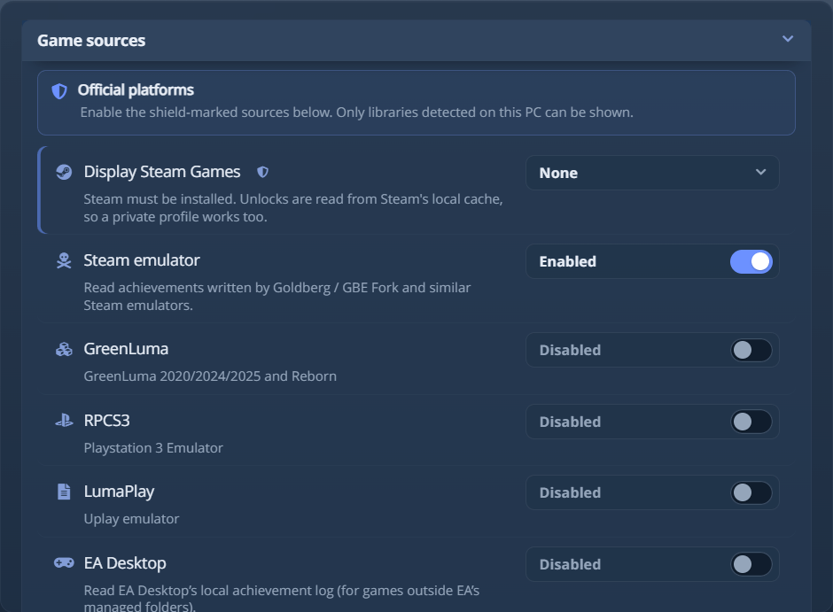
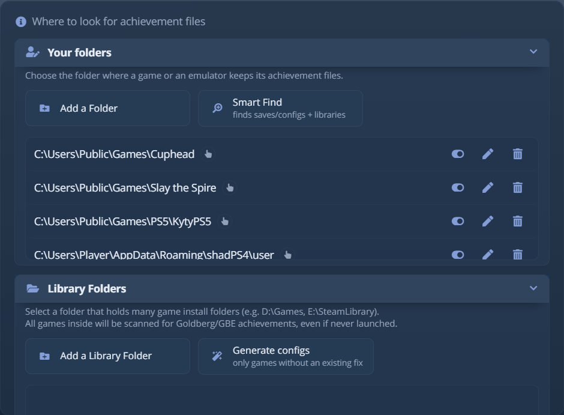
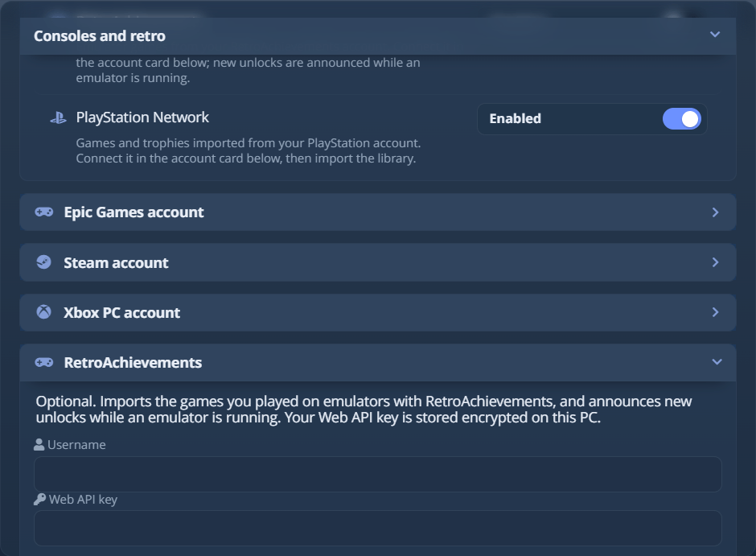

# 兼容的来源

**来源**是 AW Next 读取成就的一个地方：启动器的本地数据、与 Steam 兼容的
存档文件，或主机模拟器的奖杯文件。每个来源在 **设置 →
来源** 中都有各自的开关。

AW Next 可以读取 Steam、GOG Galaxy、Ubisoft Connect、Epic Games、Xbox PC、EA Desktop 的本地成就
日志、RetroAchievements、主机模拟器，以及 Goldberg、GBE
Fork、CODEX、RUNE 和 CPY 等 Steam 模拟器的存档文件。它不需要 Steam Web API 密钥，也不需要账号。

<div align="center">
<picture><source srcset="../assets/shot/sources-panel-800.webp 800w, ../assets/shot/sources-panel.webp 940w" sizes="(max-width: 700px) 100vw, 720px"></picture><br>
<sub>每个来源都是单独的开关；盾牌图标标出官方桌面游戏库</sub>
</div>

启用来源后，请刷新游戏库。只会显示在这台电脑上检测到的游戏库。

## 官方平台游戏库 {#official-platform-libraries}

这些来源读取启动器自己的本地数据，并在设置中带有盾牌图标。

| 来源 | AW Next 读取的内容 | 需要什么 |
|---|---|---|
| **Steam** | 本地 appcache 状态、公开个人资料数据、成就架构和产品元数据 | 已安装 Steam；连接账号是可选的 |
| **GOG Galaxy** | Galaxy 客户端的本地数据库，以及兼容的旧版存档和 UniverseLAN | 已安装 GOG Galaxy，或运行 UniverseLAN 的游戏 |
| **Ubisoft Connect** | 原生本地数据和旧版 Uplay 格式 | 已安装 Ubisoft Connect |
| **Epic Games** | 本地安装，以及连接后账号拥有的游戏及其官方成就状态 | 本地安装需要 Epic Games 启动器；其余需要连接账号 |
| **Xbox PC** | 本地 Game Pass 和 Microsoft Store 安装，以及账号拥有的游戏及其 Xbox Network 状态 | 本地安装需要 Xbox 应用；其余需要连接账号 |
| **Rockstar Games Launcher** | 它安装的游戏，以及其 Steam 版本的成就列表，连接账号后还有它们的解锁状态 | 已安装 Rockstar Games Launcher；解锁状态需要连接账号 |

**Steam**、**Epic Games** 和 **Xbox PC** 各有三种设置：**无**、**已安装**（这台电脑上的
游戏）或 **拥有**（账号拥有的整个游戏库）。**拥有** 会列出未安装在本机的游戏，
并且需要下面的账号连接。**GOG Galaxy** 提供 **无**、**已安装**
或 **已玩过**：Galaxy 在游戏卸载后仍保留其游玩数据，**已玩过** 仍会
列出这些游戏。

Steam 账号卡片下的 **Steam 库** 列出这台电脑上的每个 Steam 库文件夹。关闭
其中一个，它的游戏就会从列表中消失，包括“所有游戏”，比如你一直连着作为
存储用的驱动器。重新开启后它们会回来。

> [!NOTE]
> Steam 解锁记录是从 Steam 保存在这台电脑上的统计数据中读取的。私密个人资料或私密的**游戏详情**
> 对在这里玩过的每款游戏都有效，包括通过 SteamTools、LuaTools 或
> GreenLuma 添加的游戏，并且 Steam 一记录解锁，卡片就会更新。公开个人资料只会增加
> 你的名称和头像。只在另一台电脑上玩过的游戏需要下面的账号连接。启用通知设置中的 **Steam 客户端游戏** 后，这些解锁会
> 触发 AW Next 通知（见
> [通知](notifications.md#games-steam-runs)）。

> [!NOTE]
> **EA Desktop** 有所不同：它读取 EA Desktop 的本地成就日志，用于 EA 托管文件夹之外的游戏，
> 并且不会导入你常规的 EA 游戏库。

> [!NOTE]
> **Rockstar Games Launcher** 的游戏在你连接 Rockstar Games 账号之前，会把所有成就显示为未解锁。Social Club 把你已解锁的成就保存在用账号密钥加密的文件中，所以 AW Next 改为向 Rockstar 查询。

### 已连接的账号 {#connected-accounts}

Steam、Epic、Xbox PC、PlayStation 和 Rockstar Games 都可以在设置中连接，以读取本地文件
没有的内容。每个令牌在保存到这台电脑之前都会加密，其余功能无需
任何账号即可使用。

| 账号 | 连接后增加的内容 |
|---|---|
| **Steam** | 两个开关，默认关闭，当 Steam 来源设为 **拥有** 时显示：**添加你拥有的游戏** 和 **添加通过 Steam 家庭与你共享的游戏**。它们让私密个人资料，或从未在这里安装大部分游戏库的个人资料，也能列出正确的游戏。每个开关都会让首次扫描明显变长，因为每个添加的游戏都要解析一次成就和美术资源。本地没有可读内容的游戏随后会从你的 Steam 个人资料读取，这需要游戏详情公开；结果会缓存六小时。**隐藏已不在你的 Steam 库中的游戏** 会清除残留项，但绝不会隐藏安装在本机或通过 Steam 家庭共享的游戏。你在 Valve 自己的页面登录。 |
| **Epic Games** | 你已解锁的成就，以及设为 **拥有** 时的整个游戏库：每款游戏的完整列表、解锁状态和稀有度。少数拥有的游戏有 Epic 商店数据从未列出的成就（Shadow of the Tomb Raider、Civilization VI）。它们仍会从 Nemirtingas 的 games-infos-datas 列出，但没有解锁状态，即使你已登录，Epic 也不会共享这一信息。已安装游戏的名称、说明和稀有度无需账号即可使用。 |
| **Xbox PC** | 你的游戏库在 Xbox Network 上的解锁状态和稀有度，并在本地缓存。设为 **拥有** 时，还会带来账号只在其他设备上玩过的游戏。 |
| **PlayStation** | 你的 PlayStation 游戏和奖杯，附带 Sony 自己提供的每个奖杯的获得率，每三天在后台刷新一次。你没有的游戏可以按名称从 Sony 的目录添加，也可以用同样的方式移除。来自任何其他来源、同时也在 PlayStation 上发售的游戏，会显示其列表真实的白金，在奖杯模式下还会显示真实的等级和 DLC 分组（见[通知](notifications.md#trophy-mode)）。你在 Sony 自己的页面登录。 |
| **Rockstar Games** | Rockstar Games Launcher 所安装游戏的解锁状态和解锁日期。Rockstar 给成就编了号，AW Next 用启动器保存在 `Documents\Rockstar Games\Social Club\Titles` 的列表为它们命名：列表在那里缺失的游戏会保持全部未解锁。已在 GTA V 的两个版本上验证。你在 Rockstar 自己的页面登录，登录后留下的会话会加密保存，用于续期令牌。 |

磁贴上有一个小徽章，表示连接确认的信息：在该商店购买、通过
Steam 家庭共享，或已不在你的游戏库中。

## 与 Steam 兼容的存档 {#steam-compatible-saves}

AW Next 会从这些工具使用的位置，读取 Steam 模拟器写入的成就和统计文件（`achievements.json`、
`achievements.ini`、`achievements.bin`、`stats.ini` 以及兼容的布局）。这涵盖 **Goldberg** 和 **GBE Fork**（AW Next 也可以安装和修复它们）、
**GreenLuma**、**LumaPlay**、**SmartSteamEmu**、**CreamAPI**、**Nemirtingas** 模拟器，以及
布局兼容的 scene 发布版。文件位于其他位置的游戏，请在
**设置 → 文件夹** 中添加该文件夹。

<div align="center">
<picture><source srcset="../assets/shot/folders-panel-800.webp 800w, ../assets/shot/folders-panel.webp 940w" sizes="(max-width: 700px) 100vw, 720px"></picture><br>
<sub>AW Next 自己检查的文件夹，以及你添加的文件夹 - 单个游戏的存档或整个游戏库</sub>
</div>

便携版 CODEX、RUNE 或 CPY 发布版通常写入 `%PUBLIC%\Documents\Steam\<SOURCE>\<appid>`，
但便携副本会把这棵目录树放在游戏文件夹内，那里没有任何程序会去找。
在 **设置 → 文件夹** 中添加游戏自己的文件夹就够了：其 `steam_emu.ini`（或 `cpy.ini`）会指明
AppID，并且会先在它旁边查找存档目录树，再去共享位置。尚无存档的游戏
仍会被添加，进度为 0%。

没有模拟器配置的发布版，或你删除了 ini 的发布版，同样可以使用：存档目录树会被直接读取，
因为 `Steam\RUNE\<appid>` 的文件夹名中带有 AppID。在你添加的文件夹下一层，
也会探测相同的布局，所以你可以让 AW 指向整个游戏库。

当文件夹无法使用时，AW 会说明原因：其中有游戏但没有可读的解锁文件，其中
没有任何与成就相关的内容，或者它是 **EA app** 发布版。EA app 发布版把成就保存在
EA 账号上，而不是磁盘上，所以它们通过 EA 来源读取，无论添加哪个文件夹都无法
让它们出现。提示中还会说明探测了多少种布局，这样就能区分“什么也没找到”和“没有
查找”。

有三种情况另有处理：

- **Goldberg SocialClub**：Rockstar 和 Social Club 变体，有自己的开关。
- **RUNE Ubisoft Connect**：RUNE 的 Ubisoft 模拟器把 `achievements.cfg` 文件保存在
  `Documents\RUNE\Ubisoft Connect\achievements`。无需添加文件夹即可找到它们（在 **设置 → 文件夹** 下添加
  `RUNE\Ubisoft Connect` 文件夹同样有效），并遵循 Ubisoft
  Connect 模拟器开关。名称和图标来自 Ubisoft Connect 中该游戏的列表；没有它时
  只显示成就编号。
- **Uplay R2**：Goldberg 路径的 Ubisoft 对应方案，适用于兼容的游戏。它没有自己的
  开关：存档通过 Steam 模拟器来源传递，其修复和加载器工具位于
  **设置 → 模拟器 → Ubisoft / Uplay R1/R2**。请参阅 [Uplay R2 设置](uplay-r2.md)。

如果使用其中某种方式的游戏没有显示成就，它的 **游戏状态** 面板会指出缺少什么。
请参阅[游戏状态](game-health.md)和 [Goldberg / GBE 设置](emulator-setup.md)。

## 主机模拟器 {#console-emulators}

| 模拟器 | 主机 | 奖杯 / 成就文件 |
|---|---|---|
| **RPCS3** | PlayStation 3 | 奖杯列表旁边的 `TROPUSR.DAT` |
| **ShadPS4** | PlayStation 4 | `TROP*.XML`，其中保存列表和已获得状态 |
| **KytyPS5** | PlayStation 5 | 模拟器旁边的 `_Trophies\<title>\trophies_*.json`；列表来自游戏的 `sce_sys\trophy2` 包 |
| **Xenia** | Xbox 360 | `.gpd`，同样保存两者 |

每一种都会被实时监视，所以解锁会像其他来源一样触发通知。RPCS3、ShadPS4 和 Xenia 可以
把数据移出默认路径，AW Next 会读取模拟器所读取的设置：

- **RPCS3**：奖杯文件夹遵循 `vfs.yml`（包括相对 `$(EmulatorDir)` 的重映射）、
  可执行文件旁边的 `portable` 文件夹，以及 `RPCS3_CONFIG_DIR`。
- **ShadPS4**：无论你指向模拟器、它的 `user` 文件夹、`game_data` 本身，还是
  （自 0.19 起）它的 `trophy` 文件夹或 `home\<user>\trophy`，都能识别。它的配置会从
  shadPS4 保存过的两个位置中的任意一个读取。
- **Xenia**：遵循其配置中的 `storage_root` 和 `content_root`。
- **KytyPS5**：无论你指向模拟器、它的 `_Trophies` 文件夹，还是某个游戏的
  文件夹，都能识别。游戏会在 KytyPS5 启动器的游戏文件夹（`Kyty.ini`）和模拟器旁边
  查找，无论是已解压的还是 `.zar` 压缩包。奖杯列表保存在游戏本身里，所以
  在 AW Next 见到之后被删除的游戏，仍会作为未安装列出，使用当时保存的
  列表和图片副本。启动器中的游戏在获得第一个奖杯之前就会列出。只计算当前
  用户：启动器中为该游戏设置的用户，否则是模拟器的全局用户。没有用户设置时，会添加
  所有用户的奖杯。

因此，迁移过的 RPCS3 虚拟磁盘或 ShadPS4 数据文件夹可以直接添加到 **设置 → 文件夹**，
附近不需要有模拟器的可执行文件。

## RetroAchievements {#retroachievements}

在任何向 RetroAchievements 报告的模拟器上玩的游戏，来自你的账号，而不是
文件。打开 **RetroAchievements** 来源，并填写其下的账号卡片：你的用户名
和来自 retroachievements.org/settings 的 **Web API 密钥**。密钥在保存到
这台电脑之前会加密。

<div align="center">
<picture><source srcset="../assets/shot/retroachievements-panel-800.webp 800w, ../assets/shot/retroachievements-panel.webp 940w" sizes="(max-width: 700px) 100vw, 720px"></picture><br>
<sub>RetroAchievements 开关，其下是 Epic 和 Steam 账号卡片</sub>
</div>

**导入游戏库** 会添加你玩过的每款游戏，包括成就、解锁日期、点数和稀有度。
再次导入只获取进度有变化的游戏，第一次玩的游戏会
自动添加。在向 RetroAchievements 报告的模拟器运行期间，新的解锁会在几秒内提示
（RetroArch、DuckStation、PCSX2、PPSSPP、Dolphin、BizHawk、Project64 或任何
其他集成了 RA 的版本，通过名称或旁边的 RetroAchievements dll 识别），其他情况下在
几分钟内提示。

AW Next 从 retroachievements.org 读取解锁记录，所以模拟器中的 RetroAchievements 必须保持开启：
在那里关闭它会使解锁无法发送。若只想看到 AW Next 的通知，请隐藏
模拟器自己的弹窗。在 RetroArch 中，位置是 **Settings → Achievements → Visibility → Unlock
Notifications**。RetroBat 每次启动都会重写 `retroarch.cfg`，所以请关闭 RetroBat，并把这一行添加到
`RetroBat\emulationstation\.emulationstation\es_settings.cfg`：

```xml
<string name="global.retroarch.cheevos_visibility_unlock" value="false" />
```

对于精通弹窗，以同样方式使用 `cheevos_visibility_mastery`。

## 其他来源 {#other-sources}

| 来源 | 说明 |
|---|---|
| **为 PC 重新编译的 Xbox 360 游戏** | ReXGlue 移植版及类似项目把成就列表保存在 `achievements` 文件夹（`.toml`、`.tsv`）或 `SaveData\Achievements.json` 中，位于游戏文件夹或 `Documents\<game>`。列表来自游戏自己的 `default.xex`，涵盖其附带的所有语言，隐藏成就保持隐藏。[dbox.tools](https://dbox.tools) 补充 DLC 成就，Exophase 补充每个成就的玩家占比。`Documents` 中的列表会自动找到；对于位于游戏文件夹中的列表，**智能查找** 会在你的游戏库中根据可执行文件找到已知的移植版，早于它的第一个成就；其他位置请在 **设置 → 文件夹** 下添加该文件夹。解锁会实时提示，游戏时长会被记录，重置成就也可用。八十多个已知的移植版（Sonic Unleashed、通过 Marathon Recompiled 的 Sonic the Hedgehog、Blue Dragon re:Blue、Lost Odyssey、Perfect Dark Zero、Fable II、Gears of War 2、Forza Motorsport 4、GoldenEye 007、Skate 2、Marvel Ultimate Alliance、Eternal Sonata、Trials 合集等）在第一个成就出现之前就会根据可执行文件列出。每个配置文件各有一份列表的移植版算作一款游戏。该来源遵循 Xenia 开关。 |
| **移植到 PC 的 PS4 游戏** | Bloodborne、Uncharted 合集（每款游戏一项）、God of War III Remastered、MediEvil 以及其他基于 `run.py` 运行器构建的移植版。还有不使用它的移植版（Dragon's Crown Pro、inFAMOUS Second Son 和 First Light、The Last Guardian、Gravity Rush 2、Killzone Shadow Fall、Driveclub、Unicorn Overlord、Fist of the North Star: Lost Paradise、UFC 3、PROTOTYPE 和 PROTOTYPE 2 各一项、PORTHEON UFC 游戏）、基于 BilalReloaded 运行时的移植版（如他的 Nathan Drake Collection 移植版、Odin Sphere Leifthrasir 和 13 Sentinels: Aegis Rim、ReCasted（Ratchet & Clank，其 `trophies\trophies.log` 位于自己的文件夹中，白金奖杯在其余 46 个奖杯到手后授予）），以及自行写入列表的移植版（如 Crash Team Racing Nitro-Fueled）。**智能查找** 会在你的游戏库中根据移植版自身的文件（`run.py`、`trophy.key`、ReCasted 的 `rcps4-probe.exe`）找到它，也会在 Quiver Launcher 安装的游戏中查找；其他位置请在 **设置 → 文件夹** 下添加移植版的文件夹。奖杯列表、等级和图标来自移植版启动器所指向的原始游戏转储（`sce_sys\trophy`，即使 `npbind.dat` 已加密），或来自移植版自己的 `user\trophies\<title id>\trophies.tsv`。解锁记录来自移植版写入的 `trophies.log`、`last_run.log`、`analysis\<name>-user\trophy\trophyNN.txt`、`progress_user<N>.txt`、`<title id>-user<N>.bin`、`trophies.dat` 或 `unlocked.txt` 中的任意一个，并合并所有配置文件，会实时提示。稀有度来自 Exophase 的 PS4 列表。它的开关是 **PS4 Recomp**。 |
| **Games for Windows LIVE** | XLiveLessNess 安装。会读取每个配置文件的解锁记录，列表、文本和图标来自游戏自己的可执行文件，因此不会下载任何内容。DLC 成就来自 XLiveLessNess 的 `dlc\<title id>` 文件夹下每个内容包的 `spa.bin`。实时监视。 |
| **Dead Space 2 MarkerPatch、Alice: Madness Returns MadnessPatch** | 安装了该模组的 Steam 版会自动找到。对于其他任何版本，请在 **设置 → 文件夹** 下添加游戏文件夹（其中的文件夹，如 `Binaries\Win32`，也算作游戏文件夹），或让 **智能查找** 搜索你的游戏库。列表由模组自己的文本和图片构建，它保存的解锁会实时提示。每个都有自己的开关，在模组的 `AchievementSupport` 关闭时不会读取任何内容。 |
| **PC 移植版** | *The Legend of Zelda: Link's Awakening DX HD*（LADXHD Updated）。请在 **设置 → 文件夹** 下添加游戏文件夹。110 个成就、游戏各语言的文本及其图片都来自安装内容。解锁记录从 `%LOCALAPPDATA%\Zelda_LA\achievements` 读取（游戏带有 `portable.txt` 时则在游戏旁边）。该文件不含日期，所以解锁日期以看到它的时间为准。 |
| **重新编译的 PC 移植版** | *Twilight Princess*（Dusklight）、*Super Mario 64*（Ghostship）、*Diddy Kong Racing*（DKR-R）、*Super Mario Bros. Remastered*、带有 Super Mario Eclipse 模组的 *Super Mario Sunshine*（SMS Launcher）、*Super Mario All-Stars*（Darhkfox 的 PC 移植版）、*Road Rash 64 Recompiled*、*F-Zero X*（G-Diffuser），以及 *Pikmin* 和 *Pikmin 2*（Open Nectar）。这些移植版把成就列表内置在游戏中，所以 AW Next 自带每份列表，为英文，取自移植版的源码。成就图片来自 SMS Launcher 自己的文件夹，或从 Ghostship、Super Mario Bros. Remastered 和 Road Rash 64 的仓库获取一次；其他移植版用代码绘制图片，所以它们的成就显示游戏图标。移植版可通过 `%APPDATA%` 或 `%LOCALAPPDATA%` 下的解锁文件（`TwilitRealm\Dusklight`、`DKRPort`、`SMB1R`、`sms-launcher`、`RoadRash64Recompiled`）、Quiver Launcher（3 或 4 版）安装的游戏，**智能查找** 在你的游戏库中根据可执行文件找到的，或 **设置 → 文件夹** 下它的文件夹找到。Ghostship、Super Mario All-Stars、G-Diffuser 和 Open Nectar 把存档保存在游戏旁边，所以需要后三种方式之一；添加 Open Nectar 的文件夹时，也会找到其 `pikmin2` 文件夹中的 Pikmin 2。便携安装（`portable.txt`，或 Dusklight 的 `data_location.json`）会在其写入的位置读取。DKR-R、SMS Launcher、Super Mario All-Stars 和 G-Diffuser 会保留每次解锁的日期；其他的解锁日期以看到它的时间为准。在 Linux 上，原生版本从 `~/.local/share` 和 `~/.config` 读取，Windows 版本从其 Wine 或 Proton 前缀读取。它们共用 PC 移植版开关。 |
| **FINAL FANTASY VII (2013)** | 这个重新发行版早于 Steamworks 成就，它把 36 个解锁保存在存档旁边的一个 8 字节位字段中，无需添加文件夹即可在 Documents 中找到。 |
| **记住已见的成就** | 在存档消失后仍保留游戏在列表中，并保留后台跟踪器见到的解锁。 |
| **手动添加的游戏** | 根据标题和可执行文件添加的游戏，可选择平台和 Steam AppID。请参阅[高级工具](advanced.md#add-a-game-manually)。 |

## 不需要 API 密钥的 Steam 元数据 {#steam-metadata-without-an-api-key}

为此，AW Next 既不使用 Steam Web API 密钥，也不使用已连接的 Steam 账号。每款游戏的列表来自
无需密钥的链路：先是官方的 `GetGameAchievements` 端点（隐藏说明、图标、全球
稀有度和 Steam 的成就集），然后是 SteamCommunity 成就页面（同样的架构，使用
你的语言），再是 SteamHunters，最后才是浏览器抓取。

与 Steam 一样，开发者已归档的成就只有在你获得过时才会计入。否则它会从
列表、百分比和白金通知中排除。

结果按语言缓存在 `%APPDATA%\Achievement Watcher Next\steam_cache\schema`，所以本地
来源和以前见过的游戏在离线时也能使用。

Steam 从不宣布某次更新添加了成就，所以缓存的列表每 3
天重新检查一次，并在不移除任何成就的前提下获取新增的成就。若要立即检查，请使用 **设置 → 高级 →
重新检查成就列表**。同一位置的 **成就数据自动更新** 可为手动维护 `steam_cache` 的用户
关闭定期重新检查。按钮仍然可用。

DLC 和更新成就在标题下带有其分组名称（例如 *Hearts of Stone*），
取自同一次查询。

## 你看不到的来源 {#sources-you-do-not-see}

在 **简易** 模式下，来源列表会折叠六个小众行：GreenLuma、LumaPlay、两个
Nemirtingas 模拟器（GOG 和 Epic 存档读取器）、Goldberg SocialClub 和通知缓存
导入。只有当一行已启用，且你游戏库中没有任何游戏来自它时才会折叠。关闭它，
或拥有它检测到的游戏，这一行就会回来，所以界面模式绝不会隐藏那个
能解释缺失游戏的控件。**高级** 始终列出所有来源。

---

**下一页：** [通知](notifications.md)，选择如何提示解锁。

*特定来源的设置：[Goldberg / GBE](emulator-setup.md) · [Uplay R2](uplay-r2.md) ·
[游戏状态](game-health.md)*

<div align="center">

[← 文档](README.md) · [项目主页](https://github.com/Shirowwww/Achievement-Watcher-Next)

</div>
